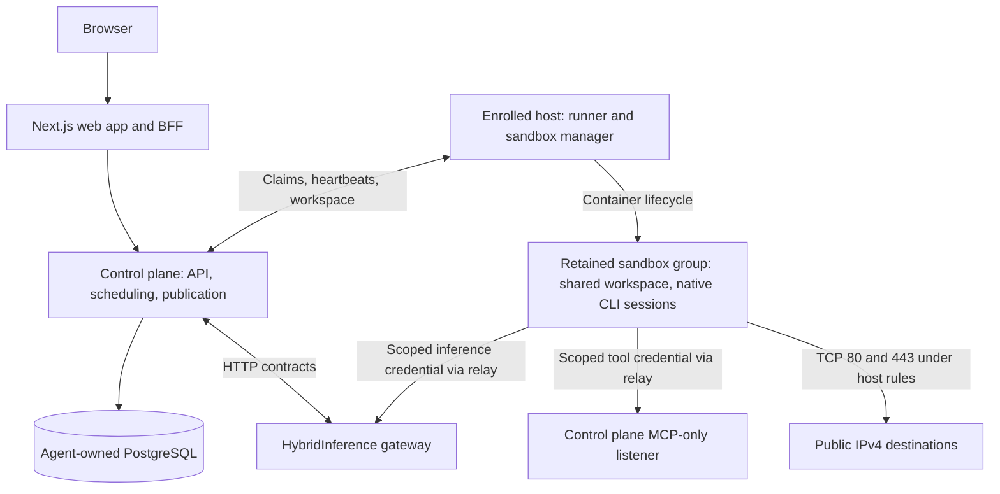

# HybridInference Cloud Agent

[](https://github.com/HarvardMadSys/hybridInference-cloud-agent/actions/workflows/ci.yml?query=branch%3Adev)
[](LICENSE)


Self-hosted coding agents that work on your repositories in isolated, retained
sandboxes.

Users give tasks from a web interface. Enrolled hosts run Claude Code, Codex,
pi, OpenCode, or Kilo against the repository, each in its own native session
inside a sandbox that survives between turns. The control plane schedules the
work, streams it to the browser, and publishes the result as a pull request.
Model access, quotas, and account identity come from a
[HybridInference gateway](https://github.com/HarvardMadSys/hybridInference),
reached over HTTP only.

<!-- TODO: add a screenshot of a chat with its workspace pane. -->

## Features

- **Five agent CLIs, run natively.** Claude Code, Codex, pi, OpenCode, and Kilo
  run as their own CLIs at pinned versions, with their own sessions, tools, and
  plugins.
- **Retained sandboxes.** A chat keeps its container, workspace, and native CLI
  session between turns, so a follow-up continues the same session instead of
  replaying a transcript.
- **Fork.** Branch a chat into a second chat that shares the workspace and runs
  in parallel with its own process and credentials.
- **Pull requests.** When the owner asks, never on its own, the platform
  publishes a workspace to its branch as a draft pull request, after a secret
  scan and path checks; asking again updates it. Agents can also push
  and open pull requests themselves with a short-lived, repository-scoped token.
  **Review** starts an independent reviewer; **Watch PR and merge** follows
  checks and reviews until the pull request merges.
- **Reusable environments.** Configure a repository's variables, secrets, setup
  scripts, and actions once, test them, and reuse them in new workspaces.
- **Per-user MCP tools.** Each user connects their own MCP servers; sandboxes
  reach them through a scoped relay, with approvals for held tool calls.
- **Workspace tools.** Browse and open files, run a terminal, rewrite a draft
  prompt, receive desktop notifications, and keep personal and project memory.
- **Administration.** Manage settings, integrations, sandboxes, hosts, and
  optional server provisioning from an admin dashboard.
- **Isolation.** Each sandbox group runs under Kata Containers with its own
  guest kernel, non-root members, and a network limited to public HTTP(S), one
  DNS resolver, and its relays.

## Status

Cloud Agent is under active development. Releases are immutable artifacts built
from a commit; there are no versioned releases yet, and configuration and APIs
can change between commits. [ENVIRONMENT.md](ENVIRONMENT.md) marks new and
removed settings. [FreeInference](https://freeinference.org) runs a hosted
deployment at [agents.freeinference.org](https://agents.freeinference.org).

## Quick start

Run the complete stack on one machine with Docker 28+, Docker Compose,
`openssl`, `curl`, and Python 3:

```bash
./deploy/local/dev.sh up
./deploy/local/dev.sh smoke
```

Open <http://127.0.0.1:13002>. The stack includes the web app, OAuth flow,
control plane, database, an enrolled host, and all five pinned agent CLIs.
`./deploy/local/dev.sh stop` stops it and keeps its database and sandboxes for
the next start.

The local stack uses a gateway fixture that returns deterministic responses, so
it needs no gateway or provider key. It verifies integration and the session
lifecycle, not model quality or production isolation. To run agents against
real models, deploy Cloud Agent against a HybridInference gateway: follow
[Running self-hosted](docs/developer/operations.md#running-self-hosted) and
[Before a job can run for real](docs/developer/operations.md#before-a-job-can-run-for-real).
The [local guide](deploy/local/README.md) covers configuration, logs, and
parallel stacks.

To work on the code, install Python 3.12 and [uv](https://github.com/astral-sh/uv):

```bash
make setup-dev
make check   # format, lint, type-check, and test the backend
```

The frontend uses Node.js 22; the
[developer guide](docs/developer/development.md#run-the-relevant-checks) lists
the checks for each area.

## How it works



The web app, control plane, and hosts are deployed separately. A host enrolls
once, then claims work and reports its capacity through heartbeats. A **job**
records a user task; an **attempt** is one execution of it on one host, under a
lease that fences out stale writes.

A new chat creates a retained container with one member. Its writable layer
holds the workspace and the CLI's native state, so follow-ups reach the live CLI
process, or resume its native session in a replacement process. Fork adds a
member to the same group. See
[native conversation recall](docs/developer/context-recall.md) for the context
states and their limits.

The gateway owns accounts, model permissions, and inference quotas; there is no
per-task dollar budget. Cloud Agent shares no database, code, or signing secret
with it and uses only the
[documented contracts](gateway_contracts/README.md). Sandboxes never hold a
long-lived credential: they receive short-lived inference grants, a scoped MCP
token, and, when the GitHub App is configured, an hour-long token for the job's
repository. A grant can still be replayed until it expires or is revoked, within
the owner's model permissions and quota. Read [SECURITY.md](SECURITY.md) and the
[sandbox network runbook](docs/developer/operations.md#the-sandbox-network)
before deploying for untrusted users.

## Documentation

| If you want to | Read |
|---|---|
| Set up a checkout and run checks | [Developer guide](docs/developer/development.md) |
| Find the module that owns a change | [Code structure](docs/developer/code-structure.md) |
| Deploy and operate a self-hosted instance | [Operations runbook](docs/developer/operations.md) |
| Look up a configuration value | [ENVIRONMENT.md](ENVIRONMENT.md) |
| Build and deploy a release | [Release guide](deploy/release/README.md) |
| Learn how a user feature works | [User notes](docs/user/) |
| Browse everything, including designs and reviews | [Documentation index](docs/README.md) |

`make docs` builds the [developer documentation](docs/developer/index.md) as a
website.

## Repository layout

```text
apps/backend/cloud_agent/         FastAPI control plane and PostgreSQL storage
apps/backend/cloud_agent_host/    Host runner, sandboxes, sandbox manager, CLI adapters
apps/backend/cloud_agent_shared/  Shared protocols, pins, errors, Git and archive helpers
apps/frontend/                    Next.js user interface and admin dashboard
gateway_contracts/                Gateway contract mirrors and control-plane API snapshot
migrations/                       Alembic revisions for the Agent database
deploy/                           Control-plane, host, sandbox, local, and release recipes
tests/                            Unit, API, integration, and external verification
docs/                             Developer guides, user notes, and agent records
```

## Contributing

Read the [contribution workflow](CONTRIBUTING.md) and the
[repository rules](AGENTS.md). Branch from `dev` as `<user>/<scope>/<name>` and
target pull requests at `dev`. Run `make check`, plus the frontend or database
checks your change needs, before opening one.

Report bugs and ask questions in
[GitHub issues](https://github.com/HarvardMadSys/hybridInference-cloud-agent/issues).
Report vulnerabilities privately, as described in [SECURITY.md](SECURITY.md).

## License

[MIT](LICENSE). Cloud Agent was extracted from HybridInference in August 2026
and keeps that project's copyright and license; [MIGRATION.md](MIGRATION.md)
records the split.
