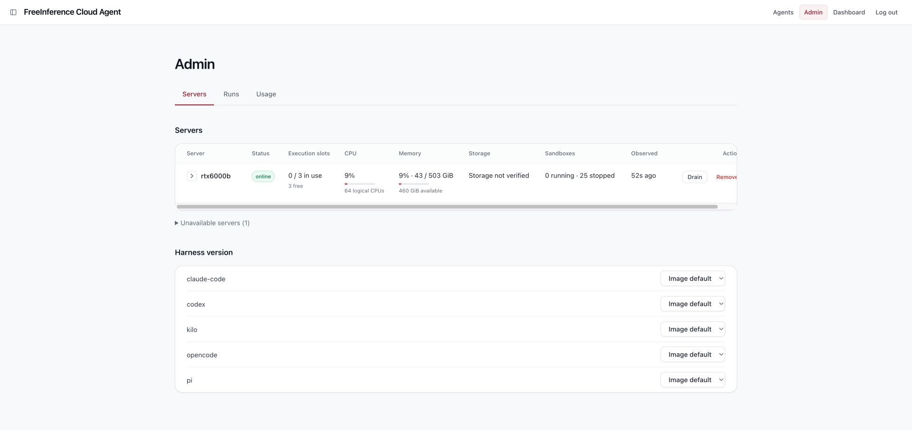
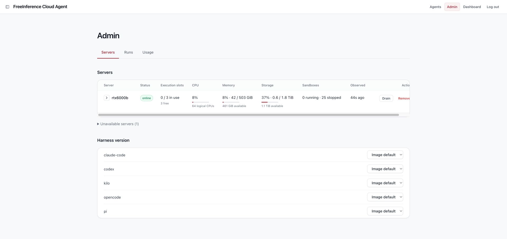
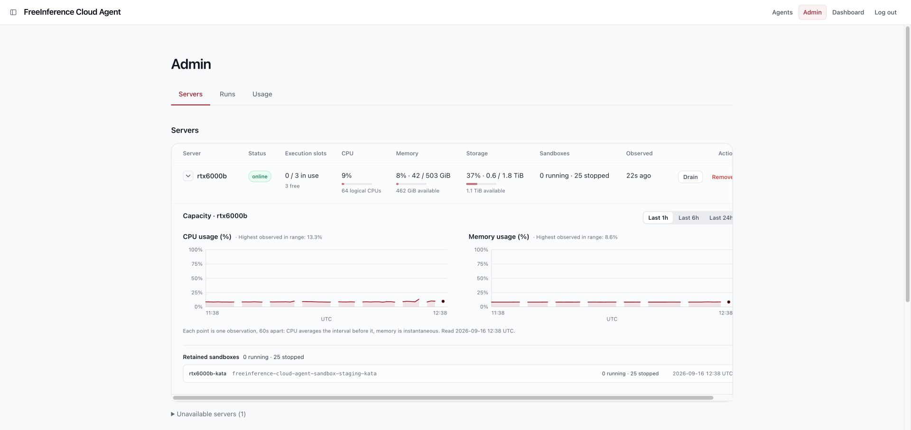
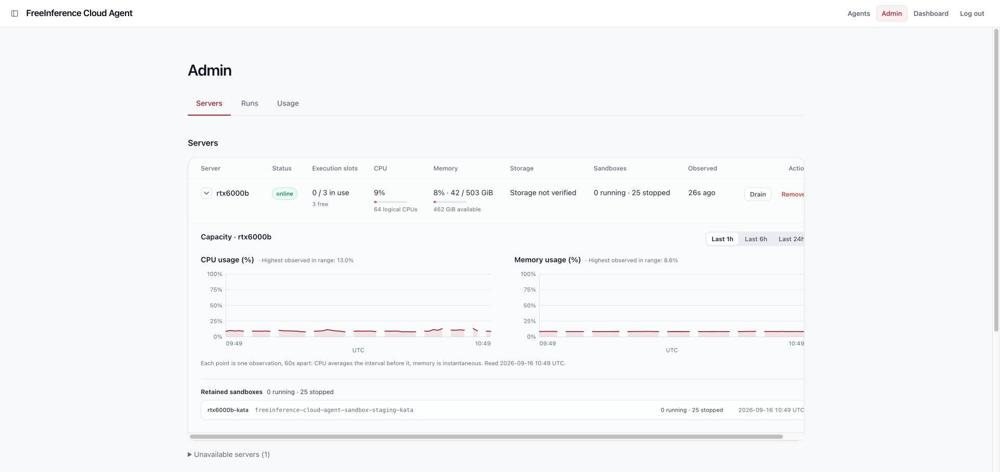

# PR #265 存储容量真机验收

> **本文记录的全部真机结果对应 `5d0050f` 及更早的提交。** 2026-09-17 的独立评审修复了部署脚本中的若干问题（调用顺序、helper 的挂载参数与运行身份、探针名校验、转义路径、verdict 的原子写入），改动覆盖了下文验证过的同一条路径。合并前需要按设计文档第 5 节重跑正向链路、XFS 配额反例 A 与独立文件系统正例 C，并确认 helper 以 `nobody` 运行时仍能签发 verified；在此之前，下文结论只对被测的那些提交成立。

## 最新结论：verdict 删除与恢复通过（5d0050f）

**单文件 bind 的删除缺陷已关闭。** 被测代码为 `5d0050f0800ad0a8031675284a71b67711c29c6b`，已[部署到实际 staging](https://github.com/HarvardMadSys/hybridInference-cloud-agent/actions/runs/35106331536)。本轮真正 unlink 宿主文件，而非清空内容；三个运行中的 runner、心跳、HTTP API 和页面均按设计降级，`check` 重建文件后无需重启便恢复。下文保留此前权限修复和首次失败的历史结果。

### 缺陷与修复

补验旧配置时，删除 bind source 后容器仍能读取原文件，`st_nlink=0`，探针继续沿用旧 verified 条目；宿主重建空文件也不影响该旧 inode。这说明先前“清空 entries”的验收不能替代 unlink。

现在 Compose 只读挂载专用 `.storage-probe/` 目录到 `/run/cloud-agent/storage-probe`，每轮读取其中的 `verdict.json`。`up` 在启动前创建目录和空 verdict，`check` 可在原目录重建已删除文件。旧 `.storage-probe-verdict` 不再使用；升级通过正常部署重建 runner，使新挂载生效。保持专用目录本身不变，不挂载整个 checkout。

### 实际 staging 的删除→恢复

2026-09-16，UTC：

| 阶段                    | 证据                                                                                                                                              |
| ----------------------- | ------------------------------------------------------------------------------------------------------------------------------------------------- |
| 删除前                  | 三个副本均正常读取 `1966736678912 B`；实际 Docker Mounts 确认目录 bind，`RW=false`                                                                |
| 14:09:36 unlink         | 删除 `.storage-probe/verdict.json`，宿主路径不存在；三个副本各自调用实际探针，全部返回 `{"reason":"unverified"}`                                  |
| 14:09:48 新采样         | API `storage_missing_reason=unverified`，Storage 的数值、source、target 均为 null；CPU、内存、0 running / 25 stopped inventory 及 online 状态保留 |
| `sandbox_host.sh check` | 真实部署用户重新验证三个副本并写出三条 verified；没有通过复制备份来恢复                                                                           |
| 14:11:18 新采样         | API 恢复正常容量，missing reason 为 null，freshness 为 fresh；页面恢复 37% · 0.6 / 1.8 TiB、1.1 TiB available                                     |

恢复后的 HTTP API：total `1966736678912`、used `683362381824`、available `1183394045952 B`，used percent `36.606938733733905`。删除前、删除后、恢复后的 sample ID 不同，缺测和恢复均来自新采样。

三个容器 ID（`81442fc97af6…`、`5fb643ff958f…`、`108581e55876…`）及 StartedAt 全程未变；宿主挂载目录 inode 全程为 `72258720`。因此恢复没有依赖重建或重启容器。





### 回归检查和范围

- `env -u CODEX_VERSION make check`：**4054 passed、490 deselected**，格式、lint、typecheck 通过；[修复提交 CI](https://github.com/HarvardMadSys/hybridInference-cloud-agent/actions/runs/35106310677) 15 success / 1 skipped。
- 新增 `tests/external/test_storage_verdict_mount.py`，在真实 Linux Docker 上通过，使用仓库实际 Compose 挂载配置和当前探针文件。覆盖同一容器中删除、重建空 verdict、重新验证以及 rename 替换。只把测试环境的 Compose 改回单文件 bind，回归立即在删除后的 unverified 断言失败；配置已恢复。
- 单测覆盖长生命周期探针重新打开文件、`check` 删除后重建、保留挂载目录 inode、初始化及写入失败隔离。既有断言保留；目录和文件权限不依赖宿主默认 umask。
- 本轮没有重跑 XFS A / C；存储口径、quota attestation 和只读 helper 未变，前轮机制证据保留。本轮仍未强制构造 staging `off` 或 stale 页面，不将其说成已经演练；unlink 已从未测项变为真实通过项。
- 已[恢复原 staging dev](https://github.com/HarvardMadSys/hybridInference-cloud-agent/actions/runs/35106981227) `6669a88308e19fd655899dbf7fe5c67846325326`。独立测试容器和临时测试环境已清理。PR 未合并，生产未改。

external 回归需在 Docker 宿主上运行，设置 `AGENT_STORAGE_TEST_IMAGE` 为已有 runner 镜像，再执行 `uv run pytest tests/external/test_storage_verdict_mount.py -m external -q`。原始证据保存在执行机器 `pr265-storage-fix-20260916` 目录的 `unlink-*` 文件中。

## 修复后结论（a2e2e36）

**部署权限阻塞已修复，核心真机验收通过。** 被测代码为 `a2e2e3645ff6cf7ac3f52219243f3750167a1437`。实际非 root 部署用户在 containerd image store 下签发了三个 `verified` 条目，runner → 心跳 → admin API → Servers 页面均收到正常容量；XFS 配额反例仍被拒绝。

- [修复版本的 staging 部署](https://github.com/HarvardMadSys/hybridInference-cloud-agent/actions/runs/35096345780)：控制面和 runner 两端成功，`.deployed-sha` 均匹配被测提交。
- `/var/lib/containerd` 仍为 `root:root`、0700。部署侧使用实际 runner 的不可变镜像启动一次性 helper，只挂两个非递归、只读目录；无额外 capability、网络、宿主 PID 或 Docker socket。helper 核对已打开目录的 mount ID、设备号、文件系统根和类型，再读取容量。
- 原生宿主路径可读时仍走原有 `findmnt` / `df` 分支。helper 复用部署总预算，内部另有 1–5 秒闹钟；真实 PID 1 阻塞实验在 1 秒后以 124 退出，容器自动清理。
- `env -u CODEX_VERSION make check`：**4051 passed**；修复提交的 [CI](https://github.com/HarvardMadSys/hybridInference-cloud-agent/actions/runs/35096231521) **15 success / 1 skipped**（Candidate on real Kata）。

### 实际 staging 的正向链路

三份 verdict 都指向宿主 ext4 的 `/`，`size_bytes=1966736678912`。静止夹取对照在第一次尝试即逐项相等：

| 位置                       |     total (B) |     used (B) | available (B) |
| -------------------------- | ------------: | -----------: | ------------: |
| 宿主 `df /`，之前          | 1966736678912 | 684150255616 | 1182606172160 |
| 实际 runner `statvfs("/")` | 1966736678912 | 684150255616 | 1182606172160 |
| 宿主 `df /`，之后          | 1966736678912 | 684150255616 | 1182606172160 |

12:41:26 UTC，真实 HTTP `GET /admin/agent/runner-hosts` 返回 200。在线 host 的字段摘录：

```json
{
  "storage_total_bytes": 1966736678912,
  "storage_free_bytes": 1282586693632,
  "storage_available_bytes": 1182606442496,
  "storage_used_bytes": 684149985280,
  "storage_used_percent": 36.64912974720953,
  "storage_source": "linux_overlay_root_statvfs",
  "storage_target": "/",
  "storage_missing_reason": null,
  "freshness": "fresh"
}
```

页面显示 **37% · 0.6 / 1.8 TiB；1.1 TiB available**，0 running / 25 stopped。页面 tooltip 的可访问文本确认了挂载点 `/`、source、`used / (used + available)` 与保留块说明。CPU、内存、历史曲线和 retained inventory 正常。



**沙箱同盘确认。** 只读查询已停止的 retained sandbox `29129c928de5…` 的 containerd overlayfs snapshot；其 upperdir 是 `…/snapshots/36367/fs`。对该目录运行同一只读容量 helper，已打开目录的设备号、文件系统根与 ext4 `/` 的预期一致，挂载根与 upperdir 总量均为 `1966736678912 B`。该沙箱全程保持 exited；没有启动、修改其内容或挂载其完整容器根。

**降级与恢复。** 将宿主 verdict 的 entries 原地清空，等待新采样后，页面显示 Storage not verified，CPU、内存和 25 个 stopped inventory 继续更新。以原部署用户执行 `sandbox_host.sh check` 成功，三个副本重新签发 verified，随后页面恢复正常数字。这里测试的是原地清空条目，未把它当作宿主 unlink 文件的测试。

### 用实际部署镜像复验新 helper

从上述 staging 实际构建镜像导出，再导入独立 XFS 实验 daemon；镜像 OCI manifest 为 `1dd846b5e4d55edd8c74eaeba765636e5e3384ad2594624b65880fb09eca174b`，config 为 `7a3b963953b89c46d34ec584e9304d242220b87be2434aa00dedb11d486bd9c0`。两个程序与被测提交逐字节一致：

```text
host_capacity.py       d724c54fe4fe56ddc1450e24421b5a452a501027ee5e8ff118e4337379c8d24c
storage_attestation.py ee3799b71b1014154a6134907c85bfe06929b8e3ff68a2efaeaf9fb99b5e19f3
```

attestation harness 原样使用提交中的存储函数，以 uid 65534 运行，不能遍历 root-owned data-root；因此实际走新 helper，而不是只验证原生 root 路径。没有替换 Docker、文件系统读数或 verdict。

- **A：真实 XFS project quota。** 容器和 upperdir 均报 `10737418240 B`，挂载根报 `33939488768 B`；verdict 为 unsupported / project quota，交给运行时后 `sample()` 返回 `{"reason":"unsupported"}`。
- **C：独立 loop-backed XFS、无配额。** verdict 为 verified，target 为 `/lab/disk`。运行时 sample、`df upperdir` 与 `df /lab/disk` 的 total / used / available 均为 `33939488768 / 1088942080 / 32850546688 B`。
- **B：vfs 非 overlay。** 本轮没有重跑；下文首次验收的真实 B 仍适用，运行时探针文件 SHA-256 未变。helper 只在 overlay 描述成功后进入。

### 范围与清理

此次关闭的是部署权限问题，并补齐正常容量、同盘确认、TiB 展示及原地清空 verdict 后的恢复。未强制构造 staging 的 `off`、样本过期或宿主 unlink verdict 场景，也未把 XFS loop-backed 正例称为第二块物理盘或 containerd 独立磁盘的验收。没有宣称设计第 9 节全部演练已完成。

临时容器、嵌套 daemon、XFS 挂载与 loop 设备均清理；staging 已[恢复原 dev 提交](https://github.com/HarvardMadSys/hybridInference-cloud-agent/actions/runs/35097683056) `6669a88308e19fd655899dbf7fe5c67846325326`。生产栈和宿主目录权限未改，PR 未合并。原始输出、实验脚本、实际 HTTP 字段、部署日志和补充截图保存在执行机器的 `pr265-storage-fix-20260916` 目录。

## 首次验收结论（f425811，修复前）

**验收未通过，暂不合并。** `overlay_root` 的配额反例、非 overlay 反例及独立文件系统正例均已在真实 Linux 内核和 Docker 上跑通；但 staging 的实际部署用户无法遍历 containerd 的快照目录，三个 runner 的部署验证都得到 `unverified`，页面始终显示 **Storage not verified**。正常容量从 staging runner 到页面的验收仍待修复后完成。

- 被测提交：`f425811ac975ce4e51e845ecefefa7baf8c454d6`，PR #265；本记录不把后续文档提交算作被测代码。
- 日期：2026-09-16，以下时间均为 UTC。
- 实际 PR 部署：[首次运行](https://github.com/HarvardMadSys/hybridInference-cloud-agent/actions/runs/35086167257)、[截图验收运行](https://github.com/HarvardMadSys/hybridInference-cloud-agent/actions/runs/35086802850)，两端部署均成功。
- 首次部署之后，dev 的一次自动部署将 staging 更新到了 `6669a88308e19fd655899dbf7fe5c67846325326`。再次部署 PR 取得页面、心跳、权限证据后，已[恢复最新 dev](https://github.com/HarvardMadSys/hybridInference-cloud-agent/actions/runs/35087238607)：两项部署任务成功，控制面和 runner 的 `.deployed-sha` 均确认为 `6669a88308e19fd655899dbf7fe5c67846325326`。

## 1. 真实 staging：发现部署权限缺口

环境：控制面和 web 在 spark2，runner 在 rtx6000b；Docker 29.2.1，`overlayfs` driver，containerd image store，宿主 ext4，Linux `6.17.0-22-generic`。实际部署由普通用户 murphy 执行，具有 Docker socket 访问权，不能无密码 sudo。

复现（在部署宿主上，以部署用户运行）：

```bash
runner=freeinference-cloud-agent-sandbox-staging-kata-runner-1
stat -c '%A %U %G %n' /var/lib/containerd
upper=$(docker exec "$runner" python -m cloud_agent_host.host_capacity describe |
  python3 -c 'import json,sys; print(json.load(sys.stdin)["upperdir"])')
findmnt -n -o TARGET,FSTYPE,SOURCE -T "$upper"
df -B1 --output=size,used,avail,target "$upper"
```

实际结果：

```text
drwx------ root root /var/lib/containerd
upperdir=/var/lib/containerd/io.containerd.snapshotter.v1.overlayfs/snapshots/39577/fs
findmnt_exit=1
df_exit=1
df: .../39577/fs: Permission denied
```

`/var/lib/containerd` 本身所在文件系统的总量是 `1966736678912 B`。runner 的描述命令也能读到这个总量，但部署侧不能证明 upperdir 所在挂载，因而不能签发 `verified`。首次部署日志中三个副本均出现 `findmnt could not locate the filesystem containing ...`，verdict 的 `mount_root` 为 null，状态为 `unverified`。

10:49:23 的控制面数据库快照：

```json
{
  "host": "rtx6000b-kata",
  "status": "online",
  "slots_used": 0,
  "slots_total": 3,
  "storage": null,
  "missing": { "cpu": null, "memory": null, "storage": "unverified" },
  "cpu_percent": 8.606815989152825,
  "memory_total_bytes": 540299722752,
  "memory_available_bytes": 495542038528,
  "inventory": { "running": 0, "stopped": 25 }
}
```

上面是相关字段的摘录，不是 HTTP 响应原文。浏览器实际页面与它一致：Storage not verified，CPU、内存、在线状态与 retained inventory 正常；展开历史曲线也正常。部署不被可选存储验证阻断、缺测不显示为 0% 的降级路径通过。



**合并前需要修复：** 为部署 attestation 提供能够读取目标挂载和 upperdir 元数据的受控执行路径，并以现有非 root 部署用户重新验收。不应为了让实验通过而临时放宽 `/var/lib/containerd` 权限；本次没有修改该目录权限、没有伪造 verdict。

## 2. 隔离实验：机制验证通过

在 rtx6000b 上创建临时 `docker:29.2.1-dind` 容器，独立网络与挂载命名空间，不挂宿主 Docker socket、宿主 data-root 或业务凭据。容器内创建 32 GiB 稀疏文件和 loop 设备，格式化为 XFS，以 `prjquota` 挂载 `/lab/disk`。嵌套 daemon 使用 classic `overlay2`，data-root 为 `/lab/disk/docker`。另一个嵌套 daemon 使用 `vfs`，data-root 为 `/lab/disk/vfs`。

测试镜像直接来自本次 staging 构建：

```text
OCI manifest: 6620051cedfa3cfe8ff2e2c101f029a773622a59a176f740bd42a923fa25b3aa
image config: b71fefbd17b1e7946100a23474f3b7598364fce7b6ab57aea115593e61a36140
host_capacity.py SHA-256:
d724c54fe4fe56ddc1450e24421b5a452a501027ee5e8ff118e4337379c8d24c
```

镜像中的探针文件与被测提交的文件哈希相同。部署验证使用从该提交 `sandbox_host.sh` 原样提取的存储常量和函数，通过小型 harness 提供日志函数、环境变量和 verdict 输出目录；调用真实的 Docker、GNU df、findmnt、timeout，没有替换读数。这个 harness 验证 attestation 算法，不能替代第 1 节的实际部署权限验收。

### A：10 GiB project quota

同一 runner 镜像以 `--storage-opt size=10G` 启动，网络为 none。

| 读取位置      |   total (B) |   used (B) | available (B) |
| ------------- | ----------: | ---------: | ------------: |
| runner `/`    | 10737418240 |    2068480 |   10735349760 |
| `df upperdir` | 10737418240 |    2068480 |   10735349760 |
| XFS 挂载根    | 33939488768 | 1089085440 |   32850403328 |

结果：真实复现“容器和 upperdir 一起返回配额”的情形。attestation 以 upperdir 与挂载根总量不相等判为 `unsupported`，reason 明确为 project quota；将真实 verdict 交给 runner 探针后，`sample()` 返回 `{"reason":"unsupported"}`，不发布 10 GiB 为磁盘容量。

本次验证的是 **XFS project quota**。Docker 的 `overlay2.size` 支持条件是 XFS 加 pquota；没有以 ext4 重复此反例，也不据此声称 Docker 支持 ext4 的此配置。

### B：非 overlay 根

同一镜像在 `vfs` daemon 下启动，根文件系统显示为 XFS。`describe` 返回 `ok=false, reason=unsupported, upperdir=null`；attestation 不写 verified 条目；运行时 `sample()` 返回 `{"reason":"unsupported"}`。通过。

### C：独立文件系统，无配额

| 读取位置       |     total (B) |     used (B) | available (B) |
| -------------- | ------------: | -----------: | ------------: |
| runner `/`     |   33939488768 |   1086836736 |   32852652032 |
| `df upperdir`  |   33939488768 |   1086836736 |   32852652032 |
| XFS 挂载根     |   33939488768 |   1086836736 |   32852652032 |
| 外层根文件系统 | 1966736678912 | 683867594752 | 1182888833024 |

三个数逐项相等。`findmnt` 选中 Docker 创建的 data-root 自绑定挂载 `/lab/disk/docker`（来源 `/dev/loop1[/docker]`），attestation 为 `verified`，探针实际返回 `target=/lab/disk/docker`、`total_bytes=33939488768`。

此正例证明探针能定位**独立 loop-backed 文件系统**，没有误读外层根文件系统。它不是第二块物理磁盘的实测，也不是 containerd snapshotter 独立磁盘的实测。

## 3. 验收边界与后续

- A、B、C 已有真实内核、文件系统和 Docker 证据，不再只是 mock 测试。
- staging 降级路径通过；实际正向容量展示失败，不能把整体验收标为完成。
- staging 的 retained sandbox 与 runner 的 upperdir 同挂载确认，以及正向 Storage 数字和 tooltip 的页面验收，需在权限修复后补齐。本次没有启动或修改用户的 retained sandbox。
- 设计第 9 节的其余 staging 场景（off、verdict 删除后恢复、过期、TiB 数字展示）未强制构造；本次页面证据覆盖真实 `unverified` 状态及其他指标继续更新。
- 临时内层容器、两个 daemon、XFS 挂载、loop 设备和外层实验容器已清理。未修改生产栈或业务 daemon 配置。
- 原始实验输出、执行脚本、两次 PR 部署日志、数据库摘录和截图保存在执行机器的 `pr265-storage-acceptance-20260916` 证据目录；本文件记录关键数值及其限制。

## 4. 仓库检查

- `env -u CODEX_VERSION make check`：4039 passed、489 deselected；format、lint、typecheck 通过。首次直接运行受到工具进程注入的 `CODEX_VERSION` 干扰，部署测试提前拒绝这个与仓库固定版本不同的值；仅在重跑进程中去掉该变量后通过，未修改测试或断言。
- 两份 Markdown 的 Prettier 检查和 `git diff --check` 通过。
- 此次回填只包含验收记录、截图和设计文档更新，不包含权限修复；自动化检查通过不能替代上述未通过的 staging 正向验收。
