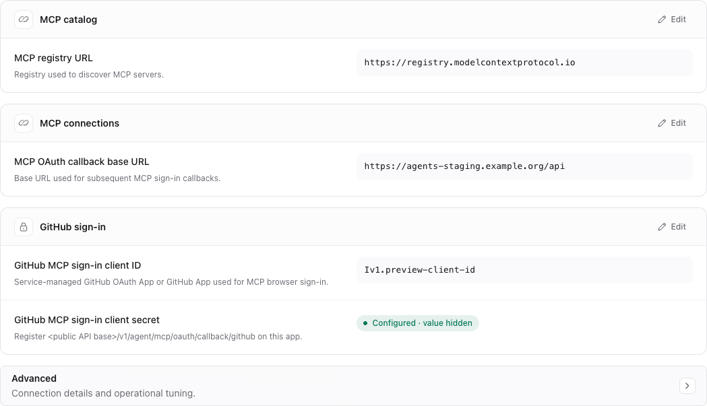
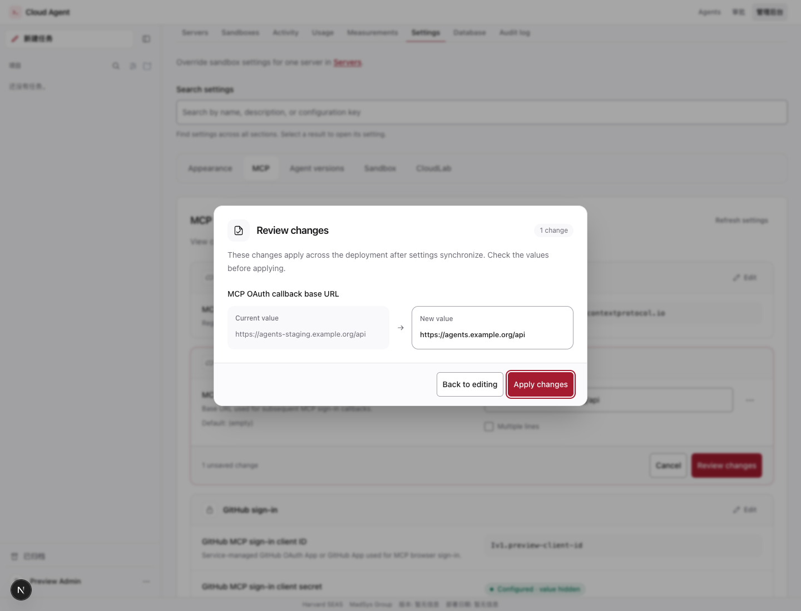

# Admin settings safety UI verification — 2026-10-15

Scope: the application settings editor at `/admin/settings`, including the MCP
category. The screenshots show the actual Next.js components with synthetic
local API responses, example.org URLs, and a placeholder client ID. No deployed
settings or real credentials were used.

## Browser checks

Chrome exercised the following at desktop size and at 390 × 844:

- Current settings are read-only until a group is explicitly edited. Cancel
  discards its changes without an API write.
- Enter opens the review dialog without saving. It shows current and proposed
  values, starts focus on the back button, traps Tab, and retains the draft
  when dismissed with Escape.
- Applying a group sends one partial request. Restoring an empty default warns
  that the setting will be cleared; cancelling sends no request.
- Replacing a secret requires an explicit action. Password entry is masked,
  the review hides its contents, and an empty replacement sends no change.
  Clearing a secret requires its own confirmation and sends `null`.
- The mobile page and dialog fit without horizontal overflow. No page
  JavaScript errors were reported.

## Automated checks

Application code revision: `608dd547`, rebased onto `00402aab` from `dev`.
The subsequent changes only add this record, its screenshots, and operator
instructions.

- Node.js 22 `make ci-frontend`: all six checks passed (ESLint, Prettier,
  TypeScript, Vitest, server-only guard, runtime configuration guard).
  Vitest: 222 files and 3,901 tests passed.
- Linux/Python 3.12 `make check`: formatting, lint, and types passed;
  10,576 tests passed and 10 were skipped because the isolated test container
  had no Docker Compose CLI. External and database-marked tests were excluded
  by the standard target.
- `git diff --check`: passed.

## Read-only group cards

## Review before applying

