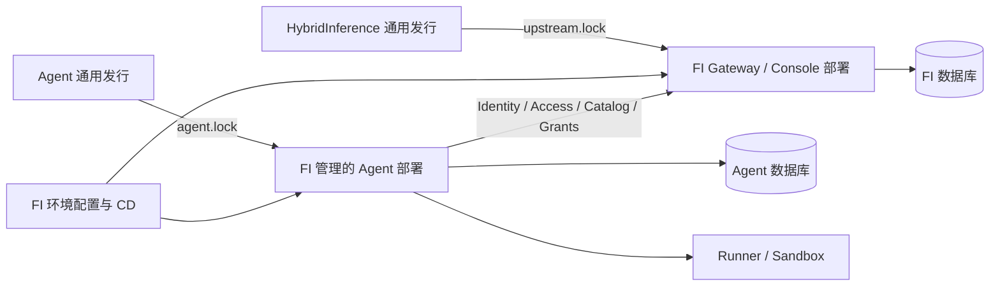
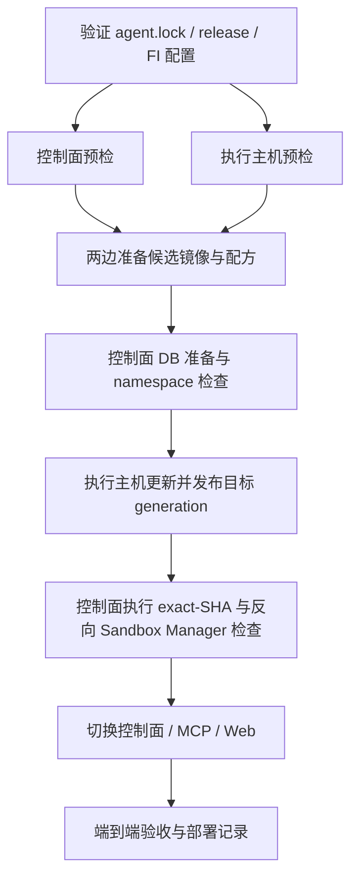

# Cloud Agent 通用发行与 FreeInference 部署迁移设计

日期：2026-09-10  
状态：已于 2026-09-18 完成 P1–P7；staging 与 production 均由 FI 部署，上游旧部署入口已移除。下文中的“当前”描述保留为实施前基线。
执行者：DS  
涉及仓库：`HarvardMadSys/hybridInference-cloud-agent`、`HarvardMadSys/freeInference`；Gateway 仓库按需做独立兼容修复

## 1. 要解决什么问题

这一系列 PR 已经把服务、数据库、用户权限和身份边界分开。下一阶段要让**发布与部署也按这个边界工作**：

> Agent 仓库发布通用、可验证的固定版本产物；FreeInference 仓库选择版本，提供本站配置，并负责 staging、production 的部署和回滚。

验收时应能回答两个问题：

1. 一个外部部署者能否用同一套 Agent 产物，配置自己的站点和 Gateway，而不用修改源码、重建品牌镜像或取得 FI 的基础设施权限？
2. FI 能否独立更新 Agent，且 FI 的主站升级、健康检查与回滚不依赖 Agent 在线？

本阶段首先做 **Agent Web 运行时站点配置**。随后发布镜像、增加按产物部署的入口，最后迁移 FI 的部署归属。不要把所有步骤塞进一个 PR。

## 2. 范围与已确定的决策

### 2.1 本阶段包含

- Web 的名称、组织信息、主站链接和现有展示开关改为运行时配置。
- Agent 发布按 digest 固定的镜像，以及对应的通用部署脚本、Compose 配方和发布清单。
- FI 新增独立的 Agent 版本锁、环境配置、部署工作流、验收和回滚记录。
- staging 切换到新部署路径；验收后再单独切换 production。
- 两个环境完成切换后，删除 Agent 上游仓库中 FI 专属的部署入口和环境假设。

### 2.2 保持的边界

- **Gateway 与 Agent 独立选版本。** FI 现有 `upstream.lock` 继续锁 Gateway/Console；新 `agent.lock` 锁 Agent。
- **Agent 内部继续遵守现有版本协议。** 控制面、Runner、Sandbox Manager、Sandbox 相关组件按同一个 Agent release 发布和部署；保留 `shared-live-exact-sha-v2` 的检查。
- FI 的角色到 `agent.use` / `agent.admin` 的映射继续在 FI；Agent 只判断自身能力和任务 ownership。
- Agent 的数据库、session 密钥、加密密钥、任务、租约与工作区继续属于 Agent 服务。
- “FI 管理部署配置”不表示把 Agent 源码或数据库搬进 FI，也不表示把 Agent 与主站拼成一次必须同时成功的部署。

### 2.3 本阶段不做

- 不做 pairing、连接码、installation 管理、多个 Agent 的管理界面或 Binding Resolver。
- 不重新设计身份协议、角色体系、计费、权限缓存或任务存储。
- 不迁移业务 owner ID，不更换 issuer，不重新登记已有 Runner，不重建数据库或工作区。
- 不为了统一镜像而同时迁移 production 的公开 URL、Cookie 路径或入口路由。
- 不承诺这一步完成后，所有仓库的历史、文档和开源检查已经全部清理完毕。

2026-09-05 的原设计包含后续讨论中放弃的安装管理方案。本文件覆盖本阶段实施范围；不要把原文中的 pairing、安装表或管理页面重新加入任务。

## 3. 当前基线与执行前核对

以下是编写本文时核对到的快照，**不是要求永远固定使用的目标版本**。DS 开工应重新检查远端 `dev`、开放 PR 和各仓库 `AGENTS.md`，避免覆盖同时进行的工作。

| 项目 | 已核对的版本/状态 | 影响 |
|---|---|---|
| Agent `dev` | `4cdaf9e07d7c1d44cd98597f305f58d7f5811b1b` | 本文 Agent 代码依据 |
| FI `dev` | `c5c13601d2c2c0dec25d5a1ca537ab1ba1235d2b` | 本文 FI 配置依据 |
| Gateway `dev` | `950f9c03d7c02e30ec4cda1d06025f8e1c192706` | 已超过 FI 当前消费版本 |
| FI `upstream.lock` | `c79876802b1d80ea21729e444ce1f1c99a5a2d75` | 已包含 `agent-access`；尚未消费后合并的 #1411 最小身份声明修改 |
| Agent #147 | 已合并，已随上述 Agent 版本部署到 staging | 最小 Agent session 与数据库 issuer 约束已有实现 |
| Agent #99 | 核对时仍开放：公共仓库 CI 安全改造 | 与本方案的镜像发布及上游部署清理协调，不重复实现 |

staging 已观察到：控制面和 MCP 健康、数据库 namespace 与 `https://staging.freeinference.org` 一致、登录后的管理页及一个旧任务的 6 轮历史可以访问。该次验收没有创建新任务，也没有完成本阶段的镜像部署与回滚演练；production 未在这轮核查中验收。

执行前另行检查 FI 是否已经消费 #1411；若仍未消费，可用独立的 Gateway lock 更新 PR 完成并验证身份链。它不是 Web 配置 PR 的前置条件，也不应与 Agent 版本强制绑定。

### 当前代码暴露的具体问题

| 位置 | 现状 | 本阶段改变 |
|---|---|---|
| Agent Web `config/env.ts`、`SiteConfigProvider` | 品牌和链接通过 `NEXT_PUBLIC_*` 在 build 时固定 | 复用现有 Provider，接收服务端运行时配置 |
| Agent Web Dockerfile / Compose | FI 展示配置作为 build args | 展示配置进入 Web 容器运行环境 |
| Agent CI | 镜像构建使用 `push: false`；Web Dockerfile 不在现有后端镜像矩阵中 | 增加完整、明确平台范围的发布流程 |
| Agent 控制面部署脚本 | 依赖源码 checkout，执行 `compose build` | 新增不依赖源码的按 digest 部署路径 |
| Agent `sandbox_host.sh` | 内部仍执行 Sandbox `docker build` 和 `compose build` | 产物模式下拉取并验证固定镜像；不能只改最外层脚本 |
| Agent staging/prod 工作流 | 上游直接控制 FI 的部署主机 | FI 仓库拥有实际环境部署 |
| FI | 已有 Gateway lock/CD，没有独立 Agent lock/CD | 新增 Agent 路径，不改成全服务联动发布 |

## 4. 仓库职责与目标拓扑

| 内容 | 唯一维护位置 |
|---|---|
| 通用身份、账号状态、grant、用量及权限扩展接口 | HybridInference |
| FI 的账号准入规则、品牌、域名、端口、网络、环境配置 | FreeInference |
| Agent Web、控制面、Runner、Sandbox、MCP、通用配置 schema | Agent |
| Agent 镜像构建、通用部署配方、协议检查、隔离与 readiness 逻辑 | Agent |
| FI 选择哪个 Agent release、在哪些机器部署、何时推广和回滚 | FreeInference |
| 生产密钥与数据库备份 | 各服务的运行环境/密钥存储；不提交任一 Git 仓库 |



通用部署代码继续留在 Agent。FI 只做环境装配和部署编排，不复制一份 Kata、租约 fencing 或 retained workspace 检查代码。

## 5. Agent Web 运行时配置

### 5.1 配置分层

保留现有 operator 名称，减少修改线上配置的风险：

| 配置 | 读取时机 | 规则 |
|---|---|---|
| `AGENT_WEB_APP_NAME` | Web 服务端运行时 | 缺省 `Cloud Agent` |
| `AGENT_WEB_ORG_NAME` | 同上 | 缺省空，隐藏对应展示 |
| `AGENT_WEB_ORG_URL` | 同上 | 缺省空；设置时验证 URL |
| `AGENT_WEB_STATUS_URL` | 同上 | 缺省空；设置时验证 URL |
| `AGENT_WEB_GATEWAY_URL` | 同上 | 仅主站/账号链接；不是浏览器 API 地址 |
| `AGENT_WEB_FEATURE_RAG` | 同上 | 缺省 false；严格解析布尔值，维持现有语义 |
| `basePath` | 构建时 | 由 Web 镜像 variant 决定，不能运行时改写 |
| 浏览器 Agent API 路径 | 默认由 variant 导出 | 根路径为 `/api`；兼容路径为 `/agents/api` |
| build SHA、build timestamp、`NODE_ENV` | 构建身份/运行模式 | 不作为站点品牌配置，也不伪装成 FI commit |
| `GATEWAY_ISSUER`、JWKS、服务 token、数据库 DSN、私钥 | 控制面/相应后端进程 | 绝不进入 Web 公共配置 |

不要把 `AGENT_WEB_GATEWAY_URL` 与控制面使用的 `AGENT_WEB_BASE_URL` 混为一谈，后者决定 BFF 返回地址等服务端行为。

### 5.2 实现方式

1. 增加一个仅服务端可导入的配置读取模块；明确列举允许输出的字段并校验。禁止遍历或展开 `process.env`。
2. 在根 Server Layout 读取配置，作为 props 传给现有 `Providers` / `SiteConfigProvider`；保留现有 `useSiteConfig`、`useBranding` 消费方式。
3. 使用当前 Next.js 版本支持的动态服务端渲染机制，防止 `next build` 把配置预渲染固化。根布局及 metadata 必须使用同一份运行时配置；不能只改浏览器里的标题。
4. 登录页、导航、页脚和账号链接统一改用该配置。清除这些字段的 `NEXT_PUBLIC_*` build args 与模块级旧值。
5. React 服务端序列化负责传输公开字段；不要自行拼接包含配置的可执行内联 JavaScript。保留现有主题预绘制行为。
6. 第一次鉴权请求前，API 路径必须已经确定。禁止先向默认地址发送 `/me`，再异步补配置。
7. 本阶段修改 `.env` 后重建容器/重启 Web 进程生效即可，不需要数据库热配置、轮询或安装状态解析器。

**不要新增 Web 的 `/api/runtime-config` 路由**：现有独立域名入口将 `/api/*` 转到控制面。服务端 props 能避免新增路由和首屏网络依赖。

对现有静态导入 API client 的处理：默认部署从构建 variant 导出稳定的同源 API 路径，品牌字段通过 Context 读取。若保留额外 API 地址配置，应显式传入 client，避免可跨 SSR 请求污染的全局可变配置。

### 5.3 basePath 与兼容策略

第一版发布以下明确区分的 Web variant：

- `web-root`：`basePath=""`，浏览器 API 路径 `/api`，新部署默认。
- `web-agents`：`basePath="/agents"`，浏览器 API 路径 `/agents/api`，用于已有兼容代理。

它们可以来自同一 source commit，但拥有不同镜像 digest。**“一份镜像适配多站点”指同一 variant 换品牌/域名无需重建，不代表不同 basePath 也共用一个 digest。**

执行前确认两个环境的实际入口和 Web 构建路径。FI 仓库目前 production 配置同时包含独立公开 URL 与旧内部代理地址，单看配置不足以判定实际生效的 basePath；不要直接替 production 选 variant。

`AGENT_WEB_BASE_PATH` 可在部署配置中保留为显式断言，必须与选中 variant 一致。`AGENT_WEB_API_URL` 在默认部署下也只校验与派生值一致；不允许以运行时变量悄悄覆盖产物约定。

若盘点发现线上使用任意前缀或跨 origin API 地址，先记录并保留旧路径，提交针对该现状的兼容方案；不能静默改地址、发送凭据到新 origin，或移除正在使用的模式。不要为假设中的需求先实现通用反向代理。

### 5.4 这一 PR 的完成标准

- 同一个已构建 Web 镜像先后运行两份站点配置，名称、metadata、组织及主站链接都随配置改变；镜像 digest 不变。
- 从构建到运行不提供 FI 域名，镜像仍能构建、启动并显示通用站点；FI 名称不作为 fallback。
- 缺少可选配置时显示通用默认；已提供但非法的 URL/布尔值给出可诊断错误，不静默回退到别的站点。
- 注入测试用 secret sentinel，它不出现在 HTML、RSC payload、客户端 bundle 或公共配置中。
- 根路径和 `/agents` 两种构建的登录、回跳、资源 URL、API 路径均不回归。
- 单元测试之外，用实际 `next build` 产物启动验证，覆盖预渲染、hydration 与运行时读取。

## 6. 通用 Agent 发布产物

### 6.1 产物集合

以下是逻辑名称；首次实现时按组织现有 registry 规范确定完整镜像名，并在 schema 中固定。名称不包含 FI 的环境或域名。

| 逻辑产物 | Dockerfile / 用途 | 首版必须验证的平台 |
|---|---|---|
| `control-plane` | 现有控制面 Dockerfile；同时用于 migrate 与 MCP relay | `linux/arm64` |
| `web-root`、`web-agents` | 现有 Web Dockerfile 的两种 basePath 构建 | `linux/arm64` |
| `runner` | Runner、sandbox manager、egress 配置生成 | `linux/amd64` |
| `sandbox` | guest、agent CLIs、观察组件 | `linux/amd64` |
| `gateway-tunnel` | 现有三个用途隔离的 tunnel 服务共用镜像 | `linux/amd64` |
| `egress-proxy` | Squid 镜像 | `linux/amd64` |
| `deploy-recipe` | 配方、协议文件、必要 host helper 和通用部署入口的归档 | 脚本；注明宿主依赖 |

这是基于当前 CI 的控制面 ARM64、执行主机 AMD64 布局，不代表所有组件已经支持所有平台。production 盘点若发现其他架构，必须先增加对应构建和启动验证，再允许其选用该 release。

发布清单按每个镜像声明平台。不得把缺少平台的单架构产物宣称为多架构。现有 CI 尚未验证 Web Docker 镜像，发布流程必须补上。

Postgres、Nginx 等第三方镜像仍是外部依赖，版本/digest 在配方或 FI 锁定配置中固定；不需要改名为 Agent 自己的产物。

### 6.2 发布清单

新增版本化 JSON schema 和生成器。每个 release 对应一份 `release.json`，至少包含：

| 字段 | 语义 |
|---|---|
| `schema_version` | 清单格式版本；首版为 1 |
| `source_repository`、`source_commit` | Agent 仓库与完整 40 位 SHA |
| `deploy_protocol` | 首版必须为 `shared-live-exact-sha-v2` |
| `images` | 每个逻辑产物的 `image@sha256:...`、平台列表；Web 另含 `base_path` |
| `runtime_catalog` | Sandbox 实际包含的 CLI 版本，与现有 runtime attestation 保持一致 |
| `recipe` | 归档下载地址、SHA-256，以及配方格式版本 |
| `database_revision` | 该 release 的迁移目标，供预检与部署记录使用 |
| `compatibility` | 最低部署器要求及已经验证的升级/回滚范围；不能仅凭 Alembic revision 推断兼容 |
| `publisher_run_url` | 生成该清单的受信发布工作流记录 |

每个自有镜像写入 `org.opencontainers.image.source` 和 `org.opencontainers.image.revision`。拉取端核对实际平台镜像的 revision；多架构 index 不一定本身提供可读的镜像 config label。

`deploy-recipe` 必须可在没有 Agent Git checkout 的目录中使用。归档显式列入所需文件；不能打包运行中的 `.env`、私钥、主机说明或整个未审计的工作目录。所有容器代码来自锁定镜像；宿主脚本只能依赖已声明的 Docker/Compose、Shell、Python 等工具及归档中的文件。

### 6.3 发布流程

- PR CI 负责检查，不持有 FI 部署权限，不发布 production 候选。
- 发布入口只接受本仓库受信分支的明确 commit，并核对该 commit 的 CI 结果；不能仅凭某个名为 CI 的工作流“最近成功”判断。
- 如果使用 `workflow_run`，校验事件来源、仓库、分支、head SHA、结论；不把外部 PR 的代码交给带发布凭据的作业执行。
- 每次正式发布必须覆盖清单中的全部必需产物和平台。路径过滤导致 Docker job skipped，不等于该 release 已有完整产物。
- 所有必需镜像构建、启动验证并推送成功后，才发布完整清单；失败时可以遗留未被引用的镜像，但不能发布可被 FI 消费的半成品清单。
- URL/tag 可以帮助查找，部署只信清单 hash 和镜像 digest，不使用 `latest`、`dev` 或可漂移标签选版本。
- 与 Agent #99 合并协调。公开仓库的普通 PR 不能进入带 FI 内网/部署权限的 self-hosted runner；中立发布器也不得复用 FI 部署凭据。

现有 CLI 默认版本是通用镜像经过测试的运行时集合，不需要仅因曾服务 FI 就全部搬走。FI 通过选择 Sandbox digest 锁定自己使用的集合。已有 FI `*_EXTRA_VERSIONS` 必须盘点并在候选产物中得到对应支持；禁止迁移时忽略它们，或继续在部署主机临时 build。不在本阶段主动实现一个任意 CLI 版本组合的构建平台。

## 7. FI 的独立版本锁与配置

### 7.1 `agent.lock`

新增独立的 JSON 锁文件，采用两层固定：**FI 锁定 release 清单的 hash；清单锁定全部镜像 digest 和部署配方 hash。** 不再复制第二套可独立修改的镜像列表。

结构示意，尖括号值故意不能通过校验，不可直接用于部署：

```json
{
  "schema_version": 1,
  "source_repository": "HarvardMadSys/hybridInference-cloud-agent",
  "source_commit": "<40-hex-agent-commit>",
  "release_manifest": {
    "url": "<trusted-publisher-release-asset-url>",
    "sha256": "<64-hex-manifest-digest>"
  }
}
```

校验分成两层：

1. 本地格式校验：字段、重复键、未知 schema、SHA 长度、仓库与 URL 来源、占位符等。不修改文件，不下载或部署。
2. 候选解析校验：下载清单并验证原始字节 hash；核对 source commit、发布来源、协议、产物完整性、平台、OCI revision、配方 hash。只产出已验证的 resolved release，不能在 hash 校验失败后仍执行下载内容。

部署准备阶段再次核对锁和清单，防止“PR 检查的是 A、部署下载的是 B”。更新 PR 附生成的可读差异：Agent SHA、各产物 digest、CLI 版本、数据库兼容说明；便于审查两层锁的实际变化。

首版提供手动更新命令或 `workflow_dispatch` 即可。不要求新增每 30 分钟轮询 bot；后续有需求再复用 FI 现有 upstream bump 模式。

### 7.2 配置组织

建议新增位置，属于计划中的文件，不是当前已存在的入口：

```text
freeInference/
  agent.lock
  ops/agent/
    validate_lock.py
    resolve_release.py
    deploy.sh
  deploy/cloud-agent/
    control-plane.override.yml
    host.override.yml
  distributions/freeinference/deploy/cloud-agent/
    staging.env
    production.env
    secrets.env.example
  .github/workflows/
    deploy-agent-staging.yml
    deploy-agent-production.yml
```

命名可随最新仓库规范调整，归属和行为不变。

- Git 内保存非秘密配置：品牌、域名、公开 issuer、variant、端口/网络、部署角色与路径等。
- 密钥仍由对应运行环境提供。Agent env 与 Gateway env 分开，不 `source` 主站 `.env`，不复制其数据库 DSN、用户密钥或 provider key。
- 显式解析和合并配置，优先级为：通用默认 → FI 非秘密环境值 → 该角色允许的 secret 值。锁定的镜像、Agent SHA、协议来自已验证 release，不允许 ambient shell env 或 secret 文件覆盖。
- 校验无秘密的配置摘要即可；避免把完整 `docker compose config`、DSN 或进程环境打印进 CI。
- 选定同一个 Agent release 可以先部署 staging 再推广 production。推广记录锁定 FI 配置 commit 与 Agent manifest hash，不能在部署时重新解析“最新 dev”。
- Gateway 与 Agent 的 workflow/并发组独立。Gateway 健康和回滚仍不等待 Agent。
- Agent lock/专属配置变更只触发对应 Agent 检查和已启用的 staging 部署；不能为此强制更新 Gateway lock 或串接 Gateway 部署。production 使用显式推广入口，并核对候选与已验收的 staging release 一致。

## 8. 按产物部署，保留现有运行保护

### 8.1 通用部署入口的行为

Agent 增加 artifact 模式，输入是已验证 release、部署角色、明确的配置路径、稳定的数据路径与 Compose project 名。旧源码构建入口可临时作为显式开发/迁移兼容模式保留，不作为 FI 新 CD 的 fallback。

产物模式必须：

- 使用 `image@digest`；配方中不能保留会隐式触发构建的 `build:`。通过 `pull` 和 `up --no-build` 部署。
- 控制面、migrate、MCP 使用同一个锁定镜像；Runner/Sandbox Manager/配置生成器使用对应统一镜像。
- `AGENT_DEPLOYMENT_SHA` 从 Agent release 的 source SHA 注入，不能从 FI checkout 的 `git rev-parse` 或部署目录推断。
- 更新 `sandbox_host.sh` 的内部构建路径，不只修改调用它的 `deploy.sh`。
- 保留 Kata probe、egress 隔离、tunnel 分工、旧 Runner drain、retained 配置检查、generation marker、heartbeat 和反向 Sandbox Manager probe。
- 不为复用代码把复杂安全检查复制到 FI；通用脚本仍从固定版本的 Agent 配方取得。
- 保留对部署协议和最低安全部署器版本的检查。应用回滚不能顺带换回一个没有现行 fence 的老部署器。

不要机械重命名现存 `org.freeinference.runtime.*` 等参与 attestation 的标签、host ID 或磁盘路径。它们可能是运行协议或历史状态标识；通用中性名称与协议迁移是不同工作。

### 8.2 配置先通过，再更新服务

当前两个部署角色可以分别开始，其中一个因配置缺失失败后，另一个已经更新。新 FI 编排应具有如下依赖关系：



具体约束：

1. **两边预检都通过前，不替换任何一边的服务。** 检查配置必填项、实际端口、镜像平台、挂载、已有 project、协议、Gateway issuer/端点与现有 namespace。
   `GATEWAY_ISSUER` 必须匹配 Gateway 实际签发身份的 `iss`；不能从 Agent 域名、主站展示链接或内部请求地址自行推导。
2. 严格只读的 `plan/preflight` 不运行迁移、不改 namespace、不 stop 服务。镜像 pull、临时 Kata probe、归档解压另属 prepare，会写缓存/创建临时资源，但仍不替换正在服务的容器。
3. 候选镜像和 host probe 成功后，在受控准备步骤做数据库备份及迁移兼容检查；数据库迁移必须允许旧控制面在过渡窗口继续运行。
4. 使用现有 namespace 校验，但不要把 `identity_namespace --check` 描述成纯只读：它会初始化空库。严格 dry-run 应用查询或单独的只读检查路径。
5. 有历史 owner 数据但缺 namespace 时，部署直接拒绝；CD 不自动执行 `--adopt-existing`。已有 issuer 不匹配也拒绝，不能通过重写它解决。
6. DB 准备和 namespace 检查完成后再允许更新执行主机。保留当前真实冷启动对缺失 API/MCP listener 的受控 bootstrap，避免首次部署因等待 host heartbeat 死锁。
7. 执行主机完成目标版本检查并发布新 generation 后，控制面再做 exact-SHA 与反向 Sandbox Manager 检查，最后替换对外服务。
8. 任一步失败记录实际已完成的阶段，不写“全部部署成功”。主机已更新而控制面切换失败仍可能发生，必须有第 10 节的恢复路径，不能声称跨主机原子更新。

### 8.3 数据路径和当前任务

- 切换前记录真实的 Compose project、volume、bind mount、数据库、密钥文件、Sandbox Manager 数据根、generation marker 路径和主机标识。
- 更换配方所在目录时，尤其注意相对路径。不能让 `../../` 指向新目录，从而创建空 volume、丢失 ready marker 或启动第二套 Sandbox Manager。
- 可以继续使用历史磁盘路径。仓库归属迁移不要求同时迁移 `/srv` 或工作区目录。
- 产物解压在独立目录，运行状态和 secret 放在稳定路径。成功部署不依赖那个目录存在 `.git`。
- 原 session/加密/control token secret 不轮换，issuer 和 DB 不换；不主动使旧任务失去访问能力。
- 已留存的 Sandbox 和运行时引用继续按现有生命周期管理；不要在切换时 `docker prune`、覆盖可变标签或删除旧镜像层。
- 不使用 `compose down -v`、重新 enroll 或重建工作区作为部署失败的默认修复方法。

## 9. PR 与环境切换顺序

每个 PR 从对应仓库最新 `dev` 的独立 worktree 开始，遵守该仓库的质量门禁。先更新设计中的过时基线，再修改代码。

| 顺序 | 仓库/交付 | 主要变更 | 合并前验收 |
|---|---|---|---|
| P1 | Agent：Web runtime config | 第 5 节；现有 Provider、Layout、API 路径、Dockerfile/Compose | 同 digest 两份站点配置；两种路径；真实构建启动 |
| P2 | Agent：完整中立发行 | 发布 schema/生成器、镜像发布、recipe 归档 | 全产物/平台验证；失败不出清单；不含 FI 凭据和品牌 |
| P3 | Agent：artifact 部署模式 | 两套 Compose 与 host 内部构建路径、协议预检、阶段入口 | 无源码 checkout 可部署；无 build；旧保护仍能拒绝不安全状态 |
| P4 | FI：Agent lock 与部署编排 | 锁校验、配置、独立 workflows、部署记录 | dry-run 与负向用例；工作流暂不自动控制现有线上环境 |
| P5 | FI + Agent：staging 切换 | 停旧 staging 自动部署，启用 FI staging 路径 | 实际新任务、旧任务、回滚演练及 Gateway 独立性 |
| P6 | FI + Agent：production 切换 | 先盘点 variant/架构/状态，再推广已验收产物 | production 配置预检、业务验收与恢复路径 |
| P7 | Agent：去掉旧 FI 部署归属 | 删除旧环境部署触发、FI 专属配置和 runner 依赖；协调 #99 | 外部干净 checkout 的构建/文档检查，所有 FI 部署已归 FI |

P2 与 P3 的具体代码可以适当调整 PR 切分，但 FI 不得消费一个缺少所需配方或产物的 release。P1 不依赖后续大改，优先交付。

staging 和 production 各自切换。**不能因为 staging 成功就先删掉 production 仍在使用的旧部署路径。**

切换时明确记录控制权交接：

1. 完成候选和配置验证，确认可用的旧版本恢复资料。
2. 停止该环境在 Agent 仓库中的自动触发，并确认没有未结束的部署作业。
3. 启用 FI 的对应部署入口并执行一次显式切换。
4. 完成验收、回滚演练或预定恢复验证后，才移除不再使用的入口。

两个仓库的 GitHub Actions `concurrency` 名称即使相同，也不提供跨仓库互斥。不能让两套自动部署同时拥有同一环境。过渡期间保留的旧入口仅用于明确选择的人工恢复。

## 10. 验收和回滚

### 10.1 必须交付的验证

| 验收项 | 通过标准 |
|---|---|
| 运行时品牌 | 同一 Web variant/digest 服务两套配置，首屏、metadata、链接正确且无 hydration 回退 |
| Web 路径 | 根路径及 `/agents` 的资源、登录、回跳和 API 请求匹配选定 variant |
| 公共配置边界 | sentinel secret 不进入浏览器；无读取 Gateway site-config 的新依赖 |
| 清单/锁 | 修改 hash、SHA、平台、协议、必需镜像之一都会拒绝；重复键/未知格式失败 |
| 发行完整性 | 任一必需构建或启动验证失败，不产生可消费的完整 release |
| 按产物部署 | 在无 Agent checkout 的目录运行，所有容器来自 digest；没有构建或隐式拉最新版本 |
| 双边预检 | 控制面缺 `GATEWAY_ISSUER` 或 host 缺必需配置时，两边都不开始服务替换 |
| 身份边界 | issuer 与已有库不符、历史库未绑定都拒绝；CD 不执行 adoption |
| 版本 fence | host/CP SHA 不匹配、旧 readiness marker、反向 Sandbox Manager 不通时，不宣告就绪 |
| 登录与权限 | 正常有权限账号可用；正常无权限账号显示拒绝；不可用账号不能取得有效 Agent 身份；故障/配置错误页面保持现有区分 |
| 历史数据 | 切换前后的采样 owner/任务计数与关键记录不变；旧会话/历史对话、工件与工作区可访问 |
| 新任务链 | 使用明确的测试任务执行至少一轮，验证排队、Runner、Sandbox、推理、结果与用量；适用时验证 MCP 和继续对话 |
| 正在执行/留存状态 | 按现有 drain/lease 协议更新，无重复 claim、越权恢复或错误 Sandbox Manager 接管；不能只测空主机 |
| 回滚 | 回到兼容的上一 Agent release，执行主机与控制面协议一致，旧任务和新测试任务可用 |
| Gateway 独立性 | 在隔离验收环境停用或不配置 Agent，Gateway 仍可启动、登录、推理、升级及回滚 |
| 外部部署 | 无 FI 源码、环境文件或部署权限的干净环境，能够取得产物、配置通用示例并走到可诊断的部署状态 |

权限和身份相关已存在测试应复用；不要为迁移新增一套 mock-only 的“同样通过”测试。涉及生产任务、真实配额或服务替换的操作只在明确授权的环境执行。

每次环境验收记录：FI config commit、Agent source SHA、manifest hash、实际 image digests/平台、数据库 revision/issuer、CP/host generation、工作流 URL、测试任务 ID、已验证与未验证的项目。不要只提交一张健康检查 200 的截图。

### 10.2 回滚规则

- 切换前保存上一个已验证 release 清单、配方、FI 配置版本和所需镜像；备份实际完成后记录可恢复的位置。不能把“准备了备份目录”写成“已完成备份”。
- 回滚输入仍是明确的旧 Agent release 与兼容配置；不能退回浮动 tag 或任意旧 commit。
- 复用当前安全部署器执行双边预检及现有 exact-SHA 流程；先恢复目标执行主机 generation，控制面通过 fence 后再切换。
- 只恢复本次更新的服务/配置。数据库通常保持已应用的兼容 schema，不自动执行 Alembic downgrade。
- 若目标旧版本不支持当前 schema、namespace 或 retained runtime 状态，停止自动回滚，选择已经验证的兼容版本或单独的恢复操作；不能借回滚绕过 #147 身份检查。
- 配置错误优先修复已知配置并重试同一版本；镜像或协议故障才选择兼容旧 release。记录实际阶段，处理 CP/host 只完成一半的情况。
- 恢复旧部署入口前，先停止 FI 新入口的自动触发；仍确保只有一个部署控制者。

## 11. 完成定义与 DS 的第一步

本阶段完成需要同时满足：

1. Agent 产物不携带 FI 品牌/环境配置，换站点配置不重建相同 variant 的 Web 镜像。
2. FI 能用独立 Agent lock 部署，Gateway lock 不随之强制变化。
3. FI staging 与 production 均已切换并有可核对的验收记录和恢复方案。
4. Agent 上游不再自动部署 FI 环境，也不要求外部贡献者使用 FI 部署 runner 或配置。
5. 原有身份、权限、数据库、Kata/租约隔离与历史任务行为没有回归。

**DS 先做 P1，不先动生产。** 先重新读取最新 Agent Web 配置、根布局和 Docker/Compose，按第 5 节完成一个小 PR；提交时附同一镜像、两份 runtime config 的实际运行证据。P1 验收后，再推进发布与部署迁移。

本文件用于实施设计，不自动授权生产切换、密钥轮换或数据恢复。代码与可审查产物先完成；实际环境切换按执行时明确的授权进行。

## 12. 代码与历史参考

以下链接固定到本次读取的源码或明确 PR，避免读者误把后来改变的 `dev` 当成本文证据：

- [Agent Web 配置模块](https://github.com/HarvardMadSys/hybridInference-cloud-agent/blob/4cdaf9e07d7c1d44cd98597f305f58d7f5811b1b/web/src/config/env.ts)、[现有 SiteConfigProvider](https://github.com/HarvardMadSys/hybridInference-cloud-agent/blob/4cdaf9e07d7c1d44cd98597f305f58d7f5811b1b/web/src/components/providers/SiteConfigProvider.tsx)、[根布局](https://github.com/HarvardMadSys/hybridInference-cloud-agent/blob/4cdaf9e07d7c1d44cd98597f305f58d7f5811b1b/web/src/app/layout.tsx)。
- [Agent 控制面 Compose](https://github.com/HarvardMadSys/hybridInference-cloud-agent/blob/4cdaf9e07d7c1d44cd98597f305f58d7f5811b1b/deploy/control-plane/docker-compose.yml)、[Web Dockerfile](https://github.com/HarvardMadSys/hybridInference-cloud-agent/blob/4cdaf9e07d7c1d44cd98597f305f58d7f5811b1b/deploy/control-plane/Dockerfile.web)。
- [控制面部署脚本](https://github.com/HarvardMadSys/hybridInference-cloud-agent/blob/4cdaf9e07d7c1d44cd98597f305f58d7f5811b1b/deploy/control-plane/deploy.sh)、[执行主机脚本](https://github.com/HarvardMadSys/hybridInference-cloud-agent/blob/4cdaf9e07d7c1d44cd98597f305f58d7f5811b1b/deploy/host/sandbox_host.sh)、[部署协议](https://github.com/HarvardMadSys/hybridInference-cloud-agent/blob/4cdaf9e07d7c1d44cd98597f305f58d7f5811b1b/deploy/DEPLOY_PROTOCOL)。
- [Agent CI](https://github.com/HarvardMadSys/hybridInference-cloud-agent/blob/4cdaf9e07d7c1d44cd98597f305f58d7f5811b1b/.github/workflows/ci.yml)、[staging CD](https://github.com/HarvardMadSys/hybridInference-cloud-agent/blob/4cdaf9e07d7c1d44cd98597f305f58d7f5811b1b/.github/workflows/deploy-staging.yml)、[公共 CI 改造 #99](https://github.com/HarvardMadSys/hybridInference-cloud-agent/pull/99)。
- [FI upstream.lock](https://github.com/HarvardMadSys/freeInference/blob/c5c13601d2c2c0dec25d5a1ca537ab1ba1235d2b/upstream.lock)、[现有锁校验](https://github.com/HarvardMadSys/freeInference/blob/c5c13601d2c2c0dec25d5a1ca537ab1ba1235d2b/ops/validate_upstream_lock.py)。
- [Gateway 权限接口 #1408](https://github.com/HarvardMadSys/hybridInference/pull/1408)、[FI 准入策略 #135](https://github.com/HarvardMadSys/freeInference/pull/135)、[Agent 最小身份 #147](https://github.com/HarvardMadSys/hybridInference-cloud-agent/pull/147)、[Gateway 最小身份声明 #1411](https://github.com/HarvardMadSys/hybridInference/pull/1411)。
- [本轮已核对的 staging 部署记录](https://github.com/HarvardMadSys/hybridInference-cloud-agent/actions/runs/34475534783)。
