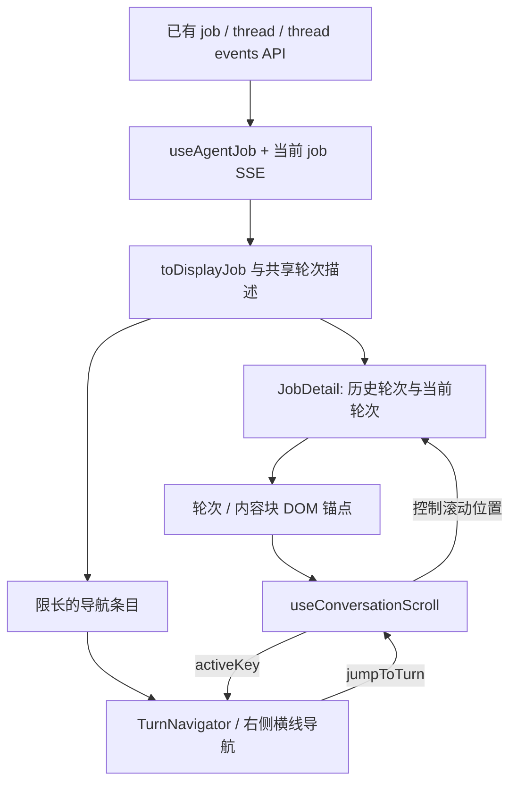

# Cloud Agent 对话导航条设计

日期：2026-09-11

状态：已实现；本轮界面收敛已在本地 Chromium 验证（见 §13.6），staging 和完整滚动几何验收仍待完成。本文不声称本轮改动已部署到 staging 或生产。

实现仓库：`HarvardMadSys/freeinference-cloud-agent`，Web Chat。

设计依据：用户确认的截图需求，以及本地 `deepseek-harness` 实现。

## 1. 要解决的问题与建议

一段 Cloud Agent 对话会包含多次用户提问、回复、工具执行和运行状态。历史越长，用户越难找到“我之前问的那个问题”和对应回复。右侧增加一列按对话轮次排列的横线，让用户悬停预览、点击定位，并知道自己正在阅读哪一轮。

**建议首版在 Cloud Agent 前端实现：每个 job/用户轮次一个刻度，复用已有 Chat 数据和内容分组。** 当前页面已经完整读取会话事件，首版不需要新 API、数据库迁移或 runner 改动。dsharness 的服务端全会话目录适合之后的历史分页优化，现在先借鉴它的交互、稳定锚点和滚动管理方式。

核心决策：

| 决策     | 首版行为                                                                            |
| -------- | ----------------------------------------------------------------------------------- |
| 导航单位 | 一轮用户请求及其 agent 活动，对应一个 job；一个 job 的多个 attempt 共用一个刻度     |
| 导航范围 | 当前 Chat 实际展示的历史轮次与当前轮次                                              |
| 预览     | 该轮首条用户输入 + 已结束轮次的最后一段可见回复；从已有文本截取，不调用模型生成摘要 |
| 点击     | 在当前 Chat 内滚到该轮开头；不切换路由、attempt、工作区或执行状态                   |
| 当前刻度 | 根据阅读位置计算，和当前运行中的轮次分开                                            |
| 流式输出 | 用户阅读历史时保留位置；只有主动回到底部或提交新一轮后才恢复跟随                    |
| 长对话   | 固定刻度间距，导航条自身可滚动；不把所有刻度压缩到不可点击                          |

本次范围是设计文档。实现不涉及 HybridInference gateway、原生会话恢复、Fork、Edit & rewind 或 Trajectory 事件视图的语义修改。

## 2. 用户体验

### 2.1 布局示意

下图是拟议布局，文字为示例，不是实际会话记录。

```text
┌──────────────────────────────────────────────────────────────┐
│ 任务标题                               Chat  Trajectory  工作区 │
├──────────────────────────────────────────────────────────────┤
│                                                              │
│   用户提问和回复                                      ──     │
│                                                       ──     │
│                         ┌─────────────────────────┐   ━━━━   │
│                         │ 检查重试后的事件是否重复  │   ──     │
│                         │ 已定位到两处重复处理……   │   ──     │
│                         └─────────────────────────┘   ──     │
│                                                       ──     │
│                                              (⌄)             │
├──────────────────────────────────────────────────────────────┤
│ Add a follow-up                                              │
└──────────────────────────────────────────────────────────────┘
```

导航条放在 **Chat 阅读区域右侧留白内**。打开 Git、Terminal、Files 后，它仍属于 Chat 列，不跟随整个浏览器窗口右缘移动。预览卡片向左展开，不遮住输入框、页头或工作区分隔条。

### 2.2 交互规则

1. 只有一个可导航轮次时隐藏导航条。至少两轮且空间允许时显示右侧横线，不增加顶部目录入口。
2. 普通刻度为短横线；当前阅读轮次更长、更亮；悬停或键盘聚焦的刻度提供独立反馈。长度表达交互状态，不表示消息长度、耗时、token 用量或任务完成比例。
3. 悬停只显示问题和可用的回复预览，不显示轮号或状态信息行。悬停不滚动正文、不请求网络、不改变当前阅读轮次。指针移入预览卡片后保持显示，离开导航条和卡片或按 Escape 关闭。
4. 点击刻度，把该轮第一个用户输入定位到阅读区域顶部下方约 24px。没有用户文本时，定位到该轮首个可见内容或轮次占位行。
5. 点击最新一轮仍然定位到**这一轮的开头**。“回到底部”定位到当前页面的正文末尾，两者用途不同。
6. 用户浏览历史时，正文右下方显示圆形向下 chevron，与输入区右缘对齐，距输入区 16px；有新内容时添加小圆点，文字放入 tooltip 和无障碍名称，不显示文字胶囊。
7. 导航条溢出时内部滚动，上下渐隐提示还有轮次。指针或键盘焦点停留在导航条内时，不自动移动导航条；离开后再确保当前刻度可见。导航条滚动不带动 Chat 正文。
8. 排队、运行中、失败和已停止的状态信息保留在预览的读屏描述中；横线保留统一配色。状态未知时省略，不推断成功或失败。

### 2.3 尺寸与窄屏

以下为首版建议值，由主题变量统一管理，浏览器验收时可微调。

| 项目             | 建议                                                              |
| ---------------- | ----------------------------------------------------------------- |
| 导航列宽         | 32px，正文为它预留至少 40px 留白                                  |
| 横线             | 普通 12×2px，悬停 18×2px，当前 20×2px                             |
| 刻度间距         | 固定 24px；每项命中区至少 32×24px                                 |
| 最大高度         | `min(420px, 有效阅读区域高度 - 64px)`                             |
| 预览卡片         | 最大宽度 280px；问题 1 行，回复最多 3 行                          |
| 显示导航条的条件 | Chat 列宽至少 720px、有效阅读高度至少 200px、精细指针设备         |
| 窄屏或触屏       | 沿用正文滚动；空间或指针条件不满足时隐藏横线，不增加另一种目录入口 |

产品确认只保留右侧横线导航，不显示顶部“Turns / 轮次”按钮或目录弹层，包括窄屏。判断宽度使用 **Chat 容器宽度**；浏览器很宽但工作区占据大半屏幕、空间不足时隐藏横线，正文仍可正常滚动。

dsharness 使用 10px 间距和整列指针命中映射；Cloud Agent 首版采用 24px 的独立按钮命中区，保留横线外观，并降低操作难度。

## 3. 已核实的实现基础

代码基线：Cloud Agent `origin/dev`，`b7a24c610a1185b0b288dce32eabd8fe487d710f`；dsharness 本地 HEAD，`c291e7961a515f6d7af9304e7fd1d257929aef26`。两者均于 2026-09-11 读取，以下描述是该代码快照的事实。

### 3.1 dsharness 中可以借鉴的部分

| 实现                           | 已有行为                                                                                | Cloud Agent 的采用方式                               |
| ------------------------------ | --------------------------------------------------------------------------------------- | ---------------------------------------------------- |
| `TurnNavigator.tsx` / CSS [D1] | 固定间距刻度、悬停/聚焦预览、内部滚动、边缘渐隐、交互时暂停刻度自动跟随                 | 复用交互原则，使用 Cloud Agent 组件与样式            |
| `turn-navigation.ts` [D2]      | 用户输入优先作为锚点；提取首条问题和最后一条可见回复；预览限长 50/120                   | 提取相同用途的视图数据；共享 Chat 的消息选择规则     |
| `session-turn-outline` [D3]    | 服务端按持久化事件生成完整轮次目录；保存轮次、`turn/start` 的 seq、问题和已结束回复预览 | 保留为未来窗口化加载的参考，首版不移植服务端投影     |
| `turn-rail-items.ts` [D4]      | 合并服务端目录与已加载锚点；未加载轮次先加载再定位                                      | 首版所有导航目标均来自已加载内容；以后扩展定位解析器 |
| `ChatView.tsx` 及滚动回归 [D5] | 阅读位置和底部跟随分别管理；处理历史插入、布局变化、延迟滚动事件                        | 一个控制器统一负责跳转、阅读位置和底部跟随           |

DSH 的 `turn/start`、SessionSeq 和 `turnOutline` 是它自己的会话模型。Cloud Agent 的 `job_id`、`turn_no`、attempt 和事件游标有不同语义，不能直接对应复制。

### 3.2 Cloud Agent 当前数据和页面

| 位置                      | 当前事实                                                                                                    | 对设计的影响                                      |
| ------------------------- | ----------------------------------------------------------------------------------------------------------- | ------------------------------------------------- |
| `useAgentJobs.ts` [C1]    | `useAgentJob()` 同时读取 job、thread 和完整 thread events，再订阅当前 job 的 SSE                            | 首版目录可在前端派生，无需额外请求                |
| `lib/api/agents.ts` [C2]  | `listAllAgentThreadEvents()` 从游标 0 开始、每页 1000 条循环读取；游标是全局事件 `id`                       | 后端事件 API 分页，不代表当前 Chat 已做窗口化加载 |
| `adapt.ts` [C3]           | 生成 `historyTurns`，保留当前轮次；原始 thinking 内容不进入聊天展示；Fork 的复制历史可退回 durable messages | 必须复用这些分组和回退规则                        |
| `JobDetail.tsx` [C4]      | 历史轮次、当前 prompt、当前 attempt 活动分别渲染；`Task progress` 是滚动区域，输入区 sticky                 | 需补齐统一轮次锚点，并测量输入区实际遮挡范围      |
| `[jobId]/page.tsx` [C5]   | `JobDetail` 按 `threadId ?? job.id` 保持组件身份，同一对话的 follow-up 不重挂载它                           | 滚动状态归属于会话，而不是当前 job                |
| `TrajectoryView.tsx` [C6] | 已有按输入、模型、工具等通道展示的事件 Minimap                                                              | 本功能在 Chat 中实现，保持事件视图独立            |

当前 `JobDetail` 没有统一的 Chat 跳转/自动跟随控制器。本设计中的控制器是需要新增的工作，不能把 dsharness 已有的滚动能力当成 Cloud Agent 已有能力。

## 4. “一轮对话”的数据语义

### 4.1 目录必须与正文对应

以当前 Chat 的分组结果为准，按 `turnNo` 排序、以 **jobId 去重与定位**。工具调用、reasoning 状态、usage、lifecycle 和单个 assistant 消息都不独立产生刻度。

当前页面按选中的 job 展示会话前缀：之前的轮次加当前轮次。如果通过旧 job 链接打开第 4 轮，即使 thread API 返回了之后的 job，首版目录仍只包含正文中的第 1–4 轮。跳到会话最新 job 沿用已有任务导航入口；不能显示一个第 8 轮刻度却找不到对应正文。

| 情况                                       | 处理                                                                                 |
| ------------------------------------------ | ------------------------------------------------------------------------------------ |
| 当前 prompt 同时出现在 durable messages 中 | 遵守 `historyIncludesPrompt`，正文和目录各保留一份                                   |
| 一个 job 有多个 attempt                    | 一个刻度；查看不同 attempt 不增加轮次，不重置阅读轮次                                |
| 当前轮次已排队，之前一轮仍运行             | 两轮分别存在；处于 `historyTurns` 不等于已结束，状态读取实际 job 元数据              |
| Fork 复制出的历史没有 events               | 使用该子会话已复制的 jobs/messages；锚点使用新的 jobId，不使用父会话 jobId           |
| 没有消息但 job 存在                        | 该轮保留占位行和可导航锚点，预览显示“暂无消息文本”，已知状态用于读屏描述                              |
| 旧 standalone job                          | 单轮展示，导航隐藏；不为了显示目录构造 thread                                        |
| `historyTurns` 缺失的旧数据/fixture        | 按已有 `threadMessages.jobId` 归组，与正文共享同一分组；缺失轮号时使用明确的显示序号 |

### 4.2 前端目录模型

下面是拟新增的 **内部视图类型**，不是后端响应。

```ts
interface ConversationTurnNavigationEntry {
  key: string; // 当前会话内的 jobId，稳定身份
  jobId: string;
  turnNo: number; // API 轮号；旧数据才使用显示序号
  promptPreview: string;
  responsePreview: string; // 未结束或无可见回复时为 ""
  state?: AgentJobState; // 复用已有映射；缺失时不推断
  previewAttemptNo?: number; // 预览受当前 attempt 选择影响时用于读屏描述
}

interface ConversationNavigationScope {
  conversationKey: string; // threadId ?? job.id
  throughJobId: string; // 当前页面展示到哪一轮
}
```

DOM 元素保存在控制器的 `Map<entry.key, HTMLElement>` 中，不放进纯数据模型。`turnNo` 用于排序、锚点标签和读屏播报，不能作为跨会话身份；事件 `seq` 是 attempt 内部序号，不能用作全会话唯一键。

为避免正文与目录各写一套规则，从 `JobDetail` 的历史/当前/消息回退分支提取一个轻量轮次描述层。它确定哪些消息会渲染、轮次顺序、首个锚点和最后一条可见回复；保留原有 `HistoryTurn`、`ThreadTurn` 和 `EventRow` 的渲染组件及操作。

`AgentHistoryTurn` 可补充已有 API 中的 prompt、state 等展示元数据；这些只是 Web adapter 的字段映射，不新增数据库字段。显示序号属于兼容逻辑，不能反向写回 `turn_no` 或用于原生 Fork 定位。

### 4.3 预览选择与更新

- 问题：优先使用正文中该轮首个用户输入；正文使用 job prompt 时就使用该 prompt。不要用会话标题覆盖真实提问。
- 回复：轮次进入现有终态后，取该轮正文的最后一条非空 `message`；若正文使用 durable assistant messages 回退，则从同一回退集合选择。失败或停止时可显示已产生的最后一段文本，对应状态由读屏描述提供，不将它称为成功结果。
- 当前轮次选择了历史 attempt 时，回复预览遵循当前正文的 attempt 过滤，并在读屏描述中标明该 attempt；job 仍运行时保持问题预览。历史轮次沿用其正文已有的事件选择规则，不借本功能重定义历史 attempt 展示。
- 没有明确终态时保持 `responsePreview=""`。不能用 `forkable` 判断轮次是否结束；它包含原生 Fork 能力等额外条件。
- 预览为转义后的纯文本，合并空白，问题最多 50 个字符、回复最多 120 个字符，截断追加省略号；实现时不切断 Unicode 字符簇。不新增 Markdown 解析器，少量原文 Markdown 符号可以保留。
- 不从工具参数、工具输出、原始 thinking、隐藏上下文或运行日志提取预览。只复用当前用户已可见的 Chat 文本。
- 流式输出期间不逐事件刷新回复预览；终态刷新后更新一次。发生明确 attempt 切换、历史修正或会话数据刷新时重新校准。

## 5. 组件与数据流



建议新增三个主要单元：

| 单元                            | 职责                                                                       |
| ------------------------------- | -------------------------------------------------------------------------- |
| `conversationTurnNavigation.ts` | 共享轮次描述和目录派生，处理去重、兼容回退、限长预览；不读写 DOM           |
| `TurnNavigator.tsx`             | 刻度、预览、内部滚动和回到底部；只接收条目、activeKey 与导航回调           |
| `useConversationScroll.ts`      | 注册锚点、计算当前轮次、跳转、底部跟随、布局变化补偿；统一拥有正文滚动写入 |

同一个控制器提供 `jumpToTurn(key)` 和 `returnToBottom()`。导航 UI 不直接调用 `window.scrollTo()`、Next router 或 job 操作 API。

导航框放在滚动区域外的相邻绝对定位层中，由包住 `Task progress` 的相对定位容器承载；它不增加正文的 `scrollHeight`。测量 Chat 区域及 sticky 输入区，导航高度、中心位置与预览边界都限制在有效阅读区域内。层级顺序为正文、导航预览、输入框/页头、模态窗口。

## 6. 滚动与定位

### 6.1 区分位置与跟随意图

`atBottom` 表示几何位置，`mode` 表示谁决定下一次内容变化后的滚动。二者不能混为一个布尔值。

| 模式        | 进入条件                                                                                 | 新事件/布局变化后的行为                          |
| ----------- | ---------------------------------------------------------------------------------------- | ------------------------------------------------ |
| `following` | 首次打开且没有阅读位置；明确点击“回到底部”；本人新一轮提交成功并已显示；用户主动滚到末尾 | 跟随正文末尾，当前刻度为当前页面最后一轮         |
| `reading`   | 用户向上阅读；跳转定位完成；切换至历史 attempt                                           | 保留阅读锚点，不因新回复或终态刷新自动滚动到底部 |
| `jumping`   | 点击刻度或目录条目                                                                       | 暂停跟随，定位目标，布局提交后进入 `reading`     |

点击最新刻度后即使内容较短、滚动恰好被限制到底部，也保持 `reading`。恢复跟随需要新的明确动作。新一轮提交失败则保留原位置和草稿，不提前进入 `following`。

用户滚轮、触摸、阅读区域中的滚动键或拖动滚动条应立即取消待执行的跳转/跟随动作。不要等到一次延迟的 `scroll` 采样才识别阅读意图。浏览器因内容布局调整产生的滚动，也不能被误认为用户主动回到底部。

### 6.2 当前阅读轮次

1. 从 `Task progress` 的可见区域扣除 sticky 输入区实际遮住的底部，得到有效阅读高度 `H`。
2. 设置阅读线：`container.top + min(96px, 0.2 × H)`。
3. 非跟随状态下，选择开头不晚于阅读线的最后一轮；阅读线还没到第一轮时选择第一轮。这样一轮很长、其提问已经滚出屏幕时，仍能正确高亮。
4. 正文位于底部时，直接选择当前页面最后一轮，覆盖短内容因滚动边界无法顶齐的情况；这个几何判断本身不把 `reading` 改成 `following`。
5. 通过滚动采样和布局变化重新计算，不用“哪个刻度最后被点击”代替实际阅读位置。

轮次位置缓存只在条目结构、Chat 宽度、正文高度或输入区遮挡变化时失效；正常滚动复用缓存，按有序位置查找。`requestAnimationFrame` 合并同一帧的测量，先读几何信息再写滚动位置，避免反复触发布局。

### 6.3 点击跳转

首版所有刻度都应有已加载目标。点击后执行：取消旧导航意图 → 退出跟随 → 查找目标 DOM → 在真实滚动容器内定位 → 布局提交后重新测量 → 更新 activeKey。

目标滚动位置为：

```text
targetTop = 当前 scrollTop + 目标锚点.top - 滚动容器.top - 24px
最终位置 = clamp(targetTop, 0, 最大 scrollTop)
```

首版正文跳转使用直接定位，避免长对话动画期间持续输出带来的目标漂移。用户手动滚动、第二次点击、切换会话或切换视图都会取消旧跳转；导航意图携带递增 generation，旧回调不能把用户带回前一个目标。

目标尚未完成 React 提交时，等待当前提交后的定位机会；若当前轮次数据已经不存在，保留原阅读位置并显示“该轮内容暂不可定位”。不反复计时重试，也不静默跳到另一个轮次。

### 6.4 布局变化与同会话续聊

使用 `ResizeObserver` 观察正文、滚动容器及输入区。输出追加、工具展开/收起、Markdown 完成渲染、打开工作区导致的重排，均进入同一布局处理流程。

- `following`：在布局更新后跟随新底部。记录由控制器写入的滚动位置，避免后续浏览器滚动事件反向取消跟随。
- `reading`：保存阅读线附近的稳定内容块及其视口偏移；变更后恢复这个位置。尾部新内容不改变当前阅读位置。
- 内容块身份优先使用 durable message id 或全局 event id，前缀包含 jobId。工具结果合并进工具行后，保留原工具行身份；不使用数组下标作为持久阅读锚点。
- `adapt.ts` 目前没有给所有展示事件保留全局 event id；实现需补充 Web 内部的 `sourceEventId`/块 key，或等价的旁路映射。字段不返回给模型，也不改变后端事件。
- 锚点因 attempt 切换或折叠而消失时，退回同一轮次的开头；同一轮也消失时再选择当前范围内最近轮次。失去精确位置应采用确定的回退，不能误触发底部跟随。
- 同一 `conversationKey` 增加 follow-up 时保留已有历史 DOM 身份和阅读状态；只有用户本人提交成功的明确意图触发底部跟随。来自其他页面的数据刷新不算提交意图。
- 切换到不同会话时清理 observer、缓存、预览、锚点和待定位回调；当前选中的旧 job 范围缩小时，移除范围外条目并校准阅读锚点。
- 切换 Chat/Trajectory 时保存 Chat 阅读锚点，隐藏导航并暂停其 observer；返回 Chat 后恢复。切换身份由现有页面 key 清理整个视图。

首版阅读状态只保存在当前页面会话内存中；整页刷新采用正常首次打开行为。跨页面持久恢复和可分享的轮次 URL 作为后续独立需求。

## 7. 可访问性、文案与内容边界

导航使用有名称的 `<nav>` 和真实按钮。轮次按钮提供“跳转到第 N 轮”标签，当前项使用 `aria-current`，焦点预览通过 `aria-describedby` 关联。方向键切换刻度焦点，Home/End 到首尾，Enter/Space 定位；方向键本身不滚动正文。用 roving tabindex 避免 Tab 遍历几百个刻度。

键盘定位后保留导航焦点，允许连续跳转，并通过简短的 `aria-live="polite"` 提示确认目标。Escape 关闭预览，键盘焦点保留在横线刻度。输入框中的方向键、Home/End 和输入法行为由输入框处理，不注册全局抢占快捷键。只在显式定位时播报，不逐流式事件播报。

使用现有 `useT()` 和中英文词典增加 `turnNavigation.*` 文案，包括目录、跳转、轮次、回到底部、新内容及定位失败。新 UI 同时验证浅色、深色、键盘 focus 和 `prefers-reduced-motion`；减少动态效果时禁用刻度/预览动画。

预览与正文使用相同 owner 已获授权的数据。导航不打开新的订阅，不在本地持久化预览，不把内容加入日志或遥测；纯文本按 React 默认方式转义，不使用 HTML 注入。权限撤销或会话删除使正文失效时，导航和预览一并卸载。

## 8. 性能与后续历史分页

### 8.1 首版开销

目录按轮次数量增长，每轮仅保存限长预览和标识。首次构建随已有 Chat 数据遍历，后续复用已结束轮次的条目。目录组件 memoize，条目内容不变时保持引用稳定，不能因为每次 SSE 产生新的 `job` 对象就重建几百个刻度。

`toDisplayJob()` 目前在渲染路径中重建显示数据，因此仅写 `useMemo([job])` 不足以达到该目标。目录缓存应以会话范围、jobId、prompt、已结束回复的来源标识/文本和所选 attempt 等实际变化为依据；运行中追加工具/消息事件无需重新扫描所有历史回复。缓存仅在终态、历史快照替换、选中 attempt 或范围变化时校准，并保持有界于当前会话。

导航引入的悬停/点击请求数应为 0；工具结果抵达后导航条目数量不变。初始 Chat 仍然加载完整事件，本文不宣称该功能降低首屏网络量或解决完整 transcript 的内存问题。

### 8.2 什么时候采用 dsharness 的全会话目录

当后续决定让 Chat 首屏只加载最近若干轮时，再单独设计服务端目录和按轮读取。这不是首版依赖，也不先加入未使用的接口。

后续必须满足：

1. 轻量目录覆盖当前可浏览范围中的全部轮次，包括未加载、无事件、Fork 复制和仅有 prompt 的轮次。现有 jobs/messages 能提供目录身份，不要求发明 `turn/start` 事件。
2. 稳定地址使用 thread/job 身份；需要事件定位时使用现有全局 event id，不能把 attempt 内 `seq` 当作跨轮次游标。
3. `resolveTurn(jobId, signal)` 在有界的轮次/事件窗口中加载目标、等待挂载、再定位。当前只有 `after` 的正向事件分页不足以高效直达历史轮次；那时必须设计读取能力，不能通过从 0 重拉全日志来假装按需导航。
4. 显示加载中状态、失败重试和无法读取提示；新点击、用户滚动、会话切换使旧加载失去落点权限。请求取消和结果 generation 检查都要考虑。
5. 目录和目标内容使用相同 owner 检查；正文窗口替换或前插保留阅读锚点；已加载与未加载时的预览规则一致。

目录 API 的分页方式、缓存、字段版本和更新通知随历史窗口化方案一起评审。先出现真实需求，再决定是否像 DSH 一样保存服务端投影。

## 9. 实现拆分与交付顺序

所有实现均在 Cloud Agent 独立仓库从 `dev` 分支开始，PR 指向 `dev`。

| 步骤            | 主要位置                                                         | 可评审结果                                                                               |
| --------------- | ---------------------------------------------------------------- | ---------------------------------------------------------------------------------------- |
| 1. 整理轮次描述 | `adapt.ts`、`types.ts`、新增 `conversationTurnNavigation.ts`     | 历史、当前和 Fork 回退使用相同轮次身份；补齐必要元数据和稳定内容块标识；正文行为保持一致 |
| 2. 滚动控制     | 新增 `useConversationScroll.ts`、`JobDetail.tsx`                 | 锚点注册、阅读轮次、定位、底部跟随和布局补偿；明确本人 follow-up 成功信号                |
| 3. 导航界面     | 新增 `TurnNavigator.tsx` 及局部样式、`JobDetail.tsx`、中英文词典 | 横线导航、预览、键盘与响应式行为                                               |
| 4. 验收与发布   | 邻近 Vitest 测试、浏览器场景、staging                            | 通过下表场景后作为一个完整功能发布；运行下述质量检查                                     |

不需要改动 `cloud_agent_host/`、grant、原生 session、存储迁移或 gateway。生产发布前需在运行中的 staging 检查实际滚动与布局；本设计评审本身不部署功能。

## 10. 验收标准

| 场景                 | 通过条件                                                                                         |
| -------------------- | ------------------------------------------------------------------------------------------------ |
| 单轮与多轮           | 单轮隐藏；每个实际展示的 job 恰好一个刻度，正文与目录顺序一致                                    |
| 长回复、多工具和重试 | 一轮几十个工具调用或多个 attempt 仍只有一个刻度；切换 attempt 不改变目录身份                     |
| 预览来源             | 多条 assistant 消息取正文最后一条；Fork 无 events 取 durable messages；不显示 thinking/工具输出  |
| 未结束与异常轮次     | 排队/运行中只预览问题；状态供读屏使用；停止/失败保留已产生文本；无文本时保留可定位锚点                 |
| 当前 prompt 去重     | `historyIncludesPrompt` 和复制历史不产生重复正文、刻度或 DOM id                                  |
| 历史 job 链接        | 目录只到当前页面展示的轮次，不存在指向未来、未渲染轮次的刻度                                     |
| 普通点击             | 目标锚点距容器顶部约 24px，误差不超过 4px；受首尾滚动边界限制时允许 clamp                        |
| 单轮很长             | 提问已离屏、仍在读该轮回复时，当前刻度继续指向该轮                                               |
| 流式输出时阅读历史   | 已存在的阅读块保持屏幕位置，误差不超过 4px；不会被新输出拉到底部                                 |
| 工具与输入区重排     | 工具展开/折叠、输入区高度变化、工作区宽度变化后，按跟随/阅读模式保持位置；锚点消失则执行文中回退 |
| 同会话续聊           | 旧轮次成为历史后身份稳定；本人发送成功跟随新轮，发送失败保留原阅读位置                           |
| 连续交互             | 快速点第 2、8、3 轮只落在最后目标；用户滚动取消待跳转；切换会话不被旧回调拉回                    |
| 返回最新内容         | 点击最新刻度到该轮开头；“回到底部”到正文末尾并恢复跟随                                           |
| 超长导航             | 200 轮保持固定间距、内部滚动和边缘提示，所有轮次可通过横线或键盘访问                         |
| 切换视图/工作区      | Trajectory 不显示本导航；返回 Chat 恢复阅读位置；导航与预览不遮挡 composer、工作区或页头         |
| 无副作用             | 导航不调用 Follow-up、Fork、Rewind、取消或工作区 API；不改变 URL、attempt 选择和输入草稿         |
| 可访问性与语言       | 仅用键盘可预览并定位；横线焦点与读屏播报正确；窄屏、触屏、中英文、深浅主题和减少动态效果可用       |
| 生命周期             | 数据失效/身份切换后预览清空；卸载时 observer、事件监听、RAF 和待定位意图全部清理                 |

纯数据规则用 Vitest 验证，组件交互用 React Testing Library 验证；滚动几何、sticky、ResizeObserver、指针与浏览器原生布局必须在真实浏览器验证，不能仅靠 jsdom 模拟断言。当前仓库已有 Vitest，尚未发现已配置的 Web 浏览器 E2E 测试入口；实现时补充最小浏览器用例，或记录可复现的 staging 人工验收步骤，不引用一个不存在的测试命令。

建议质量检查：在 `web/` 运行 `npm run lint`、`npm run type-check`、`npm test`、`npm run build`，并检查变更文件格式；按仓库要求在开 PR 前运行 `make check`。浏览器验收至少覆盖两种 Chat 宽度、100+ 轮历史、运行中追加输出和 Fork 复制历史。上述是实现后的验收要求，本次文档未执行或声称通过这些功能检查。

## 11. 取舍与评审重点

| 方案                              | 结论                                                            |
| --------------------------------- | --------------------------------------------------------------- |
| 只放一个普通滚动条                | 没有轮次和提问语义，不能满足快速识别历史问题的需求              |
| 复用 Trajectory Minimap           | 事件粒度和用途不同，目录需要基于用户轮次                        |
| 按消息高度比例分布刻度            | 长回复/工具展开会改变刻度位置，短轮次会挤在一起；采用固定间距   |
| 直接移植 DSH 的全部投影与分页机制 | 与当前完整加载方式和 job/attempt 模型不匹配；先做前端导航       |
| 点击刻度打开历史 job 路由         | 会改变当前 job 的页头、运行和工作区上下文；采用当前 Chat 内滚动 |
| 为每轮生成 LLM 摘要               | 增加调用与等待，也可能改写原意；采用确定性的已有文本截取        |

评审主要确认三点：首版是否接受当前页面会话前缀这一导航范围；24px 刻度间距及精简预览是否符合产品密度；“点击最新轮次开头”与“回到底部”的分工是否清晰。实现阻力主要在轮次锚点一致性和滚动意图管理，而不在横线组件本身。

## 12. 参考实现与代码索引

DSH 本地来源：`/Users/realtmxi/Documents/Github/deepseek-harness`。下列远端代码链接固定到本次读取的 commit，便于文档移到其他机器后复核。

- **D1**：[TurnNavigator.tsx](https://github.com/deepseek-ai/deepseek-harness/blob/c291e7961a515f6d7af9304e7fd1d257929aef26/packages/client/ui-chat/src/client/chat/TurnNavigator.tsx)、[TurnNavigator.module.css](https://github.com/deepseek-ai/deepseek-harness/blob/c291e7961a515f6d7af9304e7fd1d257929aef26/packages/client/ui-chat/src/client/chat/TurnNavigator.module.css)。
- **D2**：[turn-navigation.ts](https://github.com/deepseek-ai/deepseek-harness/blob/c291e7961a515f6d7af9304e7fd1d257929aef26/packages/client/ui-chat/src/client/conversation-nodes/turn-navigation.ts)。
- **D3**：[session-turn-outline README](https://github.com/deepseek-ai/deepseek-harness/blob/c291e7961a515f6d7af9304e7fd1d257929aef26/packages/session/session-turn-outline/README.md)、[projection.ts](https://github.com/deepseek-ai/deepseek-harness/blob/c291e7961a515f6d7af9304e7fd1d257929aef26/packages/session/session-turn-outline/src/projection.ts)。
- **D4**：[turn-rail-items.ts](https://github.com/deepseek-ai/deepseek-harness/blob/c291e7961a515f6d7af9304e7fd1d257929aef26/packages/client/ui-chat/src/client/chat/turn-rail-items.ts)。
- **D5**：[ChatView.tsx](https://github.com/deepseek-ai/deepseek-harness/blob/c291e7961a515f6d7af9304e7fd1d257929aef26/packages/client/ui-chat/src/client/chat/ChatView.tsx)、[chat-scroll-contract.e2e.ts](https://github.com/deepseek-ai/deepseek-harness/blob/c291e7961a515f6d7af9304e7fd1d257929aef26/apps/web/tests/chat-scroll-contract.e2e.ts)、[延迟滚动事件与布局变化的回归记录](https://github.com/deepseek-ai/deepseek-harness/blob/c291e7961a515f6d7af9304e7fd1d257929aef26/.agents/notes/implemented/bug-fix/2026-09-07-pinned-scroll-delivery-before-layout.md)。
- **C1**：[useAgentJobs.ts](../../web/src/components/features/agents/useAgentJobs.ts)。
- **C2**：[Agent API client](../../web/src/lib/api/agents.ts)、[owner routes](../../cloud_agent/api/routes.py)、[thread storage queries](../../cloud_agent/storage/store.py)。
- **C3**：[adapt.ts](../../web/src/components/features/agents/adapt.ts)、[types.ts](../../web/src/components/features/agents/types.ts)。
- **C4**：[JobDetail.tsx](../../web/src/components/features/agents/JobDetail.tsx)。
- **C5**：[Job page](../../web/src/app/%28agents%29/%5BjobId%5D/page.tsx)、[现有任务导航说明](../../user/sidebar-navigation.md)。
- **C6**：[TrajectoryView.tsx](../../web/src/components/features/agents/TrajectoryView.tsx)。

## 13. 实现记录（2026-09-11）

以下记录的是本次实际落地的代码与已执行的检查。第 10 节依赖真实布局的场景仍需在浏览器与 staging 中确认，本文不把它们记为已通过。

### 13.1 落地位置

| 设计单元                        | 实现位置                                                                       |
| ------------------------------- | ------------------------------------------------------------------------------ |
| 共享轮次描述与目录派生          | `web/src/components/features/agents/conversationTurnNavigation.ts`             |
| 滚动、阅读位置与跳转控制         | `web/src/components/features/agents/useConversationScroll.ts`                  |
| 横线导航、预览、回到底部 | `web/src/components/features/agents/TurnNavigator.tsx`                        |
| 正文接线与锚点                  | `web/src/components/features/agents/JobDetail.tsx`                             |
| 展示行的稳定标识                | `AgentEvent.sourceEventId`（`types.ts`、`adapt.ts`）                           |
| 文案                            | `web/src/lib/i18n/dictionaries/{en,zh-CN}.ts` 的 `turnNavigation.*`            |
| 面向使用者的行为说明与人工验收步骤 | [`docs/conversation-navigation.md`](../../user/conversation-navigation.md)           |

与设计相比的两点实现细节：

1. 轮次描述层同时决定正文渲染哪些行与目录预览什么内容，`HistoryTurn` 的 fallback 规则（无事件消息时使用 durable assistant 消息）已从组件内移入该层，两处不再各写一套。
2. 描述层每个渲染都重新派生（正确性优先），刻度列表的引用稳定性来自 `sameNavigationEntries`：把刚派生出的条目与上一批逐字段比较，相同则沿用旧数组。§8.1 的目标是"不因每个 token 重建几百个刻度"，这一点由引用稳定保证；而摘要式缓存需要预判刻度依赖的每个字段，漏一个（例如历史轮次后来才可 Fork）就会长期供出旧刻度，所以不采用。预览截断只读到预算用尽为止（见 13.5），这是"每 token 全量派生"仍然可接受的前提。

### 13.2 已执行的自动化检查

在 `web/` 下运行，全部通过（Node v22.21.1）：

| 检查                       | 结果                          |
| -------------------------- | ----------------------------- |
| `npm run lint`             | 0 error，0 warning            |
| `npm run format:check`     | 全部文件符合 Prettier         |
| `npm run type-check`       | 通过                          |
| `npm test`                 | 66 个文件、947 个用例全部通过 |
| `npm run build`            | 通过                          |
| `node scripts/check-server-only-guard.mjs` | 通过             |
| `node scripts/check-runtime-site-config.mjs` | 通过           |

新增用例：`conversationTurnNavigation.test.ts`（31）、`useConversationScroll.test.ts`（20，纯算术与 attempt 判定）、`useConversationScroll.dom.test.tsx`（14，注入盒模型的控制器行为）、`TurnNavigator.test.tsx`（19）、`JobDetail.test.tsx` 的对话导航用例（7），另在 `adapt.test.ts` 增加 1 例（历史轮次状态映射）。

### 13.3 第一轮对抗性评审后的修正

实现完成后做了一次对照本文的评审和一次针对控制器/组件的代码评审，以下问题在本次一并修正，并各自补了回归用例：

| 问题                                                                     | 修正                                                                                     |
| ------------------------------------------------------------------------ | ---------------------------------------------------------------------------------------- |
| 焦点在刻度上按 Escape 会冒泡到页面级的“Esc 停止运行”，取消正在跑的 job     | 有预览时由 document 级监听接管 Escape 并 `preventDefault`；无预览时不拦截                 |
| 纯悬停的预览无法用 Escape 关闭（悬停不产生焦点）                          | 同上：预览打开期间注册 document 级 Escape                                                 |
| 跟随模式下浏览器自身的滚动（Tab 焦点 scroll-into-view、锚点调整）被下一帧拉回底部 | 该分支先判断“变化前是否就在底部”，否则把落点当作阅读位置并转入 `reading`                  |
| 任何 `scrollHeight` 增长（窗口重排、工作区宽度变化、输入区变高）都报“有新内容” | 宽度变化或输入区高度变化引起的高度增长不计入；只在正文确实新增内容时提示                 |
| 控制器自己的补偿写落在 500ms 手势窗口内时被当成用户滚到底部                | 每次自身写入标记一次，其引发的首个 scroll 事件不参与手势判定                              |
| 运行中每个 token 都重扫全部历史轮次并重跑每轮两次 `Intl.Segmenter`        | 历史轮次与其目录条目按 `historyTurnsDigest` 记忆化；只有当前轮次的条目按 `navigationEntryDigest` 重算 |
| 导航条自动滚动只避开指针，不避开键盘焦点；离开后不补做“当前刻度可见”       | 指针或焦点在导航条内即暂停，两者都离开后重新对齐当前刻度                                   |
| 键盘选中目录行后焦点落回 body                                             | 选中后把焦点交回“轮次”按钮                                                                |
| 定位失败提示与“回到底部”重叠，且切到 Trajectory 后仍显示                  | 二者合成底部同一列，整列只在 Chat 视图渲染                                                |
| 预览卡与页头、输入框同层（§5 要求预览在其下）                             | 导航层降到 `z-0`，仍高于正文、低于输入框与页头                                             |
| 刻度的动画未响应 `prefers-reduced-motion`                                 | 刻度加 `motion-reduce:transition-none`                                                    |
| 无 `historyTurns` 的扁平 job 切 attempt 后不过滤事件                      | 与轮次分支共用同一个 attempt 过滤                                                          |
| 当前轮的 durable 回复被 `historyIncludesPrompt` 一并门控                   | 该标记只决定 prompt 卡片是否让位，不再决定正文是否渲染 durable 行                          |
| 滚动容器没有 `tabIndex`，纯键盘无法直接翻正文                             | 容器加入 tab 顺序（WAI-ARIA 可滚动区域惯例）                                              |

四项需要真实浏览器才能定论的问题（预览卡的实际遮挡、输入区真实高度下的落点像素、ResizeObserver 时序、触摸与指针行为）仍在 13.7 的人工清单里。

### 13.4 第二轮评审（针对已推送提交）后的修正

| 问题                                                                       | 修正                                                                                     |
| -------------------------------------------------------------------------- | ---------------------------------------------------------------------------------------- |
| 排队中的轮次开始运行、自动产生首个 attempt 时被当成"读者切换了历史 attempt"，被切成 `reading`，后续输出不再跟随 | 只有读者自己点选、且选的不是最新 attempt 时才 `holdReading`；判定抽成 `shouldHoldReading` 并有单测覆盖四种来源 |
| 历史轮次的目录缓存键只含状态与数组长度：轮次变为可 Fork 后按钮不出现；工具结果折叠进同一行（行数不变）时正文保留旧内容 | 取消按计数记忆化历史轮次，描述每渲染重新派生；刻度列表的引用稳定改为对刚派生结果的逐字段比较 |
| 补偿写即使没有移动位置也置位"本次写入是本控制器所为"，浏览器不产生事件，下一次真实滚动被误判为程序滚动，读者回到底部后不再跟随 | 只有真正改变位置的写入才置位；另外任何用户手势都直接清除该标记 |
| 判断"变化前是否在底部"时用了变化后的视口高度，窗口变矮会把正在跟随的读者切成 `reading` | 记录并用变化前的 `clientHeight` 判断 |
| 刻度与预览卡之间 8px 的空隙不属于任何一方，指针一旦移入卡片就触发 leave 并立即关闭，卡片实际上无法用鼠标阅读 | 卡片改为紧贴导航条、用自身 padding 充当可命中的"桥"，并给关闭加 150ms 宽限；指针移入卡片会取消关闭 |

五个问题各自补了回归用例，并逐个验证过"把修复改回去则用例变红"。

### 13.5 第三轮评审（性能）后的修正

| 问题                                                                       | 修正                                                                                     |
| -------------------------------------------------------------------------- | ---------------------------------------------------------------------------------------- |
| 预览截断先把整段回复物化成字符簇数组再截取，中文回复（或含破折号的英文）每轮都要完整分割；100 轮 × 每轮 5,000 字复现为单次派生 26ms，10,000 字为 50.5ms | `previewText` 改为惰性读取字符簇，读满「预算 + 1 个字符」即停止；预算内的短文本仍走一次 `replace` 的快速路径 |

修复前后在本机（Node 22）用同一组数据测量，200 轮 × 每轮 10,000 个中文字符的一次完整派生：修复前中位数 **175ms**，修复后 **5.6ms**（约 31×），且与回复长度无关（每轮约 28µs，其中约 12µs 是 `Intl.Segmenter` 每次调用的固定开销）。回归用例不用墙钟阈值，而是替换 `Intl.Segmenter` 统计实际读取的字符数，断言不超过预算 + 10：把"读到预算就停"改回去，该用例立即变红。

### 13.6 产品确认后的界面收敛

- 只保留右侧横线；移除顶部 Turns 按钮及其目录弹层，窄屏也不保留该入口。
- 悬停预览采用紧凑的问答摘要、轻阴影，不显示 Turn N 或状态信息行；状态和历史 attempt 信息保留给读屏描述。
- 聊天正文不显示 Turn N 分隔标签，跳转成功只向读屏播报，不再出现持久浮标。命名锚点、跳转失败提示和执行详情入口保留。
- 回到底部使用 36px 圆形向下 chevron，参照 dsharness 放在正文右下方，与输入区右缘对齐，距输入区 16px；文字放在 tooltip 和无障碍名称中，有新内容时使用小圆点。

本轮本地验收：使用真实 `JobDetail` 组件和固定 API 测试数据，在 Chromium 验证 1160px 宽屏与 640px 窄屏、浅色/深色、悬停移入预览、键盘跳转、36px 圆形回到底部按钮、无可见轮号浮标。前端全量 71 文件、1033 用例通过，lint、format、type-check、build 通过。

### 13.7 尚未执行

- 真实布局下的滚动行为。`useConversationScroll.dom.test.tsx` 用注入的盒模型覆盖了控制器的判断（落点、阅读轮次、布局补偿、跟随恢复、目标缺失），但那是给定的几何，不是浏览器算出来的：Markdown 换行重排、sticky 输入区的实际遮挡、ResizeObserver 的真实时序、指针与触摸事件，以及跳转落点的像素级误差（±4px）都仍未验证。可复现的人工步骤见 [conversation-navigation.md](../../user/conversation-navigation.md#verifying-it-in-a-browser)。
- 100+ 轮、两种 Chat 宽度、Fork 复制历史在真实数据下的表现。
- staging 上的真实验收。仓库目前没有配置 Web 浏览器 E2E 入口，因此本次未新增浏览器用例；若要在 CI 中固化这些场景，需要先接入一个浏览器测试框架，那是独立于本功能的一项工作。
- `make check`（Python 侧）。本次未改动 `cloud_agent/`、`cloud_agent_host/` 或迁移文件，开工前的 `dev` 基线在该门禁上是否为绿未在本次核对。
