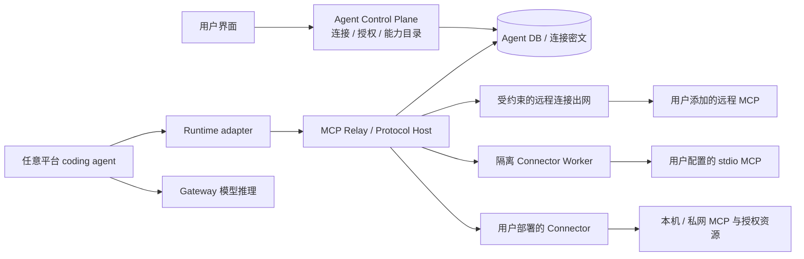

# Cloud Agent 通用 MCP 接入设计

- 日期：2026-09-11。
- 状态：原始设计提案；当前实现与验证范围见[实现对照记录](../reviews/2026-09-11-per-user-mcp-v1-conformance.md)，真实部署验收仍待完成。
- 实现仓库：`HarvardMadSys/hybridInference-cloud-agent`。
- 调研代码基线：`b7a24c610a1185b0b288dce32eabd8fe487d710f`。
- 已明确的产品目标：**平台全部 coding agent 共用通用 MCP 能力；用户可以添加自己的 MCP 服务，接入不以品牌白名单为前提。**
- 本文已替换先前将范围收窄为 GitHub 只读的草案。

## 1. 产品目标与开发时机

用户连接自己的 MCP 服务，选择任意 coding agent，在会话中授权使用这些连接。平台负责配置、认证、能力发现、权限和调用状态；用户不用针对每种 agent 重复安装配置。

GitHub、项目管理、文档、数据库、浏览器工具和用户自己开发的 MCP，采用同一套接入模型。可以提供 GitHub 等预设简化填写，但普通标准服务不需要等待平台新增专属代码。GitHub 是兼容性测试样例，不是产品边界。

| 用户操作 | 产品体验 |
| --- | --- |
| 添加 MCP | 填写远程 URL、导入 MCP JSON，或选择 stdio 的运行位置与启动配置 |
| 完成连接 | 按服务要求登录、填写密钥或直接连接；看见服务身份、位置、工具和其他能力 |
| 创建会话 | 自由选择 coding agent，选择本次允许使用的连接和能力 |
| 提交任务 | Agent 跨已授权服务获取资料或执行操作；界面显示调用与需要用户处理的步骤 |
| 管理授权 | 停用连接、收窄范围、更新凭据；新增工具和扩大权限不会偷偷继承旧授权 |
| 换一种 agent | 新会话复用同一连接，无需按 agent 重复配置 |

例如连接代码、项目管理和文档服务后，用户可以提出「结合这个问题、相关代码和设计文档定位原因，把结论写回指定页面」。读取和写回都属于可支持的能力，实际操作由用户授权决定。这描述产品目标，不宣称这些品牌服务已经完成测试。

**现在可以开发。** Agent / Gateway 的归属已明确，MCP 放在 Cloud Agent；发行版整理可以并行。通用化需要新增动态连接、协议适配、工具授权、stdio 与私网连接能力，工作量明显大于给当前 GitHub relay 补 OAuth 和 UI。

边界遵循[系统与发行版说明](2026-09-01-freeinference-system-boundaries.zh.md)和 [MCP ownership amendment](https://github.com/HarvardMadSys/hybridInference/blob/dev/docs/agents/plans/2026-08-04-cloud-agent-mcp-ownership-amendment.md)：Agent 拥有连接、任务与工具授权，Gateway 提供身份和模型推理契约，FreeInference 发行版拥有部署配置。

## 2. 通用兼容性的定义

「支持所有 MCP」落实为：**按协议、传输、认证与能力适配，不按服务品牌限定。** 不把世界上所有服务的可用性、硬件依赖或私有扩展都描述成已验证。诊断必须说明哪一维已支持、哪一维需要配置或适配。

| 维度 | 交付要求 |
| --- | --- |
| 服务来源 | 用户自定义标准 MCP；模板可选，无模板也能连接 |
| 远程传输 | Streamable HTTP；兼容旧版 HTTP+SSE |
| 进程传输 | stdio；在隔离托管环境或用户部署的 connector 上启动 |
| 认证 | None、静态 Bearer / API key / 指定 header、HTTP OAuth；stdio 的环境变量或秘密引用 |
| 多实例 | 同服务的不同账号、环境或网络位置可以分别添加，以 connection ID 区分 |
| 核心能力 | 动态 tools、resources、prompts；工具包括读取与写入，受用户授权控制 |
| Coding agent | 当前全部五种：Claude Code、Codex、pi、OpenCode、Kilo |
| 可选能力 | 按协议版本协商，显示 native / platform bridge / unsupported，不丢弃请求后报告成功 |

Streamable HTTP 本身可返回 SSE，与旧版「SSE 通道 + message endpoint」不同；stdio 使用子进程输入输出。[2025 transport 规范](https://modelcontextprotocol.io/specification/2025-11-25/basic/transports)

| 协议档案 | 接入层必须区分的行为 |
| --- | --- |
| 2024-11-05 legacy HTTP+SSE | 解析 SSE 中宣告的 POST endpoint，在可信侧校验并路由 |
| 2025 Streamable HTTP | initialize、可选 session、JSON / SSE、可选 GET 与恢复 |
| 2026-07-28 Streamable HTTP | 逐请求版本 / 能力、无旧式 initialize / session、无独立 GET stream；需要输入时按新交互模式续接 |

新旧协议需要明确的适配，不能只修改版本 header。[当前 HTTP 传输](https://modelcontextprotocol.io/specification/2026-07-28/basic/transports/streamable-http)、[当前版本规则](https://modelcontextprotocol.io/specification/2026-07-28/basic/versioning)

Roots、sampling、elicitation、资源订阅、异步 tasks、MCP Apps 等能力分别记录支持状态，缺失的 handler 列入兼容性工作。必要扩展不兼容时给出准确诊断，不按品牌拉黑，也不宣传该能力已支持。标准 tools / resources / prompts 的基础支持不能据此降为可选项。

## 3. 架构与执行位置

Coding sandbox 仍只访问已有两个固定 relay；新增 MCP URL 不会给它任意出网。Relay 根据登记的 connection 解析目标，不接受调用临时指定转发 URL。长期服务凭据不进入 coding sandbox。

| 组件 | 职责 |
| --- | --- |
| Control Plane | 连接与 OAuth、秘密存储、发现记录、会话绑定、授权和用户确认 |
| MCP Relay / Protocol Host | 对下承接 runtime，对上选择 transport；管理协议、命名空间、调用与授权 |
| Remote adapter | 远程 HTTP / SSE、认证、版本协商和重连 |
| Connector Worker | 独立隔离环境中运行 stdio server；限定进程、网络、文件与秘密 |
| 用户 Connector | 在用户机器 / 私网通过受认证出站通道提供明确选择的服务 |
| Runtime adapter | 将共用能力接入各 CLI，统一结果、状态、取消和确认交互 |

Relay 将从简单 HTTP 转发器发展为 MCP host / 协议适配层。通用 stdio、旧版长连接和双向消息需要真实会话状态。多实例以 owner lease 和共享元数据协调状态归属，不能只靠进程内字典或一个 opaque ID 代替全部状态。

Coding sandbox、Connector Worker、用户 connector 是不同边界。用户命令不在 CP、relay 进程、runner 宿主或 coding agent 的同一权限域执行。托管多租户 worker 沿用项目的 Kata / 非特权 / 资源隔离要求，只获得该连接需要的秘密与明确挂载的资源。

## 4. 添加、认证与连接诊断

### 4.1 统一添加流程

「添加 MCP」支持 URL 与配置导入。导入识别常见 `mcpServers` 中的 URL / headers、command / args / env，转换为统一结构；先展示解析结果、运行位置、秘密和资源范围，再保存测试。粘贴配置不立即执行安装命令。

远程连接记录规范化 URL 和 transport。stdio 记录参数化 argv、依赖 / 镜像版本、位置、秘密引用和挂载。不同 CLI 的配置方言由 parser adapter 处理，不假设一种 JSON 适用于所有 CLI。

连接测试只做协议握手、认证和能力发现，不执行未知业务工具。状态区分网络不可达、需要登录、缺少客户端注册、进程启动失败、协议不兼容和部分能力不支持。连接成功不等于所有会话已获得所有工具。

### 4.2 多种认证

| Profile | 行为 |
| --- | --- |
| None | 不注入外部凭据，平台仍检查用户与任务授权 |
| Bearer / API key / headers | 秘密输入，加密存储，绑定目标注入；普通 API 不返回密钥 |
| HTTP OAuth | metadata 发现、注册选择、浏览器授权、刷新、重新授权与可用的撤销 |
| stdio env / secret file | 只向对应 worker / connector 注入；可留在用户 connector 本地 |

OAuth 是 HTTP MCP 的可选认证，静态 header 是兼容模式，stdio 环境变量不是 HTTP OAuth。AS 可以与 MCP endpoint 不同域；client secret 按实际客户端类型可选。[授权适用范围](https://modelcontextprotocol.io/specification/2025-11-25/basic/authorization#protocol-requirements)

注册优先采用已有预注册信息，然后选择 AS 声明支持的 CIMD / DCR；不能自动注册时提供客户端参数入口。机制取决于版本与 metadata，不能一律要求 DCR，也不能删除旧服务仍使用的登记方式。[客户端注册](https://modelcontextprotocol.io/specification/2026-07-28/basic/authorization/client-registration)

Flow 使用高熵单次 state、S256 PKCE、精确 callback、登录用户与浏览器绑定，并保存 connection / issuer / resource / scope。现代 profile 要求的 `resource` 同时进入 authorize 和 token 请求；旧版发现回退不能混进现代 metadata 失败路径。[2025-06 授权与 resource](https://modelcontextprotocol.io/specification/2025-06-18/basic/authorization)

Token 仅用于绑定的目标。内部 `ajt`、Gateway `agr` 和外部 token 不互换。State 绑定发起时的 connection ID、config revision、authorization epoch、OAuth generation、issuer / resource；回调最终写入逐项 CAS 校验。修改目标、认证方式或执行位置也取消旧 flow，防止迟到回调覆盖新连接。手动凭据更新同样条件写入；client secret、code / state、verifier、token 不进入普通响应、日志或任务事件。

过期、refresh rotation、刷新响应是否含新 refresh token、撤销语义由 auth profile 处理；响应缺省时仅在该契约允许下保留原 refresh。没有刷新能力时提示更新。GitHub 的固定期限、成对轮换、安装审批都不是通用规则。

### 4.3 任意 URL 的网络约束

URL、discovery / registration / token 地址、redirect 和 legacy SSE 宣告的 message endpoint 都走同一出网策略。校验解析结果与实际连接 IP，覆盖 IPv4/IPv6、DNS rebinding、回环、云 metadata 和平台内部服务；限制重定向与大小，禁用非显式配置的 ambient proxy。

公网模式不允许访问平台私网。用户要接自己的私网服务时选择用户 connector。MCP 与 AS 可以不同域，但每个目标都要通过检查；凭据绑定 origin / resource，不能随任意 redirect 转送。自定义 API header 可配置，Host、Cookie、代理控制头和平台凭据不允许任意覆盖。[授权安全要求](https://modelcontextprotocol.io/specification/2026-07-28/basic/authorization/security-considerations)

## 5. stdio、本机与私网 MCP

| 运行位置 | 适用场景 | 执行方式 |
| --- | --- | --- |
| 平台隔离 Worker | 可在云端运行的 stdio 程序 | 安装阶段固定依赖 / 制品，运行阶段按 argv 启动，只注入所需秘密 |
| 用户 Connector | 本机文件、私网数据库、本地程序或专用依赖 | 用户部署并授权资源，通过认证出站通道提供 MCP；不开放通用 TCP / 命令代理 |

常见 `npx` / `uvx` 配置解析为依赖安装和启动计划，记录并固定实际版本，不每轮下载 latest。包来自用户选择，不因为尚未列入平台品牌目录就拒绝；但不能把它当成 CP 可信代码。安装环境与持有业务秘密的运行环境分离，argv 不经 shell 拼接。

默认按 connection + member 协议执行上下文隔离 stdio 子进程，防止两个任务共享 cwd、roots 或隐含状态。进程没有宿主 socket、CP 数据库凭据、其他连接秘密或未授权挂载。网络、文件、资源限额、闲置回收与退出重启纳入连接配置和部署策略。

`localhost` 与 `/Users/...` 按选定运行位置解释。云端不能直接读取用户电脑文件；界面应引导选择本机 connector，或明确提供指定数据，不能误读为 CP 本机路径。新增 command、目标或挂载范围需重新确认该连接配置。

Connector 注册、连接绑定、心跳、路由与撤销由 Agent 管理。用户 connector 仅承载获准连接的 MCP 操作，不给平台任意操作用户机器的权力。

## 6. 连接模型与授权版本

使用 Agent 数据库和现有[最小身份 / issuer 命名空间](../../developer/minimal-identity.md)，不复制 Gateway 用户表。

| 记录 | 主要内容 |
| --- | --- |
| Connection | 不可变 ID、owner、label、可空 template、transport、执行位置、endpoint / launch spec、auth profile、状态与 revision |
| Credential | connection、密文或 connector 本地秘密引用、issuer / resource、期限与 token version；可与连接表合并 |
| Capability snapshot | connection / config revision、协商版本、tools / resources / prompts 及 schema / 描述摘要 |
| Thread binding | thread、connection ID、alias、config revision、授权 epoch、policy revision、允许的能力 / 工具与调用策略 |
| Invocation / approval | job / attempt / lease、connection / 配置 / 授权 / schema 版本、参数摘要、决策与执行状态 |
| Transport session | connection + member + attempt、owner lease、协议与上游 session / 恢复状态 |
| Connector | owner、注册身份、获准连接与资源、在线状态 |

现有 `UNIQUE(user_id, server)` 必须移除或迁移。一个服务可有多个连接，名称只用于展示；线程不再仅保存 `github` 等 provider 名并临时寻找当前凭据。

| 版本 | 何时变化 |
| --- | --- |
| config revision | URL、transport、launch spec、执行位置或连接配置变化 |
| authorization epoch | 目标 / 身份变化、手动替换凭据、断开、授权范围扩大 |
| OAuth generation | 发起新 flow、取消或断开，阻止迟到 callback |
| credential version | 正常刷新、替换、清除，防并发覆盖 |
| capability revision | 工具 / schema / 描述目录变化，阻止静默扩权 |
| policy revision | 连接或会话允许范围变化；收窄立即使不再允许的调用与待确认失效 |

目标或账号变化后，旧绑定和确认失效；用户接受新授权后再使用。单纯自动刷新不要求所有会话重新授权。MCP 没有通用 `/user`：稳定 subject 仅在可验证时记录；没有可靠身份信息时，替换密钥不能被当作同一账号的无风险更新。

命令 / 参数、挂载、connector、认证方式等安全相关配置变化，同样增加 config revision 与 authorization epoch，使旧绑定、待确认和 transport handle 失效。调用发送前核对当前配置和策略版本；授权判断取当前允许范围，不能继续使用收窄前的批准。

软断开清除平台秘密、递增 epoch 并保留 tombstone。OAuth 条件提交，刷新采用跨实例行锁或 claim + CAS，限定锁与请求时长，原子更新凭据。迟到 401 / 刷新失败只能修改其对应旧版本，不能污染新连接。

旧 `agent_threads.mcp_servers` 迁到精确 connection binding。可证明 owner / 身份的行建立明确映射；不明确记录隔离并重新绑定，不能让新建同名连接接管旧线程。新增顺序迁移，不改已发布 baseline。

## 7. 动态能力与读写授权

动态发现 tools / resources / prompts，保留分页与适用版本的变更处理。Catalogue 变为模板和可选的已验证策略，不再决定哪些服务存在。授权使用 connection ID + 原能力名；向 CLI 呈现稳定、符合命名限制的命名空间。

连接后展示能力，会话显式选择。省略 / null / 空列表不启用。新增工具、schema / 描述变化或替换目标都不能自动继承原批准。resources 与 prompts 有独立读取 / 选择范围，不能借这些方法绕过工具授权。

工具策略为「禁用」「每次确认」「本会话允许」。未知服务 / 工具默认确认，用户可以明确授予选中工具的会话权限。模板可给建议；服务自报 `readOnlyHint`、`destructiveHint`、`idempotentHint` 不构成可信权限边界。[Tools 与 annotations](https://modelcontextprotocol.io/specification/2025-11-25/server/tools)

**支持写工具。** 创建工单、编辑文档、数据库操作由用户批准的工具与参数范围决定，不设全局 GitHub 式只读限制。已有代码发布继续使用其独立授权，MCP 连接不隐式授予另一条发布权限。

需要确认的调用由平台统一卡片展示服务、工具、目标与参数。五种 CLI 的 bypass / auto 设置不能绕过 relay。允许拒绝、单次批准或明确授予会话范围；批准绑定 connection / epoch / schema / 参数摘要，模型说「用户已批准」不产生权限。

Invocation 持久状态至少有 pending、approved、denied、expired、dispatching、completed、failed、outcome_unknown。执行前重查 fence 与授权版本；取消或过期后的确认不能复活任务。参数正文若为恢复执行所需，按任务内容保护，不只保存无法执行的哈希，也不写普通日志。

人工等待、CLI tool timeout、relay timeout、runner 整轮时限与 lease 必须有一致契约：记录最早截止时间，平台仅在当前活跃调用内等待；期间维持正常 lease，绝不持有数据库事务等待用户。任何一层结束使未发送批准失效，UI 显示过期，需要重新发起。每种 runtime 需验证真实等待 / 取消；不能只有一个 Approve 按钮。

写操作只由通过原子状态转换取得 dispatch 权的唯一执行者发送，不透明自动重试。Dispatch 与 session owner lease 都有 fencing generation，由 worker / connector 在执行前核验；失效 owner 不能继续派发。接管时不得重发已经 dispatching 的调用，先查询可靠结果或标记 outcome_unknown。重建协议会话不重放旧调用 / 旧批准。响应丢失时，仅有可靠幂等契约才可按契约恢复，否则由用户核对。不能从工具 hint 推导重试安全，也不能承诺外部效果 exactly-once。

## 8. 协议 Host、全部 runtime 与生命周期

### 8.1 协议与能力适配

上下游分别协商，以显式 adapter 连接。tools / resources / prompts 优先走 native client，缺少原生入口时由受控工具适配提供等价访问。类型、二进制 / 媒体与大小限制要真实呈现，不能将不支持内容当作空结果。

按 request ID、方法和上下文关联响应、通知、分页、取消、进度和双向调用；不再仅凭 JSON 中存在 `result.tools` 过滤。外部 URI 是该 server 的资源标识，不会让 CP 自动读取本机文件或任意下载。[Resources](https://modelcontextprotocol.io/specification/2025-11-25/server/resources)、[Prompts](https://modelcontextprotocol.io/specification/2025-11-25/server/prompts)

| 可选能力 | 宿主责任 |
| --- | --- |
| Elicitation | 提供真实用户表单 / URL 交互，可拒绝取消；form 不收密码 / token，URL 显示目标，不能由模型伪造同意 |
| Sampling | 通过 Agent 模型授权与已有配额，限制上下文及结果回传；不提供模型密钥或其他连接内容 |
| Roots | 只提供用户明确授权的根，不公开宿主或其他工作区 |
| 订阅 / Tasks / MCP Apps | 有版本对应 handler 才协商，准确暴露未实现状态 |

旧版的 server-to-client RPC 与新版 `InputRequiredResult` 续接需要不同关联逻辑。Elicitation 下游授权与 client 登录 MCP 是两种流程；服务取得的下游秘密不穿过模型。[当前交互模式](https://modelcontextprotocol.io/specification/2026-07-28/basic/patterns)、[Elicitation](https://modelcontextprotocol.io/specification/2026-07-28/client/elicitation)

旧版 session / event ID 使用有 kind / version 的 opaque handle，绑定 connection、config / policy revision、epoch、member、attempt、owner lease generation；同时维护真实 transport 状态。恢复校验所属 session / stream，不能跨用户重用。Owner 失效时显式重建协议会话，沿用调用记录而不重发已派发操作。

请求、单帧、累计响应、stderr、事件都有上限；SSE 支持 LF / CRLF 与分片，超限关闭而非原样放行。执行、确认和订阅分别设置有限超时，不把 GitHub 120 秒限制套给全部服务。

### 8.2 五种 coding agent

当前 registry 与 pin 见 [runtimes.py](../../cloud_agent_host/runtimes.py) 和 [sandbox image](../../../deploy/sandbox/Dockerfile.agent-sandbox)。这些是基线状态，不是线上验证。

| Runtime / 默认 pin | 必交付适配 |
| --- | --- |
| Claude Code / 2.1.220 | 复用 relay / strict config，补动态连接、确认、核心能力与实际协议验收 |
| Codex / 0.145.0 | 同时接 exec / resume 与 app-server；把[空 requirements](../../../deploy/sandbox/codex-requirements.toml)改为精确平台入口策略，验证项目配置无法旁路 |
| pi / 0.73.1 | 镜像固定的受控 MCP 扩展 / 工具适配，只显式加载它；验证 JSON / RPC |
| OpenCode / 1.18.9 | Wrapper 注入平台配置并保留其他来源 / 插件关闭策略，验证 run / serve |
| Kilo / 7.4.17 | 独立验证本家 wrapper、配置、run / serve 与确认，不因同源省略 |

Capability 细到 CLI、镜像、adapter / helper 与执行模式。创建和 claim 都校验最终版本，回退默认版也需已验证。旧 retained 容器不会因 runner 升级而获得新扩展；按实际容器判断，必要时提供新建兼容会话路径，不静默换镜像伪称恢复。

统一工具就绪、调用、确认、取消、失败及资源 / prompt 展示。Native session ready 不等于 MCP ready。每种 agent 都要有完整产品入口，而不只是在设置里显示支持。

### 8.3 attempt、续聊与 fork

保留 `ajt` 正向 `mcp` scope 检查，拒绝 `agr` 与其他 scope。有效性来自当前 running attempt、lease generation / lease 和 thread binding，当前 token 没有固定 exp。上游认证与内部 token 分开。

发送前检查 attempt / lease generation、连接状态 / epoch、config / policy revision、绑定、能力与确认；刷新或排队后再查。长流有界重检。本地断开后新请求拒绝，已发操作可能完成，取消不能撤回外部副作用。

动态配置和 token 留在 member activation 临时目录 / 环境。续聊可因新 attempt 重启 CLI 并原生恢复，即 WARM_NATIVE；不为 HOT 放大 token 生命周期。Fork 复制连接选择，不复制有效 token、transport session 或待执行确认；子任务重新授权。

Bearer token 被取得后可以按 claims 使用；relay 不证明持有者是哪一个 OS 进程。必须验证 sibling 无法读取 / 继承 token，以及异属 token / handle 混用拒绝，不作超出模型的承诺。

## 9. API 与界面契约

保留 integrations 聚合入口，新增面向连接实例的通用 API：

| API / 页面 | 语义 |
| --- | --- |
| `GET /v1/agent/mcp/templates` | 可选预设，不决定接入资格 |
| `GET/POST /v1/agent/mcp/connections` | 当前用户列表 / 添加配置，返回不可变 ID，秘密只写不读 |
| `PATCH/DELETE .../connections/{id}` | 更新 / 断开；目标身份变化撤销旧授权 |
| `POST .../{id}/test`、`.../{id}/discover` | 分阶段诊断和能力发现，不调用业务工具 |
| `POST .../{id}/authorize`、OAuth callback | 按 auth profile 注册与授权 |
| `GET .../{id}/capabilities` | 核心能力、revision 与兼容状态 |
| 会话 create / follow-up / fork | 精确 `mcp_bindings`，保存连接与能力选择 |
| 调用确认 API | 查看与决策指定 pending call，验证 owner / 摘要 / epoch |
| Connector 管理 API | 注册、绑定位置和资源、在线状态、停止与撤销 |

变更要求现有用户权限、owner 与 Origin / CSRF 检查。旧名称数组只经明确迁移映射兼容，不能形成绕过精确授权的通道。

停用与收窄影响后续调用；扩权、schema 或目标变更在可见重新授权后，于下一次执行前应用，必要时重启并原生恢复。没有安全热更新能力时如实说明，不能后台悄悄改正在运行的工具清单。

已连接、目标 runtime / 版本可用、connector 在线是独立状态。UI 给出具体修复入口，不统一显示「不支持 MCP」。

## 10. 代码迁移与部署

| 现有模块 | 通用化变更 |
| --- | --- |
| [mcp_catalogue.py](../../cloud_agent/mcp_catalogue.py) | 改为可选模板，自定义连接不查品牌硬门禁 |
| [mcp_registry.py](../../cloud_agent/mcp_registry.py) | 按 connection / transport / auth / 状态版本解析 |
| [store.py](../../cloud_agent/storage/store.py) | 连接、多账号、thread binding、能力版本、确认 / session / connector 状态 |
| [mcp_relay.py](../../cloud_agent/api/mcp_relay.py) | 扩为协议 Host / transport 路由，保留 scope / attempt / owner 隔离 |
| [mcp_proxy.py](../../cloud_agent/mcp_proxy.py) | 消息关联、动态能力与授权、SSE / 双向处理 |
| Runtime 与 Agent Web | 五种适配、添加 / 导入 / 诊断、能力选择和统一确认 |
| Connector 组件 | 新的隔离执行 / 连接能力，不扩大 coding sandbox 权限 |

复用 Agent 自有加密根并按用途分 domain，不使用 Gateway 秘密。stdio worker 只取得自己的连接秘密；本机秘密可留在用户 connector。日志保留安全元数据，参数和结果按任务内容 ACL / 保留规则处理，不承诺 MCP 正文完全不落库。

开关覆盖授权、绑定和 relay，保留查看 / 断开。Env 不会动态广播，停用需证明所有实例应用新配置或旧入口已隔离。先部署兼容 schema / gate 的版本、排空旧实例，再允许新结构写入，防止旧代码继续按 provider 名或忽略状态授权。

回滚保留 schema、关闭功能并回到兼容读取版本，不删连接表、不恢复撤销秘密。MCP / connector 不为 Gateway 模型推理引入新依赖；普通会话保持原有可用性边界。

## 11. 开发拆分与验收

按能力切片，用可控标准 MCP 验证；不等每个品牌分别写集成。以下全部属于产品目标，不能用部分 PR 合并冒充完成。

| 工作包 | 交付 |
| --- | --- |
| A：连接 | CRUD / 导入、模板解耦、多实例、精确绑定和迁移 |
| B：远程与认证 | HTTP / legacy SSE、None / 静态秘密 / OAuth、网络与 resource 绑定 |
| C：协议与授权 | tools / resources / prompts、发现、命名空间、确认、调用与会话状态 |
| D：执行位置 | 托管 stdio、依赖与资源、用户 connector、本机 / 私网 |
| E：全 runtime | 五种 CLI 与模式 / 版本矩阵、原生恢复和统一交互 |
| F：产品与运维 | 设置 / 诊断 / 确认、部署、回滚和实际验收 |

| P0 场景 | 通过标准 |
| --- | --- |
| 无模板服务 | 添加标准 MCP，无需改 catalogue / provider 代码即可调用 |
| 传输 | HTTP JSON / SSE、legacy 双端点、托管和用户 connector stdio 全覆盖 |
| 认证 | None / token / header / OAuth 自动及预注册；state / issuer / resource / PKCE / 重放负例 |
| 多连接 | 同名不同账号 / 环境互不混淆，工具命名空间稳定，旧线程不接管新连接 |
| 核心能力 | tools / resources / prompts 的发现、分页、变更、使用；不静默扩权 |
| 读写与确认 | 允许读取、批准写入；参数 / schema / epoch 篡改、迟到批准与 CLI auto 旁路失败 |
| 外部副作用 | 断流、超时、结果未知不会盲目重复写；幂等仅按可靠契约使用 |
| 五种 agent | 同一连接在各实际模式 / 版本中发现、调用、确认，结果与错误可见 |
| 本机 / 私网 | 只经用户 connector 访问授权范围，不误读本机路径或访问平台内部服务 |
| 进程隔离 | 依赖固定，无宿主 socket / 越权挂载 / 其他连接秘密，安装与运行分离 |
| 生命周期 | 逐 CLI 续聊 / fork，token / session 不复制，旧镜像诊断，非 MCP 驻留不退化 |
| 并发撤销 | 多实例刷新、迟到 callback / 401、断开 / 确认竞态不复活授权 |
| 协议网络 | 消息关联、SSE 分片 / CRLF / 恢复、双向与类型；SSRF / rebinding / redirect / 超限负例 |
| 迁移部署 | 历史行精确映射或隔离，新旧授权不混用，停用与回滚演练 |

先用可控标准 server 覆盖协议，再用至少两个独立真实远程服务和一个真实 stdio 验证互操作，其中至少一个由自定义配置接入。GitHub 可作 OAuth / 只读样例；写操作使用获授权的测试服务和测试数据。

记录实际 CLI / adapter / image / connector / 协议版本及执行结果。既有 130 项基础 MCP / runtime 测试曾通过，只证明旧基础存在；不证明通用服务已实现。实现 PR 运行仓库质量门槛、数据库集成及相应真实部署验收。

## 12. GitHub 样例与当前结论

GitHub 预设可以提供 endpoint、App 注册参数、权限说明和建议工具选择。特殊约束留在 profile，不进入通用实体的必填字段。

GitHub 不代宿主注册 / 登录；可用预注册 App 用户 token。私库受用户与 App 安装权限交集约束，公开资源另按 GitHub 规则；`/readonly` 是可选工具面，不是所有 MCP 的强制模式。[Host integration](https://github.com/github/github-mcp-server/blob/main/docs/host-integration.md)、[App 权限](https://docs.github.com/en/apps/creating-github-apps/registering-a-github-app/choosing-permissions-for-a-github-app)

其 subject 查询、刷新、安装和撤销按该 profile 处理，其他服务按自己的契约。平台同时支持静态凭据、多账号实例和自定义服务。

现在可以开发。交付目标是通用 MCP 与全部 coding agent 的一致体验；尚未实现或验证的能力要明确并补齐，不能用「GitHub 已跑通」代表产品目标完成。
