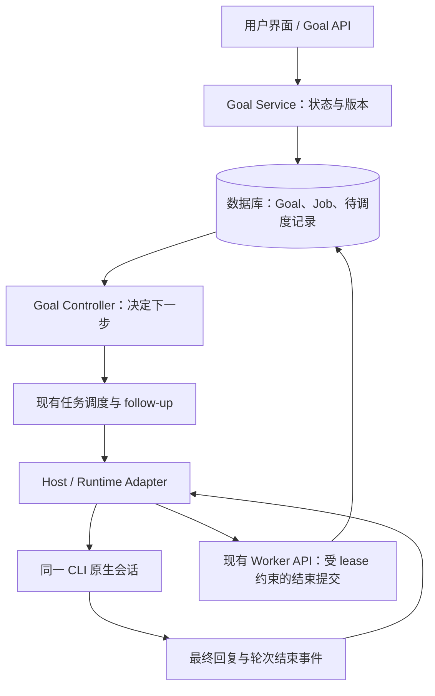

# Cloud Agent 对话 Goal 设计

日期：2026-09-20

状态：**已实现。** 本文既是方案也是实现说明；实现落在 `cloud_agent/goals/`、`cloud_agent/storage/repositories/goal_wakeups.py` 与 `migrations/versions/0018_goal_controller.py`，并替换了 PR #303 原有的四状态 Goal。已实现的原生会话与沙箱边界继续适用。§2.1 的差异表是实现依据，§13、§14 已按实际落地情况标注。

评审基线：[PR #303](https://github.com/HarvardMadSys/hybridInference-cloud-agent/pull/303)，commit `84705e0552b633da44c5120ee2ebc8582b5328fa`。DeepSeek Harness 参考基线为 `ddefc45fbc7f8e46dd73185e68295696d1297887`。下文“现有 PR”均指该快照；其部署状态不在本文中作假设。

## 1. 方案摘要

**平台保存 Goal，外层调度器驱动当前 CLI 的原生会话，运行时适配器接收模型的完成报告。Goal 不依赖 MCP。**

用户设置“持续修复，直到目标功能可用”后，平台在每轮结束时决定继续、暂停或完成。每个自动轮次仍是普通 job，复用现有 attempt、lease、计费、取消、消息展示和发布流程。

| 决策 | 建议行为 |
| --- | --- |
| 状态归属 | 一个 thread 有一个当前 Goal；数据库是状态来源 |
| 管理入口 | 平台提供 `thread/goal/set/get/clear/pause/resume` 语义 |
| 续跑方式 | 当前轮结束后，向同一原生会话提交下一轮，不重放历史 |
| 模型回报 | 最终回复末尾的独立 JSON 区块；适配器转成统一报告 |
| 普通工作轮 | 未提交终止报告就保持 active，不要求每轮报告 continue |
| 完成语义 | 首版为模型报告完成，平台校验执行与版本条件；不称为独立验收 |
| 中止原因 | 用户暂停、需要输入、用户自设的轮数上限用尽、执行失败等统一记录为暂停原因 |
| 崩溃恢复 | 状态变更与待调度记录同事务持久化，后台幂等消费 |
| 使用限制 | 默认不设轮数上限，也没有默认轮数；费用继续受 Gateway 的用户配额约束，单轮超时、取消、权限与配额等既有运行层限制照常生效 |

本文覆盖首版 Goal 控制、报告协议、调度与恢复。独立验收器、定时唤醒、跨任务共享目标和各 CLI 的原生 Goal 接管均不属于首版。

## 2. 现有实现与参考依据

### 2.1 PR #303 已经拥有平台外层控制

现有 PR 的 Goal 保存在 conversation/thread 上，自动轮次由平台创建。MCP 承担 `get_goal` 与 `report_goal` 的模型接入；最终消息中的 `GOAL_STATUS` / `GOAL_REASON` 是另一条报告路径。因此本提案是在已有外层控制基础上收敛职责和协议，不是新建一个此前不存在的外层循环。[C1]

需要调整的主要行为：

| 现有 PR | 本提案 |
| --- | --- |
| MCP 报告优先，文本作为补充路径 | 首版统一使用最终消息的结构化报告 |
| 一次 complete 触发额外验证轮，第二次 complete 才结束 | 有效完成报告直接结束；独立验收作为单独能力设计 |
| 连续三轮 blocked 才停止 | 明确需要用户介入时直接暂停，不强制空转三轮 |
| blocked 与 paused 是不同生命周期状态 | 三种持久状态：active / paused / complete；原因独立保存 |
| finish 提交后同步尝试续跑，异常由后续停滞扫描兜底 | finish 与调度义务原子落库，消费者与恢复扫描完成续跑 |
| 只按 work rounds 计算上限 | 所有由 Goal 自动触发的模型轮次统一计数，包括报告修正轮 |

现有 PR 的纯决策函数、普通 follow-up 路径、attempt fencing、轮次历史快照等思路继续采用。改动不能演变成绕过现有任务系统的第二套执行器。

### 2.2 DeepSeek Harness 的可借鉴部分

DeepSeek 将持久 Goal 服务、用户 `/goal` 命令、模型工具和 `goal-round-driver` 分开。模型工具直接调用内部 `ctx.goals`；driver 在 agent 空闲时调用 `agent.followup()`。它不要求每轮最终回复都是 JSON，完成通过原生工具更新状态。[D1][D2][D3]

我们借鉴状态与续跑分离、同会话推进、版本检查及用户输入优先。接入位置由多 CLI 平台决定：模型报告先经运行时适配器，再交给平台控制器。

DeepSeek 将持久 active 与进程内 armed 分开，恢复会话后需要授权重新启动。[D4] Cloud Agent 已拥有持久任务队列，本提案让 active 表示用户仍授权平台自动推进；控制服务重启后可以恢复未完成的调度义务。Fork、新任务和失去原生上下文仍不能自动获得继续执行的授权。

## 3. 职责与边界



| 组件 | 负责 | 不拥有的权限 |
| --- | --- | --- |
| Goal Service | owner 鉴权、状态转换、版本检查、操作审计 | 不调用模型，不在请求内等待下一轮完成 |
| Goal Controller | 根据状态、轮次结果和排队情况，决定续跑或停止 | 不实现 CLI 内部工具循环，不直接运行仓库命令 |
| Runtime Adapter | 识别本轮最终消息与正常结束，提取报告 | 不创建或改写目标，不决定是否继续调度 |
| CLI / 模型 | 执行用户工作，报告完成或所需输入 | 不自建 Goal，不改轮数上限，不恢复用户暂停的 Goal |
| 现有执行与发布系统 | attempt、lease、原生会话、沙箱、计费、发布 | 不另设 Goal 专用权限或费用体系 |

模型获得目标和本轮上下文，通过已有提示输入通道工作。报告沿 CLI 输出、Host、Worker API 返回。沙箱不直接调用 Goal 管理 API，不增加网络目的地、控制面凭据或共享工作区状态文件。

用户配置的 MCP 工具继续按现有逻辑工作；“Goal 不依赖 MCP”不改变两条固定 relay 的网络边界。

## 4. 数据与生命周期

### 4.1 当前 Goal

以下是逻辑字段，最终数据库布局在实现时映射到既有 storage ports；不是已存在的 schema。

| 字段 | 语义 |
| --- | --- |
| `thread_id` | 所属任务 |
| `goal_id` | 当前目标身份；创建或替换目标时生成新值 |
| `revision` | thread 级单调递增的 Goal 控制版本；clear 后也不归零 |
| `objective` | 用户给出的完成目标，建议沿用 4,000 字符上限 |
| `state` | `active`、`paused`、`complete` |
| `max_rounds` | **三态、可选**。省略 = 保持该 Goal 现有的上限不变；给数字 = 设置上限；显式 `null` = 解除上限。列为 `NULL` 表示“没有上限”。不用 999999 之类的哨兵值代替：哨兵在列里、在 API 里、在故障描述里都和“用户真的设了这么大”无法区分 |
| `pause_reason` / `pause_detail` | 机器可读原因与用户可读说明，仅暂停时使用 |
| `completion_basis` | 首版只有 `model_reported`，完成时记录 |
| `completed_by_job_id` | 导致完成的有效 job |
| `created_at` / `updated_at` | 生命周期审计时间 |

`rounds_used` 从当前 `goal_id` 的已开始自动 job 推导，不由模型填写。状态版本变化不重置轮数；目标替换后使用新 `goal_id`，新目标从零计数。所有历史 job 保留自己的目标快照。

没有当前 Goal 用 `goal = null` 表示，不增加 `cleared` 状态。clear 仍留下操作记录和控制版本，历史报告不能命中新目标。

### 4.2 三种状态

| 状态 | 自动续跑 | 进入方式 |
| --- | --- | --- |
| `active` | 满足调度条件时继续 | owner 创建、替换已完成目标、显式 resume |
| `paused` | 否 | owner pause，或平台记录一个停止原因 |
| `complete` | 否 | 平台接受当前目标的有效完成报告 |

建议暂停原因包括：`user`、`needs_input`、`round_limit`、`execution_failed`、`cancelled`、`report_invalid`、`report_unavailable`、`runtime_unsupported`、`context_lost`、`access_denied`、`quota_unavailable`、`scheduling_failed`、`archived`、`fork`。

“任务很难”本身不是 `needs_input`。该报告应说明缺少什么信息、权限或用户选择。这里记录的是模型判断；平台不宣称已经独立验证障碍确实存在。

### 4.3 用户操作语义

| 操作 | 状态与计数 | 已排队 / 正在运行的轮次 |
| --- | --- | --- |
| 创建 | 新 `goal_id`，active，计数为零 | 空闲时持久化首次调度义务；有人工作时等待 |
| 修改目标内容 | 新 `goal_id`，计数为零；原来 paused 则仍 paused | 取消旧自动排队轮；当前执行不被改写，下轮使用新目标 |
| 只改轮数上限 | 保留 `goal_id` 与计数；不自动恢复 paused | 重新校验排队轮；新上限已耗尽则暂停（产品界面不提供该入口，只有显式调用 API 才会出现） |
| 只改目标正文 | 保留原上限（请求没提上限就是“不变”），`goal_id` 与计数按换目标处理 | 取消旧自动排队轮；当前执行不被改写 |
| pause | paused(user)，增加 revision | 取消未开始的自动轮；已运行轮可以正常结束 |
| resume | active，增加 revision，计数不变；若 Goal 自带上限且该上限已用尽，则在同一条语句里清空 `max_rounds` | 空闲时安排工作；上下文丢失等仍然拒绝恢复，但“达到上限”不再是拒绝理由 |
| clear | 当前 Goal 置空，增加 revision | 取消未开始的自动轮；保留普通消息和执行历史 |
| 停止当前轮 | 沿用现有取消入口，同时暂停 active Goal | 不因停止当前轮而自动补发另一轮 |

pause 表示停止后续自动工作；立即中断仍使用“停止当前轮”。界面必须说明两者差别。

active 目标修改后继续 active；paused 目标编辑后仍需显式 resume。已 complete 的目标再次 set 视为新一轮授权，即使文字相同也生成新身份。

暂停、清除和编辑都会使旧 revision 的报告失效。即使旧轮次后来正常结束，其文字和产物仍保存，但不能修改当前 Goal。

## 5. 管理 API

`thread/goal/*` 表示平台服务的操作语义，不要求新增一套通用 RPC 框架。建议 HTTP 接口以 thread 为资源：

| 操作 | 建议 HTTP 路由 |
| --- | --- |
| `thread/goal/get` | `GET /v1/agent/threads/{thread_id}/goal` |
| `thread/goal/set` | `PUT /v1/agent/threads/{thread_id}/goal` |
| `thread/goal/pause` | `POST /v1/agent/threads/{thread_id}/goal/pause` |
| `thread/goal/resume` | `POST /v1/agent/threads/{thread_id}/goal/resume` |
| `thread/goal/clear` | `DELETE /v1/agent/threads/{thread_id}/goal` |

这些是拟议路由。现有 PR 的 `/jobs/{job_id}/goal` 通过 job 定位 thread；若需要兼容已有客户端，应让旧路由委托同一个服务，不能保留两套状态实现。

所有读取和操作校验 thread owner。修改请求必须带期望 `revision`，冲突返回 409 与最新版本；无 Goal 时 GET 仍返回当前控制版本。对首次创建也执行比较，防止两次并发创建互相覆盖。DELETE 可通过 `If-Match` 传递版本。

写操作接受幂等请求标识；同一标识的重试返回原结果，参数不一致则拒绝。完成状态由内部 fenced 结果路径写入，不提供模型可调用的 owner mutation API。

`set` 可以单独启动已存在任务上的 Goal，不要求额外发一条“开始”消息。若用户同时提交消息和 Goal，两者原子保存，由该用户轮先工作，不能再并发创建首次自动轮。

## 6. 每轮执行上下文

Host 接收的本轮快照包含 `goal_id`、`revision`、`objective`、当前计数和上限、报告协议版本。身份字段由平台绑定到 job / attempt，模型无需填写。

目标上下文在每轮实际执行前注入：

- 用户轮携带当时的 active Goal；普通提问仍优先处理，Goal 不扩大该轮的权限。
- 自动轮明确标识为 Goal 触发，包含完整目标、当前轮数和继续工作的指令。
- 自动轮要求根据当前工作区和真实工具结果推进，不把之前的叙述当作现在仍成立的事实。
- 做完时提交完成报告；确实需要用户介入时提交所需输入；还有可做工作时保持 active。
- 完成、暂停、清除后的新普通轮不再收到 active Goal 指令。

Goal 修改与任务 claim 竞争时，排队自动轮必须在执行前再次校验身份、revision、状态与剩余轮数。检查失败就撤销该自动轮，再按新状态决定。已运行轮的快照不可中途改写。

同一 thread 复用原生会话。健康 CLI 进程可以跨轮存活；需要重启进程时沿用现有 native resume。控制器不激活 CLI 自带的另一套 Goal 续跑功能，避免平台和 CLI 同时决定下一轮。

## 7. 模型报告协议 v1

### 7.1 格式

正常回复保持自然语言。仅当模型报告完成或需要用户介入时，在最终回复末尾附加一个独立区块：

````text
已实现目标功能，相关测试通过。原有接口行为保持兼容。

```cloud-agent-goal-report
{"version":1,"outcome":"complete","reason":"目标功能已实现，相关测试通过","evidence":["运行 pytest tests/test_feature.py，退出码为 0"]}
```
````

需要输入时，区块中的 JSON 为：

```json
{
  "version": 1,
  "outcome": "needs_input",
  "reason": "需要用户指定部署环境，才能继续配置对应的回调地址",
  "evidence": []
}
```

约束：`version` 固定为 1；`outcome` 仅允许 `complete` 或 `needs_input`；`reason` 为非空文本，最多 2,000 字符；`evidence` 是可选的文本数组，最多 8 项，每项最多 1,000 字符；整个 JSON 不超过 8 KiB UTF-8。

`evidence` 是模型提供的说明，不是已经验证的执行记录。引用的命令不会因为出现在报告中而被平台执行。

解析使用严格 JSON，拒绝未知字段、重复键、不合法枚举和超限内容；不截断后再接受。识别到的区块必须唯一、完整，并位于最终消息末尾，结束后只能有空白。不使用模糊匹配、自动补全 JSON 或自然语言猜测结果。

### 7.2 四种解析结果

| 结果 | 含义 | 平台行为 |
| --- | --- | --- |
| `absent` | 已可靠取得完整最终消息，其中没有报告区块 | 正常工作轮保持 active，受轮数上限约束继续 |
| `valid` | 唯一且符合 schema 的报告 | 进入状态决策；尚不等于已接受完成 |
| `invalid` | 出现报告标记但格式、字段、数量或位置不合法 | 允许受限修正，否则暂停 `report_invalid` |
| `unavailable` | 最终消息无法确定、丢失或无法确认完整 | 暂停 `report_unavailable`，不能当作 absent |

“没有报告就继续”只适用于正常结束且完整最终消息可读的普通工作轮。报告修正轮缺少报告算修正失败；失败、取消或异常终止的轮次不适用这条默认规则。

每份无效报告最多触发一次修正，修正轮关联原 job，不能再次触发修正。它按一个普通自动模型轮计数，仍使用同一原生会话。修正轮只整理已有结果；只有适配器能在固定 CLI 版本上可靠禁止工具执行时，才启用自动修正。剩余轮数不足、能力未验证或修正再次失败，直接暂停。首版 Goal 的可用性不依赖任何 CLI 已具有该修正能力。

### 7.3 适配器与可信边界

适配器只处理当前 attempt 的根会话最终 assistant 消息；排除工具结果、thinking、中间回复、子 agent 输出、历史消息和仓库文件。不能扫描整份 transcript 找一个看起来有效的报告。

原生 turn 完成事件只证明该轮结束，不证明目标达成。报告先作为候选保存，等待正常终态后一起提交。报告之后发生错误、取消或终态未确认时，不能接受 complete。

最终消息的确定和尾部区块提取必须发生在通用日志截断之前。若只能拿到截断片段，不能声称区块唯一或最终消息完整。适配器应有有界缓冲、完整性标记与增量区块检测，不为此无限保存 stdout。

Host 返回统一 `GoalReportEnvelope`：协议版本、解析结果、可选报告、源消息标识或摘要哈希。`job_id`、`attempt_id`、lease generation、目标身份与 revision 由现有受认证执行上下文绑定，不能采信模型输出的身份信息。控制面再次执行 schema、大小、来源与 fence 校验。

源消息已持久化后才能提交其引用；若报告随 finish 一起提交，应在同一事务保存规范化报告与其有限审计依据。该结构是拟议的 Host/Worker 契约变化，不能宣称无需升级 Host。

即使通道校验正确，报告内容仍是模型声明。结构化格式解决歧义与传输，不提供事实认证。

## 8. 轮末决策与完成语义

Goal Controller 保留“纯决策函数 + 持久化编排”的结构。正常决策读取当前 Goal、触发事件、本轮执行结果、报告、轮数及用户排队情况；决策函数不访问网络、数据库或 CLI。

建议按以下顺序判断：

1. **执行身份有效。** finish 必须先通过当前 attempt / lease 校验；被替代的 attempt 不能提交有效报告。
2. **当前仍有 active Goal。** 已暂停、清除或完成时，不因任何迟到消息恢复运行。
3. **报告属于当前目标。** 只有匹配 `goal_id` 与 revision 的结果才能改变 Goal；旧结果仅保留历史。旧轮结束可以解除忙碌状态，由新目标的调度义务继续处理，但不能沿用旧报告。
4. **本轮可正常结算。** 失败或取消不能贡献完成；用现有 attempt 重试策略处理执行失败，耗尽后暂停相应目标。Goal 不自行增加一套失败重试循环。
5. **优先处理用户输入。** 有新的用户轮待处理时，不新增自动轮，也不使用此前的 complete 提前结束目标。待用户轮结束后按新结果判断，不跨轮继承旧 complete。
6. **接受有效终止报告。** `needs_input` 暂停；满足下述条件的 `complete` 完成。最后一个允许轮次的有效 complete 仍可以接受。
7. **处理无效或缺失的传输。** `invalid` 执行第 7 节的有限修正规则；`unavailable` 暂停，不继续猜测。
8. **检查轮数。** 没有有效终止报告且轮数已耗尽则暂停；否则创建下一工作轮。

owner 创建或 resume 的触发事件不需要先有模型报告；其依据是新的用户授权和当前任务可执行状态。所有分支在真正写入前重新检查目标版本和 thread 当前排队状态。

### 8.1 首版完成的确切含义

接受 complete 必须同时满足：

- 报告来自明确归属本轮的最终消息，解析合法。
- 本轮已经正常结束，未失败、取消或被新的执行租约取代。
- 当前目标仍 active，目标身份及 revision 与执行快照匹配。
- 没有尚待处理的更新用户输入；本轮仍是该判断所依据的当前会话进度。

满足这些条件后记录 `completion_basis = model_reported`。界面可以显示“已完成 · Agent 判断”，并展示完成说明与相关轮次。该状态不等于“平台独立证明所有验收条件成立”。

不默认追加一轮“再次确认完成”。同一个模型再次声明 complete，仍然是模型判断，不构成独立验收。

### 8.2 独立验收的后续接口

明确、可执行的验收应作为单独能力：用户或项目配置预先定义检查，平台在沙箱内运行，通过真实退出码和产物决定是否满足该检查。不能从模型的 reason 文本中提取任意命令执行。

这种能力需要额外定义检查权限、超时、结果归属、工作区版本及并发修改条件。共享工作区中的兄弟任务可能继续写文件，某次测试通过不能被解释为当前工作区永久满足目标。

首版不开放尚未实现的 verifier 配置，不自动将模型所称的“测试通过”升级为 verified。如果之后提供 `checks_passed`，还必须说明这些检查覆盖了哪些条件，不能把测试集合通过自动等同于全部自然语言目标完成。

## 9. 持久化续跑与并发

### 9.1 调度义务必须落库

现有 PR 在轮次终态提交后调用续跑逻辑。[C2] 本提案用一个持久的待调度记录消除“本轮已结束、下一轮尚未创建”的恢复缺口。

拟议表或等价存储记录 `goal_wakeups` 包含：thread、目标身份与 revision、触发类型、触发记录标识、处理状态、消费租约及重试信息。它只表达“需要重新判断”，不能单独授权执行一个已失效的目标。

必须原子完成的写入：

| 触发 | 同一事务内保存 |
| --- | --- |
| owner 创建 / 编辑 / resume | 目标变化、审计记录、必要的 wakeup |
| worker finish | fenced 终态、报告及审计依据、对应 wakeup |
| 控制器决定继续 | 下一普通 follow-up job、此次调度决定、wakeup 已处理 |
| 控制器决定停止 | Goal 状态与原因、此次调度决定、wakeup 已处理 |
| owner pause / clear | 新版本、取消未开始自动轮、使旧 wakeup 失效的状态 |

这些组合写入由窄的 storage command 提供，不能让控制器分别调用几个不相关的提交后假定它们是原子的。沿用仓库 thread 在 job 之前的锁顺序，避免在 claim 或 finish 中反向锁定。

消费允许重复，实际创建下一轮必须幂等。幂等身份包含目标、版本、触发类型、触发记录和轮次类型；finish 触发使用 parent job 身份，不仅使用显示轮号。取消后重发、resume 和替换目标都有新的有效触发身份。

幂等键只处理同一事件重放。不同事件并发还必须由 thread 串行检查与写入约束保证：同一 thread 不会因为两个 wakeup 同时创建两个自动轮。

### 9.2 消费流程

1. 领取 wakeup 的短租约，读取其 thread 与当前 Goal。
2. 校验归档状态、原生上下文、仓库访问资格、运行时能力及现有 admission 条件。
3. 如需访问外部服务，先完成该读取，再进入最终数据库事务；不长时间持有 thread 锁等待网络。
4. 在事务内重新读取 revision、用户排队情况和执行状态，运行决策，原子保存结果。
5. 只有普通任务队列中的 job 可以被 Host claim；wakeup 消费者不直接启动 CLI。

已有执行轮或用户输入时，持久记录“等待该轮结束”的调度状态。thread 内任意轮次结束都重新唤醒当前 active Goal 的等待项，包括在 Goal 创建之前已开始、没有 Goal 快照的用户轮。不能消耗 set/resume 的唯一 wakeup 后让目标失去触发来源；唤醒新目标也不意味着接受旧轮次的完成报告。

临时调度基础设施故障重试 wakeup，使用有界退避；不新建一个模型 job 来“重试调度”。确认无法继续时记录具体暂停原因，不能长期只在日志里报错而让界面显示 active。

### 9.3 进程在任意位置退出

| 崩溃位置 | 恢复行为 |
| --- | --- |
| finish 事务提交前 | 沿用现有 fenced finish 重试，不产生半份报告 |
| finish 已提交、消费者未运行 | wakeup 仍 pending，恢复后消费 |
| 消费者计算完成、事务未提交 | 决策无副作用，租约释放后重新计算 |
| 下一轮已入队、消费者未收到成功响应 | 重放命中同一决定和 job，不再创建 |
| owner 已暂停、旧消费者仍在运行 | 最终版本检查失败，不允许续跑 |
| 服务恢复时 active 且没有任何待执行事项 | 恢复扫描核对终态与操作记录，补回可证明遗漏的 wakeup；无法解释时暂停并记录异常 |

控制服务重启不撤销用户已有的 active 授权。Host 崩溃后仍按现有 attempt 与 native resume 规则恢复；若原生会话或 retained container 已丢失，暂停 `context_lost`，不得重放 transcript 伪造恢复。

### 9.4 用户消息与自动轮竞争

提交用户消息时，在 thread 的同一个并发边界内撤销尚未开始的自动轮，让用户轮优先。自动轮 claim 时也重查资格。

如果自动轮已经开始，用户输入沿用现有消息排队或 steering 机制；本提案不引入新的中断方式。后续控制器必须观察已接受的用户输入，不能在它前面再插入一个自动轮。用户输入的到达版本或等价序号应进入完成判定，防止事务之间发生抢先完成。

## 10. 轮数、权限与运行边界

### 10.1 轮数计数与上限

**默认没有上限。** 用户只需要描述“做到什么程度”，平台就一直推进到：目标完成、
用户暂停或清除、需要用户介入的阻塞、或既有运行层限制（账号配额、单次执行超时、
取消、权限失效）生效为止。没有默认轮数，也没有最大轮数；`rounds_used` 是给用户
看的统计值，本身不构成停止条件。

- 计数沿用保守的“已开始”定义：首次通过执行资格校验并取得执行租约时计一次；
  未开始就被撤销的排队 job 不计数，一个 job 的多个 attempt 不重复计轮。
- 计数包含 `work` 与 `report_repair` 两种轮次：它描述的是花销，不是进展。
- 用户主动提交的轮次不消耗自动轮数，但仍正常计量其推理用量。
- `rounds_used` 按 `goal_id` 的已开始 job 推导；pause/resume/编辑都不清零。
- 只有当调用方显式设置了 `max_rounds` 时，该数字才参与决策：计数达到它时暂停并
  记录 `round_limit`。检查发生在报告之后，所以“最后一个允许轮次上报告的完成”仍然
  成立。
- **写入是三态的**：请求里省略 `max_rounds` 表示“不动现有上限”，显式 `null` 才是
  解除。界面的内联编辑只改目标正文，因此它的请求天然省略该字段——把“省略”当成
  “没有上限”会让每一次普通编辑都静默删掉用户写下的约束。
- 这个上限不是 token、时间或金额上限，也不覆盖一次 CLI turn 内部的多次模型调用。
  所有调用仍受 Gateway 用户配额约束。

**解除上限与恢复路径。** 产品界面不提供修改轮数上限的表单，因此“达到上限”不能
变成没有出口的暂停态：resume 会在同一条语句里判断上限是否已经用尽，用尽则清空
`max_rounds`，并在响应里把新的 `max_rounds = null` 返回给前端，让这次变更可见而
不是隐含的。没有用尽的上限原样保留——“最多 50 轮、第 3 轮被用户暂停”resume 之后
仍然是 50 轮。修正协议格式也不能获得免费的额外模型轮。

### 10.2 Fork、归档与上下文

Fork 继续遵循[原生会话与共享工作区设计](2026-08-31-native-session-fork-shared-workspace-design.md)。如果复制当前目标到子任务，使用新 `goal_id`、零计数和 paused(fork)，由用户决定是否启动；父任务不因此暂停或修改目标。

目标属于 thread，不属于共享 sandbox group。兄弟任务各自拥有 Goal 状态和原生会话，工作区仍可能同时变化。Goal 不引入 group 全局串行锁或工作区快照。

归档、原生上下文丢失、访问资格撤销等条件会停止续跑并留下原因。恢复任务展示、补充普通消息或重新连接页面本身不等于 resume。

### 10.3 权限沿用现有任务规则

Goal 只授权在既定任务范围内持续工作，不扩大部署、合并、发送消息、使用凭据等操作的权限。需要用户决定的动作仍遵循已有审批入口；不能通过自动发下一轮绕开正在等待的审批。

不新增每任务金额预算，不传入 Gateway 长期密钥，不开放沙箱到控制面的新网络通道。外部工具访问继续走现有用户 MCP 连接与授权体系。

## 11. 界面与事件

**Goal 的创建、查看和编辑都留在聊天输入区，没有大弹窗。** 输入 `/goal <目标>`
直接提交；命令菜单里选中 Goal 时只在输入框插入 `/goal ` 并把焦点留在框内，由用户
继续写目标；只有 `/goal` 而没有内容时不创建空目标、也不把命令当普通消息发给模型，
只提示补上目标。加号菜单的 Goal 入口走同一套交互，不再保留另一套弹窗。

输入框上方保留紧凑目标条，显示目标、状态、暂停／继续、编辑、清除。状态条显示
“已执行 N 轮”；只有用户自己写了上限时才显示总数（“已执行 N 轮（上限 M 轮）”），
不再默认显示 N/10。编辑在目标条原地展开，提供保存和取消：保存失败时草稿留在原地，
compare-and-set 冲突触发的重读不会用另一个标签页的目标覆盖草稿，而重试会带着重读
拿到的新 revision 发出。pause 的文案明确“当前轮可继续完成”；即时终止使用已有停止
按钮。

active 状态可以派生为“执行中”“等待用户轮完成”“正在安排下一轮”，这些是展示阶段，不增加持久生命周期状态。paused 显示具体原因和恢复所需动作；complete 展示完成来源与对应轮次。

自动轮使用系统标记“自动执行 · 第 N 轮”，可以展开原始提示；不伪装成用户发送的消息。正常文本继续流式展示，报告区块在识别后折叠到结果元数据；原始事件与审计依据保留。无效区块只说明报告读取失败，不据此显示完成。

Goal 状态和调度变化必须通过 thread 可订阅的事件或等价读取机制展示。前端不能因为当前 job 已结束就停止观察仍 active 的 Goal，也不能依赖 finish 请求返回前一定已经产生下一 job。

同一轮的代码、消息和发布结果仍沿用原有展示。Goal 完成不自动意味着 PR 已合并或发布完成；如果目标要求某个外部动作，报告及界面需要区分该动作的真实结果。

## 12. 运行时接入与能力验证

不假定所有 CLI 都支持原生 JSON Schema、自定义工具或工具禁用。本方案的最低能力是：确定当前根会话的最终消息、确认终态、在输出截断之前提取报告，并继续同一原生会话。

当前 PR 的固定版本如下。[C3] 表格是需要验证的基线，不表示新的 Goal 报告协议已经通过验收。

| Runtime | PR 固定版本 | 必须核实的接入行为 |
| --- | --- | --- |
| Claude Code | 2.1.220 | stream-json 消息与 result 的归属、重复结果及错误终态 |
| Codex | 0.145.0 | app-server thread/turn 归属、最终消息与 turn 结束的关系 |
| Pi | 0.73.1 | RPC 消息块的完整组装、agent_end 与错误状态 |
| OpenCode | 1.18.9 | serve bridge 的消息身份、完整结束边界与会话复用 |
| Kilo | 7.4.17 | serve bridge 的消息身份、完整结束边界与会话复用 |

建议在现有 Host 能力证明中声明 `goal_report_v1`。不满足能力要求的 runtime 不能接收 active Goal 的自动轮，但普通任务可以按既有能力正常运行。切换到不支持 Goal 的 runtime 时先暂停并说明原因，不静默变成无法读取报告的循环。

可选的报告修正能力另行声明；只有真实版本测试通过才能开启。以后原生工具或结构化结果接入同一个内部报告契约时，必须保持版本、lease、终态和计数规则一致。首版不并行启用多个报告来源，也不设计隐含的来源优先级。

## 13. 实现范围与迁移建议

本节是后续实施计划；本次交付只新增本文。

| 范围 | 预期变化 |
| --- | --- |
| `cloud_agent/goals/` | Goal 数据语义、纯决策函数、统一报告 schema、控制器 |
| `cloud_agent/ports/` 与 storage repositories | CAS、组合事务、wakeup 消费、幂等入队与恢复查询 |
| owner API | thread 级管理入口；必要时兼容 PR 中的 job 入口 |
| Worker 契约与 finish | 报告审计和结束事务，调度义务原子落库 |
| `cloud_agent_host/` | 五种 runtime 的最终消息识别、报告提取和能力证明 |
| `web/` | 状态与原因、自动轮标记、报告折叠及跨轮观察 |
| Goal 的 MCP 接入 | 移除 PR 引入的内置 goal 工具；保留其他 MCP 功能 |
| migrations | 仅按实际部署情况增加所需迁移，不直接改写已应用 migration |

先确认 PR 的 schema 和接口是否已有部署，再选择迁移方式。**本仓库当前的结论是：
没有存量数据。** `0019_conversation_goal` 与 `0020_goal_controller` 随 PR #303 的
squash 提交一起落到 `dev`，代码库内没有已部署的控制面数据库带 Goal 行；把本机
Postgres 上所有含 `agent_threads` 的库都查过一遍，命中的全部是测试库（`_test_`），
其中只有一个是调试库、一行 Goal。因此 `0022_goal_open_ended` 不需要回填。

即便如此，迁移仍然按"可能已有数据"来写，因为回填一旦猜错是不可逆的：

- **不因迁移自动恢复 paused Goal。** `0022` 只改形状约束，不碰任何一行的状态。
- **不擅自取消用户明确设置的限制。** 带 `goal_max_rounds = 10` 的行原样保留。旧前端
  默认就是 10，所以 10 值得怀疑——但怀疑不是证据，同一个值也完全可能是调用方自己
  指定的；凭数值恰好等于 10 就判定它是默认值，等于替用户删掉一条他自己写的约束。
- **旧的 `round_limit` 暂停态必须有可用出口。** 出口是 resume：上限已用尽的 Goal 在
  resume 时清空 `max_rounds` 并继续，响应里返回 `max_rounds = null`；上限没到则原样
  保留。产品界面不提供改上限的表单，所以这条路径就是唯一的恢复路径，不能留下一个
  按哪个按钮都解不开的暂停状态。
- **向下迁移是有损的，但选择保目标而不是保上限。** 旧形状无法表示"没有上限"，所以
  `0022` 的 downgrade 会给这些行填回旧默认值 10：丢掉目标远比给它加个上限糟糕。
- 老版本报告可以用于展示历史，不能驱动新版本 Goal 状态。

`0022` 之后的形状约束是：`goal_objective` 与 `goal_id` 同时存在或同时为空；
`goal_max_rounds` 可以为 `NULL`（不设上限），一旦存在则必须 `>= 1`；上限不能脱离
目标存在。没有上界：`50` 这个天花板也一并移除了。

## 14. 验收标准

实现阶段需要覆盖真实状态转换和恢复边界；本次文档交付不执行这些运行时测试。

| 类别 | 必须验证的行为 |
| --- | --- |
| 正常多轮 | 前几轮无终止报告继续，最终有效 complete 停止；全程同一原生会话 |
| 无 MCP | 未配置任何用户 MCP 连接时，五种 runtime 的 Goal 均可工作 |
| 最后一轮 | 达到上限的该轮有效 complete 能完成；无报告则按上限暂停 |
| 无默认上限 | 未显式设置上限的 Goal 超过旧的 10／50 轮仍继续排下一轮；显式设置的上限仍然生效 |
| 解除上限 | 自设上限用尽而暂停的 Goal，resume 后 `max_rounds` 变为 `null` 并继续；未用尽的上限不被清除 |
| 缺少输入 | 有效 needs_input 立即暂停，明确展示所需输入，不空转三轮 |
| 最终消息 | 工具输出、子 agent、中间回复、旧历史中的合法示例均不能提交报告 |
| 严格解析 | 重复区块、重复键、未知字段、截断、超限、尾随正文被拒绝 |
| 无报告与不可读 | absent 可以继续；无法证明最终消息完整时暂停 |
| 异常终态 | 已输出 complete 后发生失败、取消或租约失效，不完成 Goal |
| 旧版本 | 目标编辑、pause/resume、clear/recreate 后，旧报告不能修改新状态 |
| 人工优先 | 用户消息与自动入队、claim、complete 竞争，不抢先续跑或完成 |
| 幂等 | 重复 finish、重复 wakeup、消费者崩溃不产生重复自动 job |
| 原子恢复 | 在 finish 与调度的各提交边界注入故障，恢复后有确定结果 |
| 等待已有工作 | 在旧用户轮运行期间 set/resume，旧轮结束后能唤醒新目标，不能借用旧报告 |
| 轮数 | 未开始取消不计数、已开始计一次、attempt 重试不重复计轮 |
| 修正报告 | 能力不足不修正；具备能力时最多一次，禁用工具且计入上限 |
| 会话丢失 | native state 丢失后暂停，不通过 transcript replay 继续 |
| Fork | 子任务目标暂停且身份独立，不影响父任务或自动启动 |
| 混合版本 | 不兼容 Host 拒绝 Goal 自动轮，不丢失报告后继续空转 |
| 界面 | 前一 job 结束到下一 job 入队之间持续观察；报告不混入普通正文 |

单元测试覆盖决策和解析边界；Postgres 集成测试覆盖真实事务、版本、锁顺序、幂等与故障恢复；各固定 CLI 做真实 native-session 多轮验收。按仓库要求，实施 PR 前运行 `make check`，并运行相关数据库和外部验收。不能只用模型输出 fixture 声称五种 CLI 已兼容。

## 15. 取舍与评审重点

| 方案 | 取舍 |
| --- | --- |
| 平台管理 + 输出报告（本提案） | 一套状态和调度语义，覆盖多 CLI；需要可靠识别最终消息，承担模型漏报或格式错误 |
| 平台管理 + MCP 报告 | 有显式结构化工具通道；Goal 与 MCP 运行配置耦合，不符合本次希望去掉该依赖的方向 |
| 直接使用各 CLI 原生 Goal | 可以利用各自的内部工具；平台需要协调不同状态、恢复和循环规则 |
| 每轮额外模型判断是否完成 | 增加成本和另一条执行路径，依然依赖模型判断 |
| 每轮完整回复强制为 JSON | 在支持强制 schema 的 runtime 上更明确；影响普通回答形态，也需要单独核实所有 CLI 能力 |
| 模型写共享工作区状态文件 | 接入直接，但带来兄弟任务覆盖、旧文件与仓库写入混淆，需要额外文件协议 |

### 15.1 实现与原提案的两处偏差

| 位置 | 提案 | 实现 | 原因 |
| --- | --- | --- | --- |
| §4.2 三状态 | 建议三状态 | 三状态，另加一条数据库约束 `goal_state` 与 `goal_objective` 必须同时存在 | Postgres 的 CHECK 是**按语句**校验而不是按事务；把状态与目标内容绑在一起会让新建目标无法在单条语句内满足约束（已在实现中复现 `23514`）。状态与"为什么停"的绑定约束（paused ⟹ reason + detail）保留 |
| §12 能力证明 | 在 Host 能力证明中声明 `goal_report_v1` | Host 侧声明已经加上；控制面同时保留一份按 runtime 的已验证集合 `GOAL_REPORT_RUNTIMES` | 两者都在时取交集，未升级的 Host 不会让普通任务失败，未验证的 runtime 也不会静默进入读不到报告的循环 |

修复轮（`report_repair`）在实现中默认关闭：`REPORT_REPAIR_RUNTIMES` 为空集，因此在任何 runtime 通过真实版本验证之前，格式错误的报告直接以 `report_invalid` 暂停，并展示解析失败的具体原因。这与 §7.2 一致，不是遗漏。

本提案接受的主要限制：模型可能不报告已经完成，平台会继续到后续报告或轮数上限；格式正确也不能证明目标真实达成。有限轮数、来源校验、版本隔离和明确的完成来源分别处理这些不同问题，不能互相替代。

评审重点是：是否接受首版 `model_reported` 完成语义、三状态与暂停原因的划分、pause
不打断当前轮，以及“默认不设轮数上限、上限只由调用方显式给出”这一取舍。本文此前的
建议值（默认 10、最大 50）已被该取舍取代：未完成的 Goal 不再因为跑到第 10 或第 50
轮而暂停，平台也不再替用户设一个可以耗尽的预算。

## 16. 参考资料

以下实现链接固定到调研时读取的 commit；参考项目的行为不自动成为 Cloud Agent 的需求。

- [C1] [PR #303 原设计](https://github.com/HarvardMadSys/hybridInference-cloud-agent/blob/84705e0552b633da44c5120ee2ebc8582b5328fa/docs/specs/2026-09-18-conversation-goals.md)、[轮末决策](https://github.com/HarvardMadSys/hybridInference-cloud-agent/blob/84705e0552b633da44c5120ee2ebc8582b5328fa/cloud_agent/goals/decision.py)。
- [C2] [Worker finish 与续跑调用](https://github.com/HarvardMadSys/hybridInference-cloud-agent/blob/84705e0552b633da44c5120ee2ebc8582b5328fa/cloud_agent/api/worker.py#L1444)。
- [C3] [CLI 固定版本](https://github.com/HarvardMadSys/hybridInference-cloud-agent/blob/84705e0552b633da44c5120ee2ebc8582b5328fa/deploy/sandbox/Dockerfile.agent-sandbox#L96)、[Runtime 事件适配器](https://github.com/HarvardMadSys/hybridInference-cloud-agent/blob/84705e0552b633da44c5120ee2ebc8582b5328fa/cloud_agent_host/runtimes.py)。
- [D1] [DeepSeek Goal 模块划分](https://github.com/deepseek-ai/deepseek-harness/blob/ddefc45fbc7f8e46dd73185e68295696d1297887/packages/goal/README.md)。
- [D2] [DeepSeek 原生 Goal 工具](https://github.com/deepseek-ai/deepseek-harness/blob/ddefc45fbc7f8e46dd73185e68295696d1297887/packages/goal/tool-goal/src/index.ts)。
- [D3] [DeepSeek 同会话续跑](https://github.com/deepseek-ai/deepseek-harness/blob/ddefc45fbc7f8e46dd73185e68295696d1297887/packages/goal/goal-round-driver/src/index.ts)、[轮次提示](https://github.com/deepseek-ai/deepseek-harness/blob/ddefc45fbc7f8e46dd73185e68295696d1297887/packages/goal/goal-round-driver/src/prompt.ts)。
- [D4] [DeepSeek 持久 Goal 与运行授权](https://github.com/deepseek-ai/deepseek-harness/blob/ddefc45fbc7f8e46dd73185e68295696d1297887/packages/goal/goal/README.md)、[续跑限制](https://github.com/deepseek-ai/deepseek-harness/blob/ddefc45fbc7f8e46dd73185e68295696d1297887/packages/goal/goal-round-driver/README.md)。
- [Cloud Agent 原生会话与共享工作区设计](2026-08-31-native-session-fork-shared-workspace-design.md)、[仓库工作与安全边界](../../../AGENTS.md)。
