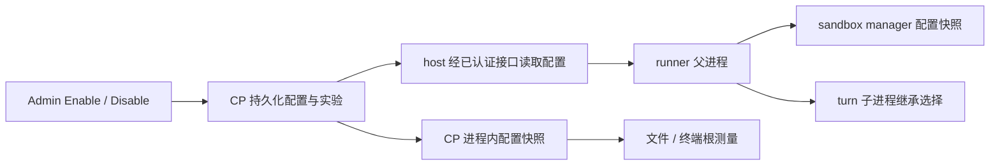

# Admin 按需测量：开始、停止和运行时生效

> 2026-09-22 更新：Admin 页面已改为持续采集直到 Disable，移除时长选择和 Details。
> 本文的定时实验说明及旧验收结果保留为历史记录；当前行为见
> [持续采集设计](2026-09-22-continuous-admin-measurement.zh-CN.md)。


日期：2026-09-21（2026-09-21 修订：按简化后的需求重写 §3–§8；短期授权续租、
参与者 ACK、由全体参与者推导的复合状态与分布式停止时限均已从设计中移除，实现、
测试与文档同步删除，不再保留兼容层）。状态：已实现，见
`docs/acceptance/2026-09-21-admin-measurement-runtime-control.md`。

代码核对基线：Cloud Agent `dev` / PR #258 的合并提交
`2aa35f4d73c4ae9dd3d47f4f2bbe2241d033a875`。执行时先同步最新 `dev`，路径和迁移号以实际代码为准。

## 1. 要交付的体验

管理员进入 **Admin → Measurements**，点击 **开始测量**，选择测什么、测哪台机器、持续多久。之后正常使用产品，匹配的操作自动采集；管理员可点击 **停止测量**，也会到期自动停止。无需为每次实验改环境变量、重新部署、重启服务或手工运行基准脚本。

一次测量实验不会主动启动沙盒、打开终端、读取用户文件或运行模型；它记录期间自然发生的操作。没有流量时，页面显示“尚无匹配操作”，而不是 0 ms。

用户已经明确取消删除筛选表单：**保留现有筛选、历史、详情和统计，在页面顶部新增控制区。** 本次不是整页重写，也不是删除 PR #258。

首版范围：

- 控制沙盒启动、终端打开、文件访问这三类已有服务端测量。
- 同一部署同时最多一个由 Admin 控制的活动实验。
- 开始、停止、自动到期、刷新后恢复状态、跨 CP replica 一致，以及无法生效时的明确反馈。
- 保留静态 env profiling 的兼容入口，但明确区分控制模式。
- 不新增浏览器端计时、纯缓存命中测量、eBPF、自动压测、跨 replica 全局采样配额和历史自动清理。

## 2. 当前代码为何不能直接接一个 checkbox

| 当前事实 | 对本次实现的要求 |
| --- | --- |
| `operation_profiling._load()` 每进程只读一次 env，`_USED_OPERATIONS` 是进程内计数 | 新增运行时配置来源，不能靠改 `os.environ` 或清空全局缓存冒充控制 |
| `bind()`、片段定类、`manifest_for_measurement()` 等还会读取“当前 run” | 在途记录必须绑定自己的不可变 run；切换实验后不能串 target、operations、manifest 或预算 |
| runner 在 claim 前选中，父进程经 `_profiling` 把选择交给 turn 子进程 | 开始信号不能只放在 claim 响应；必须在下一次 claim 前到达父进程，子进程继承起点和名额 |
| sandbox manager 的 `start_stage_recording()` 同时要求本地 run 与继承 context 匹配 | 只更新 CP 或 runner 会继续产生缺 sandbox manager 片段的样本 |
| host 心跳当前默认 30 秒；runner 与 sandbox manager 是不同容器 | 不能把“加个 heartbeat 字段”直接描述为即时开关，也不能依赖进程内变量跨容器传播 |
| 实验目录目前由首条 measurement 入库时创建 | 开始操作必须先持久化实验，零样本实验也可见、可停止 |
| `measurement-writer` 只报告回答请求的 CP 进程 | 不能拿它的 `running` 或 `Idle / off` 当全部署开关状态 |
| profiling 默认关闭，三个服务的 compose 只透传旧 env | 必须交付配置来源切换及部署接线；仅在测试中注入 provider 不算完成 |

已有端点、存储和采集器继续复用。本文对旧整合设计中“Admin 只读、env 仅重启生效、不增加控制轮询”的限制作出明确变更；原有测量边界、鉴权、片段协议、有界投递和完整性规则继续有效。

## 3. 页面与操作语义

### 3.1 控制卡片

位置：Measurements 页标题下面、现有说明与筛选上面。沿用现有组件、英文界面和鉴权流程。

```text
Measurement collection                    [Enable measurement]
Off
Collect timings while you use sandboxes, terminals and files.
Server-side timings only.
```

**只有一个按钮**，文字随状态切换：关闭时是 `Enable measurement`，采集中是
`Disable measurement`，提交中显示 `Enabling…` / `Disabling…`。不并排放两个按钮。

点击 Enable measurement 打开小表单：

| 字段 | 首版约定 |
| --- | --- |
| 操作 | Sandbox startup / Terminal opening / File access 三个复选项，默认全选，至少一个 |
| 目标 | 下拉选择当前部署的一台 host，或明确选择 All hosts；默认要求用户选择，不暗中选全站 |
| 持续时间 | 1 / 5 / 10 / 30 分钟，默认 10；后端同样限制 1–30 分钟 |
| 提交 | `Enable measurement`（表单里的主按钮）；提交期间整个卡片禁用，失败保留输入并显示错误 |

映射必须使用真实根操作：

- Sandbox startup → `attempt.startup`。
- Terminal opening → `terminal.open`；`terminal.list/create/stream_attach` 是其 request kind，不是三个新的根 operation。
- File access → `files.list` 和 `files.open`。

开启后的示意：

```text
Measurement collection                    [Disable measurement]
Measuring · Sandbox startup, Terminal opening, File access
Host: gpu-1   Expires at: 12:30 UTC   Time left: 08:42
Stored samples: 27
Changes reach every process through a background sync; allow up to 30 seconds.
```

这里的 Stored samples 使用数据库统计的真实入库行数，不拿本页行数、队列长度或本地 admitted 数替代。一次终端交互可产生多条请求记录；不要把 27 条记录称为 27 次点击。

第一版**不放“全站最多 N 条”输入框**。沿用每个根采集进程的预算保护，建议默认 100、部署级硬上限 1000，API 返回 `budget_scope=producer_instance`。详情中说明其口径；若将来需要全站精确上限，另做集中名额分配，不能把本地计数重新命名为全局上限。

### 3.2 卡片显示的是"采集配置状态"，不是"全体确认"

页面回答的是"这个部署现在被配置成采什么"，不是"每个进程是否都已经应用"。同步允许
延迟，页面把延迟写出来，而不是假装已经测量过它。四个状态：

| 展示状态 | 判据 |
| --- | --- |
| `Disabled`（`off`） | 有控制行，且当前没有未到期的实验；按钮显示 **Enable measurement** |
| `Enabled`（`on`） | 配置里的实验尚未到期；按钮显示 **Disable measurement** |
| `Unavailable` | 部署没有控制行（从未启用运行时控制）；不提供按钮 |
| `Managed by deployment configuration` | 部署未处于 `admin` 模式；不提供按钮 |

**没有** `starting` / `collecting` / `partially_active` / `stopping`。这些原本要描述
"配置传播到哪一步"，只有一张 ACK 注册表才能回答；而本功能并不问这个问题。

必须展示的内容：选中的操作（用自然语言）、目标 host、到期时间、剩余时间（本地倒数，
不低于 0）、已入库样本数、一句同步延迟提示。**状态词是 Enabled / Disabled**，不是
Measuring / Off：前者说的是配置，后者会暗示样本正在到达。**暂时没有样本时**要明确提示"开启后需要
先执行对应操作才会产生记录"，不能让它看起来像失败。关闭状态下若上一轮实验刚结束，
用 `last_stopped_run` 说明"刚关掉的是哪个实验、原因是什么"。内部诊断字段（mode、revision、deployment、预算口径）保留在 Admin API，
页面不再展示 Details 区块。

**一个按钮，不是两个**：按钮文字随状态在 `Enable measurement` / `Disable measurement`
之间切换（提交中显示 `Enabling…` / `Disabling…`）。Stop 不需要确认弹窗。

管理员刷新、关闭页面或退出登录，实验仍按服务端期限运行；浏览器不是控制器。活动状态下
每 5 秒刷新，非活动每 30 秒；页面不可见时暂停轮询，回到页面立即刷新。401/403 进入现有
撤权处理，不能吞成"关闭"。

## 4. 服务端控制记录与 API

### 4.1 数据模型

复用 `agent_operation_profiling_runs` 保存不可变实验 manifest，开始事务就创建它。扩展必要的来源、创建者、终止时间/原因，或用关联表承载生命周期；不能改写历史 manifest。

新增独立控制 capability `ProfilingControl`，沿用项目一个 port 对应一个 capability、
repository、assembly 的约定。它拥有两样东西：

1. **部署控制行**：固定 singleton key、递增 `revision`（配置版本）、当前 run、期望状态、
   修改者及修改时间，以及上一次停止的墓碑（run id + 时间 + 原因）。
2. **命令幂等记录**：request id、动作、请求内容指纹和结果；重复请求返回同一结果。

**没有参与者表。** 它本来只用于回答"每个进程是否都已应用这个 revision"，而本功能不
问这个问题：同步允许延迟，页面报告配置而不是共识，没跟上的进程继续按旧配置选取，直到
实验自己的期限。加回这张表就意味着要重新发明 ACK 去填它。

如数据库由多个部署共享，singleton key 必须使用可信的部署命名空间，不能由浏览器指定。控制行在迁移或安全 upsert 中建立，再加锁/CAS；不要再次犯“对不存在的行 FOR UPDATE 就能防并发”的错误。

`config_version`（run manifest 上）是不可变实验版本，`revision`（控制行上）是配置
变更顺序，两者不能混用。**没有续租序号**：这套机制已删除，不存在需要排序的续租。

### 4.2 Admin 接口

复用 `/admin/agent` 的管理员鉴权、审计和 `Cache-Control: no-store`，写接口遵循现有 BFF/CSRF/Origin 约定，不另开公共路由。

| 接口 | 语义 |
| --- | --- |
| `GET /admin/agent/profiling-control` | 控制模式、当前实验、revision、服务端时间、配置状态、`last_stopped_run`、stored count、同步延迟说明 |
| `POST /admin/agent/profiling-runs` | 创建并启动实验；现有 GET 不受影响 |
| `POST /admin/agent/profiling-runs/{run_id}/stop` | 停止指定实验；重复停止幂等，旧页面不能停掉另一个新实验 |

Start 请求示例：

```json
{
  "request_id": "client-generated-uuid",
  "expected_revision": 12,
  "operations": ["attempt.startup", "terminal.open", "files.list", "files.open"],
  "target": {"host": "gpu-1"},
  "duration_seconds": 600
}
```

`run_id`、`started_at`、`expires_at` 由服务器生成。All hosts 在 API 层用空 target，但 UI 必须有明确选择。拒绝未知 operation、无效 host、空操作列表、超时长、非管理员。

创建 manifest、改变控制行、保存幂等结果和审计必须同事务成功。同一部署同时只允许一个
当前实验：两名管理员同时开始只允许一个成功，另一方返回带当前 revision 的 409。

**没有"停止传播未结束"这道闸。** 它原本用来防止旧授权与新实验同时采样；授权续租删除后
不存在长期旧授权，唯一的时间边界是旧实验自己的 `expires_at`，新实验的配置版本更高，
下游按版本拒绝旧配置。

重复 Start 使用相同 request id 和相同内容，返回原 run，不能重置期限；同 id 不同内容返回冲突。先查命令幂等结果再判过期的 expected revision，保证响应丢失后的重试可兑现。

自动到期由权威时间判定，不能依赖页面保持打开或某个定时清扫刚好执行。清扫可落盘终态，
但每次读配置时一到期就必须视为关闭。

## 5. 配置如何到达三个采集端

### 5.1 显式选择控制来源

可选覆盖项 `AGENT_OPERATION_PROFILING_MODE=disabled|environment|admin`（默认行为由 [2026-09-22 设计](2026-09-22-measurement-admin-default.zh-CN.md) 更新）：

- 未设置或空白时默认由 Admin 控制，没有活动实验就不采集。旧 `ENABLED=true` 仍保留静态实验语义；`ENABLED=false` 不再隐藏按钮。
- `disabled`：部署级禁止采集，Admin 显示不可用。
- `environment`：只读旧配置，Admin 显示“由部署配置管理”，不提供假 Stop。
- `admin`：只使用持久化控制状态；旧 `ENABLED=false` 不再否决 Admin 命令，旧 RUN 也不得在 Admin Stop 后作为 fallback 被启用。初次没有活动实验就是关闭。

这个可选 mode 用于覆盖控制方式，不是每次实验的开关。CP、runner、sandbox manager 和 turn 子进程升级后默认支持 Admin，无需设置变量；每次 Enable/Disable 不要求重启。

### 5.2 传播方式与时限

采用后台同步：**不在每个业务请求/span 上查询 DB 或调用控制 API**。



1. CP 每进程一个后台任务读取控制行并更新本地快照；关闭时 30 秒一次，活动时 5 秒一次。
   本机 Admin 修改成功后可以立即唤醒本机同步。
2. runner 父进程以已有 host 身份调用 `POST /v1/agent/hosts/profiling-policy`，拿到本
   host 的配置后发布到自己的快照；关闭时 30 秒、活动时 5 秒、失败重试 10 秒，请求超时
   2 秒，加小幅抖动。
3. runner 在后台经现有鉴权 sandbox manager RPC 下发配置，sandbox manager 应用到自己的快照；sandbox manager 只接受
   **不低于**已应用版本的配置。**每次同步都重发**，不只重发"变化过的"配置：首次推送可能
   失败（sandbox manager 还在启动），而 sandbox manager 的配置在内存里，它自己重启也会丢——这两种情况在
   runner 侧都不可见，而接收端按 revision 幂等，重发是安全的。这不是 ACK 系统：runner
   不等确认，上游也不依赖它。
4. 已被选中的 turn 子进程**从 `_profiling` 里自带的不可变 manifest 恢复该次测量**，不需要
   自己先选中实验。部署路径启动的是一个**全新 Python 进程**：Admin 模式下它没有任何本地
   配置（自己的同步循环还没跑），也不读静态 descriptor。要求它"先自己选中当前实验"会让
   交接只在父进程里成立，真实子进程静默不采集。安全性来自通道而不是本地复查——这段
   context 由已经证明过该选择的父进程经管道交给它；子进程只重新声明，并仍然强制实验未过期。
5. sandbox manager 的判定分两种情况，不能混为一谈：
   - **延续**：context 带着不可变 manifest（`run` 对象），**且本进程处于 `MODE=admin`**。
     这是"已经选中的操作在 Disable 之后继续调用 sandbox manager"，必须放行，否则根记录会以缺失
     sandbox manager 阶段的形式悄悄入库——比拒绝更糟。
   - **新选择**：context 只声明操作、不带 manifest。这时**本进程的配置说了算**：run 必须
     匹配且选中该操作。调用方不能靠声明 `operations` 覆盖 sandbox manager 的配置。
   普通 profiling header 单独不能让 sandbox manager 开启采集。

   **`MODE=disabled` 与 Admin 卡片上的 Disable 是两件事，不能合并。** 前者是"本部署禁止
   采集"，包括"什么都没配"的默认值：这样的进程不能被上游 context 说服去分配 measurement
   或 recorder，否则分阶段部署无法真正静默某个 producer。所以接续**只在 `MODE=admin` 下
   可用**；`MODE=environment` 继续由本进程的静态 descriptor 决定（父子环境相同，走原有
   `_load()` 路径）。

   接续的截止时间是三个上限取较早者：**原实验 manifest 的绝对到期时刻**、传输 context
   的截止、以及（本地恰好同名时的）本地实验截止。manifest 已过期则直接拒绝——一个选择
   不能因为"在路上"而获得额外时间。

时限（实现值）：

| 环节 | 值 |
| --- | --- |
| CP 快照轮询（空闲 / 活动） | 30 s / 5 s |
| host 配置同步（空闲 / 活动 / 失败重试） | 30 s / 5 s / 10 s |
| 单次配置请求超时 | 2 s |
| 一次变更在所有进程生效的常见延迟 | 约 30 s（UI 说明这是正常情况下的预期，不是硬保证：空闲 30 s 加抖动与请求耗时） |
| 断联节点停止选取的边界 | 实验自己的 `expires_at` |

**没有 15 秒可续租授权，也没有 20 秒全量失效承诺。** 停止不需要跨机器同步时限：它只
停止"选取新操作"，已经开始的 measurement 按自己的 manifest 完成并投递，没收到停止的
节点最晚在实验到期时停止。页面把 30 秒的同步延迟直接写出来，不承诺立即生效。

### 5.3 失联

失联不阻塞业务。节点到实验 `expires_at` 后自行停止选取，不需要任何人通知它。页面显示的
是配置状态，因此不会伪造"某 host 已确认"；反过来也不会因为某 host 沉默就把整卡显示成
不可用。

## 6. 采集器需要保持的正确性

### 6.1 快照与预算

为采集器提供独立的 runtime provider，持有线程安全、原子替换的配置快照。中立词汇放 `cloud_agent_shared.operation_profiling`，HTTP/数据库/lifespan 分别由 CP 和 host 拥有；不能让 host 导入 `cloud_agent`，也不能从中立包启动网络客户端。

每条 Measurement 保存不可变 manifest、target、operations、原始 `expires_at`、配置版本和
预算归属；**没有可撤销 handle**。重复同步同一 run 的配置不会重置该 run 已用掉的名额；
切换到新 run 后，旧测量、discard、finish、export 都仍使用旧 run 的身份和预算。

配置版本只能前进：`RuntimePolicyStore.publish()` 拒绝比已应用版本更旧的快照，这就是全部
防回滚协议（不再有续租序号可供混淆）。

必须逐个审计 `active_run()` / `_load()` 的调用，至少包含 `bind`、`record_fragment` 定类、`manifest_for_measurement`、CP interaction 续接、runner handoff 和 exporter。不要仅改 `start_operation()`。

### 6.2 停止期间的操作

- 不再接纳新的根操作；不取消正在运行的文件请求、终端连接、任务、容器或模型执行。
- 已冻结记录原样投递，不能因为 UI Stop 就丢掉或修改成功结果。
- 已经开始的 measurement 正常完成、正常投递，仍受**原有实验截止时间**与采集边界约束：
  不因 Disable 被提前截断，manifest 与 `expires_at` 也不被修改。
- **它在 Disable 之后发出的 sandbox manager 调用仍然采集**：root 只是第一步，容器与 CLI 阶段发生在
  之后，那些片段属于选中它的那个实验。拒绝它们会得到"记录在、阶段缺"的样本，读起来像
  慢启动而不像配置变更。
- 未冻结记录只在**实验自己的 `expires_at`** 截止，保留已采集阶段，标为
  `profiling_stopped="expired"` 且 `collection_complete=false`；不能把部分耗时当完整样本
  算进 p50/p95。
- root、span、sandbox manager recorder 与回传片段使用一致的本地截止语义；睡眠/阻塞返回后不得把整段超期时间写进 duration。跨进程仍只传 duration，不虚构可比较偏移。
- 后续业务结果不覆盖已经冻结的 measurement outcome。长 SSE 的测量仍在 stream attach 时冻结，不等待 SSE 结束；启动仍在 prompt dispatch 冻结，不等模型执行完。
- 配置停止时刻是服务端命令时刻，本地实际停止**选取**可能晚一个同步窗口（上限 30 秒）；
  页面写出这个延迟，不伪装为全机器瞬时同时关闭。

### 6.3 入库与历史

Admin Enable 预创建的 run 与之后生产者 manifest 必须严格一致。停止时间与 revision 单独
保存，**不要改写 manifest 的原始 `expires_at`**，否则在途上传会触发 `run_conflict`。

停止后的已冻结记录仍允许在有界宽限期内交付，沿用现有 10 分钟宽限机制：**有效交付截止
就是原 `expires_at` + 10 分钟**，不是每次重试都往后顺延。不引入
`stopped_at + 传播上限` 这一类新的截止算法——Disable 不撤销在途测量，因此不需要为它单独
定义交付窗口。CP 进程内持久化与 worker HTTP 两条路径都保留现有归属、schema、幂等与
manifest 校验。

零样本实验现在是有状态的：能够区分"刚开启还没到期""已到期""已被手动停止"；仍不能仅凭
零行断言从未发生匹配操作，页面用明确的空状态提示说明"开启后需要先执行对应操作"。API 保留对旧 env 实验缺少控制状态的兼容，显示“状态未知 / 静态配置”，不捏造历史。

## 7. 开销与部署

关闭时业务入口只有本地状态检查，不分配 measurement/span、不为测量读取计时时钟、不启动测量 exporter、不写样本或上传。**Admin 动态控制仍有后台同步开销**，不能再宣称整个系统在关闭时零 I/O；应单列其轮询频率与空闲成本。

后台任务固定数量、带超时和退出清理，不按请求启动任务。延用有界 exporter / CP writer、队列容量、丢弃计数和失败隔离。控制服务或 DB 不可用时，影响的是测量可用性，不是原业务。

部署清单：

1. Cloud Agent 的 CP、host、local compose 和环境文档透传 mode（三个进程都要，sandbox manager 与
   runner 是两个容器）；默认行为保持向后兼容。
2. 迁移接最新 head；测试升级、降级和再次升级，不能凭本文写死下一个编号。
3. 能力版本随 host 注册/状态报告（`operation-profiling-control-v1`），旧版节点不能被误认
   成支持 Admin 开关。
4. FI 拥有 staging 部署，检查其环境配置如何把三个服务切到 Admin mode。若需要配套修改，列出或提交独立 FI PR；不能仅修改 Agent 仓库后声称 staging 可点。
5. 一次初始升级完成后，验收 Enable/Disable 期间服务 PID/容器不因开关而重启。不要借开关
   触发 CI、deploy workflow 或修改 GitHub Secrets。

本任务不授权生产部署、合并 PR 或擅自开启生产采集。实现和验收先在本地/测试部署完成；staging 的部署按用户后续授权推进。

## 8. 验收：用实际入口证明它真的控制采集

必须在真实路由、生命周期和父子调用接线上验证，不能只调用 helper 或用 AST 断言存在某个
关键字作为主要证据。

| 场景 | 必须验证的结果 |
| --- | --- |
| 默认关闭 | 正常启动、文件和终端操作无新测量；历史可读 |
| Enable | 真实 POST → PostgreSQL 创建实验 → CP 配置同步 → runner 真实同步 → sandbox manager 真实收到 → 真实根入口 → sandbox manager 片段 → 有界投递 → Admin 能读到记录；零样本阶段实验已可见 |
| runner 部署路径 | host 服务 claim 前选中，经真实 `_profiling` handoff 到子进程；子进程保留原 measurement id、计时起点与实验配置，且不重新占名额 |
| sandbox manager 接线 | runner 用**真实 sandbox manager client** 推送配置；sandbox manager 收到后贡献真实片段 |
| 文件和终端 | 目录与文件按真实结果分类；terminal list/create/stream attach 各自根记录、关联 ID 正确 |
| Disable | 已存结果保留；后续操作不再被选中；**已经开始**的 measurement 正常完成并入库 |
| 自动到期 | 浏览器关闭、CP 重启或后台清扫没执行时，仍按原绝对期限停采；重启不续期 |
| 乱序与失联 | 断开配置源后节点在实验 `expires_at` 停止选取；迟到/更低版本的配置不能覆盖新 Stop |
| 跨 replica | A 开、B 查/停；状态一致；两个真实 DB 连接同时 Enable 只有一个成功 |
| 幂等 | Start 响应丢失后重试仍为同一个 run、同一期限；重复 Stop 无额外副作用 |
| 下一轮 | A 在途或待投递时停止，随后 B 开始；A 的 manifest、target、片段与入库都不使用 B 的数据 |
| 预算 | 同 run 同实例反复同步不重置额度；父子不重复占用；UI 不宣称全局精确上限 |
| 鉴权 | 普通用户不能操作；401/403 到前端撤权；浏览器伪造 profiling header 不能开启 sandbox manager；host 不能请求其他 host 的配置 |
| 压力/异常 | 慢 DB、控制 API 超时、长模型任务、长 SSE 时业务不被开关/投递阻塞；队列满可见且有界 |
| 前端 | Enable 参数、Measuring/Off/到期/失败状态、刷新恢复、保留筛选、无乐观假成功 |

测试可用受控时钟验证到期，但至少有一条真实 HTTP + PostgreSQL + 独立 host/sandbox_manager 链路，
不能把所有参与者放同一进程共享一个全局变量。应用初始化和部署入口要纳入，避免"helper
正确、调用点没接"。

测量已执行但 exporter 失败等错误仍要计数；不要用"表中没有新增行"单独证明 Disable 后没有
采集。

运行仓库要求的 `make check`、相关真实 DB 测试、前端 lint/format/type-check/tests。验收
报告分开写实测通过、模拟通过和未覆盖环境。

## 9. 文件落点与交付

以下是当前落点，不要求把所有逻辑塞进这些文件：

- `apps/frontend/src/app/(agents)/admin/measurements/page.tsx` 与同目录测试：控制卡片，现有筛选保留。
- `apps/frontend/src/lib/api/adminMeasurements.ts`：类型、Start/Stop/status 客户端与错误语义。
- `apps/backend/cloud_agent/api/admin_measurements.py`：Admin 写入口与状态读取；复杂事务放 application/repository。
- `apps/backend/cloud_agent/ports/`、`storage/repositories/`、bootstrap、迁移：控制 capability、事务、生命周期及清理。
- `apps/backend/cloud_agent_shared/operation_profiling.py`：配置 provider、run 绑定、撤销、预算隔离。
- `apps/backend/cloud_agent/operation_measurement.py`、持久化与 ingest：动态根选择、续接、独立 manifest、宽限语义。
- `apps/backend/cloud_agent_host/runner.py`、host 身份客户端、sandbox_manager/client/supervisor：父进程预选、子进程继承、控制同步及片段截止。
- `deploy/`、`ENVIRONMENT.md`、FI 配套配置：真实启动入口。

完成定义：管理员能通过真实页面开启并停止真实采集，结果能入库并查询；同一操作无需人工修改 env 或重启；失败时状态不撒谎。仅按钮能点击、API 返回 200、或 mock 页面变成 Collecting，均不算完成。

交付应包含实现 PR（目标 `dev`）、简洁使用说明、测试与验收证据、必要的 FI 配套项。不要每修一个模块就等用户确认；有真实阻塞再说明，不能把既定交付遗留成“下一轮再接运行时”。
