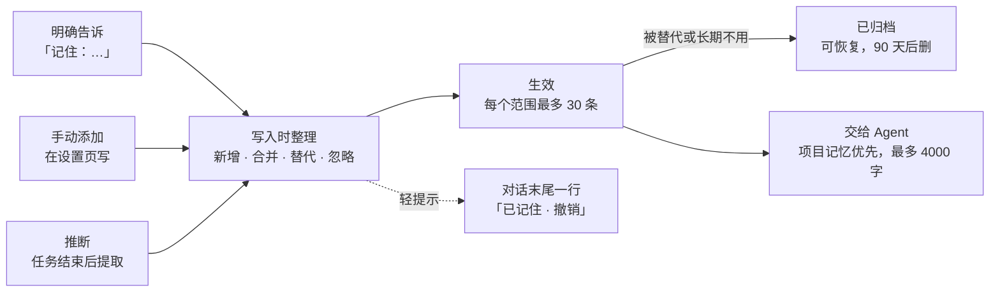

# 记忆功能重新设计

日期：2026-10-13。状态：草案，待与现有记忆功能作者讨论。

设计核对基线：远端 `dev`，提交 `466b4ac7`。

## 背景：现有记忆记不住长期规则

现有记忆每次刷新都只从最近 50 条消息重新算，并用英文正则识别偏好，所以留不住长期规则，中文偏好也几乎识别不了。现状来自 #488、#509、#514、#536，实现在 `apps/backend/cloud_agent/user_memory.py`。

| 环节           | 现在怎么做                                                                                              | 问题                                                   |
| -------------- | ------------------------------------------------------------------------------------------------------- | ------------------------------------------------------ |
| 学习范围       | 用户记忆取所有仓库最近 50 条用户消息；项目记忆取该仓库最近 50 条                                        | 来源消息滑出窗口，记忆就消失；编辑过、整合过的也一样   |
| 识别偏好       | 句子以 I prefer、Remember that、Always、Never 开头才算                                                  | 中文和其他说法全部漏掉                                 |
| 判断范围       | 句子里有 across all projects 一类英文才算用户级                                                         | 同上                                                   |
| 存储           | 每次从消息重建视图；编辑只是一条覆盖记录                                                                | 没有独立的记忆实体，无法长期保存                       |
| 整理           | 手动点「整合」，模型重写全部偏好，任务背景被丢弃                                                        | 用户不知道何时该点，结果难以预期                       |
| 交给 Agent     | 偏好拼成 JSON 放在请求开头，最多 4000 字                                                                | 用户看不到某次任务实际用了哪些记忆                     |
| 附带的近期动态 | 画像、关注领域、头像主题、首页建议，与记忆共用视图和开关；#592 起，默认个人资料头像也从用户记忆接口读取 | 关闭记忆会冻结头像；「任务背景」只展示、从不发给 Agent |

## 目标与非目标

记忆只做一件事：保存 Agent 应长期遵守的规则，并让用户看得见、改得了。

**目标**

- 记忆长期保存，直到用户修改、删除或删掉其来源对话。
- 任何语言都能记，中文和英文同等对待。
- 用户无感：记忆自动记录、直接生效，不弹确认、不打断任务；用户随时能看、改、撤销。
- 重复和冲突在写入时自动处理，不需要用户手动整合。
- 用户能看到某次任务用了哪些记忆。
- 用户记忆与每个仓库的项目记忆各自独立，冲突时项目记忆优先。

**非目标**

- 近期动态不再属于记忆：画像、关注领域、常用运行时和模型、「任务背景」都从记忆里去掉。头像和首页改进建议的去留另行决定。
- 不记录代码库的知识。仓库结构、命令等应写在仓库的 `AGENTS.md` 里，由团队共同维护。
- 不做跨用户共享的团队记忆。
- 不引入向量库或图数据库。

## 业界参考：借鉴做法，不引入系统

我们不引入现成的记忆系统，只借鉴四个做法：像 Claude Code 一样自动写入、不让用户确认，写入时由模型决定增删改，旧事实被替代而不是删除，用指令文件把规则交给编程 Agent。我们每人、每仓库只有几十条规则，数据还必须留在自己的 Postgres 里、按用户隔离，接外部记忆服务收益小、代价大。

| 方案                                                                         | 做法                                                                                                           | 我们借鉴什么                                         |
| ---------------------------------------------------------------------------- | -------------------------------------------------------------------------------------------------------------- | ---------------------------------------------------- |
| [Mem0](https://arxiv.org/html/2504.19413)                                    | 先用模型从对话提取候选事实，再与相似的已有记忆比较，由模型选 ADD、UPDATE、DELETE 或 NOOP                       | 写入时自动去重和处理冲突，取代手动「整合」           |
| [Graphiti（Zep）](https://help.getzep.com/graphiti/getting-started/overview) | 事实带时间信息，冲突时使旧事实失效，可以查历史                                                                 | 旧记忆被替代后归档，可查看、可恢复                   |
| [Claude Code](https://code.claude.com/docs/en/memory)                        | 用户手写 `~/.claude/CLAUDE.md`；另有 Claude 自己写的自动记忆，见下文                                           | 自动写入、不打扰用户；一条一个单元；短描述加索引     |
| [Codex](https://learn.chatgpt.com/docs/agent-configuration/agents-md)        | 启动时读 `~/.codex/AGENTS.md`（全局），再从仓库根目录往下读各级 `AGENTS.md`，越近的越优先，合计上限默认 32 KiB | 同上，且「更具体的优先」与我们「项目优先于用户」一致 |

**Claude Code 自动记忆的存储格式**：每个项目一个目录 `~/.claude/projects/<项目路径>/memory/`，每条记忆一个 Markdown 文件，文件头是 YAML 元数据（`name`、一句话 `description`、`type`：user / feedback / project / reference），正文是规则本身，通常附上原因和适用方式。同目录的 `MEMORY.md` 是索引，每条一行。会话开始时只加载索引（前 200 行或 25KB），Agent 觉得相关时再读全文。写不写、写什么由 Agent 自己判断，用户不需要确认，想改时直接编辑文件或用 `/memory`。

我们不照搬文件存储：这是多用户的网页服务，要做界面、按用户隔离、在服务端去重和替代；沙箱是临时的，文件放在里面会丢。所以存储仍用 Postgres，但沿用它「一条一个单元、带一句话描述」的结构，交付时可以导出成它原生读取的文件（见「交给 Agent」）。

不采用的部分：Mem0 依赖向量检索来找相似记忆，我们的量小，把同范围的全部记忆交给模型比较即可；Graphiti 的知识图谱对几十条规则是过度设计。

## 设计概览

记忆只剩一种东西：Agent 应长期遵守的规则。它分用户和项目两个范围，冲突时项目优先；有三个来源、两种状态。

三个来源写入后都直接生效，不需要用户确认，只在对话末尾留一行可撤销的提示；被替代的旧记忆归档而不是直接删除。

## 数据模型

每条记忆是一行独立的记录，存在新表 `agent_memories` 里，不再从消息重算。`repo` 为空表示用户记忆，有值表示该仓库的项目记忆。

| 列                          | 类型                               | 说明                                   |
| --------------------------- | ---------------------------------- | -------------------------------------- |
| `id`                        | uuid                               | 主键                                   |
| `user_id`                   | text                               | 所有者                                 |
| `repo`                      | text，可空                         | 空 = 用户记忆；有值 = 该仓库的项目记忆 |
| `content`                   | text                               | 一条规则，最多 240 字，沿用现有上限    |
| `description`               | text                               | 一句话摘要，最多 80 字，用于索引和列表 |
| `status`                    | `active` / `archived`              | 生效 / 已归档                          |
| `origin`                    | `explicit` / `manual` / `inferred` | 明确告诉 / 手动添加 / 推断             |
| `source_message_ids`        | bigint[]                           | 来源消息，手动添加时为空               |
| `superseded_by`             | uuid，可空                         | 被哪条新记忆替代（归档时填写）         |
| `created_at` / `updated_at` | timestamptz                        | 创建、最后修改时间                     |
| `last_used_at`              | timestamptz，可空                  | 最近一次被交给 Agent 的时间            |

用户编辑过的记忆，`origin` 改为 `manual`，此后不会被自动写入改写。`description` 借鉴 Claude Code 的索引：记忆少时不用，全部全文发送；以后条数变多，可以只发索引，Agent 需要时再取全文。

开关继续按「用户一个、每个仓库一个」单独存放。关闭后该范围既不记录新记忆，也不交给 Agent，已有记忆保留。

**上限（建议值）**：每个范围最多 30 条生效记忆。已满时，把最久没被使用（按 `last_used_at`）的自动记忆归档，给新记忆腾位置；手动添加的不会被自动归档。全部是手动添加时，新记忆不写入，并在设置页提示。

**删除规则**

| 动作                 | 结果                                                                                 |
| -------------------- | ------------------------------------------------------------------------------------ |
| 用户删除一条         | 立即物理删除                                                                         |
| 用户「清除」某个范围 | 删除该范围全部记忆，包括归档                                                         |
| 删掉来源对话         | 推断的记忆，来源全部被删就一起删除；明确告诉和手动添加的保留，来源链接显示「已删除」 |
| 被替代或因上限淘汰   | 转为归档，90 天后物理删除                                                            |
| 点轻提示的「撤销」   | 删除这次写入；若它替代了旧记忆，旧的恢复生效                                         |

## 记忆从哪里来

三个来源都直接生效，用户不需要确认。推断出来的记忆靠下面的识别规则和「写入时整理」的护栏把关，而不是靠用户点确认。

| 来源     | 触发方式                                                                                  | 范围                                                       |
| -------- | ----------------------------------------------------------------------------------------- | ---------------------------------------------------------- |
| 明确告诉 | 消息里说「记住：…」「remember …」等；或点消息旁的「记住这条」                             | 在仓库里说的默认归该仓库；明确说「所有项目」的归用户       |
| 手动添加 | 在设置页写一条                                                                            | 用户选择                                                   |
| 推断     | 任务结束后，模型从用户本轮消息里发现可能长期有效的偏好，例如用户纠正「用 pnpm，别用 npm」 | 一律归当前仓库，除非用户原话明确说所有项目；可在设置页移动 |

**识别方式**

- 明确告诉：不再靠英文正则。用一小组中英文触发词「记住、以后都、永远不要、remember、always、never」筛出候选句，再交给模型判断是不是长期规则、并改写成一句简洁的规则。触发词只用来省模型调用，不决定结果。
- 推断：每个任务结束后，只把用户自己写的消息交给小模型提取一次。Agent 的回复、代码和工具输出不参与。
- 一次性指令不记：「这个 PR 先别动测试」只对当前任务有效，模型应返回空。

**模型调用的归属**：用该用户自己的网关授权和配额，与现在「整合」的做法相同。推断随记忆开关开启，关闭开关即停止。用哪个模型见待决问题。

## 写入时整理，取代手动整合

每条新记忆写入前，都与同一范围的生效记忆比较一次，模型从四种结果里选一个。这就是 Mem0 的做法，但不需要向量检索：一个范围最多 30 条，全部交给模型即可。

| 结果 | 条件                         | 处理                                           |
| ---- | ---------------------------- | ---------------------------------------------- |
| 新增 | 没有意思相同的记忆           | 写入新记忆                                     |
| 合并 | 与已有记忆意思相同或是其补充 | 更新已有记忆的文字，追加来源消息               |
| 替代 | 与已有记忆矛盾               | 写入新记忆，旧的转为归档并记下 `superseded_by` |
| 忽略 | 已有记忆已经覆盖             | 不写入                                         |

护栏：

- 用户手写或编辑过的记忆，只能被用户明确告诉的新记忆替代，不会被推断出来的记忆改写。
- 自动合并或替代时，轻提示写成「已更新：旧 → 新」；被替代的旧记忆归档，可撤销或在设置页恢复。
- 模型调用失败或输出不合法时，按「新增」处理，不丢内容。
- 不同仓库的记忆从不互相比较或合并。

设置页的「整合」按钮和 `/consolidate` 接口在这一步上线后移除。

## 交给 Agent

先继续拼进请求，但改成只在会话第一轮和记忆变化后发；第三阶段对 Claude Code 和 Codex 改成写用户级指令文件。

现在 `api/worker.py` 在**每一轮**都把记忆拼到请求前面。沙箱使用原生会话续接，上一轮的内容还在上下文里，所以同样的记忆会反复出现。

|                | 拼进请求             | 写成用户级指令文件                                                                                |
| -------------- | -------------------- | ------------------------------------------------------------------------------------------------- |
| 支持的运行时   | 五个全部，已实现     | Claude Code 读 `~/.claude/CLAUDE.md`，Codex 读 `$CODEX_HOME/AGENTS.md`；pi、OpenCode、Kilo 待核实 |
| Agent 怎么看待 | 当作用户消息的一部分 | 当作原生指令，与它平时读的规则同一层级                                                            |
| 何时生效       | 发送时生效           | CLI 启动会话时加载，会话中途修改要下次会话才生效                                                  |
| 用户能否看到   | 隐藏在请求里         | 同样看不到：CLI 在沙箱里无界面运行，要靠我们的界面展示                                            |
| 实现代价       | 低                   | 中：host 已为每个成员准备私有 `CODEX_HOME`，需要再加写文件和更新的路径                            |

**第一阶段的拼接规则**

1. 会话第一轮发完整记忆：先当前仓库的项目记忆，再用户记忆，合计不超过 4000 字（沿用现有上限）。
2. 后续轮次，只有在记忆自上次发送后变化时，才发一段「记忆已更新」，写明新增、修改和已废弃的条目。
3. 超过上限时，按「项目优先、最近确认或使用过的优先」取舍。
4. 每次实际发送的记忆记入该轮任务，并更新 `last_used_at`，供界面展示。

**措辞**：现在的拼接把记忆称为「不可信、可能过时、没有系统权限」的数据。新设计改称「用户的长期偏好」，但推断出来的记忆没有经过用户确认，仍注明「自动整理，可能过时，与当前请求冲突时以当前请求为准」。

**第三阶段的文件交付**：对 Claude Code，会话开始时把数据库里的记忆导出成 `~/.claude/CLAUDE.md`；条数变多后，也可以按它自动记忆的格式导出为索引加单条文件，利用 `description` 按需读取。数据以数据库为准，文件只是导出的副本，会话里 Agent 对文件的改动不回写。另一条路是直接把沙箱里 Claude Code 自己的自动记忆目录跨会话保存下来，省去提取逻辑，但只对 Claude Code 有效，五个运行时不一致，所以只作为备选。

## 用户界面

默认无感：平时不弹窗、不要求确认。界面只围绕三件事：知道刚记住了什么、管理已保存的记忆、看到某次任务用了哪些记忆。

**设置页「记忆」卡片**（沿用 PR #591 的「用户记忆 | 项目记忆」切换）

- 顶部：开关、「添加」、「清除」。去掉「整合」和「刷新」，记忆不再需要重算。
- 已保存的记忆：每条一行，小字标出来源（手动添加或来源任务）和最近一次使用时间，可编辑、删除、在用户和项目之间移动。用户在这里改过的，之后不会被自动改写。
- 已归档（折叠）：被替代或因上限淘汰的旧记忆，可恢复。
- 去掉「近期工作 / 项目画像」和「建议」。

**对话里**

- 每轮开始处显示小标签「用了 3 条记忆」，点开看到具体条目，并可当场停用某条。
- 用户消息旁加「记住这条」，把这条消息交给「明确告诉」流程。
- 写入记忆的那一轮末尾，显示一行灰色小字「已记住：使用 pnpm，不用 npm · 撤销」，替代时显示「已更新：旧 → 新」。不弹窗，也不需要点任何东西。

**首页与头像**：不再从记忆取数据。头像主题、默认个人资料头像（#592）和「改进建议」如果保留，改为由独立的接口从最近的任务计算，也不再受记忆开关控制。

## 隐私与安全

记忆会进入以后每一次任务，所以最大的风险是别人的文字混进记忆、长期影响 Agent。对策如下。

| 风险                                                            | 对策                                                                                         |
| --------------------------------------------------------------- | -------------------------------------------------------------------------------------------- |
| 用户粘贴的 issue、日志或网页里写着「记住：…」，被当成用户的要求 | 只看用户自己写的行，跳过引用块和代码块（沿用现有 `_sentences` 的过滤）；推断的只记到当前仓库 |
| Agent 回复、工具输出、MCP 内容里的指令                          | 这些内容不参与提取                                                                           |
| 密钥、令牌被记下                                                | 写入前用现有的凭据检查（`normalize_memory_edit`），命中就拒绝                                |
| 只对本次有效的指令变成长期规则                                  | 沿用现有的临时范围检查，并要求模型对一次性指令返回空                                         |
| 项目记忆串到别的仓库                                            | 按 `(user_id, repo)` 隔离；只发当前任务仓库的项目记忆；不同仓库不合并                        |
| 自动记错，长期影响 Agent                                        | 对话末尾轻提示可撤销；用户编辑过的不会被改写；长期不用的会被淘汰；措辞注明以当前请求为准     |
| 删掉对话后仍留有内容                                            | 推断的记忆随来源删除；其余在设置页可见、可删                                                 |
| 模型调用的花费                                                  | 用用户自己的网关授权和配额；触发词先筛一次；关闭记忆开关即停止推断                           |

沿用以下边界：记忆只存在本服务的 Postgres；每次修改带版本号防止并发覆盖；不会把记忆发给网关以外的服务。

## 迁移与分阶段计划

分三个阶段做，第一阶段就解决「记不住」和「不认中文」，每个阶段单独成 PR。

| 阶段               | 内容                                                                                                         | 完成标准 / 前提            |
| ------------------ | ------------------------------------------------------------------------------------------------------------ | -------------------------- |
| 第一阶段：记得住   | 新建记忆表并迁移旧数据；明确告诉、手动添加；中英文都能识别；移除画像、建议、任务背景；只在首轮和变化时注入   | 完成标准：迁移核对无误     |
| 第二阶段：自动整理 | 任务结束后推断，直接生效；对话末尾轻提示与撤销；写入时去重、处理冲突；上限淘汰、归档与恢复；移除「整合」按钮 | 前提：提取用的模型已定     |
| 第三阶段：看得见   | 对话里显示用了哪些记忆；消息旁「记住这条」；Claude Code、Codex 改用用户级指令文件，条数多时改发索引          | 前提：其余运行时路径已核实 |

**迁移（第一阶段）**

1. 把 `agent_user_memories` 和 `agent_project_memories` 中 `kind = preference` 的条目写入 `agent_memories`，状态为生效，`description` 先取正文前 80 字。它们现在已经在交给 Agent，这样迁移后行为不变。
2. 用户编辑或整合过的条目记为手动添加，其余记为明确告诉（它们本来就要求 Always、Never 等明确说法）。
3. 「任务背景」条目不迁移。
4. 开关状态原样保留。
5. 旧表的画像、建议、头像相关列等首页和头像方案定下来再处理；旧的记忆接口在一个版本后删除。

## 待决问题

- [ ] 推断随记忆开关默认开启，会消耗用户配额，并把用户消息交给模型处理。是否需要单独的推断开关？
- [ ] 对话末尾的轻提示是否保留？本方案保留，因为完全静默时记错了很难发现。
- [ ] 提取和写入整理用哪个模型？固定一个小模型，还是用户当前任务的模型？
- [ ] 删掉来源对话时，明确告诉的记忆是否也一起删除？本方案只删推断的，明确告诉和手动添加的保留。
- [ ] pi、OpenCode、Kilo 是否支持用户级指令文件，路径和加载时机是什么？
- [ ] 头像生成搬到哪里？#592 起默认个人资料头像从用户记忆接口读取，把近期动态移出记忆前，需要先给头像一个独立的接口。首页「改进建议」是否保留。
- [ ] 每个范围 30 条生效、归档 90 天后删除这两个上限是否合适？
- [ ] 与现有记忆功能的作者确认：50 条窗口和英文正则是否有未写入代码的考虑。
