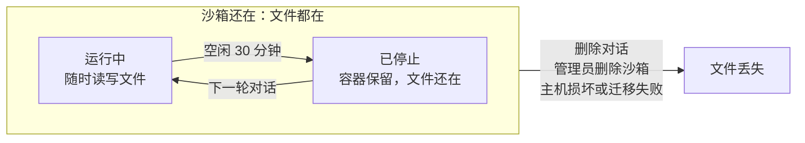

# 从空白开始：无仓库工作区设计

日期：2026-10-13。状态：方向已确认（第 9 节）；实现和本文在同一个 PR 里，实现时定下的细节已补进第 4、6、8 节。

界面入口英文为 **Start from scratch**，中文为「从空白开始」。这个名称描述起点，不暗示额外的保留期；代码标识和 API 参数继续沿用 `temporary`。

设计核对基线：远端 `dev`，提交 `8740c17a`。文中的行号都按这个提交。

相关：[AGENTS.md](../../../AGENTS.md) §6–§7、[沙箱安全模型](2026-09-01-agent-sandbox-security-model.zh.md)、[Agent 统一公网出口](2026-09-23-agent-public-egress-design.zh-CN.md)、[可复用云端环境配置](2026-10-12-repository-environment-design.zh-CN.md)、[原生会话与共享工作区](2026-08-31-native-session-fork-shared-workspace-design.md)。

## 1. 背景与目标

没绑 GitHub 的用户也能直接开始对话：沙箱照常启动，里面是一个空的工作区，界面明确告诉用户文件不会保存到任何仓库。

需求来自 Juncheng 在 Slack 列的功能清单第二条："allow user to start without a GitHub repo (warn them that data are not persisted)"。Juncheng 确认清单里的几项互相独立。Muxin 追问过用户是否还要上传仓库，还是可以简单到像 chatbot 一样；第 3 节回答这个问题。产品上参照 Codex：新建对话时可以不选项目，直接开始。

**要解决的问题**：现在发第一条消息之前，用户必须先连接 GitHub 并选一个仓库（或由管理员通过白名单分配仓库）。只想先试试的用户，或任务本来就和现有代码无关的用户（写个脚本、分析一份数据、做个原型），第一步就被挡住了。

**目标**

- 没连接 GitHub 的用户可以直接发消息，得到一个能写文件、能跑命令的 agent。
- 除了没有仓库，其他和普通对话一样：所有用户都能用，功能、归档和删除都一致。
- 用户第一次使用时确认知道：文件只在这个对话的沙箱里，没有备份到任何仓库。
- 用户想留下成果时有出路：下载整个工作区，或让 agent 通过 GitHub MCP 建仓库推上去。

**非目标**

- 绑定仓库的对话，行为完全不变。
- 不做"上传一个代码包当工作区"（第 3 节说明原因）。
- 多人协作同一个容器、用户自带环境变量是清单里的其他需求，各自单独设计；本文只写和它们的衔接点。

## 2. 现状：repo 在每一层都是必填

目前没有任何"无仓库"的路径。从输入框到数据库，repo 都是对话的身份字段；每轮结束后还会自动发布成 draft PR。

| 层 | 依赖 repo 的地方 | 代码位置 |
| --- | --- | --- |
| 前端输入框 | 发送按钮要求 GitHub 已连接且已选仓库；未连接时可以先写，但要先连接 GitHub 才能发送 | [`TaskComposer.tsx:394`](../../../apps/frontend/src/components/features/agents/TaskComposer.tsx#L394) |
| API | `AgentJobCreate.repo` 必填，格式 `owner/name` | [`schemas/jobs.py:92`](../../../apps/backend/cloud_agent/schemas/jobs.py#L92) |
| 准入 | 校验用户对该仓库的权限（防止借 App 的权限读别人的仓库），并把 branch 解析成 commit | [`job_admission.py:523`](../../../apps/backend/cloud_agent/application/job_admission.py#L523) |
| 数据库 | `agent_threads.repo` 是 `NOT NULL`。每轮的 `agent_jobs` 从迁移 0003 起没有自己的 repo 列，从对话读 | [`0001_schema_baseline.py:139`](../../../migrations/versions/0001_schema_baseline.py#L139)、[`0003_thread_level_config.py:60`](../../../migrations/versions/0003_thread_level_config.py#L60) |
| Runner | 新对话在宿主机上浅克隆仓库，打成 tar 导入沙箱的 `/workspace` | [`runner.py:1489`](../../../apps/backend/cloud_agent_host/runner.py#L1489)（`_SourcePrefetch`） |
| 收尾与 PR | 每轮结束自动排一个快照；缺 Git base 时直接报错。快照推到 `agent/<thread-id>` 分支并开 draft PR | [`sandbox.py:1768`](../../../apps/backend/cloud_agent/storage/repositories/sandbox.py#L1768)、[`publish_worker.py`](../../../apps/backend/cloud_agent/publish_worker.py) |
| 沙箱凭证 | runner 给沙箱注入只限本仓库的短期 `GH_TOKEN` | [AGENTS.md](../../../AGENTS.md) §7 |
| Environment | 仓库默认值表和绑定表的 repo 是 `NOT NULL`；`agent_environments.repo` 已经可以为空（表示个人全局变量） | [`0065_environments.py`](../../../migrations/versions/0065_environments.py) |
| 项目记忆 | `agent_project_memories` 主键是 `(user_id, repo)` | [`0053_project_memory.py:335`](../../../migrations/versions/0053_project_memory.py#L335) |
| 侧边栏 | 对话按"项目"分组，一个项目就是一个 repo | `AgentProject`，[`schemas/conversations.py:95`](../../../apps/backend/cloud_agent/schemas/conversations.py#L95) |

已经不依赖 GitHub 的部分：登录用的是 Gateway 的身份 token（[`identity.py`](../../../apps/backend/cloud_agent/identity.py)）；能不能用由 Gateway 返回的 `agent.use` 决定；上传的附件放在 `/uploads`，不在工作区里。

两个看起来相关、其实不算的功能：

- "创建 GitHub 仓库"（`CreateGitHubRepositoryRequest`，[`schemas/integrations.py:35`](../../../apps/backend/cloud_agent/schemas/integrations.py#L35)）只是省去去 GitHub 建仓库的一步，仍然要绑 GitHub。
- 本地 Docker 开发环境里的 `git://` 小仓库（`repo_clone_base_url`，[`runner.py:835`](../../../apps/backend/cloud_agent_host/runner.py#L835)）只给开发者测试用。

## 3. 方案选择：做临时工作区

推荐"临时工作区"：沙箱照常启动，只是不拉任何代码，结束时也不发 PR。这样改动最小，用户拿到的仍是完整的 agent。

| 方案 | 用户得到什么 | 实现成本 | 主要问题 |
| --- | --- | --- | --- |
| 临时工作区（推荐） | 完整 agent：写文件、跑命令、终端、文件面板、Fork 和 Side Chat | 中等：沙箱、runtime、事件流都不变，只跳过"拉代码"和"发 PR"，并把 repo 改成可空 | 文件只在沙箱里，必须讲清楚 |
| 纯聊天 | 只能对话，不能跑代码或写文件 | 高：现在所有 runtime 都跑在沙箱里，要另做一条不经过沙箱的对话路径 | 等于另做一个 chatbot，和"能干活的 agent"这个核心脱节 |
| 上传代码包当工作区 | 用户上传 zip，解压成工作区 | 高：大文件上传、安全解压（路径穿越、zip 炸弹）、配额 | 门槛没降多少，而且临时工作区加附件已经能做到 |

对 Muxin 的问题（还要不要上传仓库），答案是不用。用户想给 agent 一些文件，用现有的附件就行，再让 agent 自己解压到 `/workspace`。附件每条消息单个文件最大 5 MiB、合计 20 MiB、最多 50 个；这三个都是上限，管理员只能调低（[`settings.py:798`](../../../apps/backend/cloud_agent/settings.py#L798)）。更大的项目本来就该走 GitHub。

只提问题的用户，体验上和 chatbot 差不多：沙箱在后台，用到时才显出作用。代价是每个对话都占一个容器，这一点和普通对话一样（第 7 节）。

## 4. 用户体验

没连 GitHub 的用户打开页面就能发消息；已连 GitHub 的用户在仓库选择器里多一个"从空白开始"。其他体验和普通对话一样，只是没有 PR。

**开始对话**

1. 没连 GitHub：输入框直接可用，仓库位置显示「从空白开始」。原来"先连接才能发送"的卡片，改成输入框下方一行可选的"连接 GitHub 以使用仓库"。从这里去 GitHub、连好回来后，草稿还在，仓库选择器会打开让用户选仓库，不会停在临时工作区。部署根本没配 GitHub App 时，这一行不出现。
2. 新手引导（[`GettingStarted`](../../../apps/frontend/src/components/features/agents/GettingStarted.tsx)）不变：仍是"连接 GitHub、授权仓库、跑第一个任务"三步。没连 GitHub 的新用户也可以先用临时工作区跑任务；有了第一个对话后，这一行照旧消失。
3. 已连 GitHub：仓库选择器最上面多一项「从空白开始」，但不默认选中。现在的代码特意不给仓库设默认值，这条规则不变。搜索时它只按名字"从空白开始"匹配，并排在匹配的仓库后面：否则搜"仓库"或"repo"都会先命中它，回车选错。
4. 没有可选的仓库时默认选中临时工作区（没连 GitHub，或连了但还没给 App 授权仓库）：它不会改动任何真实仓库，默认选中没有风险。没连 GitHub 时选择器只列临时工作区：选仓库要先连接，白名单里的仓库也一样，和现在的规则一致。
5. 选了临时工作区后，分支选择器隐藏；环境只用平台基础环境加个人全局变量。
6. 部署的 GitHub App 加载失败时（issue #47），建任务的接口对所有任务都返回 503，临时工作区也一样。这时输入框锁定，提示"GitHub 暂时不可用"，恢复后自动解锁。第 6 节说明为什么没让临时工作区绕开它。

**第一次使用的确认**

- 用户第一次用临时工作区发送时，先显示一段说明和「我知道了」按钮。点了以后消息照常发出，草稿不丢；之后不再出现。点"取消"什么都不发，光标回到草稿。
- 文案："文件保存在这个对话的云端工作区，不会自动同步到 GitHub。删除对话或工作区前，请先下载需要保留的文件。"原先建议的"也没有其他备份"去掉了：配了 S3 时，沙箱停止会留可恢复的检查点（#609），这句话不准确。
- 确认状态按用户记在浏览器的 localStorage 里（键 `agents.temporaryWorkspace.acknowledged.<用户>`），和新手引导的"跳过"一样（[`firstRun.tsx`](../../../apps/frontend/src/components/features/agents/firstRun.tsx)）。换浏览器或清掉浏览器数据后，会再确认一次。

**对话中**

- Agent 能力不变：写文件、跑命令、终端、文件面板、Tools、MCP、Goal、Fork、Side Chat 都照常可用。
- `/workspace` 一开始是空目录，里面先在 `main` 分支上做一个空的 Git 提交。这样 Git 面板和每轮的"改动文件"列表不用改，就能显示 agent 改了什么。
- 附件照常放在 `/uploads`，agent 可以自己把它们复制或解压到 `/workspace`。

**保留成果**

- 「下载工作区」：把 `/workspace` 中的文件打成一个 `.tar.gz` 下载，文件名取对话标题。下载包排除各层级的 `.git` 目录或元数据文件；沙箱内部仍保留 Git 数据，`.gitignore`、`.github` 等其他文件照常包含，也不按 `.gitignore` 过滤。入口在每轮的结果卡片上（替代原来 PR 链接的位置；运行失败的那一轮也有）。超过主机的下载上限时直接拒绝并说明原因，不会下载半截。文件面板现在已经能下载单个文件（预览大小以内，见 [工作区文件](../../user/workspace-files.md#copy-and-download)），新加的是整个工作区一起下载。
- 放到 GitHub：平台不做转存功能，交给 agent。用户连上 GitHub 官方 MCP 后，直接让 agent 建仓库并把文件推上去（第 6 节）。推上去以后这个对话仍是临时工作区；想按仓库对话继续（每轮自动开 draft PR），就在那个仓库上开新对话。

**侧边栏**：临时工作区的对话归到「从空白开始」分组，和按仓库分的项目并列；分组上的"新建任务"直接开一个新的临时工作区。归档页也按同样的分组显示。

## 5. 数据持久性：准确的说法是"没有备份"

文件不会因为空闲而丢：沙箱空闲时只是停止，下一轮在同一个容器里重启，文件都还在。真正的风险是，这个沙箱之外没有第二份拷贝。所以提醒应该说"没有备份"，而不是"不会保存"。

只要沙箱还在，文件就在，运行中和已停止时都可以下载；提醒要防的是最后一步。

- 生命周期和普通对话完全一样：可以归档、删除，没有单独的保留期或自动清理。
- 空闲停止默认 30 分钟，管理员可以设成 60 秒到 7 天（`chat_idle_timeout_s`，[`host_settings.py:145`](../../../apps/backend/cloud_agent_shared/host_settings.py#L145)）。
- 删除对话不需要先归档。删除后用户再也打不开它，附件会被直接删掉（[`conversation_commands.py:435`](../../../apps/backend/cloud_agent/storage/repositories/conversation_commands.py#L435)）。同一沙箱里的对话（包括 Fork 和 Side Chat）全部删除后，后台每分钟检查一次，先停止沙箱，再删除它（[`sandbox_deletion.py:325`](../../../apps/backend/cloud_agent/workers/sandbox_deletion.py#L325)）。
- 临时工作区没有发布这一步，所以可以在沙箱还运行时就删除；仓库对话要等发布完才能删。运行中删除时，控制面先请求停止沙箱，这一步依赖 [#632](https://github.com/HarvardMadSys/hybridInference-cloud-agent/pull/632)：之前停止请求带的 activation 是占位的 0，会被沙箱管理器当成过期拒绝，沙箱要等自己空闲停止（默认 30 分钟）后才被删掉。本 PR 基于修好后的 `dev`。
- 部署配置了 S3 归档桶时，删除沙箱前会先归档一份；没配置就直接丢弃。归档目前没有面向用户的恢复入口。跨主机恢复是另一项进行中的工作，本设计不依赖它。
- 和仓库对话的区别：仓库对话每轮结束都会推到 `agent/<thread-id>` 分支，沙箱没了代码还在 GitHub 上。临时工作区没有这一步。

## 6. 技术设计

核心做法：repo 允许为空，空就表示临时工作区；runner 用一个空提交代替克隆；每轮结束不排快照、不发 PR。其余链路不变。

每轮 5 个步骤里改 3 个（加粗）：

| 步骤 | 仓库对话（现在） | 临时工作区 |
| --- | --- | --- |
| 准入 | 查仓库权限，解析分支到 commit | **只查 `agent.use`、模型和 runtime** |
| 准备代码 | 宿主机上浅克隆，打成 tar | **`git init` 加一个空提交，打成 tar** |
| 启动沙箱并导入 | 导入到 `/workspace` | 不变 |
| Agent 运行 | 写文件、跑命令，可以多轮 | 不变 |
| 收尾 | 排快照，推分支，开 draft PR | **更新沙箱状态，不排快照、不发 PR** |

中间的沙箱启动和 agent 运行完全不变，改动集中在准入、准备代码和收尾。

**关键决定**

1. 用 `repo IS NULL` 表示临时工作区，不另加类型字段。加了类型字段 repo 仍得可空，还多一条"两个字段必须一致"的规则。repo 的类型变成 `str | None` 后，类型检查会找出所有默认有仓库的地方。
2. API 里 repo 仍是必填字段，但允许显式传 `null`。漏传 repo 的旧客户端照样得到 422，不会悄悄开出一个临时工作区。
3. 工作区的起点是一个空的 Git 提交，在宿主机上生成，再像克隆结果一样导入 `/workspace`。Git 面板和改动列表依赖"相对 base 的 diff"，Fork 会沿用源对话的 base commit，这样都不用改。
4. 不加功能开关。它就是一种普通对话，所有有 `agent.use` 的用户都能用，跟着正常发布流程上线：先 staging，再生产。

**逐层改动**

| 层 | 改动 |
| --- | --- |
| 数据库 | 迁移 `0071_temporary_workspaces`（接在 `0070_memory_cutover` 后面）：`agent_threads.repo`、`agent_environment_bindings.repo` 去掉 `NOT NULL`。只要还有临时工作区对话，降级就报错拒绝，不会悄悄删数据。`base_sha` 照常记录：临时工作区记的是那个空提交，Git 面板用它算 diff |
| API 与 schema | `AgentJobCreate.repo` 改为必填可空；repo 为空时请求里不能带 `base_ref`、`base_sha` 或 `environment_id`，三者都指向某个仓库里的东西。返回结构里的 repo（`AgentJobResponse`、`AgentProject`、管理后台的几个模型等）改成可空 |
| 准入 | repo 为空时跳过仓库权限、分支解析和 commit 校验，不签发 clone token；`agent.use`、模型、runtime 校验照旧。后续消息（[`follow_ups.py:167`](../../../apps/backend/cloud_agent/application/follow_ups.py#L167)）和 goal（[`goals/controller.py:587`](../../../apps/backend/cloud_agent/goals/controller.py#L587)）里的权限复查同样跳过 |
| Runner | `_SourcePrefetch` 遇到空 repo 时 `git init` 并做一个空提交，打包导入 `/workspace`，不切输出分支。base 丢失需要补回时，同样重建这个提交，不克隆。首轮的 `checked_out` 事件带 `temporary: true`，界面显示"Empty workspace ready"，不说"Repository ready"，新手说明也不提克隆。`GH_TOKEN` 现在本来就只在有 token 时注入（[`resident_transport.py:772`](../../../apps/backend/cloud_agent_host/resident_transport.py#L772)），不用改 |
| 固定的空提交 | 控制面在准入时就要记下 base，主机之后才建这个提交，所以两边必须逐字节一致。提交内容全部固定：空树、`main` 分支、作者和提交者都是 `Cloud Agent <cloud-agent@localhost>`、时间 `1791936000 +0000`、提交信息 `Start temporary workspace`，不签名。得到的 id 是 `77bbec2039abcd5c7663078db4f90f3c860a751a`，定义在 [`temporary_workspace.py`](../../../apps/backend/cloud_agent_shared/git/temporary_workspace.py)，测试用真实 Git 核对 |
| Claim | runner 领取临时工作区时，跳过仓库权限复查，不签 clone token 和 GitHub token，也不组装项目记忆；用户记忆照旧 |
| 收尾 | `settle_thread_sandbox`（[`sandbox.py:1551`](../../../apps/backend/cloud_agent/storage/repositories/sandbox.py#L1551)）对临时工作区照常更新沙箱状态，但不排快照；快照、发布、PR 归档这几个 worker 都碰不到它 |
| 工作区 API | 文件、Git、终端接口里的 `_require_workspace_entitlement`（[`api/workspace.py:138`](../../../apps/backend/cloud_agent/api/workspace.py#L138)），对空 repo 只保留"是不是本人"的检查 |
| 下载（新增） | 控制面新接口 `GET /v1/agent/jobs/{job_id}/workspace/archive`，转给所属主机 Sandbox Manager 的 `GET /workspaces/{id}/archive`。主机先把 `/workspace` 经 Docker 的归档接口导出，压缩到自己磁盘上的临时文件，完整之后才带 `Content-Length` 返回；符号链接按链接本身打包。上限是主机设置 `workspace_download_max_mib`（环境变量 `AGENT_WORKSPACE_DOWNLOAD_MAX_MIB`，默认 1024，可设 1–16384，按压缩前计算），超过返回 413，还没有沙箱返回 409。仓库对话也能用 |
| Environment | 只用平台基础环境加个人全局变量；仓库环境按仓库保存，这里不提供 |
| 记忆 | 持久记忆按用户和仓库分作用域。临时工作区只读取用户级记忆；agent 保存记忆时，无仓库任务落到用户作用域，不会写入任何仓库的项目记忆（[`agent_memory.py`](../../../apps/backend/cloud_agent/storage/repositories/agent_memory.py)）。已补 claim 和真实数据库测试，确认读取和写入都保持这个边界 |
| 侧边栏与查询 | 项目列表把空 repo 归成一个「从空白开始」分组。现有查询的仓库筛选写成 `($n IS NULL OR t.repo = $n)`，传空表示不筛选，所以另加参数 `temporary=true`（`/jobs`、`/conversations`、`/sessions`），条件是 `repo IS NULL`；和 `repo` 同时传返回 422。前端内部用保留键 `:temporary` 表示这个分组（仓库名总带斜杠、不以冒号开头，不会撞名），发请求前换回 `temporary=true` 或 `repo: null` |
| 管理后台 | 对话、运行记录、沙箱页面把空 repo 显示为 `Start from scratch` |
| 前端 | 输入框、仓库选择器、第一次使用的确认、结果卡片、侧边栏和归档页分组（见第 4 节）；新手引导不变 |

**GitHub App 故障时为什么不让临时工作区绕开**

建任务、runner 领取任务、工作区文件和终端等二十多个接口，都依赖同一个严格的 GitHub 凭证依赖：部署配置了 App 却加载失败时，它在进入处理函数之前就返回 503（issue #47 的统一做法）。runner 领取任务时还不知道领到的是哪一类对话。要让临时工作区在故障期间照常工作，得把这些接口都改成"先看对话有没有仓库，再决定要不要 GitHub"，claim 路径还要能把领到的仓库任务退回队列。这类故障很少见、会自己恢复，所以没做：临时工作区和其他任务一样等 App 恢复，前端在这期间锁定输入框。

**放到 GitHub：交给 agent，平台不另做功能**

agent 现在就能做，平台不用为此写代码：

- 用户在 MCP 设置里连上 GitHub 官方 MCP，它在推荐列表第一位（[`catalog.py:38`](../../../apps/backend/cloud_agent/mcp/catalog.py#L38)）。MCP 连接按用户算，和对话有没有仓库无关。前提是部署配好了 GitHub MCP 的 OAuth 应用（[`github_oauth.py`](../../../apps/backend/cloud_agent/mcp/github_oauth.py)），并且用户连的是可写地址 `https://api.githubcopilot.com/mcp`，不是 `/mcp/readonly`。
- 这个 MCP 的 [`create_repository`](https://github.com/github/github-mcp-server) 能建仓库（默认私有），`push_files` 能一次提交多个文件。GitHub 凭证留在平台的 MCP 中继里，不进沙箱。
- 限制：`push_files` 把文件内容放在工具调用参数里，适合文本文件不多的小项目。大项目或二进制文件，先下载更合适。
- 另一条路：用户把自己的 GitHub token 存成个人全局 Secret，agent 在沙箱里用 `git` 或 `gh` 推送。`GH_TOKEN`、`GITHUB_TOKEN` 是平台保留名，要换个名字（[`environment.py:40`](../../../apps/backend/cloud_agent_shared/environment.py#L40)）。这条路不限大小，但 token 会进沙箱，属于用户自己选择注入的凭证（AGENTS.md §7）。
- 推上去以后，对话仍是临时工作区，不会自动开 draft PR。所以不再需要原先设想的"转存成仓库对话"：那条路要让 publisher 支持往空仓库推第一个提交，现在省掉了。

## 7. 安全与容量

临时工作区不放宽现有的安全边界，也不加新的限制：还是同一个沙箱、同一套网络规则，而且少了 GitHub 凭证。

- 谁能用：仍由 Gateway 返回的 `agent.use` 决定。仓库白名单（[`entitlement.py`](../../../apps/backend/cloud_agent/entitlement.py)）管的是"能对哪个仓库动手"，不是"谁能用"，跳过它不会开口子。
- 网络和隔离：沙箱仍然只能访问公网 80/443 和自己的两个 relay。执行隔离和普通对话一样，由管理员设置 `default_execution_profile`（对应环境变量 `AGENT_DEFAULT_EXECUTION_PROFILE`，[`settings.py:1013`](../../../apps/backend/cloud_agent/settings.py#L1013)）决定。对外开放的部署本来就必须用 `untrusted-kata-v1`（AGENTS.md §7），临时工作区不另加检查。
- 凭证更少：没有 clone token，也没有 `GH_TOKEN`。推理 grant 和 MCP 凭证和现在一样。
- 没有新能力：用户现在就能在自己的仓库里让 agent 跑任意代码，临时工作区只是去掉了 GitHub 账号这一步。
- 删除即清理：[#601](https://github.com/HarvardMadSys/hybridInference-cloud-agent/pull/601) 已经做了。同一沙箱里的对话全部删除后，后台会停止并删除沙箱，临时工作区直接沿用。
- 容量：每个沙箱默认 2 核 CPU、4 GiB 内存，磁盘配额默认关闭（[`host_settings.py:72`](../../../apps/backend/cloud_agent_shared/host_settings.py#L72)）。停止的沙箱不占 CPU 和内存，但占磁盘。临时工作区和普通对话一样，不单独限制数量。

## 8. 实现计划

原计划拆成三个 PR（后端、下载、前端），实现时合成一个：三部分互相依赖，分开合并时中间状态没法单独验收。本文也放在这个 PR 里。不加功能开关，按正常发布流程上线。

1. **一个 PR**：迁移、schema、准入、runner 空提交、收尾不排快照、工作区 API 权限分支、管理后台显示、整个工作区下载、前端全部入口、维护中的文档（运维手册、`docs/user` 里的两篇说明）。
2. **迁移编号**：[#643](https://github.com/HarvardMadSys/hybridInference-cloud-agent/pull/643) 的 `0070_memory_cutover` 已合并；本 PR 使用 `0071_temporary_workspaces`，`down_revision` 顺接 `0070_memory_cutover`，保持一个迁移 head。
3. **上线**：先在 staging 跑完下面的验收清单，再上生产；同时在 FreeInference 发行版的用户文档里补上临时工作区的说明，包括怎么用 GitHub MCP 把结果放到 GitHub。

**测试与检查**

- [x] 单元测试：schema 接受显式 `null`、拒绝漏传；repo 为空时带 `base_ref`、`base_sha`、`environment_id` 被拒；准入不调用仓库权限校验；runner 导入空提交，提交 id 用真实 Git 核对；收尾不生成快照；`checked_out` 事件标明临时工作区
- [x] 数据库：`make test-db` 覆盖迁移升级和降级。已有临时工作区数据时，降级明确拒绝，不会悄悄删数据
- [x] 下载接口：大小上限、响应头、只有本人能下载（单元测试）；符号链接按链接本身打包（本地栈实测）
- [x] 前端：`apps/frontend` 里的 lint、格式、类型检查和全部测试，包括未连 GitHub 可以发送；第一次使用要确认，确认后不再出现，取消时草稿不丢；已连 GitHub 时不默认选中；选择器里的临时工作区一行；下载按钮；侧边栏名称；`temporary=true` 的参数转换
- [x] 端到端（本地 Docker 栈）：建临时工作区、检查空提交和 `main` 分支、写文件、Git 面板和文件面板、运行中和停止后下载、超过上限返回 413、LIVE 续聊、空闲停止后 RESTORED 续聊、Fork、按 `temporary=true` 列出、归档、删除后沙箱被清理（沙箱运行中删除，约 100 秒内清理）；浏览器里走了一遍选择、确认、对话页、结果卡片和侧边栏
- [ ] staging 实测一次：连上 GitHub 官方 MCP，让 agent 建仓库并推送一个小项目
- [x] PR 前跑 `umask 022` 和 `env -u CODEX_VERSION PYTEST_ADDOPTS='-n 4 --dist loadfile' make check`

## 9. 已确认的决定

下面的问题由 Muxin 确认：前六个在 2026-10-13，第 7、8 个在 2026-10-14。

| # | 问题 | 决定 |
| --- | --- | --- |
| 1 | 做临时工作区，还是只要纯聊天？ | 临时工作区（第 3 节） |
| 2 | 提醒用常驻一行，还是第一次使用时要点"我知道了"？ | 第一次使用时点"我知道了"，之后不再弹出；下载入口放在每轮结果卡片上 |
| 3 | 要不要给临时工作区设保留期？ | 不设。生命周期和普通对话一样，可以归档、删除 |
| 4 | 每个用户最多同时保留几个临时工作区？ | 不限制，和普通对话一样 |
| 5 | 谁能用？ | 所有有 `agent.use` 的用户；普通对话有的功能，它都有 |
| 6 | 要不要做平台内的"保存到 GitHub"？ | 不做。平台提供整个工作区下载；放到 GitHub 交给 agent，通过 GitHub MCP 完成 |
| 7 | 新手引导要不要跟着改？ | 不改。仍是连接 GitHub、授权仓库、跑第一个任务三步 |
| 8 | 界面名称叫什么？ | 英文 Start from scratch，中文「从空白开始」；不暗示额外的保留期 |
