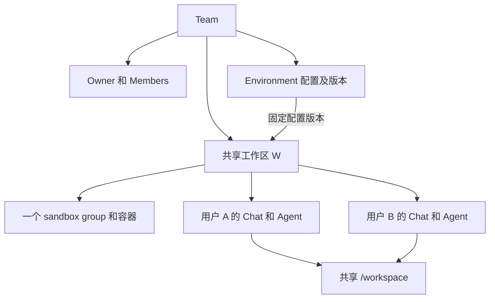

# Team 与共享工作区设计

日期：2026-10-15。状态：第一步（Team、邀请、成员）已实现；第二、三步是设计提案，尚未实现。

Team 管理一组协作成员，团队拥有可复用的环境配置和实际运行的共享工作区。成员进入同一个工作区后，共用容器、文件、依赖和服务，各自创建并控制自己的 Agent 会话。第一版以 Cloud Agent 内的协作为范围，登录身份和个人推理额度继续由 Gateway 管理。

代码基线为 `origin/dev` 的 `353a4db5`。本文描述新增行为；不会把已有个人资源自动变为团队资源。第 11 节列出分步交付范围，第 8.1 节和第 9 节记录第一步已落地的表结构和接口。

## 1 产品模型

一个用户可以加入多个 Team；每个 Team 可以拥有多个环境配置和多个共享工作区。个人空间继续存在，不要求个人用户创建 Team。

| 对象 | 含义 | 归属 |
| --- | --- | --- |
| Team | 成员、管理权、共享资源的范围 | 团队自身；有一名 Owner 负责管理 |
| Environment 配置 | 可复用的变量、脚本、快捷操作和版本 | 个人或 Team |
| Workspace 共享工作区 | 一份实际文件和运行环境，底层对应一个 sandbox group | 个人或 Team |
| Chat | 一段原生 Agent 会话及其执行成员 | 位于工作区中，保留明确的执行用户 |
| Job 和 Attempt | 某个用户在自己的 Chat 中发起的一轮执行 | 记录实际执行用户和所属团队 |

现有 `agent_environments` 已表示可复用配置，同一配置可以创建多个独立容器，不能将它直接改成“正在共享的容器”。界面使用“环境配置”和“共享工作区”区分这两件事。讨论中“团队共用一个 environment”的实际入口是共享工作区。

第一版采用以下规则：

- 团队资源默认对有资格访问的活跃成员开放，不增加部门、子团队或工作区独立 ACL。
- 每个 Chat 固定一个执行用户。其他成员可以查看团队内容，但通过自己的 Chat 发起执行。
- 团队成员关系和仓库权限同时成立，才可以访问仓库工作区及其内容。邀请加入 Team 不授予 GitHub 或 GitLab 权限。
- 新加入的成员可以看到其有资格访问的既有团队内容，包括历史；团队内不提供“私人 Chat”的承诺。
- 推理仍使用实际执行用户的模型权限和账户额度。Team 所有权、创建人和付费人是不同属性。

不采用“多人在同一个 Chat 里轮流发消息”。常驻 CLI 进程在启动时绑定一名成员的 residency grant 和 MCP 配置；换人发言就要换凭证并重启进程，失去 HOT 复用，而且会让一个成员借另一个成员的进程调用其个人 MCP 工具。

## 2 用户流程

用户在侧边栏顶部选择“个人”或一个 Team。新建 Chat、工作区和环境配置时始终显示当前归属。切换空间不迁移已有资源，也不在后台停止正在运行的任务。

典型流程是：

1. A 创建 Team，成为 Owner。
2. A 创建邀请链接并自行分享；B 登录后申请加入，A 批准。
3. A 在 Team 下保存环境配置，选定仓库和配置版本，创建共享工作区。
4. A 提交第一条消息。系统建立工作区和 A 的原生 session。
5. B 打开同一工作区，完成自己的仓库授权，在其中创建新的 Chat。
6. A、B 的 Agent 并行使用同一份文件。各自的消息、执行状态、终端和费用都有明确署名。

第一步只交付 1、2 两步：设置里的“团队”页面（建队、邀请、批准、移除、转让、退出、删除）和邀请链接打开的加入页。

共享工作区可以在首个 Chat 启动时创建，不要求先引入空容器的独立调度流程。创建后工作区有稳定的 ID 和名称，生命周期不依附于第一个 Chat。现有 `origin_thread_id` 可以保留作运行时定位，不能继续代表资源所有权。

工作区页面展示成员活动、各人的 Chat、共享文件、服务和当前绑定的配置版本。“创建我的 Chat”启动新的原生 session，不复制其他人的历史或 provider home。第一版保留本人 Chat 的 Fork，跨用户 Fork 暂不开放。

“创建我的 Chat”是新的 host 能力。当前一个新成员只能通过 Fork 进入已有 group；第二步需要让 supervisor 在已运行的容器里分配一个空闲 resident slot，并在不重跑 setup 的前提下启动一个全新的原生 session。

## 3 角色与权限

第一版支持 Owner、Admin（管理员）和 Member。每个 Team 恰好一名 Owner；Owner 可以任免管理员，管理员负责日常成员管理。平台管理员沿用独立的管理面和审计，团队角色不获得平台管理权限。

| 操作 | Owner | Admin | Member |
| --- | --- | --- | --- |
| 查看团队资料和成员名单 | 可以 | 可以 | 可以 |
| 修改团队名称 | 可以 | 可以 | 不可以 |
| 创建和撤销邀请、批准或拒绝加入 | 可以 | 可以 | 不可以 |
| 移除普通成员 | 可以 | 可以 | 不可以 |
| 任免或移除管理员、转让所有权 | 可以 | 不可以 | 不可以 |
| 查看有仓库权限的共享文件和团队 Chat | 可以 | 可以 | 可以 |
| 创建工作区，在其中创建自己的 Chat 和终端 | 可以 | 可以 | 可以 |
| 向自己的 Chat 发消息、取消自己的执行 | 可以 | 可以 | 可以 |
| 向别人的 Chat 发消息或续跑其 goal | 不可以 | 不可以 | 不可以 |
| 批准个人 MCP 调用，管理个人连接 | 仅本人 | 仅本人 | 仅本人 |
| 修改团队环境配置和共享变量 | 可以 | 不可以 | 不可以 |
| 执行已保存的团队快捷操作 | 可以，以本人身份执行 | 可以，以本人身份执行 | 可以，以本人身份执行 |
| 停止其他成员的执行、停止整个工作区 | 可以，记录管理操作 | 不可以 | 不可以 |
| 永久删除团队资源，归档或删除 Team | 可以 | 不可以 | 不可以 |
| 查看管理审计 | 可以 | 不可以 | 不可以 |
| 退出 Team | 先转让所有权或删除 Team | 可以 | 可以 |

成员记录保存 `admin/member`，Owner 始终从 `owner_user_id` 推导。角色调整带团队 revision 并写入审计；所有管理写入在团队行锁内重新检查当前角色。管理员降级、退出或被移除时，其创建的未完成邀请和申请一并关闭。重新加入默认为 Member，所有权转让后的原 Owner 也成为 Member。

表中的内容访问、运行和发布操作都还须满足 Gateway `agent.use`、仓库 entitlement 和资源状态要求。Owner 可以管理资源生命周期，但不能借管理角色读取自己无权访问的仓库内容，也不能代替其他人批准个人 MCP 操作。

成员终端拥有修改共享代码的能力，角色表不提供对恶意协作者的代码隔离。Owner 不能把共享配置中的秘密当成对 Member 保密的数据。共享工作区只适用于愿意共同执行代码的协作者。

终端输入和原始输出的 API 默认只对创建者开放，其他成员看到活动元数据；Owner 可以停止终端，不因此获得其读取或输入权限。通过共享文件或团队 Chat 主动输出的内容仍属于团队内容。

## 4 邀请与加入

### 邀请方式

第一版使用“一次性邀请链接加 Owner 或管理员批准”，不依赖全站用户目录或邮件发送服务。现有 Gateway 只提供用于显示的账户 email，没有可用的已验证邮箱邀请契约，不能把可编辑名称或未经验证的邮箱当作加入凭据。

Owner 或管理员创建邀请后，服务端用 `secrets.token_urlsafe(32)` 生成 256 位随机 token（43 个字符），数据库只保存其 SHA-256。邀请 24 小时有效，只允许一个账户领取。原始 token 仅在创建响应中返回一次；需要再次分享时生成新邀请。邀请页面只显示团队名称、邀请人及申请状态，不返回团队资源。

创建响应丢失时，同一幂等键只能恢复邀请元数据，不能从哈希恢复链接（响应里 `token` 为 `null`）。客户端提示撤销这条邀请后重新生成，避免悄悄创建多个有效链接。Member 的 membership 仅在批准时建立；pending 申请不属于活跃成员。

邀请链接形如 `/teams/join#token=…`，token 放在 URL fragment 中，浏览器不会把它发给任何服务器。加入页位于登录后的应用外壳之外（与 `/login` 相同），先把 token 移入当前标签页的 sessionStorage（30 分钟有效、用后即删），再清除地址栏中的 fragment；需要登录时回到同一页面继续。token 不写入持久缓存、分析事件、请求日志或登录回调 query，领取时通过 POST 请求体提交。领取和批准均须在邀请有效期内完成。

### 状态与并发

1. B 登录，服务端验证身份和 `agent.use`，B 在加入页明确点击“申请加入”后才领取邀请。持有链接本身不会产生团队访问权。
2. 事务按“团队行 → 邀请行”的顺序加锁，检查有效期、未撤销状态、团队仍为 active，写入绑定 B 的 join request。
3. Owner 或管理员查看申请人的显示资料（个人资料中的名字，否则是 Gateway 账户 email）和稳定账户标识，批准或拒绝。显示名只用于展示，权限永远绑定 `user_id`。
4. 批准前向 Gateway 确认申请人当前的 `agent.use`；批准事务再检查操作者的 Owner 或管理员身份、团队状态、申请有效性和成员容量，然后激活 membership、消费邀请并写入审计。

同一申请人的重复领取返回同一申请；另一账户不能抢占已领取的邀请。同一用户在一个 Team 只能有一个待处理申请（部分唯一索引保证）；随链接过期的旧申请在下一次领取时被标记为 `expired`，不再占用这个名额。重复批准返回已完成结果，不增加第二条 membership。撤销、拒绝或过期都不能再次使用原 token。

转让 Team 所有权时撤销尚未完成的邀请和申请，由新 Owner 重新发起。没有 `agent.use` 的用户可以理解拒绝原因，但不会获得资源访问权。邮箱邀请可在将来具备明确的已验证身份契约后加入。

### 容量与滥用

所有团队接口都要求已登录且有 `agent.use` 的会话，没有匿名可调用的入口；token 为 256 位随机值，猜测不可行。因此第一步不另设请求速率限制，而用容量上限约束滥用：

| 上限 | 值 |
| --- | --- |
| 一个账户同时拥有的 Team | 20 |
| 一个 Team 的活跃成员（含 Owner） | 50，在批准时检查 |
| 一个 Team 同时未使用且未过期的邀请 | 20 |
| 单次列表返回的历史邀请或申请 | 50；邀请额外保留全部仍可操作的记录，避免有效邀请被历史记录挤出 |

成员上限与工作区容量是两回事：一个 sandbox group 的常驻名额默认是 8（`resident_slot_capacity`，范围 2–128），决定一个工作区里能同时运行多少个 Chat 进程。第二步需要在工作区页面说明名额已满时的行为。

## 5 成员与团队生命周期

### 退出和移除

Admin 或 Member 主动退出、Owner 移除非 Owner 成员、管理员移除普通成员使用同一套撤权流程。控制面事务先把 membership 标记为 `left` 或 `removed`，递增 `access_generation`，同时写入审计。事务提交后，新的读取和管理请求立即被拒绝。第一步到此为止：团队还没有任何运行资源，不需要后台清理。

第二步引入团队运行资源后，同一事务还要写入持久化清理任务，后台流程处理该成员在本 Team 中的所有工作区：

- 取消排队消息，暂停 goal 和其他自动续跑，禁止 retry 或后台 claim 绕过成员检查。
- 终止该成员的 Agent、终端、环境测试和快捷操作；关闭其读取流和会话连接。
- 撤销其团队执行关联的 attempt grant、residency grant、MCP 凭证和可撤销的短期 Git 凭证；只影响该 Team 的执行，不删除个人账户连接。
- 保留已产生的团队文件和历史。成员启动的后台进程也会被停止，其已发生的文件修改或外部操作不会回滚。
- 只有确认原成员进程清理完成，才能把其 execution slot 分给另一个成员。

API 返回撤权操作 ID，区分“访问权已收回”和“运行进程清理完成”。健康主机的清理目标为 30 秒；主机失联或外部凭证撤销失败时，操作保持 pending 并重试，不能显示“全部完成”。已外泄的 token 仍受既有撤销和到期机制约束，不能承诺本地删除记录会立即让它失效。

团队执行需要一个让 host 及时得知撤权的机制。原提案是独立的短期访问租约（每 10 秒续期、最长 30 秒）。现有 host 心跳间隔为 30 秒，residency grant 的有效期为 1800 秒，独立租约意味着一条新的 host↔控制面续期通道。第二步设计评审时应先评估把成员 generation 校验并入现有心跳和 residency 续期（必要时缩短团队工作区的心跳间隔），只有并入无法满足撤权时限时才新增租约协议。无论哪种方式：租约期限从发出校验请求时计算，延迟响应不能重新获得完整有效期；续期失败按拒绝执行处理；host 故障恢复首先核对持久化撤权记录，再恢复任何进程；没有清理证据时不得重新分配 slot。

成员重新加入时复用历史 membership 的身份记录，但再次递增 generation。新成员资格不会恢复旧的排队任务、授权、连接、goal 或已丢失的原生 session。需要继续工作时，由本人重新发起可执行操作。

### 所有权

`agent_teams.owner_user_id` 是唯一的 Owner 权威字段。Owner 可以把所有权转给当前有准入资格的活跃 Member；转让原子完成，原 Owner 成为 Member。转让前先确认目标确实是活跃成员，再向 Gateway 询问其 `agent.use`，避免 Owner 借此探查任意账户的准入状态。转让不会改变其他人的模型额度或个人凭证。

Owner 不能直接退出或被普通成员移除。转让、退出、移除及 Team 状态变化锁定同一 Team 行，防止并发操作留下没有活跃 Owner 的团队；数据库约束（第 8.1 节）在提交时再兜底一次。Owner 失去平台准入时不自动选举继任者，由平台管理面通过经过审计的恢复操作处理；正常成员权限不因此升级。这个管理面恢复操作尚未实现，需要在第二步之前补上。

### 归档和删除

完整的 Team 状态为 `active → archived → deleting → deleted`；`archived` 可以恢复到 `active`。归档立即阻止新的执行和配置写入，发起全团队运行清理，保留有权限成员的历史读取。恢复增加团队执行 generation，不自动重启旧任务。

取消中的 native session 沿用现有失败和 LOST 语义；恢复 Team 不代表该 session 自动恢复。文件仍可由新的 Chat 继续使用。

永久删除从已归档的 Team 发起，Owner 在界面看到受影响的工作区和配置后明确提交。进入 deleting 后撤销全部访问并通过可重试流程清理容器、配置密文和附件等派生资源；完成后保留必要的审计 tombstone。删除失败保留进度，不把部分成功当成完成。

第一步的 Team 没有任何派生资源，因此只实现 `active → deleted`：Owner 按读取时的 revision 直接删除，未使用的邀请被撤销、待处理申请被取消，所有成员立即失去访问权，行和审计记录保留。`archived` 和 `deleting` 随第二步的运行资源一起加入。

团队工作区不会因为创建者离队、个人账户清理或最后一个 Chat 被关闭而自动删除。空闲停止仍按整个 group 的活动计算。个人资源现有的清理规则保持原有含义。

## 6 共享内容与个人数据

团队工作区中的文件、团队会话历史、主动发布到团队 Chat 的附件，以及该会话的工具输出都属于团队可见内容。发送入口持续显示归属，不能通过 UI 隐藏某个 Chat 后声称其 native history 对同容器的成员保密。

平台凭证仍按执行成员隔离：每个成员自己的 UID、provider home、tmpfs、inference grant、MCP 凭证和短期 Git token。共享可执行文件仍可能影响其他成员随后执行的代码；现有固定网络、Kata 要求和凭证边界保持适用。

这一点需要明确记录：UID 隔离挡得住“读取别人的凭证”，挡不住“在共享仓库里放一段代码等别人执行”。A 的 Agent 可以写入 git hook、npm script 或 `conftest.py`，B 的 Agent 运行测试时以 B 的身份执行它，从而接触到 B 的推理凭证和 MCP 凭证。现有安全模型（`2026-09-01-agent-sandbox-security-model.zh.md` 第 11 节）写的是“Fork sibling 属于同一个用户/security domain”；第二步要把它改为“同一个 sandbox group 是同一个信任域”，并像 2026-09-25 的 inference-grant replay 风险一样，作为一项经过安全评审的 accepted risk 记录在 AGENTS.md。缓解措施之一是团队 Chat 默认不加载个人 MCP 连接（见下文）。

第一版增加这些防止个人内容被默认分享的规则：

- 团队工作区不自动继承创建者或加入者的个人全局变量。团队 binding 的 `global_version_id` 为空。
- 选择配置时只列出本 Team 的配置。复制个人配置到 Team 只复制经过确认的脚本和普通变量，Secret 必须明确重新输入为团队共享变量。
- Team 共享 Secret 的值对能够执行工作区代码的成员可用；write-only 编辑框只防止界面回显，不构成成员间的保密保证。这个新增共享语义需要在实现评审中明确覆盖。
- 团队 Chat 不自动加载个人 memory、个人项目记忆、个人附件或全部个人 MCP 默认连接。成员显式选择的工具及资料，其输出进入团队历史，提交前展示这一归属。
- 团队内容不会自动写回个人 memory。团队记忆系统不包含在第一版范围内。
- 本人已存在的个人 Chat、工作区和含历史状态的容器不支持直接改 `team_id` 后分享。团队协作从新的团队工作区开始。

团队配置编辑生成新版本；已有工作区保持原绑定。第一版团队工作区不开放运行中变量更新，旧的环境更新入口也必须遵守这个限制。Member 创建工作区时选择团队版本或平台基础环境，不能通过 binding 参数偷偷继承个人配置或加入个人变量覆盖。加入工作区不触发新安装，也不因加入者不同而换用另一套变量。团队共享变量不会装入平台身份 token，长期平台账号凭证仍不能进入容器。

成员名册显示每个人在个人资料里填写的名字和 Gateway 账户 email（每次读取时向 Gateway 查询，不落库；查询失败时只省略 email），头像使用由账户 ID 生成的固定伙伴图。用户上传的头像可能接近 3 MB，第一步不放进名册响应。

## 7 执行与发布身份

团队资源的管理主体是 Team，实际执行主体始终是用户。`agent_threads.user_id` 和 `agent_jobs.user_id` 保留执行用户含义，不能替换成 Team ID，也不能在加入时写成 Owner 的 ID。

准入、host claim、唤醒、goal 续跑、grant 续期、MCP 调用和发布操作，都校验同一条权限链：有效登录或受信 worker 身份、当前 `agent.use`、活跃团队成员、资源归属、仓库 entitlement 和操作权限。管理 API 的批准结果不会替代第三方权限检查。

仓库 entitlement 现在以用户身份向 GitHub 查询（`entitlement.py`）。团队内容的每次读取都去问 GitHub 在延迟和限流上都不可行。第二步沿用现有 `agent.use` 的做法：在请求或长连接打开时校验一次，长连接最长存活 `OWNER_STREAM_MAX_S`（15 分钟），重连时重新校验；GitHub 无法回答时拒绝，不使用过期的肯定结果。

交互终端绑定创建者自己的 Chat 和 slot，以对应成员 UID 执行，不能复用拥有私有 HOME 集合管理权的 sandbox 基础 UID。快捷操作和环境测试也携带真实 actor 和 generation。固定配置的共享启动服务使用不带个人平台凭证的 group 服务身份；成员在自己终端启动的后台服务则随该成员撤权而停止。

一个 sandbox group 只有一个 `runtime_id` 和 `execution_profile`。因此一个共享工作区里所有成员使用同一种 Agent CLI；A 用 Claude Code 建立的工作区，B 不能在其中用 Codex 开 Chat。工作区页面需要显示这个限制。

平台发布使用明确记录的 `requested_by_user_id`，在实际签发 Git 凭证前再次确认权限。自动发布在确定 snapshot anchor 的事务中，将该 anchor job 的执行用户固化为发起人；重试或纳入其他成员的改动都不能偷偷更换用户，也不能回退成创建工作区的人或 Team Owner。该用户已离队或失去仓库权限时，原发布被阻止；其他有权限成员可以显式发起新的发布请求。

发布内容是共享工作区的一致快照，可能包含多个成员的修改。审计记录发起人、snapshot、workspace epoch 和纳入的 turns，不把整份 diff 宣称为某一个人的独立修改。已有容器级 CPU、内存和网络统计只归工作区汇总，不能重复算给每个成员；推理费用仍沿用 Gateway 的个人账本。

同一 Chat 保持每次最多一个未完成 turn，不新增 group 全局 prompt 锁。平台保存文件时检查版本，发布沿用一致快照机制；Agent 的任意 shell 写入仍存在真实共享文件冲突，不能用平台锁宣称所有 Git 操作都已串行化。

## 8 数据模型

### 8.1 Team 核心表（第一步，迁移 `0079_teams`）

| 表 | 关键字段与约束 |
| --- | --- |
| `agent_teams` | `id, name, owner_user_id, state (active/deleted), revision, created_by_user_id, create_request_key, created_at, updated_at, deleted_at`；名称 1–80 字符且无首尾空白；`(created_by_user_id, create_request_key)` 唯一 |
| `agent_team_members` | 主键 `(team_id, user_id)`；`role=admin/member, state=active/left/removed, access_generation, joined_at, departed_at`；离队保留记录；`departed_at` 为空当且仅当 active |
| `agent_team_invitations` | `id, team_id, created_by_user_id, request_key, token_hash, state (open/claimed/revoked), expires_at, revoked_at`；`token_hash` 唯一且为 32 字节；`(team_id, created_by_user_id, request_key)` 唯一 |
| `agent_team_join_requests` | `id, team_id, invitation_id, user_id, state (pending/approved/declined/cancelled/expired), decided_by_user_id, decided_at`；`invitation_id` 唯一；`(team_id, invitation_id)` 复合外键指向同一 Team 的邀请；`(team_id, user_id) WHERE state='pending'` 部分唯一 |
| `agent_team_audit_events` | `id, team_id, actor_user_id, action, target_user_id, target_id, details, created_at`；`action` 为固定词表；不存邀请 token、token 哈希、Secret 或工具原始输出 |

邀请的“过期”不单独存储，由 `expires_at` 在读取时推导；申请的 `expired` 在下一次领取时补记。

**唯一 Owner 由数据库保证。** `agent_teams` 有一个生成列 `owner_membership_state`：团队未删除时为 `'active'`，已删除时为 NULL。延迟复合外键 `(id, owner_user_id, owner_membership_state) → agent_team_members (team_id, user_id, state)` 在提交时检查。于是创建团队、转让、成员退出无论以什么顺序写入，只要提交时 Owner 不是该团队的活跃成员，整个事务就失败；团队删除后 NULL 使该行免于检查，Owner 才可以离开。成员 `role` 只保存 `admin/member`，默认 `member`；是否为 Owner 仍由 `owner_user_id` 唯一决定。

**锁顺序。** 每个写操作先锁 Team 行，再锁邀请、申请和 membership。领取只知道 token，所以先无锁读出邀请所属 Team，锁住 Team，再锁邀请并复查。只读列表复查成员资格但不加锁。

**generation 只向前。** 退出、移除和重新加入都递增 `access_generation`，重新加入复用原行；第二步的执行栅栏以它为准。

可重试的撤权和清理任务表 `agent_team_operations`（目标、generation、步骤、重试时间、终态，同一撤权 generation 唯一）随第二步加入，因为第一步没有需要清理的运行资源。团队执行 generation（归档/恢复用）同样随第二步加入。

### 8.2 现有资源的归属（第二步）

对需要共享的 `agent_sandboxes`、`agent_threads`、环境配置和 binding 增加可空 `team_id`。个人资源的值为空，团队资源指向 Team。历史 `user_id` 的语义逐表明确：thread/job 是执行人，sandbox/config 是创建人，不再统一把它当作访问权。共享工作区需要一个可修改的名称字段（加在 `agent_sandboxes` 上，或单独的工作区表），第二步实现时确定。

为保持数据库边界，为这些资源增加由归属字段生成的 `scope_key`：个人为 `user:<user_id>`，团队为 `team:<team_id>`。这只是内部约束键，不是另一套用户可见对象。

- 在 thread、sandbox、配置、binding 上建立相应 `(id, scope_key)` 唯一键。
- 执行 membership 同时外键约束 `(thread_id, scope_key)` 和 `(sandbox_id, scope_key)`，替换原来要求同一个 sandbox owner 的外键（`0001_schema_baseline` 中的 `fk_agent_memberships_sandbox_owner`）。
- `agent_sandboxes` 上的 `(origin_thread_id, user_id) → agent_threads` 外键同样改为按 scope 约束；否则团队工作区的 origin thread 必须属于创建者本人，并会阻止该 thread 的永久删除。
- 保留 `(thread_id, user_id)` 约束；团队 thread 再关联 `(team_id, user_id)` membership。历史记录可引用离队成员，运行时必须额外检查 active 和 generation。
- Fork 保留 source 和 target 都属于发起用户的条件；它与 sandbox 的绑定改用相同 scope，不开放跨用户历史复制。
- 环境默认值按 `(scope_key, repo)` 保存，配置、版本和 binding 的引用必须在同一 scope；团队 binding 不得引用个人 global version。
- snapshot 中纳入的 jobs 必须属于同一 sandbox scope；发布请求的 actor 必须是实际请求用户。

不能仅删除现有复合外键，也不能因为 SQL 中出现 `user_id` 就统一改成 `team_id`。约束需要允许同 Team 的不同执行用户，同时继续拒绝跨 Team 和个人到 Team 的错误关联。

Team ID 是不透明稳定标识（`ateam_` 前缀），名称可以修改且不承担权限含义。不同 Team 可以同名，界面用成员或标识辅助区分。Gateway `user_id` 沿用已有 identity namespace，显示资料复用 profile，成员名册不暴露完整个人设置或连接详情。

## 9 API 与统一鉴权

新增 API 使用现有主监听器和登录身份，不增加 sandbox 可调用的团队管理能力。创建类操作使用幂等键（`request_key`），会冲突的修改使用 `expected_revision`；重放先验证当前访问权，再返回允许返回的历史结果。

第一步已实现的接口（前缀 `/v1/agent`）：

| API | 行为 |
| --- | --- |
| `POST /teams` | 创建 Team 与 Owner membership；同一 `request_key` 返回同一个 Team |
| `GET /teams` | 只列出本人活跃加入的 Team |
| `GET/PATCH /teams/{team_id}` | 读取资料；Owner 或管理员带 revision 更新名称 |
| `DELETE /teams/{team_id}?expected_revision=` | Owner 删除 Team，撤销未完成的邀请和申请 |
| `GET /teams/{team_id}/members` | 活跃成员名册，Owner 在前 |
| `POST /teams/{team_id}/leave` | Admin 或 Member 退出 |
| `DELETE /teams/{team_id}/members/{user_id}` | Owner 移除非 Owner 成员，管理员只能移除普通成员 |
| `PATCH /teams/{team_id}/members/{user_id}/role` | Owner 带 revision 任免管理员 |
| `POST /teams/{team_id}/transfer-ownership` | 转给有准入资格的活跃 Member，带 revision |
| `POST /teams/{team_id}/invitations` | Owner 或管理员创建单次邀请；仅这一次响应带 token |
| `GET /teams/{team_id}/invitations` | Owner 或管理员查看全部可操作邀请及最近历史 |
| `DELETE /teams/{team_id}/invitations/{id}` | 撤销邀请及其尚未批准的申请 |
| `POST /team-invitations/claim` | 登录用户以 token 领取，生成申请 |
| `GET /team-join-requests` | 本人查询自己近 30 天的申请状态 |
| `GET /teams/{team_id}/join-requests` | Owner 或管理员查看待处理且未过期的申请 |
| `POST /teams/{team_id}/join-requests/{id}/decision` | Owner 或管理员批准或拒绝；批准前确认申请人当前准入 |
| `GET /teams/{team_id}/audit-events` | Owner 分页查看管理审计 |

随第二步加入的接口：

| API | 行为 |
| --- | --- |
| `POST /teams/{team_id}/archive` | 冻结执行并启动清理 |
| `POST /teams/{team_id}/restore` | 恢复团队，保留旧任务暂停状态 |
| `GET /teams/{team_id}/operations/{id}` | 返回撤权或删除进度 |
| `GET /team-operations/{id}` | 仅目标用户读取自己这次退出或被移除的清理状态，不返回团队内容 |

错误统一为 `{"error": {"type": …, "message": …}}`：非成员或跨 scope 的资源请求返回 404（`not_found`），已知 Team 内的角色不足返回 403（`forbidden`），失效 revision、Owner 直接退出、成员已满等冲突返回 409 并带稳定类型（如 `revision_conflict`、`owner_cannot_leave`、`team_full`、`request_pending`、`applicant_not_admitted`），失效的邀请链接返回 410（`invitation_unavailable`，不区分不存在、过期、撤销或已被他人领取）。Gateway 无法回答时返回 503，不使用过期肯定结果兜底。所有团队响应 `Cache-Control: no-store`；格式错误的请求返回通用 422，不回显请求内容，避免把输错的链接写进错误信息。

资源 API 显式选择个人或团队 scope，并按服务端记录验证。个人与团队列表的查询、计数、搜索、分页游标、SSE、附件下载、终端、Git、环境测试、快捷操作和审计分别覆盖权限；只修改导航或列表过滤是不够的。

第二步新增集中策略函数如 `authorize_team_action` 和 `authorize_resource_action`，返回带 actor、scope、操作权限和 generation 的受信上下文。读写事务在实际提交时验证相同成员状态。现有 `_owned_job` 保留个人路径的含义；团队读取、本人执行和 Owner 管理操作分别调用对应策略，禁止把“同 Team”直接加入所有 owner 检查作为通行条件。

## 10 前端与实时状态

空间选择器、成员管理和工作区页面共用服务端返回的权限。客户端隐藏按钮只是体验优化，服务端仍校验每个动作。

空间切换时，缓存键、分页游标、搜索、草稿、收藏和展开状态都包含用户及 scope；中止旧空间请求并拒绝迟到响应覆盖新空间。SSE、终端和活动订阅必须重新授权。当前空间只是一项界面偏好，不能成为授权依据。

现有变更推送（`0031_owner_change_notify`）的 `pg_notify` 负载只带资源所属的单个 `user`，只推给资源主人。团队资源的变化需要推给全队活跃成员：第二步要么在通知里带 `team_id` 由监听端按成员关系分发，要么按成员展开多条通知；无论哪种方式，推送只是“去重新读取”的提示，读取本身仍按上述权限校验。第一步的团队页面在每次操作后重新读取，加入页提供“重新检查”按钮，不依赖推送。

团队内 pin、隐藏和浏览位置属于个人偏好，不能沿用共享 thread 上的单一字段（如 `agent_threads.pinned_at`）影响所有人。关闭自己的 Chat 释放本人执行资源，团队历史保留；永久删除由 Owner 操作。

在线标记来自独立的短时 presence 心跳，断开后自然过期。在线状态不授予权限，也不应仅因浏览器开着就阻止空闲容器停止。执行活动继续沿用 group 的真实操作计时。

## 11 模块位置与分步交付

| 模块 | 变化 |
| --- | --- |
| `schemas/teams.py`、`api/teams.py` | Team、邀请和成员 API；请求校验与安全响应（第一步） |
| `domain/teams.py`、`application/teams.py` | 词表、上限、拒绝类型；token、Gateway 准入检查与显示资料（第一步） |
| `ports/teams.py`、`storage/repositories/teams.py` | 成员关系、邀请消费、Owner 不变量和审计写入（第一步） |
| `workers/team_operations.py`、集中授权策略 | 可重试撤权、清理和删除；团队资源鉴权（第二步） |
| admission、follow-ups、goals、residency、MCP 与发布 | 保持实际 actor，覆盖执行前和续期时的团队检查（第二步） |
| sandbox manager、supervisor、共享协议 | 在已有 group 中新建空白 session；团队 generation、撤权通知、进程清理和能力声明（第二步） |
| 环境、附件、memory、profile 与会话读取 | scope 验证及个人内容分享边界（第二步） |
| 前端 | 第一步：设置里的团队页、`/teams/join` 加入页；第二步：空间导航、共享工作区、隔离缓存、实时状态和清理进度 |

迁移全部追加在现有 baseline 后，旧数据默认保持个人归属。先部署兼容 schema 和理解团队 scope 的读写代码；所有控制面实例、后台 worker 与可接收团队执行的 host 就绪后，才允许创建团队运行资源。旧 host 不具备团队撤权能力时，不能 claim 团队任务。

旧代码通过 `user_id` 读取的路径不能与团队运行资源同时开放，否则创建者可能绕过离队检查。协议 capability 和部署检查用于证明新边界已生效，不改变任何网络允许范围。产生团队运行数据后，回滚须先停止团队执行并保留读取能力，不能直接启动不认识团队 scope 的旧服务。

分步交付：

1. **第一步（已实现）**：Team 创建、改名、删除；一次性邀请链接、领取、批准/拒绝、撤销；管理员任免、退出、移除、转让；Owner 审计；设置里的团队页和加入页。只有成员关系，不触碰 thread、sandbox、环境或 host。迁移只新增表，回滚即删表，不影响任何已有数据。
2. **第二步**：配置和共享工作区接入上述权限链，交付完整的双用户协作流程。包括第 8.2 节的 scope 约束、在已有 group 中新建空白 Chat 的 host 能力、撤权清理任务与 worker、host 撤权机制、归档/恢复、团队变更推送、安全模型与 accepted risk 的更新，以及 Owner 失去准入时的管理面恢复操作。第二步上线必须连同凭证隔离、清理、旧 API 防绕过和数据库约束一起验收。
3. **第三步**：presence、活动提示和发布体验。

第一版不包含全平台团队账单、团队 API Key、SSO、SCIM、团队记忆、访客角色、按工作区的私有 ACL，或个人运行中容器迁入团队。这些功能不会成为完成当前协作流程的前置条件。

## 12 验收

| 场景 | 必须得到的结果 | 步骤 |
| --- | --- | --- |
| A 创建 Team，B 加入，C 未加入 | A/B 按权限使用团队；C 的所有内容路径均被拒绝 | 第一步覆盖成员与管理接口 |
| 并发领取、批准、撤销邀请 | 只有合法申请生效；重放不重复加人，过期 token 不恢复权限 | 第一步 |
| Owner 转让与目标退出并发 | 事务保证唯一活跃 Owner，不留下无主管理状态 | 第一步（另有数据库约束兜底） |
| B 被移除后重新加入 | generation 增加，旧任务和凭证不能自动复活 | 第一步覆盖 generation；凭证部分随第二步 |
| B 只有 Team membership，没有仓库授权 | 无法读取对应代码、Chat 内容、附件或启动执行；Owner 角色也不替代仓库授权 | 第二步 |
| 两人进入同一工作区 | 使用同一容器和文件，各有 native session、进程身份和凭证；运行兼容性按现有 group 校验 | 第二步 |
| B 在 A 的 Chat 提交消息或批准其 MCP | 被拒绝；B 可新建自己的 Chat | 第二步 |
| B 运行中被移除 | 新请求立即失效；清理可追踪；queued、goal、retry、续期、终端和流都不能绕过 | 第二步 |
| 清理时主机失联、撤销接口失败 | 保留 pending 和重试；不提前报告完成或复用 slot；恢复前重新校验权限 | 第二步 |
| 创建者离队或关闭最后一个 Chat | 团队工作区和团队配置保留，可由其他成员继续使用 | 第二步 |
| 个人变量、记忆和附件存在 | 不自动注入团队；复制个人环境不会静默复制 Secret | 第二步 |
| 跨 scope 的 thread、sandbox、binding 或 fork 引用 | 数据库拒绝错误关系，个人历史约束保持成立 | 第二步 |
| 发布者离队后后台重试 | 阻止旧请求，不借 Owner 权限继续发布 | 第二步 |
| 个人与 Team 快速切换 | 列表、缓存、草稿和迟到事件不会串空间 | 第二步 |
| Team 归档、恢复、永久删除 | 执行与清理状态可区分；恢复不自动重启；删除覆盖派生资源 | 第一步只有直接删除；其余第二步 |
| 老版控制面或 host 混入 | 团队执行保持关闭或拒绝，不通过旧路径降级 | 第二步 |

第一步的测试：`tests/integration/storage/test_team_store.py`（Postgres 约束、并发领取、转让与退出并发、generation、上限、迁移往返）、`tests/servers/test_teams_api.py`（会话身份、错误类型、不回显输入、token 只出现一次、Gateway 准入检查）、前端 `lib/api/teams.test.ts`、`lib/teamInvitation.test.ts` 和 `components/features/teams/*.test.tsx`（token 不留在地址栏、登录往返、链接只显示一次、幂等重试）。第二步还需覆盖 API 越权测试、host 撤权故障测试和前端空间隔离测试，并满足仓库 `make check`、数据库测试及 `make ci-frontend` 的对应质量门槛。设计文档本身不代表第二步行为已经通过运行验收。

## 13 将来接入平台统一 Team

第一版由 Cloud Agent 数据库管理团队成员，Gateway 继续管理用户身份、`agent.use`、模型权限与推理额度。当前不增加 Gateway 团队计费字段，也不让两个服务各自决定同一份 membership。

如果 FreeInference 将来提供统一 Team 服务，通过明确的 HTTP 契约引入 `(issuer, external_team_id)` 映射，保留现有资源的稳定 Team ID。迁移时冻结本地成员写入、迁移并核对成员及 generation、切换授权权威，再将本地表降为受控镜像。不能用长期双写或两个独立 Owner 字段维持一致性。

团队计费可在此后独立设计。拥有团队资源不自动意味着 Owner 为所有人付费，也不改变现有“无 per-task dollar budget”的边界。

## 14 代码与设计依据

- [原生会话和共享工作区](2026-08-31-native-session-fork-shared-workspace-design.md)：一个 group 的容器、工作目录、并发成员和生命周期。
- [沙箱安全模型](2026-09-01-agent-sandbox-security-model.zh.md) 第 11 节：shared sandbox 的成员 UID 隔离与当前的“同一用户/security domain”假设。
- [环境配置设计](2026-10-12-repository-environment-design.zh-CN.md)与[现有环境迁移](../../../migrations/versions/0065_environments.py)：个人配置、不可变版本、冻结 binding 和 Secret 语义。
- [数据库 baseline](../../../migrations/versions/0001_schema_baseline.py)与[原生 Fork 存储](../../../apps/backend/cloud_agent/storage/repositories/session_fork.py)：现有同 owner 外键和 Fork 条件。
- [Team 迁移](../../../migrations/versions/0079_teams.py)与[Team 存储](../../../apps/backend/cloud_agent/storage/repositories/teams.py)：第一步的表、约束和锁顺序。
- [Owner 鉴权](../../../apps/backend/cloud_agent/api/_owner_auth.py)、[仓库 entitlement](../../../apps/backend/cloud_agent/entitlement.py)与[身份 namespace](../../../apps/backend/cloud_agent/identity_namespace.py)：身份、当前准入与资源权限的分工。
- [Gateway lookup 契约](../../../gateway_contracts/internal-lookups.openapi.yaml)：账户资料、`agent.use` 与邮箱显示契约。
- [变更推送](../../../migrations/versions/0031_owner_change_notify.py)：当前按单个用户推送的通知格式。
- [Residency grant](../../../apps/backend/cloud_agent/application/residency.py)、[sandbox 存储](../../../apps/backend/cloud_agent/storage/repositories/sandbox.py)与[发布 worker](../../../apps/backend/cloud_agent/publish_worker.py)：执行用户、清理资格和共享快照发布。
- [仓库安全边界](../../../AGENTS.md)：平台凭证隔离、共享代码的信任范围、固定网络及 Kata 要求。
