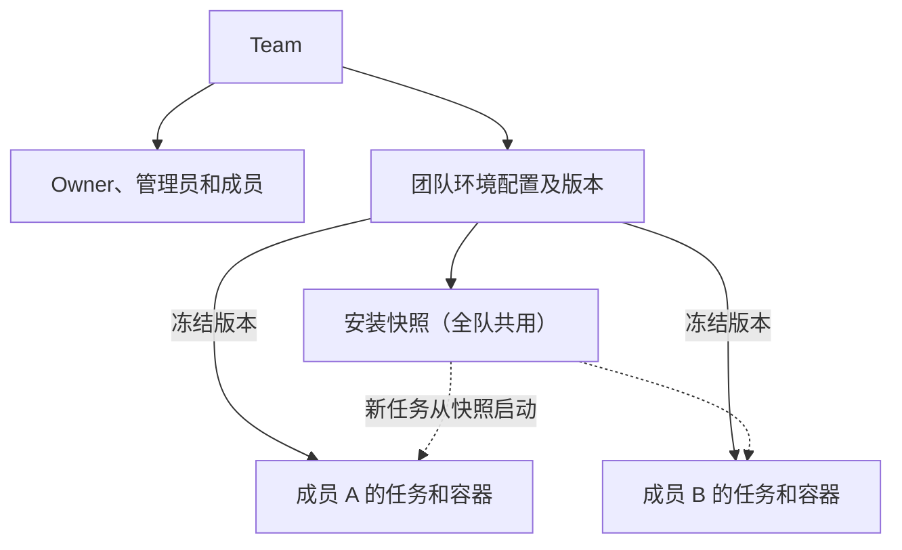

# Team 与团队共享环境设计

日期：2026-10-15。状态：第一步（Team、邀请、成员）和第二步（团队共享环境配置）已实现。

> 2026-10-15 产品调整：放弃“多名成员在同一个容器里协作”的共享工作区。多人共用一个容器容易让各自的开发互相干扰；每人已经有自己的账户，共用同一个容器带来的好处不多。团队真正需要共享的是环境配置。第二步因此改为团队共享环境配置：成员使用团队的同一份配置，在各自的容器里运行各自的任务。原设计中的共享工作区、在已有容器中新建 Chat、团队 scope 的 thread 和 sandbox、host 撤权租约、团队归档与运行清理等内容不再计划，已从本文删去；原文见 #679 合并时的版本（`7aede94b`）。

Team 管理一组协作成员，团队拥有可复用的环境配置。成员的 Chat、工作区和容器始终属于成员本人。登录身份和个人推理额度继续由 Gateway 管理。

本文描述新增行为；不会把已有个人资源自动变为团队资源。第 8 节和第 9 节记录已落地的表结构和接口。

## 1 产品模型

一个用户可以加入多个 Team；每个 Team 可以拥有多个环境配置。个人空间继续存在，不要求个人用户创建 Team。

| 对象 | 含义 | 归属 |
| --- | --- | --- |
| Team | 成员和管理权的范围 | 团队自身；有一名 Owner 负责管理 |
| 环境配置 | 可复用的变量、脚本、快捷操作和版本，属于一个仓库 | 个人或 Team |
| 安装快照 | 某个环境当前安装配置的安装结果 | 跟随环境：团队环境的快照全队共用 |
| Chat、工作区和容器 | 一段 Agent 会话及其运行环境 | 始终是执行成员本人的 |

规则：

- 团队环境对团队的活跃成员开放，不增加子团队或按环境的 ACL。
- 团队环境属于一个仓库。成员用它创建任务时，仍按成员本人检查 `agent.use` 和仓库 entitlement；加入 Team 不授予 GitHub 或 GitLab 权限。
- 推理使用执行成员的模型权限和账户额度。Team 所有权、创建人和付费人是不同属性。
- 团队成员之间互相信任：团队环境的 Secret 和安装快照对全队生效（第 6.4 节）。

界面里没有“空间”或“工作区”的概念：用户只看到项目和 Chat。团队环境与个人环境一起出现在环境列表和新建任务的环境选择里，带团队标记。

## 2 用户流程

1. A 创建 Team，成为 Owner。
2. A 创建邀请链接并自行分享；B 登录后申请加入，A 批准。
3. A（或团队管理员）在“设置 → 环境”新建环境，归属选“团队「X」”；也可以把自己的环境复制到团队。
4. B 在设置和新建任务的环境选择里看到带团队标记的环境。选择后，任务在 B 自己的容器里，以团队的变量和脚本运行。
5. B 可以查看、测试、复制这个环境，或把它设为自己在这个仓库的默认环境；只有 Owner 和管理员能修改。

第一步交付 1、2：设置里的“团队”页面（建队、邀请、批准、移除、转让、退出、删除）和邀请链接打开的加入页。第二步交付 3–5。

## 3 角色与权限

第一版支持 Owner、Admin（管理员）和 Member。每个 Team 恰好一名 Owner；Owner 可以任免管理员，管理员负责日常成员管理和团队环境。平台管理员沿用独立的管理面和审计，团队角色不获得平台管理权限。

| 操作 | Owner | Admin | Member |
| --- | --- | --- | --- |
| 查看团队资料和成员名单 | 可以 | 可以 | 可以 |
| 修改团队名称 | 可以 | 可以 | 不可以 |
| 创建和撤销邀请、批准或拒绝加入 | 可以 | 可以 | 不可以 |
| 移除普通成员 | 可以 | 可以 | 不可以 |
| 任免或移除管理员、转让所有权 | 可以 | 不可以 | 不可以 |
| 删除 Team | 可以 | 不可以 | 不可以 |
| 查看管理审计 | 可以 | 不可以 | 不可以 |
| 查看、测试、复制、选择团队环境，设为自己的默认环境 | 可以 | 可以 | 可以 |
| 创建、修改、恢复历史版本、删除团队环境 | 可以 | 可以 | 不可以 |
| 重建或删除团队环境的安装快照 | 可以 | 可以 | 不可以 |
| 退出 Team | 先转让所有权或删除 Team | 可以 | 可以 |

成员记录保存 `admin/member`，Owner 始终从 `owner_user_id` 推导。角色调整带团队 revision 并写入审计；所有管理写入在团队行锁内重新检查当前角色。管理员降级、退出或被移除时，其创建的未完成邀请和申请一并关闭。重新加入默认为 Member，所有权转让后的原 Owner 也成为 Member。

团队环境的编辑权原设计只给 Owner；按 2026-10-15 的产品决定改为 Owner 和管理员。

## 4 邀请与加入

### 邀请方式

第一版使用“一次性邀请链接加 Owner 或管理员批准”，不依赖全站用户目录或邮件发送服务。现有 Gateway 只提供用于显示的账户 email，没有可用的已验证邮箱邀请契约，不能把可编辑名称或未经验证的邮箱当作加入凭据。

Owner 或管理员创建邀请后，服务端用 `secrets.token_urlsafe(32)` 生成 256 位随机 token（43 个字符），数据库只保存其 SHA-256。邀请 24 小时有效，只允许一个账户领取。原始 token 仅在创建响应中返回一次；需要再次分享时生成新邀请。邀请页面只显示团队名称、邀请人及申请状态，不返回团队资源。

创建响应丢失时，同一幂等键只能恢复邀请元数据，不能从哈希恢复链接（响应里 `token` 为 `null`）。客户端提示撤销这条邀请后重新生成，避免悄悄创建多个有效链接。Member 的 membership 仅在批准时建立；pending 申请不属于活跃成员。

邀请链接形如 `/teams/join#token=…`，token 放在 URL fragment 中，浏览器不会把它发给任何服务器。加入页位于登录后的应用外壳之外（与 `/login` 相同），先把 token 移入当前标签页的 sessionStorage（30 分钟有效、用后即删），再清除地址栏中的 fragment；需要登录时回到同一页面继续。token 不写入持久缓存、分析事件、请求日志或登录回调 query，领取时通过 POST 请求体提交。领取和批准均须在邀请有效期内完成。

### 状态与并发

1. B 登录，服务端验证身份和 `agent.use`，B 在加入页明确点击“申请加入”后才领取邀请。持有链接本身不会产生团队访问权。
2. 事务按“团队行 → 邀请行”的顺序加锁，检查有效期、未撤销状态、团队仍为 active，写入绑定 B 的 join request。
3. Owner 或管理员查看申请人的显示资料（个人资料中的名字，否则是 Gateway 账户 email）和稳定账户标识，批准或拒绝。显示名只用于展示，权限永远绑定 `user_id`。
4. 批准前向 Gateway 确认申请人当前的 `agent.use`；批准事务再检查操作者的 Owner 或管理员身份、团队状态、申请有效性和成员容量，然后激活 membership、消费邀请并写入审计。

同一申请人的重复领取返回同一申请；另一账户不能抢占已领取的邀请。同一用户在一个 Team 只能有一个待处理申请（部分唯一索引保证）；随链接过期的旧申请在下一次领取时被标记为 `expired`，不再占用这个名额。重复批准返回已完成结果，不增加第二条 membership。撤销、拒绝或过期都不能再次使用原 token。

转让 Team 所有权时撤销尚未完成的邀请和申请，由新 Owner 重新发起。没有 `agent.use` 的用户可以理解拒绝原因，但不会获得资源访问权。邮箱邀请可在将来具备明确的已验证身份契约后加入。

### 容量与滥用

所有团队接口都要求已登录且有 `agent.use` 的会话，没有匿名可调用的入口；token 为 256 位随机值，猜测不可行。因此第一步不另设请求速率限制，而用容量上限约束滥用：

| 上限 | 值 |
| --- | --- |
| 一个账户同时拥有的 Team | 20 |
| 一个 Team 的活跃成员（含 Owner） | 50，在批准时检查 |
| 一个 Team 同时未使用且未过期的邀请 | 20 |
| 单次列表返回的历史邀请或申请 | 50；邀请额外保留全部仍可操作的记录，避免有效邀请被历史记录挤出 |

## 5 成员与团队生命周期

### 退出和移除

Admin 或 Member 主动退出、Owner 移除非 Owner 成员、管理员移除普通成员使用同一套撤权流程。控制面事务先把 membership 标记为 `left` 或 `removed`，递增 `access_generation`，同时写入审计。事务提交后，新的读取和管理请求立即被拒绝。团队环境没有需要后台清理的运行资源：成员的容器本来就是成员自己的。离队的效果由 generation 栅栏实现（第 6.3 节）：

- 离队成员不再在列表中看到团队环境，按 ID 读取、复制或绑定都返回 404。
- 其使用团队环境的会话在下一轮被 claim 时失败（`team_environment_revoked`）；正在执行的那一轮照常结束。
- 指向团队环境的仓库默认值在其下次新建任务时清除。
- 已经进入其容器的 Secret 无法收回。需要时由 Owner 或管理员轮换 Secret。

成员重新加入时复用历史 membership 的身份记录，但再次递增 generation。重新加入不会恢复旧会话对团队环境的使用；需要继续工作时，由本人新建任务。

### 所有权

`agent_teams.owner_user_id` 是唯一的 Owner 权威字段。Owner 可以把所有权转给当前有准入资格的活跃 Member；转让原子完成，原 Owner 成为 Member。转让前先确认目标确实是活跃成员，再向 Gateway 询问其 `agent.use`，避免 Owner 借此探查任意账户的准入状态。转让不会改变其他人的模型额度或个人凭证。

Owner 不能直接退出或被普通成员移除。转让、退出、移除及 Team 状态变化锁定同一 Team 行，防止并发操作留下没有活跃 Owner 的团队；数据库约束（第 8.1 节）在提交时再兜底一次。Owner 失去平台准入时不自动选举继任者，由平台管理面通过经过审计的恢复操作处理；正常成员权限不因此升级。这个管理面恢复操作尚未实现。团队环境不依赖它：管理员仍可维护团队环境；没有管理员的团队在 Owner 失去准入后，团队环境无人能修改，成员可以复制成个人环境继续使用。

### 删除

Team 只有 `active → deleted`：Owner 按读取时的 revision 直接删除，未使用的邀请被撤销、待处理申请被取消，所有成员立即失去访问权，行和审计记录保留。原设计中的 `archived` 和 `deleting` 是为团队运行资源准备的，不再计划。

团队删除后，其环境不再出现在任何人的列表中，也不能被新任务选择；已绑定的会话在下一轮失败。环境行、版本和审计保留；安装快照按现有保留规则在 7 天未使用后删除。

## 6 团队环境

### 6.1 归属与编辑

`agent_environments.team_id` 非空的环境属于该 Team，`user_id` 记录创建人。团队环境必须属于一个仓库；名称在同一 Team 和仓库内唯一，与个人环境的名称互不冲突。

- **创建。** Owner 或管理员在新建时选择团队（`POST /environments` 带 `team_id`），或把任意自己能使用的环境复制到团队（`POST /environments/{id}/copy` 带 `team_id`）。归属在创建时确定，之后不能修改。
- **编辑。** 沿用环境的版本号乐观并发；保存时锁住环境行，两名管理员同时保存会依次检查同一个版本号，而不是都得到同一个新版本。普通成员的修改、删除、恢复历史版本、重建或删除快照返回 403。
- **审计。** 创建、修改（含恢复历史版本）和删除团队环境写入团队审计：`environment_created`、`environment_updated`、`environment_archived`，`target_id` 为环境 ID。
- **默认环境。** 默认环境仍按“成员 × 仓库”保存，可以指向团队环境；设置时检查成员能使用它。删除团队环境时清除所有成员指向它的默认值。

### 6.2 运行

团队环境的绑定与个人环境相同：创建任务时冻结所选版本，之后的修改只影响新任务。区别有两点：

- **个人全局变量只在运行期生效。** 成员的个人全局变量合并进团队环境时一律改为运行期可用，仅安装期的个人变量不合并；同名变量以团队环境为准。这样同一团队环境的安装对每个成员都相同，安装快照才能全队共用；成员自己的密钥仍能交给 Agent 和它运行的命令。
- **绑定记录团队和 generation。** `agent_environment_bindings` 记录 `team_id` 和成员绑定时的 `team_access_generation`。

### 6.3 离队栅栏

每次把绑定的变量值交给容器之前，控制面检查绑定的成员仍是该 Team 的活跃成员、Team 仍为 active，且 `access_generation` 与绑定时相同。这些路径都经过同一个读取（`get_environment_binding`）：每一轮的 claim、终端、快捷操作、Fork、重新准备环境、环境测试，以及更新运行期变量。

- 一轮被 claim 时检查不通过：该轮直接置为失败，claim 返回 403 `team_environment_revoked`，不会因为换一台 host 而重新排队。
- 其他接口检查不通过时返回 409。
- 已经在运行的一轮不被中断；对它而言 Secret 已经交出。
- 脱敏和发布扫描仍然读取这些值（`for_masking`），以便继续在该会话已经产生的输出里找到它们；它们不把值交给容器。会话环境页的只读视图不含 Secret，离队后仍能打开。

### 6.4 信任前提与已接受风险

团队环境以“团队成员互相信任”为前提，这一前提记入 [AGENTS.md](../../../AGENTS.md) 第 7 节：

- **Secret 对成员可读。** 能用团队环境运行任务的成员，可以在自己的任务里读取它的 Secret。编辑器只写不读，只防止界面回显，不构成成员间的保密；环境对话框对团队环境明确提示这一点。把团队环境复制成个人环境同样复制 Secret。
- **安装快照全队共用。** 成员的任务或测试可以为团队环境排一次预构建，基于该成员检出的提交运行团队的安装脚本；构建结果供之后所有成员的新任务启动使用。成员因此能影响其他成员的容器从什么状态启动。这与成员能向共享仓库推送代码属于同一信任范围。删除和重建快照只开放给 Owner 和管理员。
- **离队不收回已交出的值。** 栅栏只阻止新的一轮；离队成员已经读到的 Secret 需要轮换。

### 6.5 安装快照

快照查找对团队环境不再要求快照属于同一用户：同一团队环境、同一安装指纹的快照对所有成员可用。成员使用快照的记录（使用次数、最近使用时间、校验失败）写在这个共用快照上，保留和淘汰规则据此计算。快照计入排队那名成员的 20 GiB 配额。删除团队环境的快照时，删除所有成员排出的快照并取消其预构建。Owner 或管理员修改团队环境的安装脚本或安装期变量后，所有成员的旧快照都作废；成员改自己的个人全局变量不影响团队快照，因为它们不参与团队环境的安装。涉及多个成员快照的写操作按账号顺序取得每个快照归属者的快照锁。

## 7 执行与发布身份

团队资源的管理主体是 Team，实际执行主体始终是用户。`agent_threads.user_id` 和 `agent_jobs.user_id` 保留执行用户含义。团队环境不改变会话、容器、终端、MCP、Git 凭证或发布的归属：它们仍然完全属于执行成员，沿用个人任务的全部检查。

## 8 数据模型

### 8.1 Team 核心表（第一步，迁移 `0079_teams`）

| 表 | 关键字段与约束 |
| --- | --- |
| `agent_teams` | `id, name, owner_user_id, state (active/deleted), revision, created_by_user_id, create_request_key, created_at, updated_at, deleted_at`；名称 1–80 字符且无首尾空白；`(created_by_user_id, create_request_key)` 唯一 |
| `agent_team_members` | 主键 `(team_id, user_id)`；`role=admin/member, state=active/left/removed, access_generation, joined_at, departed_at`；离队保留记录；`departed_at` 为空当且仅当 active |
| `agent_team_invitations` | `id, team_id, created_by_user_id, request_key, token_hash, state (open/claimed/revoked), expires_at, revoked_at`；`token_hash` 唯一且为 32 字节；`(team_id, created_by_user_id, request_key)` 唯一 |
| `agent_team_join_requests` | `id, team_id, invitation_id, user_id, state (pending/approved/declined/cancelled/expired), decided_by_user_id, decided_at`；`invitation_id` 唯一；`(team_id, invitation_id)` 复合外键指向同一 Team 的邀请；`(team_id, user_id) WHERE state='pending'` 部分唯一 |
| `agent_team_audit_events` | `id, team_id, actor_user_id, action, target_user_id, target_id, details, created_at`；`action` 为固定词表（第二步加入 `environment_created/updated/archived`）；不存邀请 token、token 哈希、Secret 或工具原始输出 |

邀请的“过期”不单独存储，由 `expires_at` 在读取时推导；申请的 `expired` 在下一次领取时补记。

**唯一 Owner 由数据库保证。** `agent_teams` 有一个生成列 `owner_membership_state`：团队未删除时为 `'active'`，已删除时为 NULL。延迟复合外键 `(id, owner_user_id, owner_membership_state) → agent_team_members (team_id, user_id, state)` 在提交时检查。于是创建团队、转让、成员退出无论以什么顺序写入，只要提交时 Owner 不是该团队的活跃成员，整个事务就失败；团队删除后 NULL 使该行免于检查，Owner 才可以离开。成员 `role` 只保存 `admin/member`，默认 `member`；是否为 Owner 仍由 `owner_user_id` 唯一决定。

**锁顺序。** 每个写操作先锁 Team 行，再锁邀请、申请和 membership。领取只知道 token，所以先无锁读出邀请所属 Team，锁住 Team，再锁邀请并复查。只读列表复查成员资格但不加锁。

**generation 只向前。** 退出、移除和重新加入都递增 `access_generation`，重新加入复用原行；团队环境的执行栅栏（第 6.3 节）以它为准。

### 8.2 团队环境（第二步，迁移 `0082_team_environments`）

| 表 | 变化 |
| --- | --- |
| `agent_environments` | 新增可空 `team_id → agent_teams`；CHECK：团队环境必须有 `repo`。名称唯一索引拆为个人（`team_id IS NULL`）和团队 `(team_id, repo, normalized_name)` 两个；新增 `(team_id, repo)` 索引 |
| `agent_repository_environment_defaults` | 外键从 `(environment_id, user_id)` 改为只引用 `environment_id`，使成员的默认值可以指向团队环境；访问在设置和绑定时检查 |
| `agent_environment_bindings` | 新增 `team_id` 与 `team_access_generation`，CHECK 两者同时为空或同时非空 |
| `agent_team_audit_events` | `action` 词表加入三种环境操作 |

迁移不修改已有行。存在团队环境（包括已删除的）时拒绝降级：删除这一列会把团队环境静默交给创建它的成员。

## 9 API 与统一鉴权

新增 API 使用现有主监听器和登录身份，不增加 sandbox 可调用的团队管理能力。创建类操作使用幂等键（`request_key`），会冲突的修改使用 `expected_revision`；重放先验证当前访问权，再返回允许返回的历史结果。

第一步已实现的接口（前缀 `/v1/agent`）：

| API | 行为 |
| --- | --- |
| `POST /teams` | 创建 Team 与 Owner membership；同一 `request_key` 返回同一个 Team |
| `GET /teams` | 只列出本人活跃加入的 Team |
| `GET/PATCH /teams/{team_id}` | 读取资料；Owner 或管理员带 revision 更新名称 |
| `DELETE /teams/{team_id}?expected_revision=` | Owner 删除 Team，撤销未完成的邀请和申请 |
| `GET /teams/{team_id}/members` | 活跃成员名册，Owner 在前 |
| `POST /teams/{team_id}/leave` | Admin 或 Member 退出 |
| `DELETE /teams/{team_id}/members/{user_id}` | Owner 移除非 Owner 成员，管理员只能移除普通成员 |
| `PATCH /teams/{team_id}/members/{user_id}/role` | Owner 带 revision 任免管理员 |
| `POST /teams/{team_id}/transfer-ownership` | 转给有准入资格的活跃 Member，带 revision |
| `POST /teams/{team_id}/invitations` | Owner 或管理员创建单次邀请；仅这一次响应带 token |
| `GET /teams/{team_id}/invitations` | Owner 或管理员查看全部可操作邀请及最近历史 |
| `DELETE /teams/{team_id}/invitations/{id}` | 撤销邀请及其尚未批准的申请 |
| `POST /team-invitations/claim` | 登录用户以 token 领取，生成申请 |
| `GET /team-join-requests` | 本人查询自己近 30 天的申请状态 |
| `GET /teams/{team_id}/join-requests` | Owner 或管理员查看待处理且未过期的申请 |
| `POST /teams/{team_id}/join-requests/{id}/decision` | Owner 或管理员批准或拒绝；批准前确认申请人当前准入 |
| `GET /teams/{team_id}/audit-events` | Owner 分页查看管理审计 |

第二步对环境 API 的改动（同一前缀）：

| API | 变化 |
| --- | --- |
| `GET /environments` | 同时返回个人环境和本人所在活跃团队的环境；每项带 `team`（`{id, name}` 或 `null`）和 `can_edit` |
| `POST /environments` | 可带 `team_id`，仅 Owner 或管理员；对已有环境的保存忽略这个字段 |
| `POST /environments/{id}/copy` | 可带 `team_id` 复制到团队，仅 Owner 或管理员；不带时复制给本人 |
| `PATCH`、`DELETE /environments/{id}`，恢复版本，重建或删除快照 | 团队环境仅 Owner 或管理员，其他成员 403 |
| 会话的环境视图，终端、快捷操作、Fork、重新准备、更新运行期变量 | 环境视图带 `team`；离队后交出变量值的接口返回 409 |
| worker claim | 离队或 Team 删除后，使用团队环境的一轮失败并返回 403 `team_environment_revoked` |

非成员按 ID 访问团队环境一律 404，不区分“不存在”和“无权访问”。

错误统一为 `{"error": {"type": …, "message": …}}`：非成员或跨 scope 的资源请求返回 404（`not_found`），已知 Team 内的角色不足返回 403（`forbidden`），失效 revision、Owner 直接退出、成员已满等冲突返回 409 并带稳定类型（如 `revision_conflict`、`owner_cannot_leave`、`team_full`、`request_pending`、`applicant_not_admitted`），失效的邀请链接返回 410（`invitation_unavailable`，不区分不存在、过期、撤销或已被他人领取）。Gateway 无法回答时返回 503，不使用过期肯定结果兜底。所有团队响应 `Cache-Control: no-store`；格式错误的请求返回通用 422，不回显请求内容，避免把输错的链接写进错误信息。

## 10 前端

- **设置 → 环境。** 团队环境带“团队 · 名称”标记。不能修改的团队环境显示“查看”而不是“编辑”，菜单只有复制和设为默认。Owner 或管理员新建环境时可以选择归属，复制时可以选择复制到哪个团队。
- **环境对话框。** 团队环境显示由哪个团队共享，以及 Secret 对全队可读、个人全局变量只在运行期生效的提示。不能修改时以只读方式打开：可以查看、测试、阅读历史，不能保存或恢复版本。
- **新建任务的环境选择。** 团队环境带团队标记；“有效配置”里不列出不会生效的仅安装期个人变量。
- **会话的环境页。** 显示所用环境属于哪个团队。

按钮的隐藏只是体验优化，服务端仍校验每个动作。团队环境的修改不推送给其他成员；他们重新打开列表时读取最新版本，已有会话本来就固定在创建时的版本上。

## 11 模块位置与分步交付

| 模块 | 变化 |
| --- | --- |
| `schemas/teams.py`、`api/teams.py` | Team、邀请和成员 API；请求校验与安全响应（第一步） |
| `domain/teams.py`、`application/teams.py` | 词表、上限、拒绝类型；token、Gateway 准入检查与显示资料（第一步） |
| `ports/teams.py`、`storage/repositories/teams.py` | 成员关系、邀请消费、Owner 不变量和审计写入（第一步） |
| `storage/repositories/environments.py`、`api/environments.py` | 团队环境的访问、编辑权、审计、默认值、绑定和离队栅栏（第二步） |
| `storage/repositories/environment_snapshots.py` | 团队环境的快照共用和删除（第二步） |
| `api/worker.py` | claim 时的离队栅栏（第二步） |
| 前端 | 第一步：设置里的团队页、`/teams/join` 加入页；第二步：环境列表、对话框、选择器和会话环境页的团队环境 |

分步交付：

1. **第一步（已实现）**：Team 创建、改名、删除；一次性邀请链接、领取、批准/拒绝、撤销；管理员任免、退出、移除、转让；Owner 审计；设置里的团队页和加入页。迁移只新增表。
2. **第二步（已实现）**：团队共享环境配置，见第 6 节。
3. **后续**：Owner 失去平台准入时的管理面恢复操作。

不包含：共享工作区（已放弃）、全平台团队账单、团队 API Key、SSO、SCIM、团队记忆、访客角色、按环境的私有 ACL。

## 12 验收

| 场景 | 必须得到的结果 | 步骤 |
| --- | --- | --- |
| A 创建 Team，B 加入，C 未加入 | A/B 按权限使用团队；C 的所有团队路径均被拒绝 | 第一步 |
| 并发领取、批准、撤销邀请 | 只有合法申请生效；重放不重复加人，过期 token 不恢复权限 | 第一步 |
| Owner 转让与目标退出并发 | 事务保证唯一活跃 Owner，不留下无主管理状态 | 第一步（另有数据库约束兜底） |
| A 创建团队环境，B 使用 | B 在列表和选择器中看到它；任务在 B 自己的容器以团队变量运行；B 修改、删除、重建快照得到 403 | 第二步 |
| C 不在团队 | 看不到团队环境；按 ID 读取、复制或绑定得到 404 | 第二步 |
| B 退出或被移除，或之后重新加入 | 使用团队环境的旧会话下一轮以 `team_environment_revoked` 失败；重新加入不恢复旧会话；不能再用的默认值被清除 | 第二步 |
| Team 被删除 | 团队环境不再列出；已绑定的会话下一轮失败 | 第二步 |
| B 的个人全局变量 | 只在运行期进入团队环境的任务；仅安装期变量不进入；同名以团队为准 | 第二步 |
| A 的任务构建了快照 | B 的新任务从它启动，使用记录写在同一快照上；只有 Owner 或管理员能删除或重建 | 第二步 |
| 团队环境的创建、修改、删除 | 写入团队审计；删除清除所有成员指向它的默认值 | 第二步 |
| 迁移往返 | 存在团队环境时拒绝降级 | 第二步 |

第一步的测试：`tests/integration/storage/test_team_store.py`、`tests/servers/test_teams_api.py`、前端 `lib/api/teams.test.ts`、`lib/teamInvitation.test.ts` 和 `components/features/teams/*.test.tsx`。第二步的测试：`tests/integration/storage/test_team_environment_store.py`（编辑权、离队与重新加入、默认值、复制、快照共用、审计）、`tests/servers/test_environments_api.py`、`tests/servers/test_environment_snapshots_api.py`、`tests/servers/test_grant_at_claim.py`（claim 栅栏），以及前端 `components/features/agents/environment/*.test.tsx` 和 `lib/api/environments.test.ts`。

## 13 将来接入平台统一 Team

第一版由 Cloud Agent 数据库管理团队成员，Gateway 继续管理用户身份、`agent.use`、模型权限与推理额度。当前不增加 Gateway 团队计费字段，也不让两个服务各自决定同一份 membership。

如果 FreeInference 将来提供统一 Team 服务，通过明确的 HTTP 契约引入 `(issuer, external_team_id)` 映射，保留现有资源的稳定 Team ID。迁移时冻结本地成员写入、迁移并核对成员及 generation、切换授权权威，再将本地表降为受控镜像。不能用长期双写或两个独立 Owner 字段维持一致性。

团队计费可在此后独立设计。拥有团队资源不自动意味着 Owner 为所有人付费，也不改变现有“无 per-task dollar budget”的边界。

## 14 代码与设计依据

- [环境配置设计](2026-10-12-repository-environment-design.zh-CN.md)：个人配置、不可变版本、冻结 binding 和 Secret 语义。
- [环境安装快照设计](2026-10-15-environment-install-snapshots-design.zh-CN.md)：安装指纹、预构建和快照保留。
- [Team 迁移](../../../migrations/versions/0079_teams.py)与[Team 存储](../../../apps/backend/cloud_agent/storage/repositories/teams.py)：第一步的表、约束和锁顺序。
- [团队环境迁移](../../../migrations/versions/0082_team_environments.py)与[环境存储](../../../apps/backend/cloud_agent/storage/repositories/environments.py)：第二步的归属、绑定和离队栅栏。
- [Owner 鉴权](../../../apps/backend/cloud_agent/api/_owner_auth.py)、[仓库 entitlement](../../../apps/backend/cloud_agent/entitlement.py)与[身份 namespace](../../../apps/backend/cloud_agent/identity_namespace.py)：身份、当前准入与资源权限的分工。
- [Gateway lookup 契约](../../../gateway_contracts/internal-lookups.openapi.yaml)：账户资料、`agent.use` 与邮箱显示契约。
- [仓库安全边界](../../../AGENTS.md)：平台凭证隔离、用户提供的环境凭证和团队环境的信任前提。
