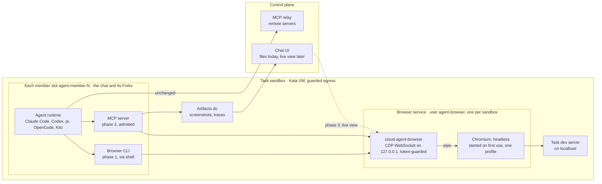
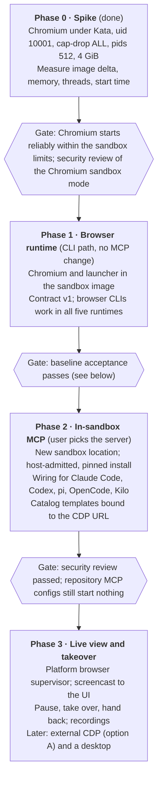

# Design: Computer Use Base Capability for Cloud Agent

Status: Phase 0 done, Phase 1 implemented · 2026-11-02, updated 2026-11-04 (review fixes)

## Summary

Cloud Agent should ship computer use as a **platform base capability**, not as a choice of tool. The platform provides a browser (later a desktop) inside each task sandbox, a stable environment and connection contract, lifecycle and isolation. Users pick the MCP server or CLI that drives it; we ship one tested default template.

We land this in three phases:

1. **Browser runtime in the sandbox image.** Agents can drive it right away through any browser CLI they install in their home directory. No MCP changes.
2. **In-sandbox MCP servers.** A user-selected MCP server runs next to the browser, admitted per session by the trusted host, for all five runtimes.
3. **Live view, takeover and recordings.** A session-scoped, authenticated channel from the UI to the sandbox browser.

The Phase 0 spike answered the main open risk: Chromium runs under our current limits (uid 10001, `--cap-drop ALL`, `no-new-privileges`, `--pids-limit 512`, 4 GiB memory), but only without its own sandbox, because Docker's default seccomp profile refuses unprivileged user namespaces. [Phase 0 findings](#phase-0-findings) has the measurements and the decision.

## Background

Today no Cloud Agent runtime can see or operate a UI. Three facts cause this.

**The sandbox has no browser.** `deploy/sandbox/Dockerfile.agent-sandbox` installs no Chromium, no display server and none of Chromium's shared libraries. The agent runs as uid 10001 (or a member uid) without sudo, so it cannot `apt-get install` them during a task.

**Native computer use does not apply to us.** Claude Code computer use needs macOS, an interactive session and a claude.ai login; we run `claude -p --input-format stream-json`. Codex computer use ships in the desktop app; Codex Cloud lists browser and computer use as roadmap. pi, OpenCode and Kilo have no native equivalent.

**Every MCP server runs outside the sandbox.** The agent only sees the platform relay:

- Claude Code starts with `--strict-mcp-config --mcp-config <relay>` and `--setting-sources user`.
- Codex reads a root-owned `/etc/codex/requirements.toml` with an empty `[mcp_servers]` allowlist; the trusted host admits only the relay, as `session`.
- pi reaches MCP through `pi-mcp-bridge.ts`; OpenCode and Kilo are configured the same relay-only way.
- Remote MCP servers run in the control plane. Stdio servers are meant for a managed worker or a user connector, and `mcp/host.py` refuses them until those exist.

The relay-only wiring is deliberate: a repository cannot auto-start its own MCP servers. But it also means a user can already *select* Playwright MCP from the Recommended list in `mcp/catalog.py`, yet it would run where it cannot reach the task's `localhost`, its files or a browser in the sandbox.

Other platforms close this gap with an in-environment browser or desktop: Cursor Cloud Agents and Devin give the agent a full desktop with recordings and takeover; GitHub Copilot's cloud agent runs Playwright MCP against `localhost` by default; Replit runs an App Testing browser. Which driver tool is best is not settled: public benchmarks (WebdriverIO's tool comparison, Browser Use's BU Bench) show no stable winner across models.

## Goals and non-goals

**Goals**

- An agent in any of the five runtimes can open, read and operate a web page served by the task itself (`localhost`) or by an allowed external host.
- The user chooses the driver tool (MCP server or CLI); the platform does not hard-code one.
- One default template works out of the box for users who do not want to choose.
- Browser state is scoped to a sandbox (a chat and its Forks, all one owner's) and reclaimed with it.
- Existing guarantees hold: repositories cannot auto-start MCP servers, egress stays guarded, no credentials leak into the sandbox.

**Non-goals**

- Building our own UI-understanding model, planner or browser agent.
- A full graphical desktop in phase 1. The contract leaves room for it; we add it only when a concrete task needs non-browser apps.
- Operating the user's own machine or logged-in browser.
- Picking the "best" tool in this doc. The default is chosen by the evaluation in a later section.

## Requirements

Each requirement names what the platform owns; everything else belongs to the user's agent and tool.

| # | Requirement | Platform owns | Phase |
| --- | --- | --- | --- |
| R1 | Runtime environment | Chromium and its libraries in the image; a display only when a desktop is added | 1 |
| R2 | Reach the task | Browser runs in the task's network namespace, sees its `localhost` and files | 1 |
| R3 | Perception and input | Nothing beyond R1: accessibility tree, DOM, screenshots and input come from CDP, used by the tool | 1 |
| R4 | Coding-loop signals | Console, network and page errors reachable from the same tool session | 1 |
| R5 | Tool attachment | A user-chosen CLI or MCP server can run next to the browser, with a well-known connection contract | 1 (CLI), 2 (MCP) |
| R6 | Session continuity | Cookies, tabs and storage persist across turns, for a chat and its Forks | 1 |
| R7 | Lifecycle | Start on demand, idle reclaim, crash recovery, kill with the sandbox | 1 |
| R8 | Isolation | No browser shared between sandboxes; the browser outside every member's UID; no control endpoint reachable from outside the sandbox | 1 |
| R9 | Evidence | Screenshots and traces land in the workspace and show in the UI | 1 (files), 3 (recordings) |
| R10 | Live view and takeover | User watches, pauses and takes control of the browser | 3 |

## Options considered

We choose C first, then B; A is deferred until live view needs an external channel anyway. The question is where the user's tool runs relative to the browser.

| Option | Where the tool runs | What changes | Main cost | Verdict |
| --- | --- | --- | --- | --- |
| A. Expose CDP to external MCP | Control plane or user connector | Sandbox publishes a per-session CDP endpoint through an authenticated tunnel; relay-hosted MCP connects with `--cdp-endpoint` | CDP is full browser control (read any page, run any script, read cookies); needs per-session auth, tunnel, revocation | Defer to phase 3 |
| B. In-sandbox MCP server | Inside the sandbox | Trusted host admits one user-chosen stdio server per session, next to the relay, in all five runtimes | Five runtime wirings; must keep repository configs out; pinned install inside the sandbox | Phase 2 |
| C. In-sandbox CLI | Inside the sandbox | Nothing in MCP; agent calls a browser CLI from its shell | No structured tool schema; quality depends on the agent reading CLI help | Phase 1 |

Why this order:

- **C needs only R1.** Playwright CLI, agent-browser and Browser Use CLI install with `npm` or `uv` into the user's home. Every runtime already has a shell tool.
- **B keeps control local.** The browser's control port never leaves the sandbox, so there is no new remote attack surface. The new surface is admission, which the trusted host already does for the relay.
- **A is the only option that needs a channel from outside into the sandbox.** Phase 3 must build that channel for live view and takeover. A then becomes cheap to add on the same channel.

## Phase 0 findings

Measured on 2026-11-03 with Debian bookworm's `chromium` 156.0.8078.79 in a `node:22-bookworm-slim` container started with the retained sandbox's flags (`--user 10001`, `--cap-drop ALL`, `--security-opt no-new-privileges`, `--pids-limit 512`, `--memory 4g`, `--init`). The Kata guest uses the same OCI seccomp profile (`Seccomp=2`, see `chat_sandbox.py`), so the namespace result carries over; Kata itself was not available on the test host.

| Question | Result |
| --- | --- |
| Unprivileged user namespaces | Refused (`unshare --user`: operation not permitted) |
| Chromium with its own sandbox | Fails at start: "No usable sandbox!" |
| Chromium with `--no-sandbox` | Starts and renders headless |
| Image growth | About 274 MB uncompressed for Chromium, its libraries and two font packages |
| Idle browser | 11 processes, about 140 threads, 174 MiB |
| Browser with 4 real pages (GitHub, Hacker News, Wikipedia, MDN) | 15 processes, about 213 threads, 321 MiB |

**Decision on Chromium's sandbox.** The managed browser runs with `--no-sandbox` when the guest refuses user namespaces, and `cloud-agent-browser status` reports `chromium_sandbox: false`. Reasons:

- Member UIDs already run unvetted repository code; the image's threat model treats that side as untrusted. A compromised renderer gains the browser's own user (`agent-browser`), which can do less than a member: it holds no member's credentials and can write only the shared workspace and its own home.
- The boundary that matters, the container and the Kata VM, is unchanged.
- The platform cannot enforce Chromium's sandbox anyway: a member can start the same binary, or a browser a tool downloads, with `--no-sandbox` itself.
- The alternatives (a custom seccomp profile that allows `CLONE_NEWUSER`, or a sandbox per browser-using member) widen the kernel surface or cost a VM each, for no gain against the threat above.

The launcher prefers Chromium's sandbox whenever user namespaces work, so a later seccomp change takes effect without a new image. `ALLOW_UNSANDBOXED` in the launcher is the switch if this decision is reversed.

"Work" is probed by mapping a user into a new namespace (`unshare --user --map-root-user`), not only by creating one. Under Ubuntu's AppArmor restriction (`kernel.apparmor_restrict_unprivileged_userns=1`, the default on Ubuntu 24.04 and on GitHub's runners) `unshare --user true` succeeds, but the namespace has no capabilities and Chromium aborts with "No usable sandbox". That is what failed the real-Chromium test in CI. If Chromium still fails sandboxed, the service starts it once more with `--no-sandbox`, logs why, and reports `chromium_sandbox: false`.

**Threads.** One browser with a few pages stays well inside 512. The limit is per group and counts threads; since a group shares one managed browser, a Fork adds tabs, not a second browser. The launcher caps renderers at four (`--renderer-process-limit=4`). We keep the group limit as it is and watch it (see [Resources and performance](#resources-and-performance)).

## Proposed design

The platform ships Chromium, a launcher and a small environment contract. Tools are attached on top of that contract and never baked in.

The launcher is the contract boundary: everything above it is the user's choice, everything below it is the platform's. Only the existing relay leaves the sandbox until phase 3 adds the live-view channel (dashed).

### Browser runtime (phase 1)

- **Binary.** Debian's `chromium` package (full Chromium, not headless-shell, so a headed mode stays possible for phase 3), plus `fonts-liberation` and `fonts-noto-color-emoji`, in its own layer of `Dockerfile.agent-sandbox`. Debian's build rather than a pinned Chrome for Testing download: it exists for amd64 and arm64 (Chrome for Testing has no arm64 Linux build), it takes Debian's security updates with every rebuild, and its dependencies are exactly the shared libraries that a browser a tool downloads for itself needs. CDP clients connect to any current Chromium, so an exact Playwright-matched build buys nothing here.
- **One browser per sandbox.** Every member of a group (the chat and its Forks) shares one managed browser, its tabs and its sign-ins, as they already share `/workspace`. A group belongs to one owner: memberships and forks carry the sandbox's `user_id` by foreign key. This is how a local agent works too: Claude Code's `--fork-session` forks the conversation and keeps working in the same directory.
- **Its own user.** The browser runs as `agent-browser` (uid 10002, group `agent`), not as a member. A member's turn ends with a reap of every process its UID started during the turn (`member-process-reaper`), so a member's browser could never outlive a turn; and a shared browser cannot belong to any one member. A member cannot switch UID inside the sandbox, so the trusted host starts the service.
- **Launcher.** `/usr/local/bin/cloud-agent-browser`, root-owned and mode 0555, Python standard library only. The host runs `cloud-agent-browser service start` as `agent-browser` before each member launch (`cloud_agent_host/sandbox_browser.py`); it is idempotent, so a container that was stopped and started again gets its service back with its next member. The service is a small loopback server. It starts headless Chromium (`--headless=new`, `--disable-dev-shm-usage`, background networking, component updates, crash upload and metrics off, at most four renderers, one profile) only when the first client connects, and stops it again after the idle timeout. Members use `start`, `status`, `stop` and `self-test`; `start` makes sure Chromium runs and prints the CDP WebSocket URL.
- **One pipe, many clients.** Chromium speaks CDP only over `--remote-debugging-pipe` to the launcher's daemon. The daemon serves it as a WebSocket on `127.0.0.1`, at a random port, behind a random path token (`ws://127.0.0.1:<port>/<token>/devtools/browser`). Each client gets its own browser-level session (`Target.attachToBrowserTarget`). Its command ids are rewritten into one space, and every reply and event goes back only to the client that owns the session it came from. Two Playwright clients and two Puppeteer clients worked at the same time in the spike. `Browser.close` from a client ends only that client's connection, because the browser belongs to the sandbox, not to one tool. Each client's replies and events are written by a task of its own: the loop that reads the browser's pipe never waits for a client's socket, so a client that stops reading (an 8 MiB screenshot it has not read yet) cannot delay another client. A client more than 256 MiB behind is disconnected.
- **Downloads across users.** A client names its own download directory, and Playwright's is 0700 in the client's temporary directory, which Chromium, as `agent-browser`, cannot write. When a client's `Browser.setDownloadBehavior` names a directory Chromium cannot write, the service points Chromium at a staging directory of its own instead. When the download finishes, it asks a *courier* of the client's UID to copy the file to where the client will read it, and only then passes the "completed" event on. The client's UID comes from the kernel's socket table for its connection. The courier is one process per UID, started by `cloud-agent-browser start`; it registers over a unix socket in the state directory, and the service checks its UID with `SO_PEERCRED`. The courier copies only a regular file the service user owns, out of the staging directory, into a directory its own UID owns, under a name no file has yet. So a compromised browser can at most add a new file to one of the member's directories. A download with no courier, or one that cannot be copied, is reported to the client as canceled, and the reason is logged.
- **No HTTP discovery.** There is no `/json/version` endpoint. Clients resolve it against the server's root, which would drop the token from the path. Every client we target accepts a WebSocket URL directly.
- **Downloads stay possible.** Egress allows them (public IPv4 TCP 80/443), and a repository's own tests may depend on the exact browser its tooling downloads, so the image sets no `PLAYWRIGHT_SKIP_BROWSER_DOWNLOAD` or `PUPPETEER_SKIP_DOWNLOAD`. It sets `CHROME_PATH`, which tools that look for an installed Chrome read. The preinstalled browser still matters: it needs no download, and its libraries are what lets a downloaded browser start at all as a non-root member.
- **Tool install.** Users install a CLI into `~/.local` or `~/.npm-global` from their environment setup, as with any other dev tool. Pinning is the user's choice in phase 1.

### Environment and connection contract (v1)

This is the stable surface that templates and user tools rely on. It is versioned; additions are backward-compatible.

| Name | Kind | Meaning |
| --- | --- | --- |
| `cloud-agent-browser start` | command | Ensures Chromium runs; prints the CDP WebSocket URL (`ws://127.0.0.1:<port>/<token>/devtools/browser`). `--json` prints the status instead |
| `cloud-agent-browser status` | command | JSON: `service`, `running`, `endpoint`, `browser`, `chromium_sandbox`, `last_error`, `profile`, `artifacts_dir` |
| `cloud-agent-browser stop` | command | Closes Chromium for every member; the service and the profile stay, and the next `start` relaunches it |
| `cloud-agent-browser self-test` | command | Starts the browser and checks it end to end (two clients, a page, a screenshot, session isolation) |
| `cloud-agent-browser service start` / `stop` | command, platform | Runs or ends the service, as `agent-browser`. The host runs `service start`; a member cannot stop the service |
| `CLOUD_AGENT_BROWSER_CONTRACT` | env | Contract version, `1` |
| `CLOUD_AGENT_BROWSER_BIN` | env | `/usr/bin/chromium` |
| `CLOUD_AGENT_ARTIFACTS_DIR` | env | `/workspace/.cloud-agent-artifacts`: screenshots, traces and downloads; shown in the workspace files, kept out of Git |
| `CLOUD_AGENT_BROWSER_STATE_DIR` | env | `/run/agent-browser`: 0750, owned by `agent-browser`, group `agent`. Holds the endpoint file and status record (0640) and the service log |
| `CLOUD_AGENT_BROWSER_PROFILE` | env | `/home/agent-browser/profile` (0700) |
| `CLOUD_AGENT_BROWSER_IDLE_S` | env, optional | Idle timeout in seconds; default 900 |

Every value is set by the image and is the same in every sandbox; the host adds nothing per member. Without them, the launcher falls back to directories under `$HOME`.

**Managed vs self-launched browsers.** Only a browser started by the launcher is *managed*: it gets the guarantees in this doc (idle reclaim, session continuity, token-guarded CDP, a lifetime independent of any member, operator signals). A tool may still launch `CLOUD_AGENT_BROWSER_BIN` itself; that browser is an ordinary user process. It is killed with the sandbox and counted against its limits, but the platform makes no promise about its debug port, profile or lifetime. Templates always use the managed browser.

### In-sandbox MCP servers (phase 2)

A user can run an MCP server *in the sandbox*, next to the agent, instead of behind the relay: it then sees the task's `localhost`, its files and the sandbox browser. As built:

- **New location.** `sandbox` beside `remote`, `managed-worker` and `user-connector` (migration `0110_mcp_sandbox_location`). Such a server is one exactly pinned package started by `npx` or `uvx` (`npx -y pkg@1.2.3`, `uvx pkg==1.2.3`; not `latest`, not a range). It takes no mount, no working directory, and no secret of any kind: no `secret://` value, no static credential, no OAuth. The sandbox also runs repository code, so a credential given to the server would be one the repository could read; a server that needs one stays remote. `cloud_agent.mcp.launch` enforces this when the connection is saved, and again at every claim.
- **A gateway, not a stdio entry per CLI.** The image ships `cloud-agent-mcp`. Its gateway presents a member's servers to the member's CLI as one Streamable HTTP server named `sandbox`, at the fixed address `http://127.0.0.1:47801/mcp`, the way the relay presents the remote ones as `session`. Tools are named `<alias>__<tool>`, exactly as the relay names them. Three reasons for a gateway:
  - A server spawned by the CLI as the member would be killed at the end of any turn in which it started, by the member's turn-end reap. The gateway's user is not a member.
  - Every runtime already speaks HTTP MCP to the relay. So each needs one more URL, not a stdio client of its own; pi's bridge has none.
  - The address is fixed, so Codex's root-owned allowlist names it once (`[mcp_servers.sandbox]`) and never changes under a sibling Codex member.
- **Three identities.** A server is code the user chose but nobody reviewed, so it must affect nothing beyond its own member:
  - **The admission** says which servers a slot may use. The host writes it as root, into the root-owned `/run/agent-mcp-admissions`.
  - **The gateway** runs as `agent-mcp` (uid 10003). It serves the address and runs no server.
  - **Each slot's runner** runs as `agent-mcp-<slot>` (uid 12001 + slot). It runs that slot's servers as stdio children and answers only the gateway, checked with `SO_PEERCRED`.

  A server can reach its own runner and its member's other servers. It cannot write an admission, signal the gateway, take its address (the host starts the gateway before the runner) or reach another slot. Review found the first design, where servers ran as the gateway's user, let one slot's server rewrite another's admission; an end-to-end test in the built image now runs exactly that attack and every step of it is refused.
- **Admission stays with the trusted host.** A claim carries the job's sandbox servers (`sandbox_mcp_servers`: alias, command, args, plain env). The relay identity never lists them, so the relay never dials one. Before each member launch, the host (`cloud_agent_host/sandbox_mcp.py`) does three steps:
  1. As root, it writes the slot's admission.
  2. As `agent-mcp`, it starts the gateway.
  3. As the slot's runner user, it starts the slot's runner.

  The admission carries the SHA-256 of the member's MCP credential: the token the CLI already sends to the relay, so one header reaches both servers. Only the digest is ever written. A request is served only with the servers of the member whose admission matches its token. The runner starts admitted servers at once, so the CLI's first tool list does not wait for an install. An idle server, one with no call running for the idle timeout, is stopped; a call in progress keeps its server, however long it runs. A tool call is routed to the server that listed the tool, so a broken server cannot answer for another.
- **Per-runtime wiring.** One more entry in what `AgentRuntime.relay_urls` returns, with the relay's header:
  - Claude Code: another `http` server in `--mcp-config`, still under `--strict-mcp-config`.
  - Codex: another `-c mcp_servers` entry, `required = false` with a 180 s start-up, so a server that fails does not stop the turn.
  - pi, OpenCode and Kilo: one more URL in `AGENT_MCP_SERVERS`, which their wrappers already loop over.
- **Templates.** Two presets ship beside the remote ones. *Playwright browser*: `@playwright/mcp@0.0.83 --cdp-endpoint ${CLOUD_AGENT_BROWSER_CDP} --output-dir /workspace/.cloud-agent-artifacts/playwright-mcp`. *Chrome DevTools*: `chrome-devtools-mcp@1.11.0 --wsEndpoint ${CLOUD_AGENT_BROWSER_CDP}`. The gateway replaces `${CLOUD_AGENT_BROWSER_CDP}` with the sandbox browser's URL when the server starts. It gets that URL from `cloud-agent-browser start`, which also starts the courier that hands that user's downloads over. In the import step, a user can also choose "Each chat's sandbox" as the run location of any pinned `npx` or `uvx` server.
- **Change and revocation.** The servers a launch was admitted with are part of what the member's CLI process is fixed to (`ResidentTransport.incompatible_fields`, field `mcp`). So a server turned off, added or re-pinned makes the next turn start a new CLI that resumes the native session, and that launch replaces the slot's admission. A launch with no sandbox servers revokes the slot's admission. The host skips that exec only for a slot it has itself seen clean since it started, so a restarted host revokes once per slot before trusting it. This matters because the residency's MCP credential is deterministic for the residency, so an admission left behind would still open the gateway. An admission written before the container last started is ignored. A change never applies in the middle of a turn.
- **Authorization.** A sandbox server is not behind the relay's per-tool policies (allow, confirm, deny): its power equals the agent's shell, and audit comes from the runtime's tool-call events. The UI says so. The connection's test button explains that it is checked in the sandbox rather than marking it unreachable.
- **Results.** Image results already flow through `protocol_compat/tool_images.py`. The Playwright preset writes snapshots and screenshots under `CLOUD_AGENT_ARTIFACTS_DIR`, kept out of Git, rather than into the repository.
- **Known limit: downloads through Playwright MCP.** Playwright MCP 0.0.83 attached with `--cdp-endpoint` never sends `Browser.setDownloadBehavior`, so a link it clicks does not download at all. The same page downloads normally for plain Playwright run as a member or as `agent-mcp`, through the service's hand-off. This is the server's behavior, not the platform's; a later preset version, or a flag for it, can lift it.

### Live view and takeover (phase 3)

The launcher becomes a platform-owned browser supervisor. It streams frames over CDP `Page.startScreencast` to the UI through an authenticated, session-scoped channel, and forwards user input during takeover while the agent's turn is paused. The same channel can later carry option A (external CDP) and a desktop display.

## Security and isolation

The browser adds no new trust boundary in phases 1 and 2: it runs as its own unprivileged user inside the same Kata VM and guarded network, and can do nothing the agent's shell cannot already do.

- **CDP is token-guarded on loopback.** Chromium never opens a TCP debug port itself; only the launcher's WebSocket is on `127.0.0.1`. Its token is in `/run/agent-browser`, which only `agent-browser` writes and only the `agent` group reads: the members, the sandbox user and owner environments, all the group owner's. A member reads the endpoint only from a directory and file no other user could have written, so no member can plant an endpoint for the others. The path is compared in constant time, and the `Host` header must name loopback. This is the same loopback-plus-secret shape as the OpenCode and Kilo bridge. No port is published from the sandbox until phase 3, and that channel is authenticated per session and revocable.
- **Members share the browser, not each other's credentials.** The browser runs as `agent-browser`, so no member owns its processes or its profile, and none can signal them. A member's tools reach it only through CDP. A member's own credentials (its home, its provider state) stay private as before.
- **Clients are isolated from each other.** A client can only send commands on sessions it created; any other session id gets CDP's "session not found" error, and events reach only the owning client. Pages themselves are shared: every client of the sandbox's browser sees every tab.
- **Chromium's own sandbox.** `--cap-drop ALL` and `no-new-privileges` rule out the setuid sandbox, and Docker's default seccomp profile refuses the user namespaces its namespace sandbox needs. The managed browser therefore runs with `--no-sandbox`, a decision recorded with its reasons in [Phase 0 findings](#phase-0-findings). It is visible (`chromium_sandbox` in `status`) and reversible in one place.
- **Egress.** Browser traffic uses the sandbox's single guarded network and resolver. A page can reach only what the agent could reach with `curl`. No new allowlist entries are added for browsing.
- **Untrusted page content.** Pages can carry prompt injection. This is the same risk as a fetched web page today; templates default to the task's `localhost` and allowed hosts, and the agent sees page text as tool output, not instructions.
- **Repository configs stay inert.** In-sandbox MCP servers are admitted only by the trusted host from the user's selection. `.mcp.json`, `.codex/config.toml` and similar files in the repo still start nothing.
- **Relay authorization.** An in-sandbox server is not behind the relay's authorization layer. That is acceptable because its power equals the agent's shell; audit comes from the runtime's tool-call events, as for shell commands.
- **Credentials.** The profile holds only cookies created in the sandbox's tasks. We do not import user browser profiles. A profile lives as long as its sandbox's retained container.

## Session semantics

A browser belongs to exactly one sandbox group: the chat that created the sandbox and every Fork that joined it. They share its tabs, cookies and storage, as they share `/workspace`. Nothing is shared between sandboxes.

| Event | Browser process | Profile (cookies, storage) | Open tabs |
| --- | --- | --- | --- |
| New turn in the same chat | Reused if alive, else started on the first connection | Kept | Kept if the process survived |
| A turn ends | Untouched: the turn-end reap scans the member's UID only | Kept | Kept |
| Idle past the reclaim timeout | Chromium stopped by the service; the service stays | Kept | Lost |
| Chromium crashes | Its clients are disconnected; the next connection starts a new one | Kept | Lost |
| Sandbox stop or eviction | Killed with the sandbox; the service is started again with the next member launch | Kept: the browser user's home lives in the retained container's writable layer | Lost |
| Fork | Shared with the source chat | Shared | Shared |
| A member stops the browser (`stop`) | Stopped for every member | Kept | Lost |
| Two tools or subagents | Shared | Shared | Shared; each client has its own CDP sessions and should open its own tab |

Rules behind the table:

- **A Fork shares the browser.** A Fork continues the source chat's work in the same container, on the same files, for the same owner. Signing in again in the Fork, or a browser that had none of the source's tabs, would be the surprise. A Fork that should start clean belongs in a new sandbox.
- **One browser per profile, not one client.** Chromium's profile lock only stops two browser processes from opening the same directory. It does not stop several CDP clients (two tools, two subagents, or a chat and its Fork) from driving the same managed browser and interfering with each other's tabs, cookies or downloads. The launcher accepts any number of CDP clients; coordinating them is the tools' job (next rule).
- **Tab ownership is the tool's job.** The platform does not arbitrate tabs between subagents or members; templates open a new page per agent by default.

## Resources and performance

A browser that is never started costs only image size; the costs below apply only to tasks that use it. All numbers are to be measured in the phase 1 spike, not assumed.

| Limit today | Where | Why the browser stresses it | Mitigation |
| --- | --- | --- | --- |
| 4 GiB memory default | `chat_sandbox_models.py` `memory_limit`, `sandbox_memory_mib` setting | Chromium plus a dev server plus the agent CLI share one cgroup; an OOM kill takes the whole sandbox | Measured 174 MiB idle, 321 MiB with 4 pages. Launch on demand, idle reclaim, at most 4 renderers. No change to the default |
| `--pids-limit 512` | `chat_sandbox.py` | The limit counts threads, and Chromium runs many processes and threads | Measured about 140 threads idle and 213 with 4 pages. Renderers capped at 4. No change now; raise it for the group if browser starts begin to fail on it |
| `/dev/shm` 64 MiB (Docker default) | container runtime | Chromium uses shared memory for rendering | `--disable-dev-shm-usage` in the launcher |
| Image size (about 5.3 GB today) | `Dockerfile.agent-sandbox` | Chromium and its libraries add a layer | About 274 MB uncompressed, in its own cacheable layer |
| CPU limit | `cpu_limit` | Rendering and screenshots compete with builds | Headless only in phases 1 and 2 |

Startup is paid once per sandbox per idle period, not per tool call, because the service reuses Chromium for every member. The idle service itself is one small Python process.

## Evidence, observability and UX

Phase 1 shows evidence as files; phase 3 adds a live view. No new UI is needed for phase 1.

- **Screenshots and traces.** Tools write into `CLOUD_AGENT_ARTIFACTS_DIR` (`/workspace/.cloud-agent-artifacts`). The workspace file listing walks the directory tree and skips only `.git`, and `WorkspaceFiles.tsx` already previews PNG, JPEG, GIF and WebP, so the user can open what the agent saw. `cloud-agent-browser start` creates the directory and adds it to `.git/info/exclude`, the way the environment tools directory is excluded, so it never enters a diff or a published branch.
- **Inline images.** When a tool returns an image in a tool result, `protocol_compat/tool_images.py` already moves it into a user message for runtimes that need that.
- **Operator signals.** The service logs Chromium's start, stop, crash and reclaim to its log in the state directory, and the host logs a service that could not start. We add counters for browser starts, crashes, OOM kills of sandboxes with a running browser, and peak threads.
- **Live view (phase 3).** A browser pane in the chat shows the screencast. Takeover pauses the agent's turn, forwards the user's input, and hands control back with a short note to the agent about what changed.
- **Recordings (phase 3).** Screencast frames or a Playwright trace, saved to the artifacts dir and linked from the turn.

## Rollout plan

Each phase is useful on its own, and a gate must pass before the next one starts. Dates are set after the spike.

Phase 1 already unblocks most use cases: an agent can verify its own frontend change with any browser CLI. Phases 2 and 3 improve tool choice and user trust, not basic capability.

**Baseline acceptance (Phase 1 gate).** The gate checks the platform, not which tool is best:

- At least two independent tools (for example Playwright CLI and agent-browser) connect to the managed browser through the contract.
- Each opens the task's own `localhost` app, completes a multi-step interaction and writes a screenshot to `CLOUD_AGENT_ARTIFACTS_DIR`.
- Isolation tests pass: a uid outside the sandbox group cannot read the token; a member cannot stop the service or plant an endpoint; the browser survives a member's turn-end reap.
- Lifecycle tests pass: idle reclaim, crash relaunch, kill with the sandbox, no orphaned processes.

The default-tool evaluation below runs in parallel and does not gate any phase.

**Phase 1 acceptance so far.** In the built image, in a container with the sandbox's flags, with the service started the way the host starts it (`service start` as uid 10002, workdir `/`), against a fixture app on `localhost`:

- Member 0 drove the browser with Playwright (`connectOverCDP`), clicked, set a cookie and wrote a screenshot to the artifacts directory.
- Every member-0 process was then reaped with `member-process-reaper` and an empty baseline, as at the end of a turn. The browser kept running.
- Member 1, standing in for a Fork, connected with Puppeteer (`browserWSEndpoint`), saw member 0's tab and its cookie, and called `browser.close()` without ending the browser.
- A uid outside the `agent` group could not read the endpoint. A member could neither stop the service nor write its directory.
- After a container restart, the service was gone until the next `service start`, and the profile was still there.
- Codex's review findings, after the fixes:
  - A member's Playwright `connectOverCDP` with `acceptDownloads` downloaded into its own 0700 directory, in the default context and in a new one. `download.path()` and `saveAs` both worked, and the file belonged to the member. The same script had reported `canceled` before.
  - A member's Puppeteer download (`policy: 'allow'`) was named as the page suggested.
  - One client stopped reading an 8 MiB `Runtime.evaluate` reply. Another client's `Browser.getVersion` then took 0 to 1 ms. Before the fix, it did not answer within 10 s.
  - The image build now runs the self-test as agent-member-0 against a service run as agent-browser, including that download.
- Before that, with the earlier per-member launcher: two Playwright and two Puppeteer clients at once, a refused (404) guessed path, crash relaunch, and an idle browser stopping with no process left.

Unit tests drive the service against a fake Chromium. They cover lazy start, two clients on one Chromium, `stop`, crash recovery and idle reclaim. They also cover a stalled client that must not delay another, and a client too far behind being dropped. Then the sandbox fallback; and downloads staged and handed over, de-duplicated across sessions, or canceled with no courier. Last, the courier's refusals. Still to run: the same on Kata, through a real chat turn.

**Delivery.** Phases 1 and 2 ship as two pull requests:

1. **Base capability** (this doc, Phase 0 findings, Phase 1): the sandbox image with Chromium, the `cloud-agent-browser` launcher and its per-sandbox service, the host starting it, contract v1, the artifacts dir, and the isolation, lifecycle and baseline acceptance tests.
2. **In-sandbox MCP** (Phase 2): the `sandbox` connection location with its migration, catalog templates, MCP directory UI, host admission and change/revocation lifecycle, and wiring for all five runtimes. Branched from `dev` after PR 1 merges.

Phase 3 gets its own design doc once both are in production.

## Evaluation plan for the default template

The default is the tool with the highest success rate on our own tasks; cost and stability break ties. Public benchmarks are inputs, not the decision: their winners change with the model.

**Task set.** 20 to 30 tasks drawn from real Cloud Agent work, each with a scripted pass check:

- Verify a UI change on the task's own dev server and attach a screenshot.
- Reproduce a reported frontend bug and name the failing console or network error.
- Complete a multi-step form or login flow on a local fixture app.
- Check a page for broken layout at two viewport sizes.
- Read data from a page that needs scrolling or pagination.

**Candidates.** Playwright CLI, Playwright MCP, agent-browser, Chrome DevTools MCP and Browser Use CLI. Stagehand needs its own model calls, so it is measured but billed separately.

**Runs.** Claude Code and Codex, the two runtimes most users pick; three runs per task and tool.

**Metrics.** Pass rate, tokens and cost per task, wall time, tool or browser crashes, peak sandbox memory and threads.

**Output.** A results table in the repo and a one-line decision in this doc. Until then the catalog marks no tool as default. We rerun when a runtime or model changes.

## Open questions

- [x] Do unprivileged user namespaces work in our Kata guest? No (Docker's default seccomp profile); the managed browser runs with `--no-sandbox`, see [Phase 0 findings](#phase-0-findings).
- [x] Do the 4 GiB and 512-pid limits hold? Yes for one browser with a few pages; confirm on Kata with a heavy SPA and two browsers in one group.
- [x] Is the member's home persisted across sandbox eviction? Yes, in the retained container's writable layer.
- [ ] Should a user be able to clear the sandbox's browser profile (sign out everywhere) from the UI?
- [ ] How do agents learn the browser exists? Phase 1 relies on `chromium` and `cloud-agent-browser` being on `PATH` and on the environment; a short platform instruction to every runtime is a follow-up.
- [x] Does a Fork share the browser? Yes, like `/workspace`: one browser per sandbox group.
- [ ] Login inheritance across sandboxes: should a user be able to opt a new chat into a saved login? Who approves it, and how is it scoped?
- [x] Where does `CLOUD_AGENT_ARTIFACTS_DIR` live? `/workspace/.cloud-agent-artifacts`, excluded through `.git/info/exclude`.
- [x] Phase 2: arbitrary in-sandbox servers, or only templates? Any exactly pinned `npx`/`uvx` package with no secret, plus two browser presets.
- [ ] Phase 3: is takeover input forwarded through the existing session channel, or a new one?
- [ ] When does a full desktop (display server, non-browser apps) become worth its cost?

## References

Repository (branch `dev`):

- `deploy/sandbox/Dockerfile.agent-sandbox`, `deploy/sandbox/codex-requirements.toml`
- `apps/backend/cloud_agent_host/chat_sandbox.py`, `chat_sandbox_models.py` (limits, member slots, tmpfs)
- `apps/backend/cloud_agent_host/runtimes/claude.py`, `codex.py`, `pi.py`, `opencode.py`, `kilo.py`
- `apps/backend/cloud_agent/mcp/catalog.py`, `launch.py`, `host.py`, `transports.py`
- `apps/backend/cloud_agent/application/session_fork.py`
- `docs/agents/specs/2026-09-16-mcp-setup-experience.md`

Driver tools:

- [Playwright MCP](https://github.com/microsoft/playwright-mcp)
- [Playwright CLI](https://github.com/microsoft/playwright-cli)
- [agent-browser](https://github.com/vercel-labs/agent-browser)
- [Chrome DevTools MCP](https://github.com/ChromeDevTools/chrome-devtools-mcp)
- [Browser Use](https://github.com/browser-use/browser-use)
- [Stagehand](https://github.com/browserbase/stagehand)

Benchmarks: [OSWorld](https://os-world.github.io/), WebArena-Verified, Online-Mind2Web, the WebdriverIO browser-tool comparison and Browser Use's BU Bench. Figures from these were gathered during earlier research and are not restated here.
