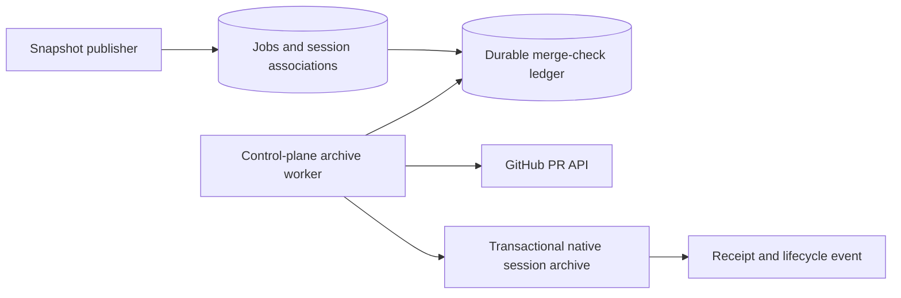

# Automatic session archiving after a PR merge

The main control-plane listener checks published GitHub PRs and archives the
sessions whose current completed work belongs to a merged PR. Checks run every
30 seconds by default, using the existing GitHub integration. No webhook URL,
external scheduler, or separate session API is required.

## Components and integration points



- `storage/repositories/snapshot.py` records published PR links on contributing
  jobs. Job IDs, session IDs and owner IDs provide the trusted mapping.
- `storage/repositories/pr_archive.py` discovers eligible sessions, claims
  checks, records retries, and commits archival with a completion receipt.
- `workers/pr_archive.py` validates PR links, verifies repository access,
  fetches merge state, and retries failures.
- `bootstrap/lifespan.py` starts and stops the worker in the main listener.
  The MCP-only listener does not run another copy.
- Migration `0040_pr_merge_archive` creates `agent_pr_archive_checks`, including
  a due-work index and a unique receipt per `(thread_id, pr_url)`.

Polling is both the detection mechanism and the reconciliation mechanism.
Restarting the control plane does not lose associations, receipts or retry
dates. A worker crash leaves a lease that another worker can recover after
expiry; lease tokens fence late writes from the previous worker.

## Which sessions are archived

The trigger is the session's **latest turn**, ordered by `turn_no`. It must be
successful and have a recorded published PR. The session must be live and
unarchived. Active or newer unpublished turns defer archival; accepted pending
owner messages also defer it.

A shared snapshot can publish one PR for multiple sessions. Each qualifying
contributor is processed independently. Other sessions in that sandbox do not
qualify merely because they share its workspace. Forks copy publication links
for display; copied history qualifies only if the fork's own job actually
belongs to a published snapshot. Original jobs retain their existing direct
publication association for compatibility.

PR labels, titles, descriptions and branch names cannot select an archive
target. The worker extracts a number only from a persisted HTTPS GitHub PR URL
matching the stored repository. It constructs the API request from the
configured GitHub API origin and the stored repository, verifies owner access,
and checks the response's PR number, URL and base repository. Only the boolean
`merged: true`, with a valid merge timestamp, authorizes archival. Closing a PR
without merging leaves the session active; slower checks permit a later reopen
and merge to be detected.

Immediately before committing, the repository locks the session and rechecks
ownership, the latest job, publication association and claim token. A merge
observed for an earlier turn cannot archive newly submitted work.

## Archive actions

The database transaction:

1. Sets `agent_threads.archived_at`, preserving an existing archive timestamp.
2. Pauses automatic goals, cancels queued goal rounds, and applies the existing
   archived queue pause semantics.
3. Stores the merge timestamp, commit SHA, archive timestamp and completed
   receipt in the ledger.
4. Appends a `session_archived_pr_merged` lifecycle event to the associated job.

The existing owner-change notification updates the session list. Transcripts,
attachments, job history and PR links remain available in the archive. Shared
workspaces and retained native sessions remain intact. Archival does not
delete files or stop running agent processes.

Restoring a session preserves its completed receipt. The same PR merge will
not archive it again; a later distinct published PR can create a new obligation.

## Configuration and rollout

1. Back up the Agent database and apply `alembic upgrade head` through
   `0040_pr_merge_archive` using the existing release migration workflow.
2. Deploy the updated main control plane and MCP listener. The worker starts
   with the main listener and reads live saved settings and credentials.
3. Configure the existing GitHub App installation and owner repository access,
   or the existing deployment publication token and repository allowlist. The
   App path requests repository-scoped `pull_requests: read` tokens. Credentials
   remain in the control plane.
4. In **Admin → Settings → Publication**, review these values:

| Setting | Default | Effect |
|---|---|---|
| `pr_archive_enabled` | `true` | Enable or pause automatic checks. |
| `pr_archive_poll_s` | `30` | Seconds between passes and ordinary open-PR checks. |
| `pr_archive_timeout_s` | `10` | Timeout for each PR API read. |
| `pr_archive_batch_size` | `20` | Maximum associations processed in one pass. |
| `pr_archive_retry_max_s` | `3600` | Cap exponential retry delay; provider-required waits take precedence. |
| `pr_archive_max_failures` | `10` | Block repeated non-transient access or invalid-response failures. |

`AGENT_PR_ARCHIVE_ENABLED` and `AGENT_PR_ARCHIVE_POLL_S` seed settings only when
the settings row is first created. For an existing deployment, use the saved
settings; changing environment values does not override them. Enablement also
applies to eligible sessions published before deployment.

Set the control-plane log format to `json` for structured verification. Validate
with a test repository and session: merge its published PR, confirm the session
appears in archived history, inspect its lifecycle event and ledger receipt,
then restore it and confirm that the same merge does not archive it again.

## Failure handling and recovery

Open PRs are checked again on the ordinary interval. Closed, unmerged PRs are
checked on a slower interval of at least five minutes. Requests sharing the
same owner, repository and PR can share one verified result during a pass.

Timeouts, transport failures, GitHub outages and rate limits retry automatically
with capped exponential backoff and jitter. Provider retry/reset times take
precedence over the configured cap. Missing integration configuration does not
consume a completed receipt; checks can resume after configuration is repaired.

Invalid mappings or mismatched API identities block the affected association.
Repeated access or invalid-response errors also become terminal skipped rows
after the configured threshold. Logs record safe reason codes, without provider
response bodies, credentials or session content. Failure of one check does not
discard other sessions' obligations.

Inspect ledger state with read-only SQL:

```sql
SELECT thread_id, job_id, pr_url, state, failures, last_error,
       next_check_at, lease_expires_at, merged_at, archived_at, completed_at
FROM agent_pr_archive_checks
ORDER BY updated_at DESC;
```

After fixing the recorded mapping or access problem, an operator can retry one
terminal skipped association using bound parameters:

```sql
UPDATE agent_pr_archive_checks
SET state = 'pending', failures = 0, last_error = NULL,
    completed_at = NULL, next_check_at = NOW(), updated_at = NOW()
WHERE thread_id = :thread_id AND pr_url = :pr_url
  AND state = 'skipped' AND claim_token IS NULL;
```

Completed archive receipts must remain intact when restoring a session. Do not
clear a live claim token; its lease provides crash recovery.

Successful archival emits `agent_session_archived_after_pr_merge`; retry and
blocked events use `agent_pr_archive_check_failed` and
`agent_pr_archive_blocked`. These records and durable lifecycle events provide
verification without an external notification destination. Configure existing
log alerting for blocked checks and persistent worker failures.

## Timing and acceptance

For eligible sessions under ordinary load and healthy dependencies, target
merge-to-archive latency of at most 60 seconds for 95% of merges. Measure from
the provider's merge timestamp to the stored archive timestamp. This is an
operating target, not a measured production result. Active turns, pending
messages, backlog, rate budgets and retry delays can extend it. Reopened PRs
may wait for their slower closed-PR check. After an outage, durable checks
resume automatically; a crashed claim becomes eligible after lease expiry.

Verify duplicate processing, worker races and restart recovery; shared PR
contributors; unrelated and inherited fork sessions; new work submitted during
a merge check; closed and reopened PRs; mismatched API identities; credential
rotation; rate limits; and restoration after archival. No test should produce
an incorrect session archive. Run `make check` and the database-backed archive
tests before release.
