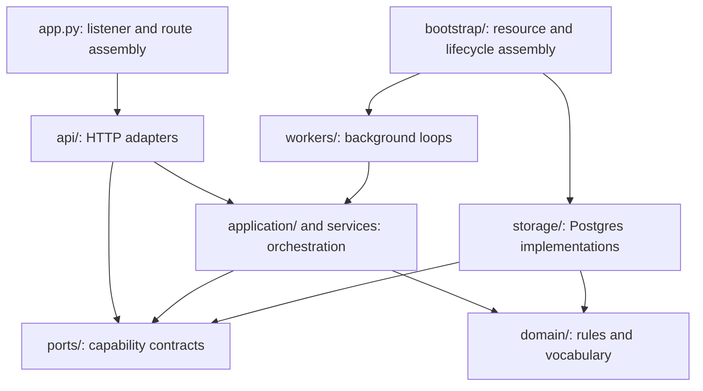

# Code structure

This guide explains where behavior belongs and how to follow it through the
repository. Use [development.md](development.md) for setup and checks, and
[AGENTS.md](../../AGENTS.md) for service and security boundaries.

## Start with the deployment boundary

```text
apps/
  backend/
    cloud_agent/          Control plane and its HTTP APIs
    cloud_agent_host/     Host execution and retained sandbox management
    cloud_agent_shared/   Contracts and algorithms shipped in both images
  frontend/              Next.js browser UI and backend-for-frontend routes
gateway_contracts/       Gateway HTTP contracts and control-plane OpenAPI
migrations/              Agent-owned database schema, managed by Alembic
deploy/                  Image builds and deployment entry points
scripts/                 Development, qualification, and release tooling
tests/                   Backend behavior, integration, and boundary checks
docs/                    Maintained guides and dated design evidence
```

The control plane and host are independently deployed implementations. Neither
imports the other. Shared code provides the facts and contracts they agree on;
it imports neither implementation. Gateway integration uses HTTP contracts.
The agent database and Gateway database remain separate.

## Follow a control-plane request



`app.py` mounts the owner/admin API and the separate MCP-only listener. It
installs shared HTTP response and exception policies, and on both listeners a
dependency that runs ahead of every route's own (`api/_parameters.py`): a path
or query parameter holding NUL, or a route's integer parameter too wide for a
`bigint`, is refused with a 422 before any query reads it. So is a JSON body
holding NUL or half a surrogate pair, on a route an owner, an administrator or
the on-call relay calls; host and sandbox reports keep their own models, which
replace those characters instead. `bootstrap/lifespan.py`
constructs the resources and starts and stops background work; route modules
do not own service startup or shutdown.

| Directory or module | Owns | Put a change here when |
|---|---|---|
| `api/` | HTTP parsing, dependencies, authorization entry points, response mapping | The request or response behavior changes |
| `schemas/` | Pydantic request, response, and host/worker wire models | A transport field or validation rule changes |
| `application/` | Admission, follow-ups, Fork, delivery, reconciliation, and other flows | A use case coordinates several capabilities |
| `domain/` | Execution state, request identity, and business vocabulary | A rule is independent of persistence and HTTP |
| `ports/` | Narrow typed capabilities | A caller needs a new operation from an adapter |
| `storage/assembly.py` | Construction of Postgres repository capabilities | A storage capability is wired into the service |
| `storage/repositories/` | SQL and transaction/fencing behavior | A durable query or mutation changes |
| `workers/` | Scheduled work and recovery loops | Work continues independently of a request; queue and goal recovery cannot hold up attempt lease recovery |
| `bootstrap/` | Resources and lifecycle | A component must be constructed, started, or closed |
| `mcp/` | MCP hosting, transport, policy, and process-local runtime | Protocol or upstream session behavior changes |
| `goals/` | Goal orchestration and retry policy | Goal scheduling or progress policy changes |
| `providers/` | External provider implementations | A provider's integration behavior changes |

The storage assembly exposes capabilities such as `store.host_pool` and
`store.pending_messages`. Callers type against the capabilities they use. They
do not import Postgres repositories or reach through the assembly to its pool.
Application flows may use the existing FastAPI exception contracts; moving
files does not imply those interfaces have become framework-independent.

MCP session ownership lives in `mcp/runtime.py`: lazy host construction,
fenced session reaping, maintenance, and closing. Both the relay's handlers
and bootstrap call that runtime directly. Eager send-now handoff task retention
and cancellation live in `application/send_now.py`; the durable delivery rows
and recovery worker still own crash recovery.

## API schemas are organized by domain

Import public models from `cloud_agent.schemas`. Its `__init__.py` explicitly
exports them; implementations use direct imports between domain modules rather
than importing the facade back into themselves.

| Modules | Models for |
|---|---|
| `jobs`, `conversations`, `messages`, `goals` | Tasks, sessions, queues, questions, and goals |
| `events`, `resources`, `workspace` | Event streams, measurements, files, terminals, and Git views |
| `workers`, `hosts`, `admin_hosts` | Worker requests, enrollment, heartbeats, and admin host controls |
| `archive_settings`, `audit`, `config` | Archive settings, admin audit, and advertised configuration |
| `runtime_upgrades` | Agent CLI updates started from the admin Settings page |
| `integrations`, `mcp`, `session` | Source control, MCP selection, identity, and user preferences |
| `teams` | Teams, members, invitations, and join requests |
| `_host_reports`, `_sandbox_manager_wire`, `_prompts` | Private helpers: bounds for host and worker reports, Sandbox Manager field-name compatibility, and the prompt text rule |

Keep model names and serialized behavior stable during structural refactors.
Cross-domain annotations must resolve immediately after import. Intentional
wire changes require the contract update described in the developer guide.

## Follow a host execution

`runner.py` owns claims, attempt leases, turn execution, heartbeats, and draining.
`claimed_job.py` defines claim payloads and lease errors;
`control_plane_client.py` owns attempt-scoped worker HTTP calls, request
deadlines, and event replay. The runner explicitly re-exports their existing
public names and keeps client construction at its orchestration boundary.

`chat_sandbox_models.py` holds retained-container specs, inspection/status
values, ownership labels, and identity bounds. Group bridges, relay membership,
Kata guest route synchronization, and network proof/release live in the composed
`chat_sandbox_network.py` component. It consumes a narrow container protocol;
exact container identity, bounded exec, and fail-stop operations stay with the
manager. Existing manager network entry points delegate to that owner. Network
snapshots remain scoped to one operation, and operational log names are stable.
`chat_sandbox.py` manages retained groups and their members; `sandbox.py` owns the container/process
boundary. The Sandbox Manager and session supervisor coordinate native
sessions and workspace operations. The supervisor's metadata lock protects
in-memory ownership only. Stop, orphan recovery, and archive deletion reserve
one group's lifecycle before Docker or marker I/O, then revalidate its group,
member, container, and lifecycle identities before accepting the result. Other
groups remain available; failed checks release their temporary reservation,
while durable archive and native-flush barriers remain in force. Public sandbox model imports through
`chat_sandbox` continue to work.

The runtime adapters are a package under `cloud_agent_host/runtimes/`:

| Module | Responsibility |
|---|---|
| `base.py` | Adapter contracts, capabilities, MCP configuration, and runtime errors |
| `events.py` | Normalized event vocabulary and bounded payload helpers |
| `preview.py` | Partial-reply preview batching |
| `claude.py`, `codex.py`, `pi.py`, `opencode.py`, `kilo.py` | One CLI dialect's commands and event parsing |
| `generic.py` | The generic line-oriented adapter |
| `registry.py` | Adapter lookup and construction |

Existing callers use `cloud_agent_host.runtimes`; the package explicitly
exports its public API. Runtime discovery facts live in the immutable
`cloud_agent_shared/runtime_catalog.py`, so the control plane advertises runtime
IDs, MCP support, and reasoning efforts without loading host adapters. Runtime
version pins remain in `cloud_agent_shared/shared_protocol.py` and image files.

## Shared operation profiling

Producers continue to import `cloud_agent_shared.operation_profiling`. The
implementation is organized under `cloud_agent_shared/profiling/` by schema,
models, run parsing, policy, measurement collection, stage observers, process
context, export, and clock access. See the package's
[responsibility and contract guide](../../apps/backend/cloud_agent_shared/profiling/README.md).

The facade keeps the existing producer API and operational diagnostics. Clock
access respects its replaceable `time` object, keeping deterministic tests and
the default-off path intact. New profiling logic belongs in its concern module
instead of expanding the facade.

## Follow a browser action

Next.js route files live under `apps/frontend/src/app/`. Shared feature UI lives
under `components/features/` (`agents` for tasks and conversations, `settings`
for the settings pages, `teams`, `profile` and `auth`), reusable presentation
components under `components/`, and browser utilities and API clients under
`lib/`. Server-only
integrations belong in the existing server modules; a browser component must
not pull server credentials into its import graph.

`lib/api/agents.ts` is the explicit public API facade. It delegates to focused
modules under `lib/api/agents/`: jobs, threads, sessions, goals, configuration,
integrations, resource and usage reads, workspace files, terminals, and event
streams. Shared create/Fork idempotency response handling stays private to that
package. Keep endpoint paths, retries, credentials, cursor handling, and
notifications with their owning operation.

`components/features/agents/JobDetail.tsx` composes the job page. Its extracted
implementation lives under `job-detail/`:

| Module | Responsibility |
|---|---|
| `JobDetailHeader` | Page header and conversation actions |
| `JobTranscript` | Transcript projection and navigation |
| `JobComposer`, `useJobComposerSettings` | Message input and composer settings |
| `RunOutcome`, `GitPanel` | Outcome, publication, and Git interaction |
| `JobDetailSidePanels`, `LazyPanels` | Workspace/inspector rendering and lazy loading |
| `useJobDetailPanels` | Panel selection, focus, resizing, and retained panel state |
| `useJobConversation` | Turn navigation, transcript scrolling, and reading position |
| `useJobRunActions` | Stop, Fork, and restore actions with request guards |

Keep state with the concern that owns it. Retained panels preserve terminals,
file previews, and drafts while hidden; scope changes must reset the relevant
state. Keep hooks' dependencies explicit and preserve lazy loading when
extracting components.

## Add a feature without losing the structure

1. Identify the service and concern that owns the behavior using the maps above.
2. Add or update its domain rule, wire model, and port only where the behavior
   requires them. Implement durable operations inside storage.
3. Put orchestration in an application flow or owning service, then call it from
   the HTTP adapter or worker. Wire new resources through bootstrap.
4. Add public facade exports deliberately. Import implementation modules
   directly within a package to keep its dependency graph clear.
5. Exercise observable behavior and affected boundaries. For structural
   refactors, compare contracts and reuse existing behavioral tests.
6. Run the relevant complete gates and update the maintained guide for changed
   ownership, commands, or behavior.

Backend architecture checks enforce service-image independence, API import
direction, domain/port independence, and repository isolation. Backend imports
must use the installed package names (`cloud_agent`, `cloud_agent_host`, and
`cloud_agent_shared`), rather than the checkout namespace `apps.backend`.
The host image flattens these packages, so checkout-prefixed imports can work
locally and fail after deployment; the guards reject them in all three packages.
The import scanners include relative imports, imports inside functions, and
`TYPE_CHECKING` blocks. Backend behavior tests remain under `tests/`; frontend
tests remain alongside the feature or utility they exercise.
