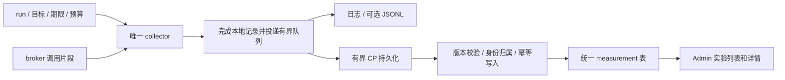

# 可选操作测量：整合 #218 的存储与 Admin 展示

日期：2026-09-16，2026-09-18 更新。状态：**已在 #258 分支实现并完成服务端验收，
尚未合并或部署；浏览器 producer 仍明确延期。**

核对基线：[#218](https://github.com/HarvardMadSys/hybridInference-cloud-agent/pull/218)
`9c02a26`、[#258](https://github.com/HarvardMadSys/hybridInference-cloud-agent/pull/258)
历史基线 `3a191e5` 与后续提交 `e77e3e6`。后者加入文件和终端的
服务端测量；当时的 review 见
[e77e3e6 review](2026-09-16-operation-measurement-e77e3e6-review.zh-CN.md)。

本文记录已经采用的实现：**保留 #258 的唯一采集器，把 #218 的持久化、读取和
Admin 展示接到同一份测量记录上。** 文件和终端与启动共用这条数据链路。
本文对记录身份、存储、读取和交付顺序的决定优先于旧设计；操作边界与浏览器接入
继续参考[平台测量清单](2026-09-14-platform-operation-measurement-inventory.zh-CN.md)。

## 1. 为什么需要整合

| 实现 | 已有能力 | 本方案如何处理 |
| --- | --- | --- |
| #218 | 独立 ActivationRecorder、同步上报、attempt 上三个 activation 字段、Admin 面板 | 复用展示入口、交互和数据库测试思路；重写采集接线、写入模型与协议 |
| #258 远端 | 默认关闭、run/目标/期限/预算、启动阶段、四路径、跨进程片段、有界日志/JSONL 导出 | 保留为唯一计时与选择机制 |
| e77e3e6 本地 | schema v2、CP 文件/终端选择、broker 阶段、响应关联信息 | 修复 review 问题后接入相同存储；明确只是服务端片段 |
| #265 | host 文件系统空间容量及 Servers 展示 | 独立推进，不纳入本次耗时链路 |

#218 实际计时从 claim 之后开始，在 CP prompt admission 后、调用 supervisor
之前结束；#258 从 claim 请求前开始，到 prompt 交给 supervisor 后结束。
两者不能合并成同一条历史曲线。最终只保留 #258 的启动口径。

本次交付包含：可选持久化、单条详情、实验内列表和有边界的分布统计、Admin 入口。
本次不要求：常驻全量监控、告警、浏览器采集实现、全局采样配额、追踪服务或动态
Admin 开关。浏览器尚未实现不阻塞服务端数据落库，但 UI 必须明确覆盖范围。

## 2. 一条数据链路，两个独立决定

**采集开关也是新增写入的总门。** 保留 `AGENT_OPERATION_PROFILING_ENABLED` 和
`AGENT_OPERATION_PROFILING_RUN`；没有第二个容易配置分裂的持久化开关。只有被当前
run 选中的根操作会投递，profiling 关闭时 writer 不启动、无上传和数据库写入；
已有历史仍可查询。`AGENT_OPERATION_PROFILING_SINK` 只控制可选 JSONL 基线文件，
不再是启动记录进入 Admin 的前提。

| 状态 | 行为 |
| --- | --- |
| profiling 关闭、配置无效或未选中 | 无新增测量记录、队列、上传、数据库写入；原业务响应不变 |
| profiling 开启 | 同一冻结记录写日志/可选 JSONL，并经有界队列异步入库；不增加第二套 timer |
| 采集到期、记录已在队列中 | 停止新增计时；允许在有界投递宽限期内上传已完成的记录 |

浏览 Admin 历史不打开 profiling，不启动额外轮询。env 配置仍按进程读取，部署或
重启相关进程后生效；本切片不把它包装成即时生效的网页按钮。

## 3. 先修正身份与计数，再保存数据

### 3.1 三层身份

e77e3e6 为 list/create/stream 多份记录复用 `measurement_id`，并在并发时复用可变
Selection。直接把这个 ID 做数据库主键会覆盖记录；按行计数又会把一次交互当成
多次完整打开。进入持久化之前统一为 schema v3：

| 字段 | 唯一范围与含义 |
| --- | --- |
| `interaction_id` | 一次逻辑交互的关联 ID；终端 list/create/stream 可以共享 |
| `measurement_id` | 一次本地根请求的不可变记录 ID；每个请求新建，重传不变 |
| `call_id` | 同一 measurement 内的一次物理下游调用；每次重试新建 |
| `producer_instance_id` / `clock_domain_id` | 进程实例和时钟域；重启后变化 |

片段键为 `(measurement_id, producer, call_id)`。不使用阶段名作为身份，也不使用
用户输入的 ID 作为数据库幂等键。浏览器的关联输入不能赋予选择资格或访问权限。

终端一次打开的服务端例子：

| interaction | measurement | request_kind | 下游片段 |
| --- | --- | --- | --- |
| i1 | m1 | terminal.list | m1 / broker / c1 |
| i1 | m2 | terminal.create | m2 / broker / c1 |
| i1 | m3 | terminal.stream_attach | m3 / broker / c1 |

三条记录各有自己的时长和完整性。不能将其总和命名为“点击到终端可用”；它没有
浏览器时间，且并发请求可能重叠。将来浏览器以独立 measurement 记录交互全程。

### 3.2 continuation 与预算

选择表只保存不可变的交互选择信息，**不保存可供多个请求共用的可变 Measurement**。
每次请求持有自己的 collector 和 call counter。表内绑定 run、已认证 owner、job、
thread、sandbox、host、操作类别，以及原始绝对截止时间；当前业务流程解析出的归属
必须重新匹配，不能拿上次的 facts 冒充本次证据。

续接引用使用独立 `X-Agent-Interaction-Id`；只关联本 CP 已授权、仍有效的交互。
旧 `X-Agent-Measurement-Id` 若临时兼容，只通过服务端映射解析，不沿用它作新记录 ID。
引用过期、被淘汰、跨实例找不到或范围变化时继续业务，但不重新抽样来伪装续接成功。
响应可给已启用实验的客户端一个有界缺失原因；普通关闭路径不增加字段。

保留当前 `max_operations` 的**每进程根请求预算**：上述三个请求各消费一个名额，
broker 子阶段不另消费。后续续接只在原交互选择下申请剩余名额，不重新进行目标抽样。
预算不足就缺少该请求的测量，不能仍显示交互完整。实验 manifest 列出 admission
实例及各自预算；持久化行数不是采样预算，也不宣称跨 replica 的总上限。

TTL 取原始交互到期与 run 到期的较早者，访问和重启不续期。并发请求用独立状态，
选择缓存淘汰不影响已开始请求的 finally 收尾。首次关闭/未选中不会创建该缓存。

### 3.3 文件操作名与响应兼容

`files.list` 包含根目录和子目录，`files.open` 表示文件预览。不能按 path 是否为空
决定类型。利用原有读取结果的 kind 定类，禁止额外执行探测命令。

在读取前无法确认 kind 的路由，可在 run 允许的文件操作交集下保留一个**候选**，
broker 只继承这次有界候选。共享协议显式携带候选类别，不能先冒称 files.open。
结果返回后按 kind 确认操作，只有命中 run 的类别才提交名额与记录；其余 discard
并退款。无法确认 kind 的错误计入实验诊断的 unknown-kind 数，不编造成功的操作
类别。候选最多占一个名额，截止与范围校验同正式记录，候选计时成本纳入开启开销。

JSON 响应仅在选中时添加 profiling metadata；未选中时只排除**新增 metadata**，
不能全局 `exclude_none`。保留既有根字段与嵌套字段的 null；检查复用响应模型的
PUT files、terminal input/resize/delete 等未接入路由，不得意外多出 profiling:null。
SSE body 仍是原终端事件，metadata 仅放响应头。

## 4. 记录必须讲清“测到了哪里”

v3 保留 v2 的 outcome、producer、timing_sources、stages、spans、milestones、facts、
missing_fragments、truncated_fragments、dropped_spans 和原始微秒整数；新增：

| 字段 | 要求 |
| --- | --- |
| `interaction_id`、唯一 `measurement_id` | 按 §3 |
| `request_kind` | 区分 terminal.list/create/stream_attach 等本地请求，不混算分布 |
| `boundary_version` | 明确同名 operation 的口径版本；改变起止点必须升版 |
| `coverage_scope` | `host_startup` / `server_request` / 将来的 `browser_interaction` |
| `start_boundary`、`end_boundary` | 实际代码边界；不能只写含糊的 started/ready |
| `collection_complete` | 本地边界闭合、必要片段齐全、无采集截断/丢弃；失败样本也可能完整 |
| `end_to_end_complete` | 当前服务端记录恒 false；将来按浏览器及关联片段单独判定 |
| `observed_at` / `received_at` | 前者 producer 的墙钟，后者数据库接收时间；均不用于推算耗时 |

迁移期间 `measurement_complete` 可作为 collection_complete 的兼容别名，但不能在
UI 中简写为“整个操作完整”。`startup_outcome` 仍只作为 attempt.startup 的别名。
CP 必须重新验证完整性约束；声明 true 与缺失/截断矛盾的记录直接拒绝，不能让它进入
成功样本分位数。

| 记录 | 当前准确起止点 | 不能声称包含 |
| --- | --- | --- |
| attempt.startup | runner claim 请求前 → supervisor prompt dispatch 返回 | CP 排队、模型首输出、浏览器等待 |
| files.* server_request | CP 完成既有认证/归属/entitlement/broker 解析后 → 业务结果校验完成 | 前面的权限查询和 broker 解析、响应编码/传输、UI commit |
| terminal.list/create server_request | 同上 → list/create 业务结果校验完成 | 响应编码、xterm 加载、用户可输入、shell rc 完成 |
| terminal.stream_attach server_request | 同上 → 上游流校验与本地 StreamingResponse 构建完成 | 完整流生命周期、浏览器流连接与首输出 |

broker 返回的 truncated、skipped、缺失应答必须保留到 CP 记录及公共 metadata。
公共 metadata 使用明确的 `fragment_recorded` / `fragment_truncated` 与
`collection_complete` 字段区分单次下游应答和整个本地记录；构建响应前完成必要的
收尾判定，再冻结记录，避免公共响应宣称完整而紧接着 finish 判为过期。

保持微秒原值，展示时才换成毫秒；不把所有 child 与 parent 相加，也不沿用 #218
`sum(stages) <= total_ms` 对扁平毫秒字典的约束。跨进程 child 只展示来源和 duration，
不伪造其在 runner/CP 时间轴上的 offset。同一父阶段重复执行保留 ordinal/call ID。
文件内容预览截断 (`content_truncated`) 不等于计时截断。

## 5. 持久化模型

采用一张通用 `agent_operation_measurements` 表与一张轻量实验表
`agent_operation_profiling_runs`；不把文件/终端强行挂到某次 attempt，也不继续给
agent_attempts 添加三套专属耗时列。

measurement 的不可变唯一键为 `measurement_id`；主要列如下：

| 列组 | 内容 |
| --- | --- |
| 身份 | measurement_id、interaction_id、profiling_run_id、schema_version |
| 可信关联 | owner_id、job_id、thread_id、sandbox_id、host_id；attempt_id/lease_generation 可空 |
| 可过滤口径 | operation、request_kind、boundary_version、coverage_scope、producer、producer_instance_id |
| 摘要 | duration_us、outcome、collection_complete、startup_path、runtime/version、execution_profile 可空 |
| 时间与原文 | observed_at、received_at、经验证的 record JSONB、canonical payload hash |

可信关联由 CP 依据已有业务上下文或 worker 凭据解析，不接受 payload 自报的 owner
覆盖数据库归属。startup 必须绑定确切 attempt；文件/终端无 attempt 也可独立保存。
原文与摘要在同一事务写入；摘要从原文一次生成，不各维护一套语义。

实验表记录 run_id、操作范围、目标、绝对截止时间、创建/接收时间、配置版本和每个
admission 实例的预算/部署版本。它是实验 manifest 与查询目录，不是本切片的跨实例
配额分配器。run_id 不跨不同实验复用；身份相同但范围冲突的 manifest 明确拒绝。

索引先覆盖 `(run_id, received_at, measurement_id)`、`(job_id, attempt_id)`、
`(thread_id, received_at, measurement_id)`；复杂 JSONB 全文索引不属首版。
数据库保留约束：微秒非负、关联关系合法、不可变身份、JSONB 为对象。

**迁移必须接当前 dev 的 Alembic head。** #218 的 `0007_attempt_activation_timing`
基于旧迁移链，当前已有 `0007_attempt_turn_resources` 及后续 revision；不得直接
cherry-pick 后制造两个未处理的 head。新增 additive migration，不修改已发布 revision。
按当前 ports/repositories/assembly 架构增加窄的测量读写能力，不恢复旧 store.py 大类。

本切片落实了每条 64 KiB、producer 根操作预算、256 条/4 MiB 投递队列和写入超时。
14 天自动清理与跨 replica 的每-run 20,000 条硬上限尚未实现，不能在 Admin 中声称
已有该保留策略；它们属于部署长期运行前的后续容量治理，不替代当前实验预算。

## 6. 写入协议与业务隔离

### 6.1 producer 到 CP

已实现 worker 入口：`POST /v1/agent/worker/jobs/{job_id}/measurements`，一次一条根记录。
runner 使用已有的 worker 身份和固定 CP 地址；令牌只保存在队列投递 envelope 中，
绝不写进 JSON、日志或数据库。broker 不单独入库，由根 producer 汇总其应答。

CP 文件/终端根记录通过后台任务调用同一验证/写入服务，不从 CP HTTP 回调自己。
数据库 I/O 不进入请求 finally；记录冻结后非阻塞入队，后台 consumer 在应用事件循环
上使用连接池。跨线程投递使用线程安全桥接，不把 asyncpg 连接交给 exporter 线程。

worker 写入验证：有效签名/用途、job/attempt/lease_generation 精确匹配、run/口径、
载荷上限，以及从数据库导出的资源归属。持久化 endpoint 不复用 broker 上的 Any
放行规则：独立诊断请求可以返回 4xx，业务请求只收到其异步投递结果，不受影响。

### 6.2 已完成 attempt 的迟到记录

#218 原 SQL 要求 status=running 且 lease 未过期；直接复用它会丢掉后台队列中
晚到的启动记录，尤其是很快失败/结束的 attempt。

新入口是**追加历史诊断**：允许确切 attempt 在已结束或被后续 attempt 取代后接收
其自身记录，前提是 worker 凭据仍有效、历史 attempt 的 generation 匹配、且接收时间
不晚于配置的 run 截止后 10 分钟。它不更新 attempt/job/lease 状态，不把旧 attempt
的样本归到当前 attempt，也不放松任何现有业务写入的 fence。

凭据过期或 generation 无法验证即拒绝；不接受过期 token，不为了诊断续租。投递重试
最长 10 分钟且不越过上述接收期限。采集 TTL 和投递宽限期是两个不同限制：宽限期
只送出已冻结样本，不能继续打点或重新采样。

### 6.3 幂等、边界与降级

- 同 ID、同 canonical payload hash 的重试返回成功；同 ID、不同内容返回冲突，
  不能 last-write-wins。收到重复记录不增加样本数或存储配额。
- 校验字节数、stage/span/fragment 数目和嵌套深度，复用 collector 的有界常量。
  拒绝超限记录或显式保存 partial，不能静默裁剪后仍显示完整。
- facts 使用白名单；不保存文件内容/路径、终端输入输出、prompt、token 或任意 env。
  保留类型、大小桶、动作和关联 ID；未知 schema 保留错误计数，不错误解释为现有版本。
- log/JSONL 和 CP 各有有界投递队列，CP 拥塞不阻塞本地导出。复用既有默认队列上限
  256 条，并增加每目的地总载荷 4 MiB 上限，达到任一上限即丢弃并计数。
- 后台请求设连接/读写 timeout；仅网络错误、429、5xx 有界退避重试。同一记录最多
  3 次尝试；schema/auth/冲突错误不循环重试。停止进程最多等待 2 秒，不无限 drain。
- 线程/task 启动失败、连接池耗尽、磁盘慢、CP 不兼容、队列满均只影响诊断。
  禁止同步 fallback、逐阶段上传、每次测量额外 heartbeat 或数据库写入。

关闭/未选中时不发送“没有测量”的占位记录。因此数据库无记录时无法区分关闭、未选中、
导出丢失、旧版本等原因，Admin 必须诚实显示“无已保存样本，原因未知”。实验期间可
有界聚合 dropped/rejected/retry 计数；进程崩溃丢失的计数仍是未知，不能宣称零丢失。

## 7. 读取 API 与 Admin

读取入口沿用现有 Admin 身份校验与 Cache-Control:no-store（成功和错误响应均覆盖）。
已实现接口：

| 接口 | 用途 |
| --- | --- |
| `GET /admin/agent/profiling-runs` | 有界时间窗内的实验目录 |
| `GET /admin/agent/measurements?run_id=...` | 按 operation、request_kind、scope、path、outcome、完整性、job、thread、attempt、interaction 筛选；游标分页 |
| `GET /admin/agent/measurements/{measurement_id}` | 单条摘要、阶段、原始完整性与缺失原因 |
| `GET /admin/agent/profiling-runs/{run_id}/summary` | 同口径的 count、p50/p95、失败/partial 数；SQL 聚合而非只算当前页 |
| `GET /admin/agent/measurement-writer` | 当前 CP replica 的队列、in-flight 与拒绝/丢弃计数 |

`attempt_id` 与 `interaction_id` 是两把不同的精确键，不是同一筛选的两种拼写。
attempt 选中一次执行，且只有 `attempt.startup` 记录带 attempt；interaction 选中一次
终端打开的 list/create/stream_attach 三个请求，它们都没有 attempt。查询按两者分别
过滤，Admin 列表、表单、URL 与记录详情各自提供入口；把两者当成一个会让“这次启动”
的读取返回三条终端请求。接口不再静默忽略不认识的查询参数（返回 422
`unexpected_query_parameter`），因为 FastAPI 默认会丢弃未知参数，那会让一次写错键的
精确筛选变成整段实验的宽读取，而调用方看不出来。

路径基于既有应用 API 前缀挂载；启动面板放在 Admin run detail 的 attempt 明细里
（`StartupMeasurement`，按 job+attempt 精确读取本次启动）。文件/终端通过 thread 与
interaction 查询，不伪装成当前 attempt 的一部分。普通 owner API 不默认附带跨用户
诊断详情。

四条启动路径由真实 container/resident action 分类（`_classify_startup_path`）。这一轮
修掉了一个让 `new_group` 永远不可能出现的缺陷：`ChatSandboxManager.create` 写入的字面
量是 `"created"`，而 `SandboxActionFacts.note` 的最强事实守卫和分类器都判 `"create"`，
于是守卫不生效、随后必然执行的 `start` 覆盖了它，每个新建 group 都被记成
`resume_stopped`。测试替身写的是 `"create"` 并注释“与真实 manager 一致”，所以单元测试
一直通过。现在字面量取分类器认识的值，并有一条回归测试驱动真实 `create` 交给真实分类器。

复用 #218 的加载/错误/无数据状态与阶段排序交互；数据类型及路径分类改成 v3：

- 顶部显示 run、operation、起止边界、server/host 覆盖标签、outcome 与完整性。
- 四条启动路径直接读真实 container/resident action，去掉按 context_status/hot
  猜路径的逻辑。缺事实就 unknown；未执行阶段显示未执行/缺失，不补 0ms。
- 本地阶段按时间线或耗时排序，broker children 显示来源、call ID 与持续时间。
  不画跨进程伪精确时轴，也不把 parent+child 叠加当总耗时。
- partial/failed 样本可以展开；truncated 的 duration 标为“截至采集截止的观测值”，
  不与成功完整样本混入主分位数。缺 browser 不是业务失败，server-only 也不是 E2E。
- 没有样本显示“无已保存的测量”；只有服务端片段显示“服务端片段已采集；用户等待
  时间未测量”。不能从当前开关状态猜测过去某次为何没有记录。

默认分布按 operation + request_kind + boundary_version + coverage_scope 分组，
startup 再按 startup_path/runtime 分组；只纳入成功且 collection_complete 的样本，
同时列出被排除的失败/截断/缺失数量。显示 n；n<20 的 p95 标记样本不足，不据此
判定优化。交互数单独 count distinct interaction_id，不等于样本条数。

schema v1/v2 startup 日志可经明确适配器转换边界后离线导入；e77 的 v2 文件/终端
记录没有唯一请求 ID，不按旧 measurement_id 幂等导入。首版不提供自动历史导入。
旧 #218 数据若存在，只能以 legacy_activation 独立口径读取，不改名成 v3 startup。

## 8. 实施顺序与 PR 收敛

以下依赖步骤均已在 #258 分支完成：

1. 修复 [review 的五项问题](2026-09-16-operation-measurement-e77e3e6-review.zh-CN.md)，
   定下 v3 身份、scope/边界和 continuation 规则；更新测试，不能通过改弱断言过关。
2. 合并当前 dev 并解决路由抽取冲突；测量路由落在新的 workspace/worker leaf，
   migration 接到当前单一 head。
3. 以 collector 的冻结记录接后台投递、独立写入服务与 additive migration，覆盖
   runner startup 和 CP 文件/终端两类根 producer；仅 startup 入库不算完成整合。
4. 将 #218 的页面与 Admin 读取改成消费统一记录，增加文件/终端的实验列表和分组。
   不引入 ActivationRecorder、同步 report_activation 或旧三列存储。
5. 更新文档并验证整条链路。#218 是否关闭仍由维护者决定；本实现不自动修改其他 PR。

浏览器点击到 UI commit/xterm 可交互的接入仍按平台清单推进，可在本整合后实施；
新增 producer 复用表和 API，不再创建第二套 startup 专属持久化。CP 排队、完整
broker 解析/wake 前段、eBPF 资源窗口、#265 磁盘容量保持各自边界。

## 9. 验收：功能与自身开销都必须可检验

| 类别 | 必须验证的场景 |
| --- | --- |
| off 兼容 | 与 parent 版本的真实 HTTP 响应对比；根和嵌套 null 保留；共享模型的未测路由不出现 metadata；无新增 exporter/网络/DB |
| 选择 | 目标不匹配退款；续接换 host/sandbox、过期、缓存淘汰、跨 replica 不恢复时不沿用旧事实或重新抽样 |
| 身份与并发 | list/create/stream 不同 measurement，共享 interaction；并发请求互不 finish；重试 call ID 独立；每条消费正确预算 |
| 文件分类 | 根目录/子目录均 files.list；文件为 files.open；单类别 run 不漏选子目录、不混入文件；候选失败/丢弃可解释 |
| 片段 | 正常空阶段、broker 未开、错误回声、超期跳过、截断、重试失败；公共 metadata 与落库记录一致 |
| 投递 | 队列满、后台启动失败、慢日志/慢 DB、超时、401/422/429/5xx、重启丢队列；业务请求继续且不等待 drain |
| 鉴权与幂等 | 跨 job/attempt/owner 拒绝；有效凭据的已结束 attempt 可落自身历史；过期凭据拒绝；重复只存一条，冲突不覆盖 |
| 存储 | 真实 Postgres JSONB 往返、summary 与原文一致、大小/条数/保留期限制；迁移升级/回退/单 head |
| Admin | 无记录不显示 0；server-only 不显示 E2E 完整；unknown 路径不猜；partial/失败可查看、分布不混算；未知 schema 不使整页 500 |

验收包含真实 collector → 无 JSONL 依赖的运行时投递 → HTTP → Postgres → Admin API，
真实数据库锁拥塞、持续 terminal SSE、失败请求、关闭快路径、迁移单 head，以及 web
类型/单测/生产构建。最终提交仍须以本分支 `make check`、`make test-db` 和 CI 为准。

**整条真实链路验收。** 上一轮的“整链”测试用替身换掉了 job/attempt 查询，文件/终端路由
也用存储替身，所以它证明不了这些接缝。这一轮新增的验收把真实
job/attempt/sandbox/membership 行、真实身份与归属查询、collector、投递、真实 HTTP、
真实 Postgres 与 Admin API 接在同一条链上，并覆盖：模型仍在运行时启动记录已入库；
启动失败也能投递且退出等待有界；SSE 持续打开时 terminal attach 已入库；文件/终端失败
请求按既定分类规则记录；真实数据库拥塞下业务继续响应且队列容量/并发/超时/丢弃计数
正确；关闭时没有新增采集任务、投递或测量写入。

性能实验分别比较 bare / off / on-local / on-persist，以及 CP/DB 故意变慢时的业务
延迟、队列长度和丢弃数。分别覆盖四条启动路径、目录/文件读取、terminal list/create/
stream_attach；固定部署/镜像/缓存/并发并给出 n、p50、p95。预先约定的新增 p95
预算为 `max(10 ms, baseline p95 × 1%)`；另报绝对差值，不能用微基准代替业务结果。
实验要同时说明后台 CPU/内存/网络成本；异步并不意味着没有系统开销。

浏览器点击到可见、纯浏览器缓存命中、跨 replica 全局采样与自动保留清理仍延期，
不阻塞本切片的服务端交付，也不得在 Admin 中声称已覆盖。

最终可交付结果是：开启一个有范围、有期限的实验，运行三类服务端操作，在 Admin
找到同一批原始样本，解释每项耗时、边界与缺失，并能关闭采集恢复原业务路径。
