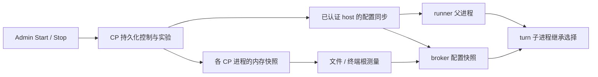

# Admin 按需测量：开始、停止和运行时生效

日期：2026-09-21。状态：待实现；本文不是已交付功能说明。

代码核对基线：Cloud Agent `dev` / PR #258 的合并提交
`2aa35f4d73c4ae9dd3d47f4f2bbe2241d033a875`。执行时先同步最新 `dev`，路径和迁移号以实际代码为准。

## 1. 要交付的体验

管理员进入 **Admin → Measurements**，点击 **开始测量**，选择测什么、测哪台机器、持续多久。之后正常使用产品，匹配的操作自动采集；管理员可点击 **停止测量**，也会到期自动停止。无需为每次实验改环境变量、重新部署、重启服务或手工运行基准脚本。

一次测量实验不会主动启动沙盒、打开终端、读取用户文件或运行模型；它记录期间自然发生的操作。没有流量时，页面显示“尚无匹配操作”，而不是 0 ms。

用户已经明确取消删除筛选表单：**保留现有筛选、历史、详情和统计，在页面顶部新增控制区。** 本次不是整页重写，也不是删除 PR #258。

首版范围：

- 控制沙盒启动、终端打开、文件访问这三类已有服务端测量。
- 同一部署同时最多一个由 Admin 控制的活动实验。
- 开始、停止、自动到期、刷新后恢复状态、跨 CP replica 一致，以及无法生效时的明确反馈。
- 保留静态 env profiling 的兼容入口，但明确区分控制模式。
- 不新增浏览器端计时、纯缓存命中测量、eBPF、自动压测、跨 replica 全局采样配额和历史自动清理。

## 2. 当前代码为何不能直接接一个 checkbox

| 当前事实 | 对本次实现的要求 |
| --- | --- |
| `operation_profiling._load()` 每进程只读一次 env，`_USED_OPERATIONS` 是进程内计数 | 新增运行时配置来源，不能靠改 `os.environ` 或清空全局缓存冒充控制 |
| `bind()`、片段定类、`manifest_for_measurement()` 等还会读取“当前 run” | 在途记录必须绑定自己的不可变 run；切换实验后不能串 target、operations、manifest 或预算 |
| runner 在 claim 前选中，父进程经 `_profiling` 把选择交给 turn 子进程 | 开始信号不能只放在 claim 响应；必须在下一次 claim 前到达父进程，子进程继承起点和名额 |
| broker 的 `start_stage_recording()` 同时要求本地 run 与继承 context 匹配 | 只更新 CP 或 runner 会继续产生缺 broker 片段的样本 |
| host 心跳当前默认 30 秒；runner 与 broker 是不同容器 | 不能把“加个 heartbeat 字段”直接描述为即时开关，也不能依赖进程内变量跨容器传播 |
| 实验目录目前由首条 measurement 入库时创建 | 开始操作必须先持久化实验，零样本实验也可见、可停止 |
| `measurement-writer` 只报告回答请求的 CP 进程 | 不能拿它的 `running` 或 `Idle / off` 当全部署开关状态 |
| profiling 默认关闭，三个服务的 compose 只透传旧 env | 必须交付配置来源切换及部署接线；仅在测试中注入 provider 不算完成 |

已有端点、存储和采集器继续复用。本文对旧整合设计中“Admin 只读、env 仅重启生效、不增加控制轮询”的限制作出明确变更；原有测量边界、鉴权、片段协议、有界投递和完整性规则继续有效。

## 3. 页面与操作语义

### 3.1 控制卡片

位置：Measurements 页标题下面、现有说明与筛选上面。沿用现有组件、英文界面和鉴权流程。

```text
Measurement collection                         [Start measurement]
Off
Collect timings while you use sandboxes, terminals and files.
Server-side timings only.
```

点击 Start 打开小表单：

| 字段 | 首版约定 |
| --- | --- |
| 操作 | Sandbox startup / Terminal opening / File access 三个复选项，默认全选，至少一个 |
| 目标 | 下拉选择当前部署的一台 host，或明确选择 All hosts；默认要求用户选择，不暗中选全站 |
| 持续时间 | 1 / 5 / 10 / 30 分钟，默认 10；后端同样限制 1–30 分钟 |
| 提交 | Start measurement；提交期间禁重复点击，失败保留输入和错误提示 |

映射必须使用真实根操作：

- Sandbox startup → `attempt.startup`。
- Terminal opening → `terminal.open`；`terminal.list/create/stream_attach` 是其 request kind，不是三个新的根 operation。
- File access → `files.list` 和 `files.open`。

开启后的示意：

```text
Measurement collection                         [Stop measurement]
Collecting · Sandbox startup, Terminal opening, File access
Host: gpu-1        Time left: 08:42        Stored samples: 27
```

这里的 Stored samples 使用数据库统计的真实入库行数，不拿本页行数、队列长度或本地 admitted 数替代。一次终端交互可产生多条请求记录；不要把 27 条记录称为 27 次点击。

第一版**不放“全站最多 N 条”输入框**。沿用每个根采集进程的预算保护，建议默认 100、部署级硬上限 1000，API 返回 `budget_scope=producer_instance`。详情中说明其口径；若将来需要全站精确上限，另做集中名额分配，不能把本地计数重新命名为全局上限。

### 3.2 状态必须回答“现在会不会测”

后端返回期望状态及生效证据，UI 不自行猜测：

| 展示状态 | 判据与行为 |
| --- | --- |
| Off | 没有活动 Admin 实验，显示 Start；不等于没有历史 |
| Starting | 开始已持久化，相关进程尚未确认配置 |
| Collecting | 所选范围内预期参与者确认了当前配置；无操作时照样可为 Collecting |
| Partially active | 有进程未支持、未确认、失联或已耗尽本地预算；简述原因，允许 Stop |
| Stopping | 停止已持久化，等待配置传播或旧授权的有限有效期结束 |
| Stopped / Expired | 展示终止原因，允许开始新实验；记录继续保留 |
| Unavailable / Status unknown | 部署未开启 Admin 控制模式或状态读取失败；不伪装为 Off |

不要用一个乐观切换的布尔 checkbox 表示所有状态。采用 Start / Stop 按钮加状态文字。Stop 不需要额外确认弹窗，它只停止采集，不中断业务，也不删数据。

管理员刷新、关闭页面或退出登录，实验仍按服务端期限运行。浏览器不是控制器。活动状态下页面每 5 秒刷新；不可见时暂停页面轮询，回到页面立即刷新。401/403 进入现有撤权处理，不能吞成“关闭”。

## 4. 服务端控制记录与 API

### 4.1 数据模型

复用 `agent_operation_profiling_runs` 保存不可变实验 manifest，开始事务就创建它。扩展必要的来源、创建者、终止时间/原因，或用关联表承载生命周期；不能改写历史 manifest。

新增独立控制 capability，例如 `ProfilingControl`，沿用项目一个 port 对应一个 capability、repository、assembly 的约定。它拥有：

1. 部署控制行：固定 singleton key、递增 `revision`、当前 run、期望状态、修改者及修改时间。
2. 命令幂等记录：request id、动作、请求内容指纹和结果；重复请求返回同一结果。
3. 有界的参与者状态：CP/root/broker 的进程实例、host、能力版本、已应用 revision、最近确认时间、当前 run 与本地预算状态。按 TTL 失效并清理；过期成员不能永久膨胀。

如数据库由多个部署共享，singleton key 必须使用可信的部署命名空间，不能由浏览器指定。控制行在迁移或安全 upsert 中建立，再加锁/CAS；不要再次犯“对不存在的行 FOR UPDATE 就能防并发”的错误。

`config_version` 是不可变实验配置版本，`revision` 是启停控制顺序，续租序号是授权刷新顺序，三者不能混用。

### 4.2 Admin 接口

复用 `/admin/agent` 的管理员鉴权、审计和 `Cache-Control: no-store`，写接口遵循现有 BFF/CSRF/Origin 约定，不另开公共路由。

| 接口 | 语义 |
| --- | --- |
| `GET /admin/agent/profiling-control` | 控制模式、当前实验、revision、服务端时间、生效状态、缺失参与者、stored count |
| `POST /admin/agent/profiling-runs` | 创建并启动实验；现有 GET 不受影响 |
| `POST /admin/agent/profiling-runs/{run_id}/stop` | 停止指定实验；重复停止幂等，旧页面不能停掉另一个新实验 |

Start 请求示例：

```json
{
  "request_id": "client-generated-uuid",
  "expected_revision": 12,
  "operations": ["attempt.startup", "terminal.open", "files.list", "files.open"],
  "target": {"host": "gpu-1"},
  "duration_seconds": 600
}
```

`run_id`、`started_at`、`expires_at` 由服务器生成。All hosts 在 API 层用空 target，但 UI 必须有明确选择。拒绝未知 operation、无效 host、空操作列表、超时长、非管理员。

创建 manifest、改变控制行、保存幂等结果和审计必须同事务成功。两名管理员同时开始只允许一个成功，另一方返回带当前状态的 409。停止传播未结束时不允许新开，避免旧授权与新实验同时采样。

重复 Start 使用相同 request id 和相同内容，返回原 run，不能重置期限；同 id 不同内容返回冲突。先查命令幂等结果再判过期的 expected revision，保证响应丢失后的重试可兑现。

自动到期由权威时间判定，不能依赖页面保持打开或某个定时清扫刚好执行。清扫可落盘终态，但读/发放授权时一到期就必须视为关闭。

## 5. 配置如何到达三个采集端

### 5.1 显式选择控制来源

建议新增 `AGENT_OPERATION_PROFILING_MODE=disabled|environment|admin`：

- 未设置时，完全保留旧 `ENABLED` + `RUN` 语义，默认关闭。
- `disabled`：部署级禁止采集，Admin 显示不可用。
- `environment`：只读旧配置，Admin 显示“由部署配置管理”，不提供假 Stop。
- `admin`：只使用持久化控制状态；旧 `ENABLED=false` 不再否决 Admin 命令，旧 RUN 也不得在 Admin Stop 后作为 fallback 被启用。初次没有活动实验就是关闭。

这个 mode 是部署允许使用何种控制方式，不是每次实验的开关。首次升级需要将 CP、runner 和 broker 接到 Admin 模式；此后每次 Start/Stop 不得要求重启。

### 5.2 参考传播方案与时限

采用后台同步及有期限的授权，不在每个业务请求/span 上查询 DB 或调用控制 API。



可执行的默认方案：

1. CP 每进程的后台任务读取 DB 控制行并更新本地快照；关闭时 30 秒一次，活动时 5 秒一次。本机 Admin 修改成功后可以立即唤醒本机同步，其他 replica 仍走同一协议。
2. runner 父进程以已有 host 身份调用新增内部配置交换接口，例如 `POST /v1/agent/hosts/profiling-policy`。携带上一轮应用确认，返回本 host 可用的配置；关闭时 30 秒、活动时 5 秒，网络超时 2 秒，加入小幅抖动。
3. runner 在后台经现有鉴权 broker RPC 下发同一配置，broker 返回其应用确认；未实际确认不能由 runner 代报成功。不得把 host 凭据新增暴露给 broker 或沙盒。
4. 已被选中的 turn 子进程通过现有可信 broker 连接读取控制快照，活动测量期间后台每 5 秒同步；冻结后停止同步。子进程只承接选择，不重新决定 run、不申请第二个名额。
5. broker 不因收到普通 profiling header 自行开启配置。只有可信服务控制消息可更新本地 policy，普通调用还必须有匹配的已选中 context。

这是参考传输方式，DS 可以复用项目中更合适的现成通道，但必须保留以下契约并说明替换理由：

- 健康环境下 Start 在 **35 秒内**开始生效，UI 期间显示 Starting。
- 活动授权的剩余有效期最多 **15 秒**；Stop 后 **20 秒内**所有旧授权失效，不再增加采集区间，包含断网节点。健康节点通常在下一次同步时提前停止。
- 授权携带 run id、控制 revision、不可变 manifest、权威生成的有效期限和续租序号。下游只能取更早期限，不能重新发一个“从现在起 15 秒”延长旧授权。
- 过期、乱序或重复的响应不能重新激活已经停止的 run。停止保留 revision 墓碑，不是清空成“从未收到配置”。
- CP 对 host 发放/续签授权必须依据权威 DB 当前状态，与 Stop 有明确的事务顺序；不能从一个陈旧 CP 内存快照不断给 runner 续命。
- 本地用单调时间执行期限，不比较不同机器的 monotonic 值。转换时扣除请求在途时间；对重复同一授权不能重新延长本地截止点。网络延迟、时钟跳变和进程暂停要有测试。
- 15 秒授权仅用于控制失联时的最长继续采集时间，**不是**把实验 `expires_at` 改成 15 秒。健康续租不会重置实验、预算或正在测量的起点。

若达不到上述时限，应在设计差异和 UI 中给出真实时限；不能把未实现的 20 秒作为上线承诺。

### 5.3 状态证明与失联

预期参与者按当前部署的 CP 实例登记、host pool 和选中操作推导：启动需要 runner + broker；文件/终端需要 CP roots + 目标 host 的 broker。新 host 加入或 CP 扩容后也要领取并确认当前 policy。

旧版 host 没有 capability、缺 ACK、失联、本地额度耗尽均须可区分。所有有效 ACK 必须绑定 run、revision 和实例；上一次实验的 ACK 不能证明这次生效。UI 主区只显示简洁状态，实例与原因放详情，不再堆内部字段。

失联不阻塞业务。节点到本地授权期限后自行关闭采集。页面可以显示“停止期限已到；某 host 未确认”，不能伪造该 host 已回复。停止传播结束的判断使用有界旧授权窗口或真实 ACK，不依赖无限等待离线节点。

## 6. 采集器需要保持的正确性

### 6.1 快照与预算

为采集器提供独立的 runtime provider，持有线程安全、原子替换的配置快照。中立词汇放 `cloud_agent_profiling`，HTTP/数据库/lifespan 分别由 CP 和 host 拥有；不能让 host 导入 `cloud_agent`，也不能从中立包启动网络客户端。

每条 Measurement 保存不可变 manifest、target、operations、原始 expires_at 和预算归属；另持有本 run 的可撤销控制 handle。相同 run 的续租只更新有效授权，不重置 `_USED_OPERATIONS`。切换到新 run 后，旧测量、discard、finish、export 都仍使用旧 run 的身份和预算。

必须逐个审计 `active_run()` / `_load()` 的调用，至少包含 `bind`、`record_fragment` 定类、`manifest_for_measurement`、CP interaction 续接、runner handoff 和 exporter。不要仅改 `start_operation()`。

### 6.2 停止期间的操作

- 不再接纳新的根操作；不取消正在运行的文件请求、终端连接、任务、容器或模型执行。
- 已冻结记录原样投递，不能因为 UI Stop 就丢掉或修改成功结果。
- 未冻结记录在**本地观察到撤销、授权失效或实验到期的最早边界**截止，保留已采集阶段，标为停止/截断且 `collection_complete=false`；不能把部分耗时当完整样本算进 p50/p95。
- root、span、broker recorder 与回传片段使用一致的本地截止语义；睡眠/阻塞返回后不得把整段超期时间写进 duration。跨进程仍只传 duration，不虚构可比较偏移。
- 后续业务结果不覆盖已经冻结的 measurement outcome。长 SSE 的测量仍在 stream attach 时冻结，不等待 SSE 结束；启动仍在 prompt dispatch 冻结，不等模型执行完。
- 控制停止时间是服务端命令时刻，本地实际停止可能晚一个传播窗口；如需要展示两者，单独记录，不能伪装为全机器瞬时同时关闭。

### 6.3 入库与历史

Admin Start 预创建的 run 与之后生产者 manifest 必须严格一致。停止时间、revision 和 ACK 单独保存，**不要改写 manifest 的原始 expires_at**，否则在途上传会触发 run_conflict。

停止后的已冻结记录仍允许在有界宽限期内交付。复用现有 10 分钟宽限机制，并定义 Admin run 的有效交付截止为 `min(原 expires_at, stopped_at + 传播上限) + 10 分钟`；不是每次重试都往后顺延。更新 CP 进程内持久化与 worker HTTP 两条路径，且保留现有归属、schema、幂等、manifest 校验。

零样本实验现在是有状态的：能够区分刚开始、已到期、被手动停止和当前未完全生效；仍不能仅凭零行断言从未发生匹配操作。API 保留对旧 env 实验缺少控制状态的兼容，显示“状态未知 / 静态配置”，不捏造历史。

## 7. 开销与部署

关闭时业务入口只有本地状态检查，不分配 measurement/span、不为测量读取计时时钟、不启动测量 exporter、不写样本或上传。**Admin 动态控制仍有后台同步开销**，不能再宣称整个系统在关闭时零 I/O；应单列其轮询频率与空闲成本。

后台任务固定数量、带超时和退出清理，不按请求启动任务。延用有界 exporter / CP writer、队列容量、丢弃计数和失败隔离。控制服务或 DB 不可用时，影响的是测量可用性，不是原业务。

部署清单：

1. Cloud Agent 的 CP、host、local compose 和环境文档透传 mode；默认行为保持向后兼容。
2. 迁移接最新 head；测试升级、降级和再次升级，不能凭本文写死下一个编号。
3. 能力版本随 host 注册/状态报告，旧版节点不能被误认成支持 Admin 开关。
4. FI 拥有 staging 部署，检查其环境配置如何把三个服务切到 Admin mode。若需要配套修改，列出或提交独立 FI PR；不能仅修改 Agent 仓库后声称 staging 可点。
5. 一次初始升级完成后，验收 Start/Stop 期间服务 PID/容器不因开关而重启。不要借开关触发 CI、deploy workflow 或修改 GitHub Secrets。

本任务不授权生产部署、合并 PR 或擅自开启生产采集。实现和验收先在本地/测试部署完成；staging 的部署按用户后续授权推进。

## 8. 验收：用实际入口证明它真的控制采集

必须在真实路由、生命周期和父子调用接线上验证，不能只调用 helper 或用 AST 断言存在某个关键字作为主要证据。

| 场景 | 必须验证的结果 |
| --- | --- |
| 默认关闭 | 正常启动、文件和终端操作无新测量；历史可读；动态模式的空闲同步与测量写入分开计数 |
| Admin 开始 | 真实 POST → PostgreSQL 创建实验 → 配置同步 → 真实根入口 → broker 片段 → 有界投递 → Admin 能读到记录；零样本阶段实验已可见 |
| runner 部署路径 | host 服务 claim 前选中，经真实 `_profiling` handoff 到子进程；起点包含 claim，每次只占一个名额 |
| broker 接线 | 开始后贡献真实片段；正常空片段完整；未确认/截断如实为 partial |
| 文件和终端 | 目录与文件按真实结果分类；terminal list/create/stream attach 各自根记录、关联 ID 正确 |
| Stop | 已存结果保留，后续操作不产生新样本；业务继续；在途片段正确截断；到传播上限后所有旧授权失效 |
| 自动到期 | 浏览器关闭、CP 重启或后台清扫没执行时，仍按原绝对期限停采；重启不续期 |
| 失联与乱序 | 断开控制源，旧授权自行到期；迟到 Start/续租/旧 ACK 不能覆盖新 Stop；陈旧 CP 不能继续续签 |
| 跨 replica | A 开、B 查/停；状态一致；两个真实 DB 连接同时 Start 只有一个成功 |
| 幂等 | Start 响应丢失后重试仍为同一个 run、同一期限；重复 Stop 无额外副作用 |
| 下一轮 | A 在途或待投递时停止，随后 B 开始；A 的 manifest、target、退款、片段与入库都不使用 B 的数据 |
| 预算 | 同 run 同实例反复刷新不重置额度；父子不重复占用；UI 不宣称全局精确上限 |
| 鉴权 | 普通用户不能操作；401/403 到前端撤权；浏览器伪造 profiling header 不能开启 broker；host 不能请求其他 host 的策略 |
| 压力/异常 | 慢 DB、控制 API 超时、长模型任务、长 SSE 时业务不被开关/投递阻塞；队列满可见且有界 |
| 前端 | Start 参数、Starting/部分生效/Stop/到期/失败状态、刷新恢复、保留筛选、无乐观假成功；实际浏览器验收截图 |

测试可用受控时钟验证时限，但至少有一条真实 HTTP + PostgreSQL + 独立 host/broker 进程链路，不能把所有参与者放同一进程共享一个全局变量。应用初始化和部署入口要纳入，避免“helper 正确、调用点没接”。

测量已执行但 exporter 失败等错误仍要计数；不要用“表中没有新增行”单独证明 Stop 后没有采集。

运行仓库要求的 `make check`、相关真实 DB 测试、前端 lint/format/type-check/tests；基准记录关闭时额外后台成本与开启开销，沿用项目已有预算，不把测试 mock 延迟当生产实测。验收报告分开写实测通过、模拟通过和未覆盖环境。

## 9. 文件落点与交付

以下是当前落点，不要求把所有逻辑塞进这些文件：

- `apps/frontend/src/app/(agents)/admin/measurements/page.tsx` 与同目录测试：控制卡片，现有筛选保留。
- `apps/frontend/src/lib/api/adminMeasurements.ts`：类型、Start/Stop/status 客户端与错误语义。
- `apps/backend/cloud_agent/api/admin_measurements.py`：Admin 写入口与状态读取；复杂事务放 application/repository。
- `apps/backend/cloud_agent/ports/`、`storage/repositories/`、bootstrap、迁移：控制 capability、事务、生命周期及清理。
- `apps/backend/cloud_agent_profiling/operation_profiling.py`：配置 provider、run 绑定、撤销、预算隔离。
- `apps/backend/cloud_agent/operation_measurement.py`、持久化与 ingest：动态根选择、续接、独立 manifest、宽限语义。
- `apps/backend/cloud_agent_host/runner.py`、host 身份客户端、broker/client/supervisor：父进程预选、子进程继承、控制同步及片段截止。
- `deploy/`、`ENVIRONMENT.md`、FI 配套配置：真实启动入口。

完成定义：管理员能通过真实页面开启并停止真实采集，结果能入库并查询；同一操作无需人工修改 env 或重启；失败时状态不撒谎。仅按钮能点击、API 返回 200、或 mock 页面变成 Collecting，均不算完成。

交付应包含实现 PR（目标 `dev`）、简洁使用说明、测试与验收证据、必要的 FI 配套项。不要每修一个模块就等用户确认；有真实阻塞再说明，不能把既定交付遗留成“下一轮再接运行时”。
