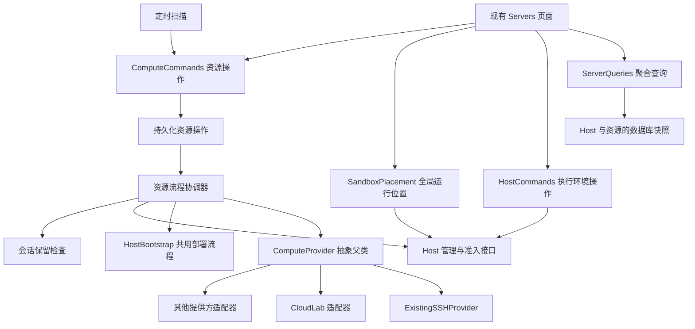
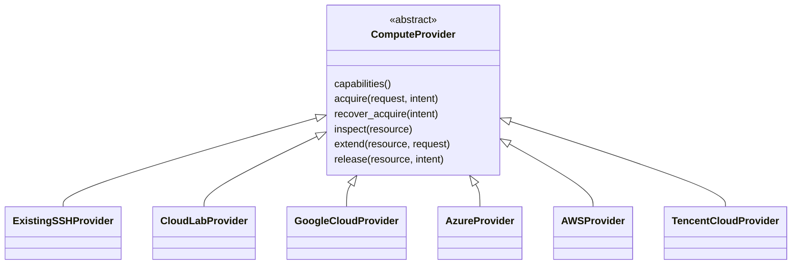

# Cloud Agent 计算资源生命周期与现有服务器管理整合设计

日期：2026-10-04。状态：设计与同一 PR 内实现完成；自动化验证结果见 PR，真实 CloudLab 与节点部署仍需环境验收。

设计核对基线：远端 `dev`，提交 `3750f43af418dc8af665a27219c2b29332aa738c`。实现已对齐 `dev` 提交 `a1d0f18acf31794816e0edc195ca37e8f0b480c8`，使用 `apps/backend`、`apps/frontend` 布局。

目标是让现有 Servers 页面统一支持两种新增方式：接入已经能够 SSH 访问的机器，以及向 CloudLab 或其他云平台申请新资源。所有来源实现同一个 `ComputeProvider` 抽象父类，取得资源后共用 Host 部署、注册和就绪检查。Host 模块继续管理执行资格，计算资源模块管理底层资源，跨边界的操作由应用层协调。

本期前端只提供一个全局运行位置设置，由管理员统一决定所有新建 sandbox 使用哪台服务器，复用现有 `active_host` 策略。Provider 提供可用资源，全局放置用例负责目标校验和策略更新。单个 sandbox 的位置选择留到后续；已有 sandbox 的跨服务器迁移也不属于本期。

2026-10-04 修订：将已有 SSH 机器提升为完整的 Provider 接入方式，明确父类与子类关系。已有机器无需预装 Cloud Agent；SSH、CloudLab 及将来的云提供方共用同一部署流程。本文说明目标职责与约束；实现和部署入口见文末映射及 [资源管理运行手册](../developer/operations-compute.md)。实际云端端点、账号权限与目标机器需要部署环境单独验证。

## 一 现有能力与需要补充的能力

| 现有入口 | 目前的真实语义 | 本设计中的归属 |
| --- | --- | --- |
| Enrollment token 与 Host register | 授权一个执行环境接入，首次心跳后开始具备领取任务的资格 | Host 管理 |
| List 与 capacity history | 查询执行状态、资源观测、版本和容量历史 | Host 查询，复用到 Servers 视图 |
| Active host | 为所有尚无 sandbox 的新会话统一选择放置位置 | 全局放置策略 |
| Slots 与 runtime versions | 调整并发和新会话使用的 Agent CLI 版本 | 执行配置 |
| Drain 与 Undrain | 停止或恢复新的任务领取；Drain 也影响旧会话后续轮次 | Host 管理 |
| Remove | 撤销 Host 凭证，留下 disabled 记录 | Host 管理 |
| Delete 与 Forget | 删除 Host 管理记录，不操作真实机器 | 管理记录清理 |
| 申请、续期、释放外部资源 | 当前尚无实现 | 新增计算资源管理 |

当前 Host 是已注册的执行环境身份。同一物理服务器可以部署多个 Host。Servers 页已经按物理名称分组展示，但 `physical_host` 是显示信息，不能作为云资源操作的授权或身份依据。

当前会话的 Docker 状态绑定原 Host；跨机器恢复尚未实现。`slots_used=0` 不能证明机器上没有需要保留的会话。资源回收必须有独立于 Host Remove 的前置条件。

## 二 模型与职责



这是同一控制平面中的模块划分。第一版使用现有 Postgres 加后台 worker，不引入消息总线、独立微服务或通用工作流引擎。

### 资源对象

```text
ComputeAllocation  一次资源接入或外部分配，记录来源与管理边界
  └─ ComputeNode   分配中的一台服务器
       └─ Host     该服务器上已注册的执行环境，可以有多个
            └─ SandboxGroup 现有容器、工作区和会话
```

CloudLab 的 Allocation 对应 experiment，可以包含多个 Node；未来接入单实例云服务器时，一个 Allocation 可以只包含一个 Node。已有 SSH 机器也产生一个 Allocation 和一个 Node，表示平台接入了这台机器，不表示平台创建或拥有了它。第一版可以只创建单节点 CloudLab experiment，数据模型保留上述关系。

`Server` 只作为面向页面的聚合视图，不再建一份拥有独立状态和写入接口的 Server 表。

| 模块 | 自己决定什么 | 不依赖什么 |
| --- | --- | --- |
| Host 管理 | 注册、凭证、心跳、并发、Drain、移出池 | CloudLab SDK、实验 ID、续期协议 |
| SandboxPlacement | 全局运行位置的读取、目标校验和更新，以及实际分布查询 | Provider SDK、机器申请与销毁 |
| 计算资源模型与策略 | 期望资源状态、租期、管理范围、续期策略 | HTTP 路由、具体 SDK、Docker 命令 |
| 资源流程协调器 | 申请到接入、续期、资源退出的步骤与恢复 | 不通过 HTTP 调用本服务自己的路由 |
| ComputeProvider 子类 | 已有资源接入或供应商 API、资源观测、能力与错误的转换 | Host 表、sandbox 表、任务调度决策 |
| HostBootstrap 与连接组件 | 通过受信连接完成统一部署和就绪检查 | 云资源的申请、续期、销毁决策 |
| 会话保留检查 | 哪些会话与在途操作阻止资源释放 | 云平台实现 |
| ServerQueries | 合并已有观测，生成可操作能力和阻塞原因 | 不在页面 GET 请求中调用云平台 |

应用层通过窄接口协调这些模块。Provider 返回资源事实，不能直接把 Host 改为 online、清空会话、修改任务或调用 Docker。

### 最小持久化结构

| 数据 | 必需内容 |
| --- | --- |
| `compute_allocations` | 内部 ID、provider key、可选 provider account 引用、可选外部资源 ID、接入方式、经过校验的 provider 参数、管理模式、期望状态、实际状态、实际到期时间及其观测时间、策略及 revision |
| `compute_nodes` | 内部 ID、allocation ID、provider 节点标识、此次资源实例的身份、显示名称、连接信息 |
| 现有 Host 的可选绑定 | 服务端维护的 `compute_node_id`；原 Host 状态、slots、心跳、凭证继续由原模块持有 |
| `compute_operations` | 请求 ID、类型、目标、参数摘要、固定执行参数、步骤、状态、错误、重试时间、执行租约与 fencing generation |
| Host 准入限制记录 | 目标 Host、限制来源、作用范围、版本；由 Host 准入模块管理 |

资源 ID 与 Host 名称分别管理。新 experiment、重新分配的节点或另一台同名服务器获得新的资源身份；不因为 hostname 一样就继承旧会话。已有绑定不能在保留会话仍依赖它时重新指向另一资源实例。

底层资源的管理模式分为 `observe` 和 `manage`。导入默认 `observe`，不授予云平台变更权限；用户请求部署 Host 是独立的接入意图，可以在这样的机器上执行。采用 `manage` 时明确授予哪些资源操作以及完整作用范围。管理模式不等于所有权声明，也不能从持有某个账号 Token 推导出对该账号全部资源的管理授权。

云平台外部身份使用 `(provider_id, external_id)` 唯一约束，避免为同一账号创建多个连接别名后重复管理同一资源。将来供应商使用账号内局部 ID 时，由适配器将账号作用域规范化进外部 ID。SSH 接入使用平台生成的稳定登记 ID，地址和主机名只作连接信息，不充当可复用的资源身份。未知到期时间与无到期时间分别表示；读取失败保留上次观测和 stale 标志，不把 `null` 显示成永久有效。

凭证只保存可信 secret reference，正文、资源规格、操作结果和日志均不包含 Token。Host 和 sandbox 不取得 Provider 账号凭证。

### 状态分别表达

- Host 状态沿用 `enrolling / online / draining / offline / disabled`。
- 资源保存 `desired_state=present|absent` 和 Provider 观测到的状态，附原始状态与观测时间。
- 操作保存 `pending / running / waiting / blocked / succeeded / failed / unknown`；步骤只服务于该操作的恢复。

页面可以同时显示“机器运行中、Host 离线、续期待确认”。资源 ready、Host online 和可以安全释放是三个分别判定的事实。

## 三 如何复用原来的增查改删

### 新增服务器的两种入口

新增表单首先选择：

| 方式 | 输入 | Provider 行为 | 后续共用流程 |
| --- | --- | --- | --- |
| 接入已有服务器 | SSH 地址、端口、用户、凭证引用、已核实的主机身份 | `ExistingSSHProvider.acquire(mode=attach)` 核实连接与身份并返回资源句柄，不申请新机器 | 环境检查 → 安装或采用已有 Host → 注册 → readiness |
| 申请云服务器 | Provider、账号引用、该 Provider 的资源配置 | 对应子类 `acquire(mode=provision)` 请求分配资源，返回操作进度和最终节点 | 环境检查 → 安装 Host → 注册 → readiness |

第一种不要求机器已经安装 Cloud Agent，也不要求它是自建物理服务器。用户只有某台 AWS、Azure 或腾讯云机器的 SSH 信息时，也可以用 ExistingSSHProvider 接入；平台只取得所声明的接入能力，不由服务器品牌推断其云账号或租期管理权限。

SSH 是访问和部署通道；Provider 是资源取得与管理来源。CloudLab 取得的节点同样可以交给共用的 SSH 部署组件。将来需要其他访问通道时增加连接组件，而不是复制整个云 Provider 和 Host 部署流程。

底层仍保留 `attach` 与 `provision` 两种显式意图，不让一个方法根据是否找得到机器自行决定创建。云 Provider 也可以声明支持 attach，凭外部资源 ID 接管一个已经存在的实例或 experiment；原来的资源导入入口映射到这种意图。

### 既有操作的复用

先将 `api/admin_hosts.py` 内现有管理用例提取到 `application/host_commands.py`。这是职责提取，保留现有鉴权、审计、错误响应和返回整个池快照的行为。旧路由调用这些用例；资源退出流程通过同一组 Host 能力调用它们，不复制 SQL，也不调用旧 HTTP 路由。

| 页面操作 | 用例及调用关系 | 完成条件 |
| --- | --- | --- |
| 接入已有服务器 | ExistingSSHProvider 接入 → 共用部署 → 既有 enrollment；已部署的 Host 可验证后采用 | 注册与 readiness 完成 |
| 申请新服务器 | 指定 Provider 申请 → 观测节点 → 同一部署流程 → enrollment → readiness | 资源、Host、sandbox manager 和执行环境全部可用 |
| 查找与详情 | ServerQueries 合并资源和 Host 的数据库观测 | 返回数据时间、来源与 freshness |
| 统一选择 sandbox 运行位置 | SandboxPlacement 更新现有全局 active_host，claim 继续执行该限制 | 所有尚未分配的新 sandbox 统一使用目标；已有 group 保留原 Host |
| 改并发、Drain | 原 HostCommands | 原有规则继续生效 |
| 改自动续期配置 | ComputeCommands 更新策略与 revision | 配置保存成功，执行结果另外展示 |
| 立即续期 | ComputeCommands 创建 extend 操作 | 读回实际到期时间满足该操作的固定目标 |
| 移出任务池 | 原 Remove 用例 | 凭证撤销、Host disabled，机器继续存在 |
| 释放计算资源 | 资源退出流程 | 保护检查通过，Provider 确认资源已终止 |
| 清理历史记录 | Forget 用例与依赖保护 | 无活动绑定、保留状态或未决操作依赖 |

“删除”菜单可以收纳后面三项，但按钮必须显示上述具体动作和作用对象。原 DELETE 仍然只清理记录；不根据 provider 类型偷偷增加销毁服务器的副作用。对尚有资源绑定或保留会话的 Host 增加明确的 `409` 保护；这是需要覆盖兼容测试的安全收紧，不能宣称完全无行为变化。

资源管理新增以下入口，既有 `/admin/agent/runner-hosts/...` 保留：

```text
GET   /admin/agent/servers                         聚合列表与搜索
POST  /admin/agent/servers                         统一接入或申请并部署服务器
POST  /admin/agent/compute-allocations/import       仅导入观测，不自动部署 Host
PATCH /admin/agent/compute-allocations/{id}/policy  修改管理和续期策略
POST  /admin/agent/compute-allocations/{id}/extend  手动续期
POST  /admin/agent/compute-allocations/{id}/retire  开始资源退出
GET   /admin/agent/compute-operations/{id}          查看操作及阻塞原因
POST  /admin/agent/compute-operations/{id}/cancel   取消尚未提交释放的退出操作
```

统一新增入口提交 `AddServer(provider, mode, provider_config, deployment_profile, request_id)`。应用层从注册表选择子类，持久化接入意图，驱动 acquire，再调用同一个 HostBootstrap。`provider_config` 由该子类的配置模型校验和版本化；CloudLab 的 project/profile 与其他云的配置各归其子类，不摊成一个满是可空字段的父类参数对象。

这里的 AddServer 是应用用例；不新增独立可写的 Server 实体，也不把申请资源和部署 Host 塞进 Provider 父类。原 Host 的注册入口继续存在，供部署步骤复用。

字段更新用 PATCH，外部操作用明确的命令。资源规格变化只有在以后有确定的 resize 用例和 capability 时才新增，不把任意规格 PATCH 隐式转成删除重建。

资源长操作返回 `202 + operation_id`；配置更新返回保存的 revision。旧 Host 接口仍返回池快照。新页面完成任一操作后刷新聚合查询，不在前端维护另一套资源真相。

聚合查询在一个数据库读快照中取得本地记录，但明确每个 Provider、Host 的原始观测时间，不宣称外部观测在同一时刻完成。资源尚未注册 Host 时也展示申请进度；没有资源绑定的旧 Host 继续展示。物理名称可以用于旧数据展示分组，所有变更都必须使用真实 ID。

后端统一返回 `allowed_actions` 和有类型的 `blocked_reasons`，执行时重新验证。前端按能力显示按钮，不写 `if cloudlab ... else cvm ...`；后端也不能把一次页面查询当作后续销毁操作的授权凭据。

### 前端页面与交互

这是一项前后端完整功能，日常接入、查询、配置和下线都在现有 **Admin → Servers** 页面完成。容量、并发、暂停接单与移出池继续调用已有 Host 接口；Provider 接入、租期和释放通过独立的资源接口完成。前端集中入口，不合并两套后端职责。

页面以 **Servers** 为主要管理区域：顶部是 **New sandbox location**，下面直接列出统一服务器清单；**Harness version** 放在整个 Servers 区域下方。全局放置和服务器管理在后端继续独立，前端不再拆出单独的 Global settings 区块。列表采用紧凑的两行展示：名称及当前目标标记在上方，状态、来源、sandbox 数和剩余租期在下方。点击名称或省略号后，在居中的详情窗口完成管理；右上角菜单进入访问设置或释放／断开流程。已有 SSH 机器与云资源共用列表；多个旧 Host 按现有物理机器规则分组。一个云 Allocation 的节点显示在同一行及其详情内，续期和释放始终以整个 Allocation 为范围。

| 页面区域 | 展示内容 | 主要操作 |
| --- | --- | --- |
| Servers 顶部 | New sandbox location | 选择所有新 sandbox 的统一目标 |
| Servers 列表 | 名称和来源、在线状态、已有 sandbox 数、剩余租期、自动续期状态 | 新增、查看详情；较大列表支持搜索和来源筛选 |
| Harness version | 位于服务器列表下方的版本选择器 | 选择新会话使用的 CLI 版本；无版本菜单时保留标题并说明等待服务器上报 |
| 服务器详情 → Overview | 当前状态、并发、CPU/内存/存储、sandbox、节点信息 | 原地调整并发、暂停/恢复接单、移出池、Forget；合格服务器可设为全局目标，资源释放入口单独说明范围 |
| 服务器详情 → Lease | 确认的到期时间、自动续期策略 | 保存策略、手动续期；切换页签保留策略草稿，仅有租期能力的资源显示该入口 |
| 服务器详情 → Activity | 仅该资源的操作记录 | 查看进度，再返回同一服务器的记录页签 |
| Activity 窗口 | 进行中的操作及历史；首页仅显示活跃数量 | 查看进度，按后端允许的动作重试、核对结果或取消 |
| 服务器详情 → Access settings | 该服务器使用的云账号与 SSH 密钥 | 验证、更新凭证；修改共享凭证时显示受影响的服务器数量 |

新增窗口用类型卡片区分 **Existing SSH server** 和已支持的云 Provider。SSH 直接填写连接目标；支持申请资源的云默认进入 Create new，也可以选择 Connect existing。账号和 SSH 密钥在 Add server 的同一表单内选择或填写，主页面不再提供独立 Connections 入口。提交时先保存新凭证，再以返回的 ID 提交服务器请求；部分失败会保留已保存的凭证并清除其秘密输入，重试不会重复保存。凭证仍由独立接口维护，不会进入服务器请求。前端不显示 Agent deployment 或 Deployment settings；新增请求省略部署模板，由控制面从运维配置中自动选择尚未占用的模板，原有显式模板 ID API 仍兼容。没有可用模板时明确拒绝，不能复用其他服务器的身份或放宽隔离。新增表单按云账号、资源归属、Machine template 和 SSH access 分组，Provider 通过 section 元数据声明字段位置，控制面服务逻辑不依赖表单分组。CloudLab 项目说明资源归属，Template project/name 说明创建机器使用的 CloudLab profile 来源；Server name 仅是列表显示名。唯一已保存凭证默认复用并显示名称与 Change，多份凭证未确定时要求选择；新增凭证仍在当前表单完成。主流程只有 Add server / Create server 一个提交入口，使用创建流程已有的检查和部署步骤，提交后打开操作进度；不再要求用户先单独 Validate。SSH 端口直接显示在 SSH access 中，默认 22，不使用高级选项折叠。CloudLab 实验名、模板参数和项目组放 Advanced options，可选值与默认值仍照常提交。仅观察导入也放在高级选项，选中后隐藏 SSH 部署字段并将同一个主按钮改为 Import resource，不要求部署配置或 SSH 凭证；切回创建自动退出观察模式。JSON 格式错误展开所在选项并定位字段，凭证保存错误留在对应账号或密钥区域。已有服务器从 Access settings 修改已绑定的账号／密钥，密钥不回显；编辑草稿绑定打开时的 revision，后台刷新不能绕过并发修改检查。服务器查询只增加凭证记录 ID 与节点的 SSH 地址、端口、用户名，不返回原始 Provider 配置或秘密引用。操作详情区分 Back 与 Close：Back 回来源，Close 关闭窗口。Host 操作结果在当前详情内反馈；云资源查询失败时仍可通过已有 Host 清单进行管理。

申请尚未完成时，Activity 保留操作及其进度，已取得的资源显示在列表中。资源可用但 Host 尚未注册时显示 Awaiting agent；列表的 Online 表示在线观测，能否用于全局位置仍按接单条件判断。HTTP 202 不代表服务器已经可用。下线影响、已有 sandbox 阻塞及整组释放范围在移除入口展示。

### 前端统一设置 sandbox 运行位置

本期只有 Admin → Servers 中的一个 **全局运行位置** 设置。管理员将它设为某台已接入的服务器后，所有尚未分配的新 sandbox 都统一使用该目标。新建任务和会话页面不增加服务器选择器，单个 sandbox 的覆盖设置留到后续设计。

候选项来自已接入并完成 readiness 的 Host，显示服务器名称、来源、可用性及影响接单的容量或租期信息。选择位置不会隐式申请机器；管理员先通过新增服务器完成 SSH 接入或云资源申请，再统一切换到它。保留现有 **Automatic** 作为清除全局固定的兼容入口，并明确它允许在合格 Host 池中分配；指定目标不可用时不会自动进入 Automatic。

| 场景 | 前端行为 | 服务端语义 |
| --- | --- | --- |
| 全局目标切换为服务器 B | 显示统一目标 B 与保存结果 | 此后所有尚未分配的新 sandbox 只能在 B 的所选 Host 上首次领取 |
| 已排队，尚未领取且未预留 sandbox | 无需逐项修改 | 首次领取时使用当前全局策略 |
| 已领取、正在创建或已经保留的 sandbox | 显示各服务器的实际存量 | 继续使用已经绑定的 Host，包括停止但保留状态的容器 |
| 从已有会话 Fork | 遵守原 group 的位置 | 共享工作区，继续留在原 Host |
| 全局目标离线、Drain、容量不足或租期不足 | 显示阻塞或等待原因 | 不在其他机器偷偷创建新 sandbox；管理员可统一改选 |
| 清除固定，选择 Automatic | 明确显示允许在合格服务器间分配 | 恢复现有全局自动分配行为 |

切换成功表示全局设置已经保存。页面同时显示 **新 sandbox 的统一目标** 与 **已有 sandbox 的实际分布**；仍有 sandbox 在其他服务器时明确展示数量，不能把保存设置显示为“所有 sandbox 已迁移”。容量暂满时允许等待空位；权限、安全、运行时能力、资源准入和实际到期边界仍由后端执行。

如果要把已存在的 sandbox 也全部集中到新机器，需要迁移工作区、容器状态和原生会话。当前没有跨机器迁移能力，本期保留原 Host，不销毁重建、不改写绑定来假装完成迁移。旧机器在保留依赖仍存在时不能释放。

### 全局放置契约与调度边界

沿用 `agent_runner_policy.active_host` 作为唯一的全局放置配置，并复用现有 `PUT /admin/agent/runner-hosts/active` 及管理员鉴权、审计。`SandboxPlacement` 只封装全局目标读取、校验和更新，复用同一份策略与存储；不另建一套策略表，也不引入 `PlacementRequest`、逐任务 placement 字段或修改单个会话位置的接口。

聚合 Servers 查询返回供页面选择的真实 Host 身份、来源、就绪状态、可用动作和阻塞原因；显示名称与 `physical_host` 只用于展示。同一 ComputeNode 有多个 Host 时，页面应能辨识最终固定的执行环境，首版仍保存一个明确的 Host ID，不扩展成节点级调度或动态更换 Host。

现有 runner 继续拉取任务。Claim 在事务内读取并锁定全局 policy，结合执行环境安全要求、运行时能力、slots 和资源准入决定首次领取。策略更新沿用同一 policy 的事务锁序列化：切换提交之前已经完成的领取保留原 Host，提交之后尚未分配的新 sandbox 使用新目标。已有 group 的实际 Host 映射仍是后续轮次和 Fork 的唯一位置依据。

Provider 适配器不参与 claim，也不决定全局目标。新增 SSH 或云资源完成部署后只成为可选项，不自动改写全局设置。CloudLab 续期、资源退出与全局切换通过既有准入和依赖检查协调；切换目标不会顺带 Drain、Remove 或释放原服务器。所有全局变更均要求现有 `agent.admin` 权限。

### 新增服务器表单

采用一个新增窗口，先选择接入方式，再填配置，最后查看本次动作摘要。表单字段随所选 Provider 改变，公共的名称、部署选项和完成状态保持一致。

| 分支 | 表单字段与交互 | 提交动作 |
| --- | --- | --- |
| 接入已有 SSH 机器 | 显示名称、地址、端口、登录用户、选择或新增 SSH 凭证；验证连接并展示机器身份、系统和部署条件 | **接入并部署** |
| 申请云资源 | 选择已实现的 Provider 与账号连接；填写该 Provider 的资源字段；CloudLab 首版包含项目、profile、参数和初始时长 | **申请并部署** |
| 采用云端已有资源 | 在支持 attach 的云 Provider 中选择“已有资源”，输入或选择外部资源 ID，展示完整节点范围 | **接入并部署**；仅登记时使用独立的“仅导入观测”动作 |

云提供方列表只列出当前后端已启用且有对应接入能力的实现；未来的 AWS、Azure 等子类尚未交付时，不显示一个可以提交却无法工作的选项。

部署前验证由后端执行。SSH 验证只检查连通性、身份和部署条件；云配置验证不创建资源，也不保证随后一定有可分配额度。最终提交仍需重新验证关键条件，不能把旧的验证结果当作永久有效。

提交摘要显示目标机器或资源范围、将部署的 Agent 环境、是否启用自动续期，以及供应商能够明确提供的时长或费用信息。日常界面不要求用户理解 enrollment token、数据库锁或 operation generation。Enrollment 由公共部署流程在需要时完成。

### 连接与凭证

为了真正从前端完成接入，连接配置是本功能的必要入口。管理员在 Add server 中选择服务端已保存的账号或密钥，也可以直接填写新的 SSH 密钥或 CloudLab Token。后续替换或轮换从服务器详情进入，日常操作仍仅引用连接 ID。

秘密字段只写入可信控制平面，通过配置的 SecretStore 保存；读取接口只返回连接名称、范围、验证状态和遮蔽摘要。秘密不返回列表、不放入 URL、前端持久缓存、表单草稿或操作日志。Provider 账号凭证不下发到 Host；SSH 部署凭证仅供受信连接组件使用。

已有的 CloudLab 凭证不会自动出现在部署后的服务端或网页中。首次接入需由管理员通过连接入口提交，或由部署环境预先配置连接引用。SecretStore 未配置时明确显示连接管理不可用，不退回明文数据库或浏览器存储；这是上线前必须完成的部署依赖。

SSH 主机身份首次核实与身份变更都在连接验证结果中明确呈现；连接组件不能为使验证通过而关闭主机身份校验。连接更换后重新检查受影响资源，并保留操作审计，不能把旧的健康状态无条件继承给新凭证。

### 续期操作

在支持延期且已授予资源管理权限的 Allocation 上，显示 **自动续期** 开关及配置表单。字段包括提前多久申请、延长到多远、使用理由；高级配置再展开接单截止策略。SSH 接入的机器显示“租期未托管”，不展示一个无效的续期开关。

保存配置后显示“策略已保存”，资源管理区独立展示实际到期时间、最近观测时间及配置的周期检查间隔；待处理操作可能推迟检查，不承诺一个精确的下次执行时间。最近一次续期结果通过 Operations 列表查看。点击 **立即续期** 提交同一个后端续期命令，操作详情展示请求目标与实际批准结果。到期时间同时显示带时区的绝对时间和剩余时间；观测过期时标记数据时间，不把客户端倒计时当作新的云端确认。

自动续期在后台 worker 中执行，关闭浏览器、刷新页面或管理员退出登录都不停止它。关闭开关阻止后续自动请求，已经发出的外部请求仍按操作详情跟踪，不能显示成已经被撤回。

### 下线与删除交互

行内动作使用现有的 **暂停接单**、**恢复接单**、**移出任务池**。资源管理区单独提供 **下线并释放资源**；清理历史记录只在依赖保护允许时出现。这些按钮对应不同的后端命令，界面不使用一个含糊的 Delete 自动选择副作用。

下线前的影响摘要显示整个 Allocation 的节点、Host、运行任务、保留会话和新会话放置引用。对于 CloudLab，即使从一个节点打开，也明确指出将影响整个 experiment。开始下线后显示停止接单及等待条件；有保留会话时显示“仍有会话保留在该服务器，当前无法释放”，并提供查看会话或取消下线等实际可用动作。

影响预览是只读结果。后端在提交下线及最终释放时重新核对范围、版本与依赖，前端的确认不替代这些检查。释放已提交后，操作详情移除取消入口；结果未知时保持“正在核对”，不提供会重复申请或释放资源的盲目重试按钮。

### 操作进度与失败恢复

新增、手动续期和下线提交后打开一个共用的操作详情面板，以持久化操作记录为数据源。申请资源、等待节点、部署、注册、就绪检查分别展示；当前步骤可等待或失败，不绘制没有真实依据的总进度百分比。

前端在该操作活跃时轮询，完成后刷新 Servers 聚合查询；可以关闭面板后继续其他管理工作。重新打开页面仍能找到未完成操作。断网保留上次读取时间，重新连接后查询服务器状态，浏览器不负责继续执行后台流程。

每次提交生成稳定的 request ID；重复点击和响应丢失后的查询使用同一个 ID。输入修改后作为新的请求处理。失败信息区分“配置需要修正”“暂时失败可重试”“已有资源但部署失败”和“外部结果未知”；重试与取消按钮由后端返回的操作能力决定。

资源操作执行期间只锁定相关表单或动作，列表查询及其他服务器的管理继续可用。并发编辑策略发生 revision 冲突时保留用户未提交内容，提示刷新当前配置后重新保存，不静默覆盖另一个管理员的修改。

### 前端契约与实现边界

除资源操作接口外，同一 PR 实现以下支撑契约：

| 契约 | 用途 |
| --- | --- |
| `GET /admin/agent/compute-providers` | 已启用 Provider、接入方式、配置字段描述与能力 |
| `GET/POST/PATCH /admin/agent/compute-connections...` | 连接元数据、受保护的凭证写入与替换；读取不返回秘密 |
| `POST /admin/agent/server-preflights` | 执行无资源分配副作用的连接及配置验证，返回验证操作 |
| `GET /admin/agent/compute-operations` | 找回进行中的操作，或按 request ID 核对提交结果 |
| `POST /admin/agent/compute-operations/{id}/retry` | 由后端校验是否可恢复，并恢复现有操作 |
| `GET /admin/agent/compute-allocations/{id}/retirement-impact` | 读取下线范围及阻塞原因 |

全局位置继续通过现有 `PUT /admin/agent/runner-hosts/active` 更新，服务器候选和实际分布由聚合查询提供。本期不新增每会话的位置接口，任务创建契约保持不变。

公共表单组件支持受限的文本、数字、选择、连接引用及秘密输入组件。后端 Provider 注册表描述表单字段，各子类配置模型校验供应商特有输入，不把云 SDK 引入浏览器，也不让字段描述携带可执行代码。前端验证改善填写体验，后端验证才决定是否受理。

前端只调用 Cloud Agent Admin API；供应商请求、秘密读取、操作恢复和续期定时均由服务端负责。Provider 基类及子类不进入前端 bundle，Secrets 也不通过运行中的 sandbox 代理。

所有新页面与端点沿用现有 `agent.admin` 权限要求，按钮隐藏只是体验，后端仍鉴权和审计。分阶段部署时，未支持的 Provider、表单或动作有明确不可用状态；旧 Host 管理入口和容量展示继续可用。

前端交付的完成条件包含新增两条路径、连接配置、进度恢复、续期策略、下线影响展示，以及统一切换所有新 sandbox 的目标和展示实际存量分布，不能仅以“后端 API 可调用”验收。逐 sandbox 选择和迁移已有 sandbox 不在本期验收范围。

## 四 通用 Provider 父类与子类

使用 `ComputeProvider` 作为抽象父类，已有 SSH 机器和各个云提供方都是它的子类。资源来源通过继承扩展，连接和部署通过组合复用。



第一批实现 ExistingSSHProvider 和 CloudLabProvider；其余类是扩展位置，不提前添加不可使用的空实现，也不预先承诺供应商能力完全一致。

父类定义统一语义和明确的不支持结果。它不持有业务数据库，不决定重试策略，不部署 Host，不接管任务调度。

```python
from abc import ABC, abstractmethod

class ComputeProvider(ABC):
    @abstractmethod
    def capabilities(self) -> ProviderCapabilities: ...

    @abstractmethod
    async def acquire(self, request: AcquireRequest, intent: OperationIntent) -> ProviderReceipt: ...

    @abstractmethod
    async def recover_acquire(self, intent: OperationIntent) -> AcquisitionResolution: ...

    @abstractmethod
    async def inspect(self, ref: ResourceRef) -> ResourceObservation: ...

    async def extend(self, ref: ResourceRef, request: ExtendRequest) -> ProviderReceipt:
        raise UnsupportedCapability("extend")

    async def release(self, ref: ResourceRef, intent: OperationIntent) -> ProviderReceipt:
        raise UnsupportedCapability("release")
```

以上是概念接口，实际类型定义见 `ports/external/compute_provider.py`。AcquireRequest 包含显式 mode 和已经由子类配置模型校验的参数。接入已有机器不是 create 的假实现，而是 acquire 的一种合法语义。恢复接口返回已确认资源、仍在进行、确认未创建或结果未知；通用流程按这些结果决定下一步。

标准结果包含资源句柄、节点、实际生命周期观测和连接描述。连接描述引用 SSH 等访问方式、目标和凭证引用，不携带明文秘密或供应商 SDK 对象。初次申请可以只返回 pending receipt，直到 inspect 发现可接入的节点。ExistingSSHProvider 核实 SSH 访问，HostBootstrap 再检查操作系统、部署权限、已有安装和运行环境，检查不通过就停在可诊断的接入步骤。

ProviderCapabilities 至少声明支持的 acquisition modes、是否支持租期延长、是否支持外部资源释放。有效动作还要结合具体资源的管理模式、账号权限和保留状态计算；类支持 release 不代表当前资源可以释放。配置验证、capability 声明与方法实现要有一致性测试；不支持的操作在提交前拒绝，父类默认异常防止误调用被当作成功。

| 子类 | acquire 的含义 | 续期与释放 |
| --- | --- | --- |
| ExistingSSHProvider | attach 已存在且可核实 SSH 访问的机器 | 不提供云资源续期或销毁；仍可按现有功能移出 Host 池 |
| CloudLabProvider | provision experiment，或 attach 明确指定的已有 experiment | 实现 CloudLab 延期与终止，并保留整个 experiment 的作用范围 |
| GoogleCloudProvider 等后续子类 | 按各自资源模型实现支持的 attach 或 provision | 按实际能力、资源类型与授权声明，逐一验收 |

ExistingSSHProvider 不掌握底层云资源租期时明确报告未托管或未知，不把 SSH 可达解释成永不到期。后续若要接入底层云账号，需要显式核对外部实例身份并变更管理绑定，不能由地址或机器名称自动升级权限。

`ExtendRequest` 包含持久化后的固定 `target_expires_at` 和实际使用理由。`ProviderReceipt` 表示已确认、受理待查、被拒绝或结果未知；它不等于资源已经达到期望状态。父类以 capability 容纳差异；重启、停止、变规格等有明确需求时再扩展，不要求每个子类都实现假操作。

Provider 注册表在 bootstrap 组装，应用层依赖父类并按 provider key 解析。新增供应商主要增加子类、配置校验、注册和适配器测试；Host 管理、统一接入、手动与自动续期流程不增加供应商分支。若新供应商需要父类尚未表达的真实能力，再明确扩展契约，不能把它藏进任意参数或通用 delete。

子类返回标准错误类别，例如权限错误、配额或资源不足、暂时不可用、已终止、能力不支持、结果未知，并保留不含秘密的诊断。需要人工审核只有在 Provider 确实提供证据时才这样标记，不能将所有 `403` 都解释成等待审批。

## 五 手动和自动续期共用执行路径

手动操作和定时策略都提交 `RequestExtension(allocation_id, target_expires_at, reason)`。区别只有触发来源和目标时间计算；权限、幂等、调用、观测确认、失败处理与审计共用实现。

策略至少包含 `enabled`、`renew_before`、`extend_to_horizon`、使用理由、停止新会话的提前量和停止领取任务的提前量。自动续期只对明确启用的 managed allocation 生效；导入资源和保存 Token 都不自动开启它。

1. Worker 查询资源和到期时间；策略用服务器时钟决定是否需要续期。运行位置在稳定的控制平面侧，不依赖被续租机器存活。
2. 在事务中保存操作和固定的目标到期时间。手动与自动请求按 allocation 串行协调，等价请求合并，不能同时发送不受控的延长请求。
3. 在事务外调用 Provider。成功或超时后重新观测，只有实际租期达到目标才记为成功；部分批准保存实际时间并显示未满足的目标。
4. 临时错误退避重试；明确拒绝或凭证失效按原因阻塞并通知管理员。请求超时先查询，不重新用“当前时间加若干小时”生成更远的目标。
5. 根据实际租期更新 Host 准入限制。续期成功仅解除这个资源控制器持有的限制，不能撤销管理员手动设置的 Drain。

CloudLab 的当前 API 接受显式 `expires_at` 或相对 `extend_by`。适配器优先用已经持久化的绝对时间；创建后仍以 Provider 读回值为事实来源。延期受 CloudLab 规则和资源条件约束，不能把自动续期做成永久在线保证。

### Host 准入限制

增加一个独立于 Host liveness 的准入机制。每条限制的来源包含 allocation ID、用途和必要的 operation ID，附作用范围和版本。用途区分 `lease_deadline`、`retirement` 和 `bootstrap`，有效限制取并集。范围分为 `new_groups` 与 `all_claims`：

- `new_groups` 只阻止创建新的 sandbox group，现有会话后续轮次继续按原规则运行。Fork 加入既有 group 时属于既有状态操作，退出流程还需另行阻止新增成员。
- `all_claims` 阻止所有新的任务领取；已运行任务按既有边界结束。
- 原 Drain/Undrain 继续管理管理员的 Host 状态。Undrain 不绕过资源限制；续期成功只解除 `lease_deadline` 限制，不能清除同一资源的 `retirement` 或 `bootstrap` 限制。

Claim 的最终事务在扣 slots 的同一决策点检查这些限制；Fork、初始 sandbox reservation、Host 绑定和 enrollment 也在各自写入决策点检查资源退出栅栏。只在 HTTP 路由提前检查存在竞态。

每个 allocation 提供同一准入锁定点：创建依赖的事务取得共享锁并验证版本，设置退出栅栏和最终释放检查取得排他锁。涉及现有全局放置 policy 锁时仍先取得该锁，然后按 allocation ID 排序取资源准入锁，再进入既有 job、Host 和 group 写入路径；任何路径都不能持有这些下游对象锁后反向取得资源准入锁。迁移时需要核对并调整所有相关路径，外部 API 调用期间不持有这些数据库锁。

对有硬到期时间的受管资源，claim 还根据已持久化的期限与服务器时钟计算准入，即使定时 worker 停止也不能超过已知截止时间继续接单。正常运行时定时刷新观测；超过 freshness 阈值的受管资源暂停新的放置，旧会话仍受最后已知的硬期限约束。

建议满足 `renew_before > stop_new_groups_before > stop_claims_before >= 0`，具体值按机器租期与任务时长配置。提前停止接单只减少中断风险；现有任务没有统一的完成时间上限，因此它不能证明任务一定能在到期前完成。

机器租期、attempt lease 和 API Token 有效期使用独立字段和策略。若未来供应商有付费续费，需独立定义费用与授权约束，不能因子类声明了 extend capability 就自动进行购买。

## 六 资源退出与删除

`retire` 是应用用例：停止向资源增加依赖，检查已有依赖，释放外部资源，保留结果。它不是 Provider Adapter 中的 `delete_server()` 包装。

```text
记录退出意图并设置准入栅栏
  → 冻结资源绑定和新的会话成员创建
  → 等待在途任务与操作结束
  → 检查全部保留状态和资源管理范围
  → 撤销相关 Host 的接入资格
  → 发送 Provider release
  → 确认外部资源已终止
  → 保留已退出的资源与操作记录
```

CloudLab 的终止单位是整个 experiment。用户即使从一个节点进入，也必须看到全部受影响节点和 Host。只接管 experiment 的一部分节点时，不能获得释放整个 experiment 的能力；含有未纳入管理的用途时返回 `unmanaged_scope`。

ExistingSSHProvider 没有 release capability。其页面提供原来的“移出任务池”和受保护的记录清理，不显示“释放云资源”；后端收到这样的释放请求也明确拒绝，不能改成 SSH 关机、删磁盘或返回一个假的释放成功。

释放前至少检查：

- 全部节点和执行环境的完整绑定范围，以及新的绑定已经被栅栏阻止。
- 运行中的 attempts、正在 materialize 的 Fork、未决 prompt delivery 和相关 workspace 操作。
- 保留的 sandbox group，包括 stopped 容器；归档聊天和停止容器都不等于放弃其状态。
- 最新可核实的 Host/sandbox_manager 容器观测与数据库依赖是否一致。离线、观测过期、未知容器或未覆盖的节点返回阻塞，不能把未知当作零。
- 全局新会话限制是否仍指向该资源。默认返回 `placement_pinned`；管理员明确修改或清除全局固定后才能继续，不自动悄悄切换。已经分配的 group 则由保留状态规则保护，不能通过改选位置绕过。

保留状态由现有 sandbox 领域判断。当前没有跨机器恢复，也没有证明“归档即可安全丢弃”的生命周期契约，所以第一版对仍有保留 group 的资源返回 `retained_groups_present`。不增加通用 `force=true` 绕过这些条件。未来真正的销毁会话或迁移功能需另有明确用例、授权和验收。

退出等待或被保留状态阻塞时，原来已启用的续期策略继续生效，且续期不会解除退出限制。退出意图本身不自动启用或关闭续期。这样 `desired_state=absent` 不会被误解为“立即放弃仍承载会话的机器”；管理员主动禁用续期时，仍按实际期限限制接单并展示会话受影响的风险。

资源退出栅栏先提交，再在所有创建依赖的路径中执行；最终检查和不可逆阶段的提交使用一致的事务锁顺序。Claim、Fork、绑定等并发写入要么先完成并被退出检查看到，要么被栅栏拒绝。不得用“检查一次空闲，随后异步删除”代替这个边界。

最终检查通过后，先持久化 `release_committed`，再撤销 Host 凭证并发送释放请求。从这个提交点起取消不再可用，即使请求尚未送达 Provider。提交之前取消只清除该退出操作的限制。若释放结果未知，保持限制并继续观测；不要自动 Undrain 或重新注册 Host 来补偿，因为机器可能已经被释放。

只有已经纳入完整管理范围、观测和依赖都通过检查的资源，才允许系统主动释放。外部平台自行到期回收是另一种事实：保存 Provider 证据，通过既有会话领域处理丢失状态；单次心跳超时不等于 Docker 数据已丢失。

## 七 申请部署与操作恢复

### 申请到可接单

两种新增方式共用一个 AddServer 流程：记录接入意图 → 对应 Provider 的 acquire → 观测实际节点 → HostBootstrap 部署 → 绑定的一次性 enrollment → heartbeat、sandbox manager 与安全环境 readiness → 允许新会话。SSH 子类完成已有机器核实后进入部署，云子类在新资源分配完成后进入同一个步骤。

HostBootstrap 是独立接口，首个实现可以复用现有部署脚本；创建云资源的适配器不负责 SSH、Docker 或 Kata。安全检查沿用目标部署批准的现有策略，不因 Provider 更换而放宽隔离、权限或网络边界。

HostBootstrap 接受规范化的节点连接描述和部署配置，通过 SshTransport 等连接组件工作。节点仅需具备要求的访问条件，Host 软件由该流程安装；若检测到已有安装，核对部署身份与版本后采用或提示冲突，不覆盖一个未经接管的 Host。支持的平台、权限和环境要求在 preflight 返回，不把“能登录 SSH”直接当作“适合运行公开多租户 sandbox”。

一次性 enrollment token 在部署即将注册时签发，绑定 Host 名称和服务端记录的目标 Node。节点绑定由控制平面从授权意图取得，不能相信 runner 自报的 provider ID。平台注册成功或机器 SSH 可达都不代表 sandbox 已安全就绪。

签发 enrollment token 之前就为这个绑定建立 `bootstrap` 准入限制。即使首次心跳将 Host 标为 online，该限制仍阻止其接单，直到受信的 readiness 检查通过。

重复部署复用操作身份，恢复时先读取已完成步骤。已成功接入的 Host 使用其持久凭证；丢失的一次性 token 按注册结果核对后重新签发，不能无条件反复注册并挤掉现有 Host。

创建成功而部署失败时，操作停在可诊断状态并可以重试。资源仍显示在 Servers 页面；清理也走同一个退出流程，不在异常处理里直接删除。自动清理仅在未来有明确策略且满足相同释放条件时启用。

SSH attach 不创建底层机器，部署失败后只保留接入失败状态和可重试步骤，不对已有机器执行云资源补偿删除。该规则来自 acquisition mode 和 capability，不在通用流程中通过供应商名称判断。

### 持久化与并发规则

所有外部副作用先记录意图再执行。`request_id` 与参数 fingerprint 唯一：同一请求重试返回同一操作，相同 ID 不同参数返回冲突。每个 allocation 同一时刻只执行一个外部变更调用，策略修改和退出使用 revision 协调。处于 waiting 或 blocked 的退出流程不占用外部调用的执行租约，因此可以继续执行必要续期；提交 `release_committed` 后停止创建或派发新的续期调用。

Worker 以短事务领取操作，释放数据库锁后调用外部 API，结果按执行租约和 fencing generation 写回。失去租约的 worker 不能覆盖新状态。数据库栅栏不能撤回已经发给云平台的请求；因此还必须有固定请求参数、外部幂等能力或查询恢复、以及不可逆阶段的取消限制。

CloudLab 创建接口的公开定义没有可依赖的标准幂等键。适配器可以持久化专用项目内的预定名称和创建上下文，只有在能够唯一核实资源时才接续。无法确定上次创建是否成功时标记 `unknown`，要求核对或显式导入，不能盲目重复申请。遇到同名资源也不能直接收编或删除它。

释放结果超时不宣告成功。仅当正确账号和作用域下有足够证据确认资源终止或不存在时完成操作；权限问题和暂时无法查询不等同于资源已经消失。资源记录采用 tombstone，避免把后续创建的同名机器当作原资源。

CloudLab 的公开 API 将指定实验 UUID 的 `DELETE 204` 定义为已删除，可以作为终止凭据；查询返回 UUID 和 project 均匹配的明确终止状态也可用于恢复。单独的 `404` 返回 `resource_visibility_unknown`，即使实验列表请求认证成功也不能证明原项目仍然可见。若删除确认丢失后只能查到 `404`，操作保持 release committed，保留资源与部署 profile 的占用，等待提供方确认或恢复原访问权限后重试，不自动认定释放成功。

资源退出进入释放阶段后，旧续期操作不得启动。已有续期请求若结果未知，先核对并串行完成处理；不能把“数据库中任务已取消”解释成供应商侧请求已经取消。

## 八 代码落点与交付顺序

| 位置 | 内容 |
| --- | --- |
| `cloud_agent/application/host_commands.py` | 提取现有 Host 管理用例，供旧路由与资源流程复用 |
| `cloud_agent/application/server_queries.py` | 聚合现有 Host、容量、资源与操作的读模型 |
| `cloud_agent/application/host_commands.py` 中的 `SandboxPlacement` | 独立的全局目标校验和更新用例，复用现有 active_host 策略及存储 |
| `cloud_agent/domain/compute.py`、`schemas_compute.py` | 公共投影、请求幂等指纹、命令与策略的校验 |
| `cloud_agent/ports/external/compute_provider.py` | Provider 能力接口与标准结果 |
| `cloud_agent/ports/compute_resources.py` | 资源及操作存储的窄接口 |
| `cloud_agent/application/compute_resources.py` | AddServer 与资源命令、权限、策略更新、幂等意图 |
| `cloud_agent/application/compute_reconcile.py` | 已定义的续期和退出流程，调用 Host 与会话边界 |
| `cloud_agent/providers/compute/existing_ssh.py` | ExistingSSHProvider，已有机器接入与可核实观测 |
| `cloud_agent/providers/compute/cloudlab.py` | CloudLabProvider，API 和字段转换 |
| `cloud_agent/ports/external/host_bootstrap.py` 与部署实现 | 共用 Host 安装、采用已有部署、preflight 和 readiness；组合 SSH 连接组件 |
| `cloud_agent/workers/compute_resources.py` | 定时扫描、领取操作、退避和恢复 |
| `cloud_agent/storage/repositories/compute_resources.py` | Postgres 实现和事务约束 |
| 现有 Host pool、claim、sandbox 与 Fork 存储入口 | 准入限制与退出栅栏的最终写入检查 |
| `cloud_agent/api/admin_compute.py` 与 `api/admin_hosts.py` | 新资源路由与保留的 Host 路由 |
| `cloud_agent/bootstrap/` | Provider 注册表、凭证引用、worker 生命周期接线 |
| 现有 Servers 页 | 保留列表、容量和放置功能，集成新增与资源详情入口 |
| `AddComputeServer.tsx` 与 `ComputeConnectionForm.tsx` | 两条接入表单、Provider 字段、连接配置和验证 |
| `ComputeResourcePanel.tsx` 与 `ComputeResources.tsx` | 租期策略、资源范围、影响摘要、持久化操作进度及轮询刷新 |
| Servers 页中的全局运行位置控件与实际分布摘要 | 复用现有 New chats 选择逻辑，统一设置目标，展示仍留在其他服务器的 sandbox |
| 独立资源 API client 与现有 `admin.ts` | 新资源契约和原 Host 契约分别封装 |

这些路径均相对于 `apps/backend`，前端仍在 `apps/frontend`。HostBootstrap 随第一批 SSH 接入实现，后续云 Provider 直接复用它。先提供实际需要的 SSH 连接实现，其他通道有需求时再增加。

按依赖拆成四个可以分别验收的阶段：

四个阶段在同一个 PR 中交付；此处表示实现与验收顺序，不是只完成前两阶段。

1. **通用父类与 SSH 接入**：提取 HostCommands，建立 ComputeProvider、注册表、接入记录和聚合查询，实现 ExistingSSHProvider 与共用 HostBootstrap；同时交付 SSH 新增表单、连接配置、验证与操作进度。已有 SSH 机器不必预装 Cloud Agent，旧接口继续工作。
2. **CloudLab 与续期闭环**：实现 CloudLabProvider 的已有资源接入、inspect/extend、统一操作记录、手动与自动续期、准入限制和告警；同时交付云连接、资源导入、期限和策略管理界面。这一阶段就解决当前需要。
3. **安全退出**：完整资源范围、保留状态检查、并发栅栏、Provider release 和 Forget 保护；同时交付影响摘要、下线状态与允许的取消入口。存在保留会话时可阻塞，不能假称支持无损回收。
4. **申请到接入**：实现 CloudLabProvider 的 acquire provision 模式和未知结果恢复，复用既有 HostBootstrap、enrollment 与 readiness；同时启用云申请表单及申请到上线的完整进度。其他云按相同契约逐个增加。

全局运行位置沿用已有能力，本期补齐聚合 Servers 视图中的统一入口、候选状态、阻塞原因及实际存量分布。之后接入的 SSH 或云节点完成 Host 就绪检查即可成为全局目标，不要求修改任务创建接口，也不新增逐 sandbox 的意图存储或调度分支。

单个 sandbox 的位置选择、已有 sandbox 的跨机器迁移与恢复、按负载自动扩缩容、硬件规格调整和云费用管理分别留到后续。它们可以使用这里的资源身份和操作机制，但不成为本期服务器管理和自动续期的前置依赖。

## 九 验收场景

| 场景 | 预期 |
| --- | --- |
| 老客户端调用 Remove 或 DELETE | 不产生任何 Provider release 调用；有关联依赖时明确拒绝 Forget |
| 接入只有 SSH 访问能力且未安装 Agent 的机器 | 核实连接后走共用部署、注册与 readiness，不申请新云机器 |
| 只有 AWS 实例的 SSH 信息，没有云账号 | 可作为 ExistingSSHProvider 接入，不出现云销毁或续费能力 |
| SSH 接入与 CloudLab 申请分别到达部署阶段 | 调用同一个 HostBootstrap，不复制安装与注册流程 |
| 不支持的 acquire mode、extend 或 release | 提交前明确拒绝，不返回假成功或改做另一种操作 |
| SSH attach 或云端仅导入后部署失败 | 保留操作及诊断，不补偿删除已有资源 |
| 新增 Provider 子类 | 经 capability 和适配器契约测试接入，现有 Host 管理没有新增供应商分支 |
| 全局目标设置为服务器 B，随后创建多个独立会话 | 所有尚未分配的新 sandbox 只能由 B 的所选 Host 首次领取，无单会话覆盖入口 |
| 旧客户端继续创建任务 | 请求契约不变，遵守当前全局放置限制 |
| 清除全局固定，选择 Automatic | 恢复现有在合格 Host 池中分配的行为 |
| 全局目标容量满或不可用 | 展示排队或阻塞原因，不偷偷在其他机器创建 sandbox |
| 全局切换与首次 claim 并发 | 同一 policy 锁确定切换生效边界，提交前已分配的保留，之后未分配的统一使用新策略 |
| 切换后继续已有会话或 Fork | 使用原 group 的 Host，页面展示旧服务器上的存量，不能声称迁移完成 |
| 新服务器接入完成 | 成为可选项，不自动改写全局 active_host |
| 未授权用户修改全局运行位置 | 后端拒绝，候选列表不泄露管理范围 |
| 管理员只使用前端接入 SSH 机器或已支持的云资源 | 能配置连接、提交、查看过程及结果，无需手工签发 enrollment 或执行部署命令 |
| 配置自动续期后关闭网页 | 后台按保存策略继续运行，重新打开可看到实际租期与执行结果 |
| 提交响应丢失、双击按钮或页面刷新 | 按同一 request ID 找回操作，不重复申请机器 |
| 更新策略时另一管理员已修改 | 返回 revision 冲突，保留输入，不静默覆盖 |
| 连接保存、列表读取、诊断或错误上报 | 不回显或持久缓存秘密，未配置 SecretStore 时明确不可用 |
| 未实现 Provider 或当前资源不支持某项操作 | 不显示可提交的虚假入口，直接调用 API 也被拒绝 |
| 从 CloudLab 单节点进入下线确认 | 展示整个 experiment 的影响，实际释放仍由后端重新校验 |
| 手动与自动续期同时触发 | 同一资源只有受控的一次变更流程，重试不不断叠加时长 |
| 续期已成功但响应丢失 | 通过读回租期确认，不重复创建新的延期目标 |
| 续期只批准部分时间 | 页面展示实际到期时间，未满足的目标不标成功 |
| 管理员已 Drain，之后自动续期成功 | Host 仍保持管理员的 Drain |
| 下线被保留会话阻塞，同时发生续期 | 已启用的续期继续执行，下线和 bootstrap 限制不被解除 |
| Worker 停止或资源观测变旧 | 已知硬期限仍限制 claim；新放置按 freshness 规则暂停 |
| Host offline，Provider 显示机器运行 | 显示两个真实状态，不自动销毁、不猜测会话丢失 |
| 无运行任务但有 stopped sandbox | 释放操作被保留状态阻塞 |
| 释放与 claim、Fork、注册绑定竞争 | 新依赖被栅栏拒绝，或先完成并被检查计入 |
| 一个 experiment 含多节点或未知用途 | 展示整体影响，管理范围不完整时拒绝释放 |
| Provider ready 但 Kata 或 sandbox manager 未就绪 | 资源可见，Host 不接新会话 |
| 创建请求结果未知或名称碰撞 | 不盲目重试、不收编或删除未经核实的资源 |
| 释放请求结果未知 | 保持退出限制，查询确认，不自动恢复接单 |
| 云端重新分配同名节点 | 使用新资源身份，不恢复旧 Host 的会话映射 |
| 旧后台与新前端分阶段部署 | 缺失资源能力有明确降级，原 Host 管理仍可用 |

同一 PR 为这些边界增加行为测试、并发数据库测试和 Provider 故障模拟，并按仓库要求运行 `make check`。自动化验证使用本地 Postgres 和模拟 Provider；实际 CloudLab 申请、真实节点部署及 Kata 隔离仍需在配置好的部署环境验收。具体命令与结果记录在 PR 的验证说明中。

## 十 核对依据

- [现有 Host 管理 API](https://github.com/HarvardMadSys/hybridInference-cloud-agent/blob/3750f43af418dc8af665a27219c2b29332aa738c/apps/backend/cloud_agent/api/admin_hosts.py)：操作语义、审计、Remove 与 Forget 的区别。
- [Host 注册与心跳](https://github.com/HarvardMadSys/hybridInference-cloud-agent/blob/3750f43af418dc8af665a27219c2b29332aa738c/apps/backend/cloud_agent/api/hosts.py)：凭证、注册和 readiness 边界。
- [现有领取任务事务](https://github.com/HarvardMadSys/hybridInference-cloud-agent/blob/3750f43af418dc8af665a27219c2b29332aa738c/apps/backend/cloud_agent/storage/repositories/attempt_commands.py)：Host 状态和并发限制的最终决策点。
- [物理服务器与执行环境身份](https://github.com/HarvardMadSys/hybridInference-cloud-agent/blob/3750f43af418dc8af665a27219c2b29332aa738c/deploy/host/.env.example#L120)：同一物理服务器可有多个 Host。
- [会话持久化边界](https://github.com/HarvardMadSys/hybridInference-cloud-agent/blob/3750f43af418dc8af665a27219c2b29332aa738c/docs/operations.md#L1511)：保留状态、同机恢复和未实现的跨机恢复。
- [CloudLab 资源与延期说明](https://docs.cloudlab.us/basic-concepts.html)：experiment、节点、延期审核和本地磁盘的临时性。
- [CloudLab Portal API 说明](https://docs.cloudlab.us/advanced-topics.html)：官方 API 与客户端入口。
- [CloudLab OpenAPI](https://gitlab.flux.utah.edu/emulab/portal-api/-/blob/master/openapi.json)：创建、查询、延长与终止；延长请求支持 `expires_at`、`extend_by` 和 `reason`。这些说明来自文档核对，本轮未执行资源变更 API；生产 API 地址、账号权限与实际错误行为需在接入验收时验证。
